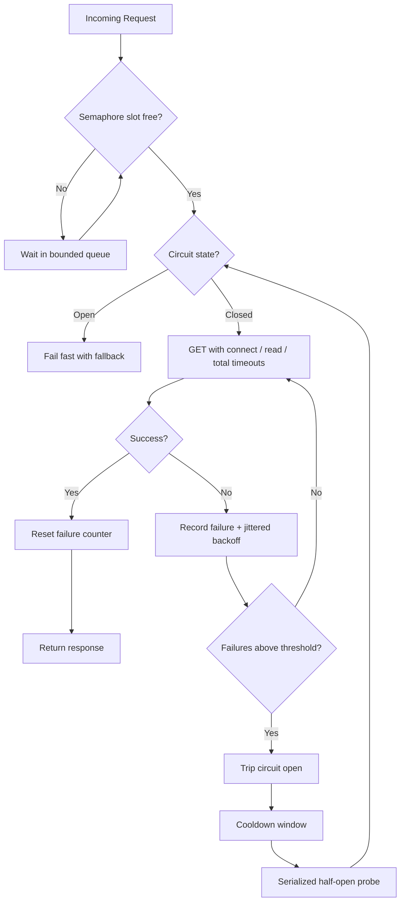

| Difficulty | Channel | Tags |
|---|---|---|
| advanced | backend | asyncio, aiohttp, concurrency |

At peak, Netflix's API swallowed roughly 20,000 requests per second and fanned them into more than a million upstream calls every ten seconds. When a cache bug forced traffic straight into the database, the database-select circuit hit an 80% error rate and 157 of 200 API instances flipped to fallbacks [1]. Video-view rates barely moved. That is graceful degradation in action, and it is precisely what a well-built aiohttp connection pool manager is supposed to deliver when a downstream service starts wilting.

---

> ### Real-World Case — Netflix
>
> Netflix's API brokered catalog and subscriber metadata between internal services and hundreds of device types, handling about 1 billion requests a day with ~20,000 req/s peaks that fanned out to 1M+ upstream calls every 10 seconds. When engineers found a bug that cached partially populated Java objects, they bypassed the shared cache and sent traffic straight to the database — only to be throttled by their own DB.
>
> | | |
> |---|---|
> | **Challenge** | A single latent or throttled dependency could block request threads in seconds and take down the whole API. They needed to bound concurrent outbound calls, cut off failing dependencies quickly, and keep streaming usable instead of letting retries and timeouts cascade. |
> | **Solution** | They wrapped every dependency call in a fault-tolerance layer (later open-sourced as Hystrix): aggressive network timeouts plus retries, per-dependency bounded thread pools/queues, non-blocking tryAcquire semaphores for in-memory calls and untrusted fallbacks, and a circuit breaker that trips on an error rate over a 10-second rolling window and probes for recovery. Timeouts, saturation, and client errors all route to explicit fallbacks — cached/stale data, fail-silent, or fail-fast. |
> | **Outcome** | During the incident the database-select circuit hit an 80% error rate and 157 of 200 API instances were serving fallback requests, yet video-view rates were almost unchanged. The API sustained ~20,000 requests/s at peak across roughly 60 circuits; Hystrix later executed tens of billions of thread-isolated and hundreds of billions of semaphore-isolated calls daily at Netflix. |
> | **Lesson** | The concurrency cap, not the circuit breaker, is the primary protection — the breaker is a release valve that lets a downstream service recover. Counterintuitively, enlarging pools, queues, and timeouts during latency is a self-inflicted DDoS; shedding load and returning a degraded-but-useful response is what preserves availability. |

---

## Hook — When Your Own Database Becomes the Villain

Picture the graph: 20,000 requests per second arriving at an API, each one fanning out until over a million upstream calls are in flight every ten seconds [1]. Now take one shared cache off the menu. Traffic diverts to the database, the database-select circuit starts screaming at an 80% error rate, and 157 of 200 instances answer with fallbacks instead of fresh data [1]. Sound familiar? The terrifying part is not the failure itself, it is that the failure stayed contained. 💡 Insight: graceful degradation is not an accident; it is a design decision made long before the pager fires. Here is the thing though, most Python services do not have a battle-tested resilience library to lean on. They have an aiohttp session, a Semaphore, and good intentions. How far can those three things actually take you?

## Problem — The Cascade You Cannot Afford

Building on that scene, the core challenge is not making requests fast, it is making failure boring. Every unbounded asyncio task that opens a socket is a small bet that the downstream service will answer quickly [2]. Multiply that bet by a million calls and the house always wins eventually. ⚠️ Watch Out: an aiohttp session without explicit timeouts can wait indefinitely on a sluggish peer, and a stalled coroutine still holds its connection slot [5]. Consequently, three failure modes arrive together: resource exhaustion from too many in-flight sockets, retry storms that hammer an already sick dependency, and connection leaks when cleanup is skipped during shutdown [8]. Many developers discover the leak only after a deploy, when file descriptors climb steadily and nobody can explain why. 🔥 Hot Take: a retry without backoff is not resilience, it is a denial-of-service attack with your own service as the victim. The real question is which failure deserves to be stopped first, and where that stop button should live.

## Real-World Case — Netflix

Netflix answered that question with circuits, and the numbers make the lesson stick. The API brokered catalog and subscriber metadata for hundreds of device types at roughly 1 billion requests per day, with fan-out producing over 1 million upstream calls every ten seconds [1]. When a bug cached partially populated Java objects, engineers bypassed the shared cache and sent traffic straight to the database, where their own throttling policy met them [1]. At the height of the incident the database-select circuit reported an 80% error rate and 157 of 200 API instances were serving fallbacks, yet video-view rates were almost unchanged [1]. Around 60 circuits kept the blast radius small, and Hystrix later executed tens of billions of thread-isolated and hundreds of billions of semaphore-isolated calls daily at Netflix [1][6]. That last detail is the plot twist: the semaphore-isolated path, built on the same primitive sitting in Python's asyncio toolbox [9], carried the larger share of traffic. So what does a circuit actually look like when the heavy lifting is done with coroutines instead of threads?

## Deep Dive — Semaphores, Backoff, and Breakers

Building on Netflix's semaphore-heavy approach, three mechanisms do the heavy lifting in an aiohttp pool manager, and each solves a different failure. First, bounding concurrency with an asyncio.Semaphore turns an infinite crowd into a predictable queue [2][9]. Second, exponential backoff spaces retries so a recovering service is not immediately re-buried [4]. Third, a circuit breaker stops sending requests altogether when the failure rate crosses a threshold, giving the dependency room to breathe [3]. 🎯 Key Point: these layers are ordered, not interchangeable. The semaphore caps blast radius, backoff softens the retry, and the breaker removes the caller entirely. Here is the tradeoff nobody mentions in the happy-path docs: holding a semaphore slot while sleeping through backoff reduces available concurrency, so a saturated pool can look slow even after the upstream recovers. The comparison below makes the choices concrete.

| Option | What it buys you | The real tradeoff |
|---|---|---|
| Semaphore only (limit=100) | Simple ceiling on sockets [2] | Queued requests still wait forever without timeouts |
| Semaphore + timeout | Predictable latency ceiling [5] | Timeouts alone create retry storms |
| Semaphore + backoff | Gentler recovery [4] | Slots held during sleep reduce throughput |
| Full breaker + backoff | Contained cascade failures [3] | Requires tuned thresholds and cooldowns |

HTTP semantics matter too: idempotent methods such as GET are safe to retry, while non-idempotent calls need idempotency keys before a retry is even legal [7]. When would a team actually reach for this? Any service that fans out to more than one dependency, sits behind a load balancer, or has watched a 2am latency spike become a full outage. If the dependency is a single in-process function, skip the machinery and keep your afternoon.

## Workflow — From Request to Response Without Tears

This leads to a concrete request lifecycle, and the Mermaid diagram Connection Pool Request Flow below tells the story better than another wall of prose. Step 1: an inbound request asks the semaphore for a slot; if none is free it waits in the queue rather than opening yet another socket [2]. Step 2: once inside, the circuit breaker is consulted, and an open circuit fails fast with a fallback, which is exactly the behavior that kept Netflix's video-view rates stable [1]. Step 3: a closed circuit issues the HTTP call with explicit connect, socket-read, and total timeouts [5]. Step 4: success resets the failure counter; failure increments it, records a timestamp, and schedules a jittered backoff [4]. Step 5: crossing the threshold trips the breaker for the cooldown window, after which a half-open probe decides whether to close it again [3]. ⚠️ Watch Out: that half-open probe must be serialized, or a flood of recovered callers will reopen the circuit instantly and turn recovery into a permanent outage.

## Code Example — A Pool Manager That Fails Gracefully

Consequently, here is the implementation that turns that flow into working code. The complete snippet also lives in the codeExample block, while this walkthrough explains why each piece earns its place.

The constructor creates a bounded Semaphore, a three-part ClientTimeout, and breaker state made of a failure count plus a timestamp [2][3][5]. start() builds a TCPConnector with keep-alive and DNS caching so sockets are reused instead of renegotiated on every call [5][8]. close() releases those sockets during shutdown, closing the leak mentioned earlier.

_circuit_open() implements the closed, open, and half-open states: while failures exceed the threshold and the cooldown has not expired, callers fail fast; once it expires, the counter resets so one probe can test the water [3]. make_request() acquires a single slot, checks the breaker, then loops up to four attempts. Inside the try block, await response.read() forces body transfer to complete so stream errors are counted rather than returned inside a half-broken response object. Success zeros the counter, which heals the circuit. Failure increments the counter and sleeps for min(2 ** attempt, 8) + random.random(), capped exponential backoff plus jitter that prevents synchronized retry waves across every worker [4]. 💡 Insight: this version holds the slot during backoff; for higher throughput, release it before sleeping and reacquire it before the next attempt. That is the first optimization a real team makes once metrics show the queue backing up.

## Lessons Learned — Battle Scars and Better Tomorrows

The journey from Netflix's 80% database-select errors to an aiohttp semaphore ends with a handful of habits worth keeping.

- Set all three timeouts, total, connect, and socket read, before shipping anything async [5].
- Treat retries as a budget, not a reflex: cap attempts, add jitter, and only retry idempotent methods [4][7].
- Give every breaker a half-open probe and a cooldown, because a breaker that never recovers is just an outage with extra steps [3].
- Close the session on shutdown or file descriptors leak until the process restarts [5][8].
- Propagate errors honestly through the async stack instead of swallowing them into generic None values [2].
- Watch concurrency with metrics and resize the pool from data, not from a guess that worked on a laptop.

🔥 Hot Take: the most dangerous connection pool is the one that looks healthy because nobody configured a timeout. If this feels overwhelming, start with just the semaphore and the three timeouts, that alone removes most of the drama from a 2am incident. More importantly, test the failure path, not just the happy one: a breaker that has never tripped in staging is a hypothesis, not a safeguard.

---

## Connection Pool Request Flow

<strong>Original Interview Question</strong>

**Q:** How would you implement a connection pool manager for aiohttp that handles graceful degradation under high load and connection timeouts?

**A:** Implement a connection pool manager for aiohttp using a semaphore to limit concurrent connections, exponential backoff for retrying failed requests, and circuit breaker pattern to gracefully degrade under high load and connection timeouts.

## Conclusion

The Netflix story began with a cached Java object gone wrong and ended with video-view rates flat while 157 of 200 instances served fallbacks [1]. Your version of that story can end just as calmly: bound the concurrency, give failure a timeout, space the retries, and let a circuit decide when to stop trying. The one insight worth repeating to your team is that resilience is not the absence of failure, it is the presence of a deliberate, tested way to fail small. Tomorrow, open your aiohttp session configuration and add explicit connect, read, and total timeouts, one diff that makes your next 3am page a great deal quieter.

---

## References

1. [Netflix incident report](https://netflixtechblog.com/making-the-netflix-api-more-resilient-a8ec62159c2d) — article
2. [asyncio — Asynchronous I/O](https://docs.python.org/3/library/asyncio.html) — documentation
3. [Circuit breaker design pattern](https://en.wikipedia.org/wiki/Circuit_breaker_design_pattern) — documentation
4. [Exponential backoff](https://en.wikipedia.org/wiki/Exponential_backoff) — documentation
5. [aio-libs/aiohttp on GitHub](https://github.com/aio-libs/aiohttp) — documentation
6. [Netflix/Hystrix on GitHub](https://github.com/Netflix/Hystrix) — documentation
7. [RFC 7231: HTTP/1.1 Semantics and Content](https://datatracker.ietf.org/doc/html/rfc7231) — documentation
8. [Connection pool](https://en.wikipedia.org/wiki/Connection_pool) — documentation
9. [asyncio synchronization primitives](https://docs.python.org/3/library/asyncio-sync.html) — documentation

---

**Author:** Satishkumar Dhule — [GitHub](https://github.com/satishkumar-dhule) · [LinkedIn](https://linkedin.com/in/satishkumar-dhule) · [Website](https://satishkumar-dhule.github.io)
