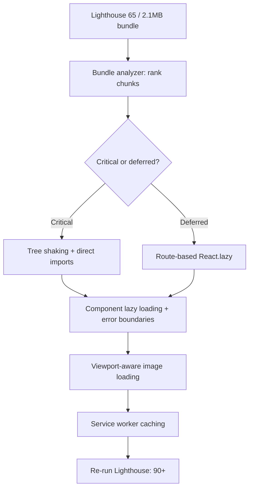

| Difficulty | Channel | Tags |
|---|---|---|
| intermediate | frontend | lighthouse, bundle, lazy-loading |

Only 1% of unauthenticated visitors converted into sign-ups, logins, or app installs — that was the number staring at Pinterest during its international growth push [1]. The culprit was not the marketing: the monolithic mobile site shipped over 2.5MB of JavaScript, and average Android hardware on 3G waited up to 23 seconds before any UI became usable [1]. Teams rebuilt the experience around smaller chunks and caching, dropping the core bundle from 650KB to 150KB and Time to Interactive from 23s to 5.6s [1]. That same playbook is how a React app stuck at a 65 Lighthouse score with a 2.1MB bundle climbs past 90.

---

> ### Real-World Case — Pinterest
>
> Pinterest's international growth push exposed a mobile web experience where only 1% of unauthenticated visitors converted into sign-ups, logins, or app installs. On average Android hardware over 3G, the old monolithic site shipped over 2.5MB of JavaScript (~1.5MB main bundle plus ~1MB lazy-loaded), and users waited up to 23 seconds before any UI was usable.
>
> | | |
> |---|---|
> | **Challenge** | Cut a multi-megabyte JavaScript payload and its parse/compile cost enough to make the mobile feed interactive on slow connections — while rebuilding a full-featured React app in a single quarter. |
> | **Solution** | They rebuilt the mobile site as a React/Redux/webpack PWA split into three chunk types: a vendor chunk (~73KB), an entry chunk (~72KB), and async route chunks (~13-18KB), using React Router dynamic imports for route-based code splitting and babel-preset-env to transpile only what target browsers needed. Webpack Bundle Analyzer revealed that the lazily loaded route chunks were mostly duplicate code — so they moved the shared code into the main entry chunk, a counterintuitive move that made it 20% larger but shrank every lazy chunk by up to 90%. They virtualized the Masonry grid, lazy-loaded images with dominant-color placeholders and progressive JPEGs, staged Workbox service-worker caching from runtime lazy assets to precached vendor/entry chunks, popular routes, and per-locale bundles, and used Lighthouse to validate TTI. |
> | **Outcome** | Core bundle dropped from 650KB to 150KB, First Meaningful Paint fell from 4.2s to 1.8s, and Time to Interactive collapsed from 23s to 5.6s on 3G — and to 3.9s on repeat visits with service-worker caching. Business impact: time spent up 40%, user-generated ad revenue up 44%, core engagements up 60%; the ~150KB web feed delivered the same core experience as apps requiring 9.6MB (Android) or 56MB (iOS). |
> | **Lesson** | Lazy loading is not just about splitting code — you must inspect what is inside each chunk. Moving duplicated code into the initial bundle can be a net win, and route-level splitting only pays off when combined with bundler analysis, payload budgets, and staged service-worker caching for repeat navigation. |

---

## Hook — The 23-Second Silence

The number was brutal: just 1% of unauthenticated visitors converted into sign-ups, logins, or app installs [1]. On average Android hardware over 3G, Pinterest's old site delivered roughly 1.5MB in the main bundle plus another 1MB of lazy-loaded code, leaving users staring at a dead screen for up to 23 seconds [1]. Picture a tourist on a train, tapping a pin, waiting through 23 silent seconds, and then closing the tab. That is the moment a performance bug stops being a metric and becomes a lost customer.

💡 Insight: The tension is not 'JavaScript is slow.' It is that every kilobyte shipped before interaction is a tax on conversion. Your 2.1MB React bundle and 4.2s Time to Interactive are the same tax, just on a smaller scale. Sound familiar? Many developers discover this only after Lighthouse has already handed them a 65.

So what exactly is hiding inside those 2.1MB?

## Problem — The 2.1MB Monolith Behind a 65 Score

Building on that tension, the typical React app does not become bloated on purpose. Single-page applications load the shell once and then ship route code, third-party SDKs, and shared dependencies up front, which is exactly why a 2.1MB initial payload feels normal until Lighthouse calls it a 65 [7].

Here is what you need to know about where the weight comes from:

- Monolithic entry chunks: every route, modal, and chart lands in the first response even though most visitors never open them.
- Barrel-file imports: `import { format } from './utils'` can drag an entire utility index into the bundle when tree shaking cannot prove the rest is unused.
- CommonJS dependencies: tree shaking relies on static ES module structure, so libraries compiled to CommonJS quietly defeat it [3].
- Eager third-party libraries: analytics, chat widgets, and date pickers load on every page 'just in case.'
- Unoptimized images: full-resolution hero images compete with JavaScript for the same bandwidth on 3G.

⚠️ Watch Out: Adding `React.lazy()` to a component that is still statically imported elsewhere changes nothing. Two imports, one eager, and the chunk is back in the initial payload.

Consequently, the real question is not 'how much code is there?' but 'which code must exist before the first interaction?' That question sets up the Pinterest case perfectly.

## Real-World Case — Pinterest

This leads straight back to the story that opened the article. During an international growth push, Pinterest faced a mobile web experience where only 1% of unauthenticated visitors converted, with over 2.5MB of JavaScript and usable UI arriving up to 23 seconds late on average Android hardware over 3G [1].

The rebuild treated JavaScript as a budget rather than a convenience. The core bundle fell from 650KB to 150KB, First Meaningful Paint improved from 4.2s to 1.8s, and Time to Interactive collapsed from 23s to 5.6s on 3G — reaching 3.9s on repeat visits once service-worker caching was in place [1].

| Metric | Old monolithic site | Rebuilt PWA |
|---|---|---|
| Core bundle | ~650KB | 150KB |
| First Meaningful Paint | 4.2s | 1.8s |
| Time to Interactive (3G) | 23s | 5.6s (3.9s repeat) |
| App-equivalent size | 9.6MB Android / 56MB iOS | ~150KB web feed |

🔥 Hot Take: The business numbers were louder than the engineering ones. Time spent rose 40%, user-generated ad revenue climbed 44%, and core engagements jumped 60% [1]. A ~150KB feed delivered the same core experience that native apps needed 9.6MB (Android) or 56MB (iOS) to provide [1].

Pinterest's approach is a textbook progressive web app strategy — small shell, deferred code, offline-aware caching [6]. But how do those ideas translate into a React codebase that already ships 2.1MB?

## Deep Dive — Splitting, Shaking, and the Lazy-Loading Spectrum

However, copying Pinterest's outcome without understanding the mechanism usually produces a bunch of tiny chunks and no speed gain. The mechanics matter.

**Analyze before slicing.** Tools such as webpack-bundle-analyzer turn a 2.1MB mystery into a labeled map: which library, which route, which duplicated dependency. Dynamic `import()` is the language primitive that makes a boundary possible [2], and React wraps it with `React.lazy()` and `Suspense` [8].

**Choose the right split.** Route-based splitting is the highest-leverage move because it removes entire screens from the first load; component-based splitting is for heavy, conditionally used widgets such as charts or editors.

| Option | Best for | Real tradeoff |
|---|---|---|
| Route-based split | Distinct pages or tabs | Needs a preload strategy or navigation feels slow |
| Component-based split | Charts, maps, rich text editors | Extra round trip when the component finally appears |
| Tree shaking + import hygiene | Utility and SDK bloat | Only works with static ES modules [3] |
| Service-worker caching | Repeat visits | Adds cache-invalidation complexity [4] |

**Shake the tree properly.** Tree shaking removes unused exports at build time when modules stay static; mixing in CommonJS require patterns or side-effectful barrel files keeps dead code alive [3]. Specifically, prefer direct imports, mark safe packages as side-effect-free, and re-check the analyzer after each change.

**Lazy-load visuals too.** JavaScript is not the only weight. Images should load when they approach the viewport, which is exactly what `IntersectionObserver` was built for [5]. Here is a practical rule: if a pixel is below the fold or behind a tab, it has no business downloading on first paint.

**Cache what will be needed again.** Service workers let repeat visits skip the network entirely, and HTTP caching semantics define how long responses may be reused [4] [9]. Pinterest's 3.9s repeat-visit TTI came from this layer [1].

🎯 Key Point: Lazy loading is not free. Split too finely and the browser performs a waterfall of tiny requests; split sensibly and one heavy chunk disappears. 🔥 Hot Take: 'lazy everything' is how a 2.1MB bundle becomes 2.1MB plus 40 network round trips.

So when would you actually use each technique? Route splitting is the default for any app with more than one screen; component splitting belongs behind a feature flag or a modal; tree shaking is hygiene you apply everywhere; caching is for returning users. The workflow below strings these decisions together in the order that produces measurable gains.

## Workflow — From Lighthouse 65 to 90+ in Seven Moves

This leads to a repeatable sequence rather than a bag of tricks. The Mermaid diagram below — the **Bundle Optimization Flow** — traces the same path teams follow when a 65 score and a 2.1MB entry chunk need to become a 90+ score.

1. **Baseline first.** Run Lighthouse on throttled mobile conditions and record TTI, LCP, and total JavaScript. Pro tip: throttle to 3G and a mid-range CPU, not your laptop. Without a baseline, every later win is a guess.
2. **Map the bundle.** Feed the production build into webpack-bundle-analyzer and rank chunks by size. Mark each as critical or deferred.
3. **Cut dead weight.** Remove unused dependencies, replace heavyweight utilities with direct imports, and verify ES module output so tree shaking can work [3].
4. **Split at routes.** Convert each route component with `React.lazy()` and wrap the router in `Suspense` [2] [8].
5. **Split at heavy components.** Lazy-load charts, editors, and maps behind an error boundary; add hover or viewport prefetch for the ones users often open.
6. **Defer images and cache repeats.** Use `IntersectionObserver` for below-the-fold media [5] and a service worker for repeat-visit assets [4].
7. **Measure again.** Re-run Lighthouse, confirm the score, and watch for regressions in navigation latency.

⚠️ Watch Out: Step 3 must come before step 4. Splitting a bundle that still contains unused libraries produces smaller chunks of the same garbage.

💡 Insight: Teams often stop after step 4 and celebrate a smaller main chunk, then wonder why navigation feels sluggish. Prefetch and caching are what turn a smaller bundle into a faster experience. With the sequence settled, the code becomes almost boring — which is exactly what production code should be.

## Code Example — Production-Ready Lazy Boundaries

Building on that sequence, the snippet below implements the core of steps 4 through 6: route-level lazy chunks, a guarded heavy component, and viewport-aware image loading.

```javascript
const Dashboard = lazy(() => import('./routes/Dashboard'));
const Analytics = lazy(() => import('./routes/Analytics'));

<Suspense fallback={<Spinner />}>
  <Routes>
    <Route path="/dashboard" element={<Dashboard />} />
    <Route path="/analytics" element={<Analytics />} />
  </Routes>
</Suspense>
```

Line-by-line, here is what is happening:

- `lazy(() => import(...))` registers a dynamic import, so the route's code is fetched only when that route renders [2].
- `Suspense` supplies a fallback while the chunk downloads; without it, React cannot render the boundary.
- Each `` keeps its component in a separate chunk, which is the route-based split described earlier.
- The `ChunkErrorBoundary` in the full example below catches failed chunk loads — a stale hashed filename after a deploy is a classic production failure mode.
- `LazyImage` uses `IntersectionObserver` so off-screen media never downloads during first paint [5].

🎯 Key Point: The full production version in the codeExample field also prefetches on intent. Preloading a chunk on link hover hides most of the network round trip, which is the difference between 'lazy' and 'slow.' If this feels overwhelming, you are not alone; start with one route and one error boundary — that alone usually moves the needle.

Now for the part that matters most: what survives when the Lighthouse tab is closed?

## Lessons Learned — The Numbers Worth Remembering

Consequently, the journey that started with 1% conversion ends with a simple truth: performance work is a budget, not a cleanup task.

- **Measure before optimizing.** Pinterest's 650KB core bundle and 23s TTI were visible only because teams measured on the hardware and network their international audience actually used [1].
- **Split at the right seam.** Routes first, heavy components second, images third; random component splitting creates request waterfalls.
- **Tree shaking is configuration, not magic.** ES modules and direct imports decide whether 2.1MB becomes 1.4MB [3].
- **Repeat visits are a second product.** Service-worker caching turned 5.6s into 3.9s [1] [4].
- **Ship error boundaries with every lazy chunk.** Deployed chunk URLs change; users on old HTML will request files that no longer exist.

Battle scars worth avoiding: analyzing a development build, lazy-loading a component that is also statically imported, caching HTML forever, and celebrating a score bump without checking navigation latency.

Many developers think the win is the smaller bundle. Actually, the win is the moment the interface becomes usable — the 23-second silence ending at 5.6 seconds [1]. The fastest bundle is the one you never ship.

So what should change tomorrow? Run Lighthouse, run the analyzer, and remove one dependency before adding one abstraction. That single habit is the whole playbook.

---

## Bundle Optimization Flow



<details>
<summary><strong>Original Interview Question</strong></summary>

**Q:** You're tasked with improving a React app's Lighthouse performance score from 65 to 90+. The bundle size is 2.1MB and Time to Interactive is 4.2s. What specific steps would you take to optimize the bundle and implement lazy loading?

**A:** Implement code splitting with React.lazy() and Suspense, analyze bundle composition with webpack-bundle-analyzer to identify largest chunks, remove unused dependencies and optimize imports, add dynamic imports for heavy components and third-party libraries, implement route-based splitting for better initial load times, and utilize tree shaking with proper ES module configuration.

</details>

## Conclusion

Pinterest's 1% conversion problem and your 65 Lighthouse score are the same story told at different scales [1]. The fix was never a clever React trick; it was a decision to treat every kilobyte as borrowed time, then spend that time on route splits, tree shaking, lazy media, and caching. Start tomorrow with one audited chunk and one lazy boundary, and keep the 150KB feed in mind the next time a 2.1MB bundle tries to look harmless. The fastest bundle is the one you never ship — paste that on your team's wall.

---

## References

1. [Pinterest incident report](https://medium.com/dev-channel/a-pinterest-progressive-web-app-performance-case-study-3bd6ed2e6154) — article
2. [MDN: Dynamic import operator](https://developer.mozilla.org/en-US/docs/Web/JavaScript/Reference/Operators/import) — documentation
3. [MDN: Tree shaking glossary](https://developer.mozilla.org/en-US/docs/Glossary/Tree_shaking) — documentation
4. [MDN: Service Worker API](https://developer.mozilla.org/en-US/docs/Web/API/Service_Worker_API) — documentation
5. [MDN: Intersection Observer API](https://developer.mozilla.org/en-US/docs/Web/API/Intersection_Observer_API) — documentation
6. [Wikipedia: Progressive web app](https://en.wikipedia.org/wiki/Progressive_web_app) — documentation
7. [Wikipedia: Single-page application](https://en.wikipedia.org/wiki/Single-page_application) — documentation
8. [GitHub: facebook/react](https://github.com/facebook/react) — documentation
9. [RFC 9111: HTTP Caching](https://datatracker.ietf.org/doc/html/rfc9111) — documentation

---

**Author:** Satishkumar Dhule — [GitHub](https://github.com/satishkumar-dhule) · [LinkedIn](https://linkedin.com/in/satishkumar-dhule) · [Website](https://satishkumar-dhule.github.io)
