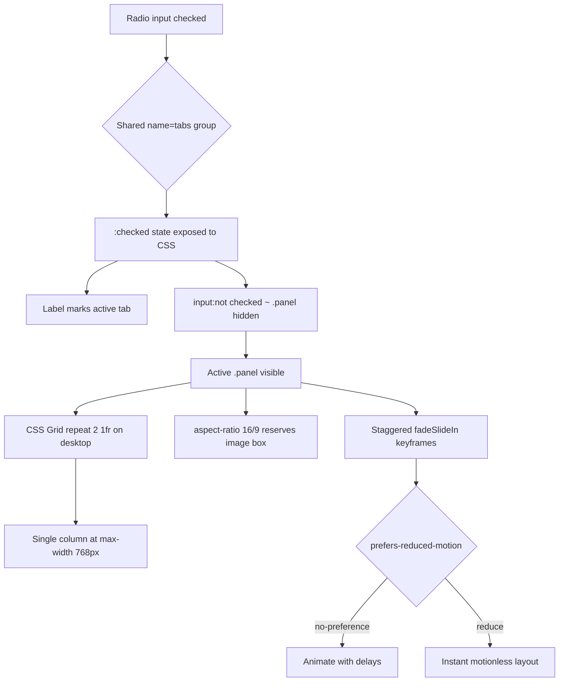

| Difficulty | Channel | Tags |
|---|---|---|
| beginner | frontend | css, flexbox, grid, animations |

When Microsoft's Office Engineering and Experiences team set out to rebuild the Fluent 2 documentation site — the design system behind Office, Windows, and Teams — the old stack was fighting them at every turn: rigid frameworks, one-off custom components, and a content workflow out of step with their Figma-to-Markdown pipeline [1]. The rebuild cut page-build time in half and shipped 200+ pages over 10 months, with simple pages going from Figma to live in just 20–30 minutes [1]. Here is the quiet hero of that story: components that do more with less runtime code, like tab panels that need zero JavaScript. This is the journey from a fragile click handler to a handful of radio inputs, one sibling selector, and a well-placed media query.

---

> ### Real-World Case — Microsoft
>
> Microsoft's Office Engineering and Experiences team had to rebuild the documentation site for Fluent 2, the design system used across Office, Windows, and Teams. Earlier attempts with other frameworks and CMSs were too rigid, hard to maintain, or out of step with their Figma-to-Markdown workflow, and the content relied on many one-off custom components that did not suit a CMS.
>
> | | |
> |---|---|
> | **Challenge** | Build a lightweight, low-maintenance design-system docs site that stays fast, secure, and scalable at scale, while supporting custom components, a React-based design library, and legacy Storybook iframes during migration. |
> | **Solution** | They rebuilt the site on Astro, which ships zero JavaScript by default and generates fully static files — the same 'let HTML and CSS do the work, add JS only where needed' philosophy behind CSS-only interactive patterns like radio-driven tabs. Astro's island architecture let them keep React for the design-system library while the bulk of the 200+ documentation pages stayed static and JS-free. |
> | **Outcome** | New pages were built in half the time compared with the previous stack; the team shipped 200+ pages of new content over 10 months and could implement a simple page from a Figma design in just 20–30 minutes. Fully static files hosted on Azure also gave them DDoS protection and scalability without backend dependencies. |
> | **Lesson** | For documentation and design-system sites, defaulting to zero JavaScript and static output removes framework/CMS overhead and speeds up content work — a strong real-world validation of the 'CSS-first, minimal JS' approach, even if true tab semantics still need ARIA and scripting. |

---

## Hook — The deploy looked fine. Then the bundle never arrived.

The tabs rendered, the cards lined up, and the demo passed — until the JavaScript failed to load on a spotty conference Wi-Fi network and the docs page collapsed into one motionless column. Sound familiar? Many developers reach for a framework component the moment they hear the word "tabs," then discover that a twelve-line interaction has dragged in tens of kilobytes of client-side code. That tradeoff stings most in documentation, where readers arrive from search engines, on slow connections, and often with scripting delayed or disabled. CSS was designed precisely to describe presentation declaratively [8], so a purely visual state machine arguably belongs in the stylesheet, not the bundle. The stakes are bigger than a few kilobytes: docs are the front door to a design system, and a stuck tab panel is a locked door. But is a radio button really enough to replace an entire component?

## Problem — The tab component that quietly taxes every page load

Building on that tension, the core problem is not tabs themselves — it is the reflex to solve a presentational problem with runtime code. A typical framework tab component ships state, event handlers, and a hydration pass, all to toggle a `display` property the browser already understands. For a docs site publishing hundreds of pages, that reflex multiplies: every page pays the same JavaScript tax, and every interaction becomes a potential hydration mismatch [8]. Consider the reader, not the architecture diagram. Someone lands from Google, waits through a 400 ms round trip on a phone, and leaves if content shifts or stalls. An extra 10–40 KB of script means parse, compile, and execute time before the first card appears. Moreover, JavaScript failures are silent killers: when the bundle errors, the tabs freeze and the reader sees the wrong panel with no explanation.

⚠️ Watch Out — battle scar number one: hiding a panel with `opacity: 0` or `height: 0` instead of `display: none` leaves focusable links inside a panel that looks invisible. Keyboard users then tab into ghost content. The CSS-only pattern avoids this if the hidden rule truly removes the panel from rendering.

Here is the thing though — the radio-input approach is not a hack; it is a deliberate use of form semantics for state [3]. When would you actually use it? Any time the interaction is a single choice among a few views with no data fetching, no remote state, and no dynamic tab list. Settings panels, onboarding guides, component docs — that is the sweet spot. So what does this look like when a company with thousands of engineers gets it right? The next section has receipts.

## Real-World Case — Microsoft

That problem is far from theoretical. Microsoft's Office Engineering and Experiences team hit it head-on while rebuilding the Fluent 2 documentation site, the design system used across Office, Windows, and Teams [1]. Earlier attempts with other frameworks and CMSs were too rigid, hard to maintain, and out of step with their Figma-to-Markdown workflow; the content relied on many one-off custom components that simply did not suit a CMS [1].

🔥 Hot Take: the team did not merely "add a docs site." They changed the shape of the work — fully static files hosted on Azure, no backend dependency, DDoS protection and scalability inherited from the platform [1].

The numbers make the case concrete. New pages were built in half the time compared with the previous stack; 200+ pages of new content shipped over 10 months; and a simple page could go from a Figma design to live in just 20–30 minutes [1]. The tooling behind that rebuild is open source and inspectable on GitHub [9], so the pattern is not folklore. Consequently, the lesson is not "adopt framework X" — it is "let the platform do the boring parts." CSS-only tabs fit that philosophy perfectly. But how exactly does a radio button become a tab switch? That requires understanding one selector most developers skim past.

## Deep Dive — The selector chain that does the switching

Building on the case study, the mechanism is beautifully small. Radio inputs sharing the same `name` form a mutually exclusive group, so exactly one can be checked at a time [3]. The `:checked` pseudo-class exposes that state to CSS, and the general sibling combinator `~` reaches every following `.panel` under the same parent [7]. One rule — `.tabs input:not(:checked) ~ .panel { display: none; }` — hides every panel whose radio is not selected. No event listeners, no state store, no hydration boundary.

⚠️ Watch Out — the DOM order trap: `~` only matches siblings that come *after* the input in document order. Place all inputs and labels before all panels, or the selector silently does nothing. This is the most common battle scar with the pattern, and it fails quietly rather than loudly.

💡 Insight: `:focus-visible` is not the same thing as `:focus`. It reveals the outline only for keyboard-like interaction, keeping mouse clicks visually clean while preserving accessibility [4]. Many developers assume a global `outline: none` is harmless; actually it is an accessibility regression waiting to happen.

Then the layout layer takes over. `grid-template-columns: repeat(2, 1fr)` produces the 2×2 desktop card grid [2], while a `max-width: 768px` media query collapses it to a single column on mobile. Each media box uses `aspect-ratio: 16 / 9`, which reserves space before image bytes arrive and keeps Cumulative Layout Shift near zero [6].

🎯 Key Point: sizing images through CSS instead of intrinsic dimensions is a real Core Web Vitals win, not just cosmetic polish. Here is the plot twist — the stagger is opt-in, not default. Wrapping the animation in `@media (prefers-reduced-motion: no-preference)` means motion-sensitive readers get a calm, instant layout [5]. Many developers think "stagger" means "always animate"; actually it means "animate when welcome." When would you use this? Docs, landing pages, settings screens — anywhere a single choice swaps a small set of views. Ready to see the pieces snap together?

## Workflow — From checked radio to rendered panel

This leads to a repeatable build order, and the sequence matters more than the syntax. Step one: declare one radio per tab, all sharing `name="tabs"`, with the first marked `checked`. Step two: pair each radio with a `` so clicking the tab text toggles state and the label inherits the interactive behavior. Step three: keep DOM order strict — every radio and label first, every panel afterward — because the sibling combinator does not look backward [7]. Step four: give each panel the 2×2 grid and the mobile override, then let `aspect-ratio` reserve the image boxes [2] [6]. Step five: add the staggered keyframes only inside the reduced-motion guard [5], and finish with `:focus-visible` for keyboard users [4].

The diagram below renders that state chain from the checked radio all the way to the motion decision:

Here is the real tradeoff, stripped of dogma:

| Option | Runtime cost | Accessibility effort | When it wins |
| --- | --- | --- | --- |
| CSS-only radio tabs | ~0 KB JS | Manual labels and focus discipline | Static docs, marketing pages, 200-page sites |
| JS framework tabs | 10–40 KB plus hydration | ARIA often handled for you | Dynamic tab lists, remote data, app shells |

⚠️ Watch Out: the CSS-only route is not a universal replacement. Tabs generated at runtime from an API, or tabs that need to be added and removed dynamically, are genuinely easier in JavaScript. Choose the tool that matches the problem, not the one that wins a purity argument.

Theory is tidy; production has sharp edges. The next section ships a generator that keeps the pattern consistent across hundreds of pages.

## Code Example — A generator that keeps 200 pages consistent

Rather than hand-writing identical markup 200 times, the TypeScript snippet in the `codeExample` field turns a typed `Tab[]` into a complete panel. That choice directly echoes the Microsoft workflow: content stays data-like, presentation stays in a shared static asset, and nothing needs a backend [1]. The generator emits the radios first with a single `checked` default, then the panels, then returns one `.tabs` wrapper — DOM order that the `~` combinator depends on [7]. Each generated card gets an `aspect-ratio` image box, a title, and a meta line, so the 16:9 slot is reserved before images load [6]. The exported `tabsCSS` string is the entire interaction layer: the hiding rule, the 2×2 grid with its mobile collapse [2], the `:focus-visible` outline [4], and the staggered keyframes behind a `prefers-reduced-motion: no-preference` guard [5] [10]. Ship that string once as a static stylesheet and every page inherits the behavior. Pro tip from debugging this pattern repeatedly: if a panel never appears, inspect the DOM order before blaming the selector — the general sibling combinator is the usual culprit. If the animation feels wrong on a test machine, toggle the OS "reduce motion" setting and watch it vanish; that is success, not a bug. But knowing the code works is different from knowing it will survive a team. The final section covers the habits that keep it upright.

## Lessons Learned — Battle scars and the one insight to steal

The journey from a fragile click handler to a static, radio-driven panel produces a short list of habits worth keeping.

• DOM order is destiny: all radios and labels before all panels, because `~` never looks backward [7].
• Motion is a preference, not a decoration: guard every stagger with `prefers-reduced-motion` [5].
• `focus-visible` beats a blanket `outline: none` for keyboard users [4].
• Reserve media space with `aspect-ratio` so layout shift stays off the vitals report [6].
• Static wins when the content is static — fewer moving parts meant 200+ pages and half the build time in the Microsoft rebuild [1].

🔥 Hot Take: if a component's entire state is "which of these four boxes is visible," shipping JavaScript is a solution in search of a problem. Many developers discover this only after their bundle budget is already blown. Here is the thing though — the pattern demands discipline. Labels must be wired correctly, panels must be ordered correctly, and dynamic tabs still need a real framework. Used where it fits, it trades runtime complexity for a few lines of declarative CSS that any designer can read.

So what should change tomorrow? Pick one tabs component in your docs, delete the click handler, and rebuild it with radios, a sibling selector, a 2×2 grid, and a reduced-motion guard. Then measure the bundle, the layout shift, and the keyboard path. Remember the one line worth sharing with your team: the best tab component is the one that never ships a JavaScript file.

---

## CSS Tab State Flow

<strong>Original Interview Question</strong>

**Q:** Build a CSS-only tab panel for a design-system docs page. Use radio inputs to switch tabs (no JavaScript). Desktop: a 2x2 grid of cards under each tab; mobile: single column. Each card has a fixed 16:9 image area, a title, and a short meta line. Add a subtle entrance animation with a stagger and keep focus-visible outlines; ensure prefers-reduced-motion is respected?

**A:** Use a set of radio inputs with a shared `name` attribute and corresponding `` elements for each tab section. The `:checked` state of each radio controls visibility of its associated panel via adjacent sibling selectors. Each panel renders a 2×2 card grid on desktop and collapses to a single column on mobile. Cards use `aspect-ratio: 16/9` for fixed image containers, with a title and meta line below.

## Conclusion

Microsoft's Fluent 2 rebuild showed that removing runtime complexity can accelerate delivery: half the page-build time, 200+ pages in 10 months, and 20–30 minutes from Figma to live, all from static files with no backend dependency [1]. The journey here ran from a failing JavaScript bundle through the radio-and-sibling-selector mechanism, the 2×2 grid and reserved 16:9 boxes, the reduced-motion guard, and the focus-visible outline — each piece small, together a production-grade tab panel. Tomorrow, take one tabs component in your docs, strip out the click handler, and rebuild it with this pattern. Then verify the keyboard path, the OS reduce-motion setting, and the bundle diff. Leave your team with one memorable line: the best tab component is the one that never ships a JavaScript file.

---

## References

1. [Microsoft incident report](https://astro.build/case-studies/microsoft) — article
2. [MDN Web Docs: CSS Grid Layout](https://developer.mozilla.org/en-US/docs/Web/CSS/CSS_grid_layout) — documentation
3. [MDN Web Docs: :checked pseudo-class](https://developer.mozilla.org/en-US/docs/Web/CSS/:checked) — documentation
4. [MDN Web Docs: :focus-visible pseudo-class](https://developer.mozilla.org/en-US/docs/Web/CSS/:focus-visible) — documentation
5. [MDN Web Docs: prefers-reduced-motion media feature](https://developer.mozilla.org/en-US/docs/Web/CSS/@media/prefers-reduced-motion) — documentation
6. [MDN Web Docs: aspect-ratio property](https://developer.mozilla.org/en-US/docs/Web/CSS/aspect-ratio) — documentation
7. [MDN Web Docs: General sibling combinator](https://developer.mozilla.org/en-US/docs/Web/CSS/General_sibling_combinator) — documentation
8. [Wikipedia: Cascading Style Sheets](https://en.wikipedia.org/wiki/CSS) — documentation
9. [GitHub: withastro/astro](https://github.com/withastro/astro) — documentation
10. [MDN Web Docs: Using CSS animations](https://developer.mozilla.org/en-US/docs/Web/CSS/CSS_animations/Using_CSS_animations) — documentation

---

**Author:** Satishkumar Dhule — [GitHub](https://github.com/satishkumar-dhule) · [LinkedIn](https://linkedin.com/in/satishkumar-dhule) · [Website](https://satishkumar-dhule.github.io)
