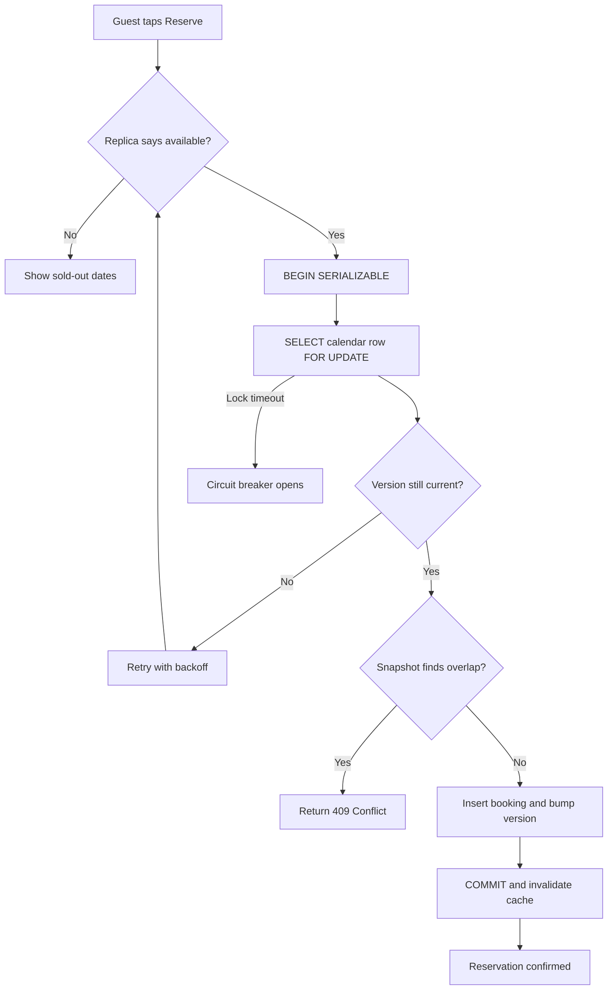

| Difficulty | Channel | Tags |
|---|---|---|
| intermediate | database | acid, isolation-levels, mvcc |

Booking.com set out to make hotels, flights, and cars feel like one seamless trip, then discovered that reservation data refuses to play nicely with an eventually consistent store: after painful sharded-MySQL failovers, the team chose Cassandra for scale, only to learn that orders are transactional by nature [1]. Today that Order Platform holds roughly 20 TB in a single CockroachDB Cloud cluster spanning Frankfurt, London, and Ireland, delivering 99.999% availability and a 99.99998% write SLI [1]. Those are the real stakes: when two guests want the same room, "eventually consistent" is just a polite way of saying "one very unhappy customer."

---

> ### Real-World Case — Booking.com
>
> Booking.com's 'Connected Trip' initiative required consolidating siloed reservation data into one Order Platform that orchestrates checkout, payment, and fulfillment across hotels, flights, and cars. After painful sharded-MySQL failovers, the team deliberately chose Cassandra for scale and availability — but reservation data turned out to be transactional by nature.
>
> | | |
> |---|---|
> | **Challenge** | Cassandra offered only row-level isolation, so multi-row, multi-partition read-modify-write operations — exactly the shape of a booking that checks availability and then claims it — could not be made atomic. Their workaround, a locking system built on lightweight transactions, sometimes timed out with no way to tell whether the condition legitimately failed or the infrastructure misbehaved; limited secondary indexes also forced a parallel OpenSearch index that had to be kept in sync. |
> | **Solution** | After proof-of-concept testing three databases, they migrated Order Platform to CockroachDB, whose ACID transactions and default SERIALIZABLE isolation make the whole reservation operation all-or-nothing across rows and regions. Native CDC and secondary indexes let them delete the hand-built locking, cross-check, and sync services. |
> | **Outcome** | Order Platform now holds ~20TB of reservation data in a single CockroachDB Cloud cluster spanning Frankfurt, London, and Ireland, at 99.999% availability and a 99.99998% write SLI. Nodes can go down without disturbing service, and removing redundant consistency services cut operational cost and cognitive load. |
> | **Lesson** | Choosing availability over isolation doesn't remove concurrency control — it pushes it into fragile application-level locks whose timeouts have ambiguous meaning. When the invariant 'two guests cannot hold the same reservation' is non-negotiable, serializability in the database is the simpler architecture, even at the cost of a tiny slice of write availability. |

---

## Hook — The click that costs twice

Picture the checkout button. A guest in Berlin and a guest in Dublin tap "Reserve" on the same Paris apartment within 80 milliseconds of each other. Both screens show the same available dates. Both payments authorize. Then the property owner opens the calendar and sees two guests for one unit. 💡 Insight: the bug is not in the payment gateway; it is in the tiny window between "looks free" and "is booked." Sound familiar? Every developer who has shipped a booking flow has stared at that window and hoped nobody noticed. Here is the thing though: hope is not a concurrency control strategy, and the fix is far more interesting than "just add a lock."

## Problem — Two guests, one calendar, zero mercy

Building on that tension, the core challenge is deceptively small: availability is shared state, and shared state is where race conditions live. A naive flow reads availability, validates dates, inserts a row, and commits; under load, those steps interleave like commuters at a subway door. The industry calls the desired guarantee serializability, meaning the outcome must match some order where transactions ran one after another [2]. Database transaction theory also reminds developers that a commit is only safe when the whole unit succeeds or none of it does [5]. ⚠️ Watch Out: a unique index on (property_id, check_in) protects exact starts but misses overlapping stays like Monday-to-Friday versus Wednesday-to-Sunday. Many developers discover this only after a customer service ticket with two confirmations attached. The stakes are money, trust, and support queues that grow faster than your on-call rotation. So what breaks first when traffic spikes?

## Real-World Case — Booking.com

Consequently, the most instructive example is not a toy app but Booking.com's Connected Trip rebuild. Siloed reservation data for hotels, flights, and cars had to be consolidated into one Order Platform that orchestrates checkout, payment, and fulfillment [1]. Sharded MySQL failovers had already proven painful, so Cassandra was chosen deliberately for its scale and availability. Then came the plot twist: reservation data is transactional by nature, and "always writable" is not the same as "always correct" [1]. The team moved roughly 20 TB of reservation data into a single CockroachDB Cloud cluster across Frankfurt, London, and Ireland, reaching 99.999% availability and a 99.99998% write SLI, while removing redundant consistency services reduced both operational cost and cognitive load [1]. 🔥 Hot Take: the architecture did not win because it was newer; it won because it stopped asking application code to fake transactions the database could enforce. How does that lesson shrink down to your booking table?

## Deep Dive — Isolation, snapshots, and the honest lock

This leads to the machinery behind the guarantee. SERIALIZABLE isolation is the strictest level: conflicting transactions are aborted and retried instead of silently producing an impossible schedule [6]. MVCC adds another layer by giving each transaction a snapshot, so availability checks read a stable view while writers proceed elsewhere [3]. Optimistic concurrency control then uses a version column: if the row changed since the read, the transaction fails fast and the caller refreshes [4]. Row-level locking with SELECT FOR UPDATE narrows the blast radius to one property calendar row rather than freezing the whole table, which is the practical form of two-phase locking most teams can tolerate [7]. Google's Spanner showed at scale that globally distributed transactions can work when consensus and clock-aware commits are treated as first-class infrastructure, not application afterthoughts [8]. 🎯 Key Point: these techniques are complementary, not competing religions. Here is the real tradeoff:

| Approach | Reads stay fast | Prevents overlap | Failure mode | Use it when |
|---|---|---|---|---|
| SERIALIZABLE only | Yes | Yes | Serialization aborts under contention | Correctness matters more than retry-free latency |
| Optimistic version column | Yes | Yes, on stale writes | Client must retry after version drift | UI flows already refresh state |
| SELECT FOR UPDATE | No, writer blocks | Yes | Lock queues and timeouts | Hot properties need deterministic serialization |
| Read replicas + cache | Excellent | No, stale windows | Ghost availability | Discovery/browse, never final checkout |

When does each apply? Use replica reads for browsing, optimistic checks for the first submit, and a locked calendar row plus SERIALIZABLE only at the final commit boundary. 💡 Insight: the trick is not locking everything; it is locking the smallest thing that decides ownership. But wait, it gets better: the moment a hot property becomes a lock magnet, the system needs a retry policy that does not stampede. Which lock should actually own the decision?

## Workflow — From availability check to confirmed stay

Building on those trade-offs, the flow separates cheap reads from expensive truth. First, the browse page reads a replica or cache and shows dates that are probably free. Second, the checkout service begins a SERIALIZABLE transaction and locks the property's calendar row. Third, it compares the client-supplied version with the locked row; a mismatch means somebody else moved first. Fourth, it performs an MVCC snapshot read for overlapping reservations inside the locked boundary. Fifth, it inserts the reservation, increments the version, commits, and invalidates the cache. Sixth, any serialization failure or conflict triggers bounded retries with exponential backoff and jitter. The Mermaid diagram below tells this story visually, including the unhappy paths:

⚠️ Watch Out: never treat the replica read as authorization; it is a hint, not a promise. Production teams also cap retries, because five attempts with jitter is a safety valve while five hundred attempts is a denial-of-service with extra steps. What happens when the lock never returns?

## Code Example — A reservation that refuses to double-book

With the flow in place, the implementation can stay small and honest. The Python example below uses psycopg, whose transaction context manager and typed error hierarchy map neatly onto this pattern [9]. It locks one calendar row, checks a version, validates overlaps inside the snapshot, writes the reservation, and retries only failures that are safe to retry. Run it against a table with property_calendar(property_id, version) and reservations(property_id, guest_id, check_in, check_out).

## Lessons Learned — Battle scars worth keeping

Having walked the path from race condition to retry loop, the durable lessons are mostly about restraint. 💡 Insight: availability checks are cheap; availability decisions are not, so put the decision behind the lock and leave the check in front of it.

- **Battle scar:** locking the entire property table. It works at ten bookings per minute and collapses at ten thousand. Lock the calendar row instead.
- **Battle scar:** unbounded retries. Cap attempts, add jitter, and fail visibly; retry storms turn a hot listing into an outage.
- **Battle scar:** caching confirmations. Invalidate only after commit, and treat stale cache as a UI hint rather than truth.
- **Battle scar:** skipping observability. Track lock wait time, serialization aborts per second, and retry counts; these metrics warn before customers do.
- **Battle scar:** trusting client timestamps. The database clock and server-side version are the arbiters, not the browser.

🔥 Hot Take: "high availability" does not mean every request succeeds; it means the system stays correct and responsive while some requests are honestly rejected. If this feels overwhelming, you are not alone: the patterns only look mysterious until somebody draws the boundary between read and write. The memorable line to share with your team is this: consistency is not a setting you toggle, it is a place you choose to put a lock.

---

## Reservation Commit Flow

<strong>Original Interview Question</strong>

**Q:** You're building a booking system for Airbnb where multiple users can reserve the same property simultaneously. How would you design the transaction handling to prevent double bookings while maintaining high availability?

**A:** Use SERIALIZABLE isolation with optimistic concurrency control. Implement row-level locks on property availability tables, use MVCC snapshot reads for checking availability, and apply application-level validation to ensure atomic booking operations.

## Conclusion

The journey started with two guests, one Paris apartment, and a checkout button that looked harmless. Booking.com's 20 TB, three-region Order Platform showed the enterprise version of the same problem: availability is readable anywhere, but ownership must be decided somewhere with teeth [1]. You do not need a global cluster to apply the lesson. Put replica reads and caches in charge of browsing, put a version check in charge of freshness, and put one locked calendar row plus SERIALIZABLE in charge of the final decision. Tomorrow, audit one write path in your system and ask where two requests can both believe they won. Then move that boundary, add bounded retries, and measure the aborts. The one-line insight worth carrying into your next design review: high availability is achievable, but only when correctness has a locked seat at the table.

---

## References

1. [Booking.com incident report](https://www.cockroachlabs.com/customers/booking-com/) — article
2. [Isolation (database systems)](https://en.wikipedia.org/wiki/Isolation_(database_systems)) — documentation
3. [Multiversion concurrency control](https://en.wikipedia.org/wiki/Multiversion_concurrency_control) — documentation
4. [Optimistic concurrency control](https://en.wikipedia.org/wiki/Optimistic_concurrency_control) — documentation
5. [Database transaction](https://en.wikipedia.org/wiki/Database_transaction) — documentation
6. [Serializability](https://en.wikipedia.org/wiki/Serializability) — documentation
7. [Two-phase locking](https://en.wikipedia.org/wiki/Two-phase_locking) — documentation
8. [Spanner: Google's Globally-Distributed Database](https://arxiv.org/abs/1209.2532) — paper
9. [psycopg PostgreSQL adapter for Python](https://github.com/psycopg/psycopg) — documentation

---

**Author:** Satishkumar Dhule — [GitHub](https://github.com/satishkumar-dhule) · [LinkedIn](https://linkedin.com/in/satishkumar-dhule) · [Website](https://satishkumar-dhule.github.io)
