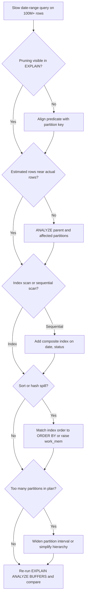

| Difficulty | Channel | Tags |
|---|---|---|
| intermediate | database | explain, query-plan, partitioning |

The deploy looked fine. Days later, queries at Hatchet - a YC-backed durable execution platform running PostgreSQL - were taking up to 10x longer, jumping from a few milliseconds to more than 20ms on batched compound-key joins across daily partitions [1]. Active sessions and CPU spiked under moderate load, and the culprit was not the partitioning design itself but stale statistics on the partitioned parent [1]. That detail turns a routine performance story into a masterclass in reading EXPLAIN plans before reaching for a bigger index.

---

> ### Real-World Case — Hatchet
>
> Hatchet, a YC-backed durable execution platform built on PostgreSQL, stores hundreds of millions of task rows per day. After hitting ~200M rows in a single table with bloated indexes and near-constant chunked deletions, they moved to daily range-partitioned tables (v1_task, v1_task_event) with compound primary keys. Days after the rollout, queries doing batched compound-key joins across partitions degraded from a few milliseconds to over 20ms, causing massive spikes in active sessions and CPU under moderate load.
>
> | | |
> |---|---|
> | **Challenge** | The team first suspected too many partitions were being scanned and tried forcing planner-time partition pruning, but it didn't help. A minimal repro of 14 daily partitions with 1M rows each produced an EXPLAIN ANALYZE plan with a row estimate off by a factor of 6,100,000×, which was pushing the planner toward sequential scans and bad join strategies. |
> | **Solution** | PostgreSQL expert Laurenz Albe suggested manually running ANALYZE on the partitioned parent tables. Autovacuum processes the leaf partitions but never the parent (it stores no tuples), so parent-level statistics used for estimates above the Append node were missing. They scheduled daily ANALYZE runs on the parent tables (PR #2163) and later reverted N+1 query workarounds that had been introduced to dodge the bad plans. |
> | **Outcome** | The manual ANALYZE immediately fixed the 10× query slowdown, bringing queries back to milliseconds and resolving all rollout issues. The fix was committed as a scheduled daily job; a follow-up PR removed the workaround queries that had papered over the misestimates. |
> | **Lesson** | In a partitioned-table EXPLAIN plan, check estimated vs. actual rows above the Append node—not just pruning and index use. Autovacuum never analyzes partitioned parents, so joins, GROUP BY, and DISTINCT can be planned from default/stale statistics unless you explicitly run ANALYZE on the parent. |

---

## Hook — The deploy looked clean. Then latency went 10x.

Picture a green deployment dashboard. Nothing crashed, no error budget burned, and yet by day three the p99 for a batched join had drifted from single-digit milliseconds to more than 20ms [1]. The stakes were hundreds of millions of task rows per day, a queue that backs up fast, and active sessions climbing under load that used to feel routine [1]. Sound familiar? Many developers discover this only after the on-call graph starts looking like a heart monitor.

🔥 Hot Take: partitioning is not a speed button. It is a bet that your queries, your statistics, and your partition key all agree on the same story.

## Problem — A date filter that should fly, but does not

Building on that tension, the core challenge is deceptively simple: a query filters a date range on a 100M-row table and still crawls. Partitioning promises to skip irrelevant data, but that promise only holds when the planner can prove which partitions can be ignored [4]. When the proof fails, PostgreSQL walks partitions that were supposedly out of scope.

Here is what tends to break, and what it costs you:

- **Pruning leakage:** the plan lists far more partitions than the date range requires, so scan work multiplies [4].
- **Stale statistics:** estimated rows diverge wildly from actual rows, sending the planner toward the wrong join strategy [2].
- **Index mismatch:** an index exists, but its column order does not match the filter, so sequential scans win [6].
- **Sort and hash spills:** the filter is cheap, but ordering or aggregation writes temp files and eats CPU [2].

A query plan is a sequence of steps chosen from many valid alternatives, and optimizers are imperfect [5]. The painful part is that all four symptoms look identical on a latency chart. Throwing RAM or an index at the problem feels productive, but if the planner is guessing with a stale map, the new index may sit unused while CPU climbs [2]. That is the moment when reading the plan stops being optional.

## Real-World Case — Hatchet

However, theory rarely lands as hard as a production incident. Hatchet, a YC-backed durable execution platform built on PostgreSQL, had been storing hundreds of millions of task rows per day in a single table that reached roughly 200M rows, with bloated indexes and near-constant chunked deletions [1]. The team moved to daily range partitions named `v1_task` and `v1_task_event` with compound primary keys, a design that looked textbook-clean [1].

Days after rollout, batched compound-key joins across partitions degraded from a few milliseconds to over 20ms, roughly a 10x regression, and moderate load triggered massive spikes in active sessions and CPU [1]. In a controlled repro with 14 days of partitions and about 1 million rows per day, a row estimate was off by a factor of 6,100,000 [1]. Planners make join and scan choices from those estimates; feed them fiction and they return fiction at speed [3].

The twist: pruning was not the villain, and neither was a missing index. Expert Laurenz Albe suggested running `ANALYZE` on the parent table manually, and the slowdown vanished immediately [1]. The root cause was a documented footnote: partitioned tables do not store tuples themselves, so autovacuum does not analyze the parent, even though it does analyze child partitions [4].

💡 Insight: the fix was scheduled as a daily job, and a follow-up PR deleted the workaround queries that had been masking bad estimates [1]. Sometimes the best optimization is deleting clever code.

## Deep Dive — Reading the plan like a detective

Building on the Hatchet discovery, the plan tells a story in four chapters. Read them in order, because the last three can be artifacts of the first.

**1. Pruning: is the planner skipping partitions?**
Look for an `Append` or `Merge Append` listing only relevant partitions. PostgreSQL states that pruning is driven by partition bounds, not by indexes, so an index on the date column does not make pruning happen [4]. Planner-time pruning removes subplans entirely, shown as `Subplans Removed`; execution-time pruning shows up as `loops=0` or `never executed` when values come from parameters or nested loops [4].

**2. Estimates: is the map current?**
`EXPLAIN ANALYZE` prints estimated rows next to actual rows; a large divergence means the planner chose a plan from bad data [2]. Hatchet's 6.1-million-fold miss is the extreme version [1]. The parent table needs its own `ANALYZE` after initial population or major distribution changes [4].

**3. Access paths: index or sequential scan?**
A sequential scan is not automatically evil; it is correct when a large fraction of a partition qualifies. An index helps when the query touches a small slice [4]. Composite indexes on `(date, status)` win when the date predicate narrows the range and the status predicate finishes the filtering [11].

**4. Ordering and aggregation: where did the time go?**
Sorts and hash aggregates appear as explicit nodes, and buffer counts reveal temp-file spills [2]. An index whose column order matches `ORDER BY` can remove the sort, while an index built only for filtering cannot [6].

⚠️ Watch Out: physical layout is a second-order lever. `CLUSTER` can rewrite data into index order, and recent PostgreSQL versions support clustering partitioned tables through a partitioned index, but it is blocking work and not a default habit [12].

| Option | What it fixes | Real tradeoff |
| --- | --- | --- |
| Pruning-aligned predicate | Dead partitions in plan | Requires values tied to the partition key |
| `ANALYZE` parent and children | Wild row-estimate errors | Seconds of maintenance, no schema change |
| Composite `(date, status)` index | Selective scans inside partitions | Slower writes, more storage, possible bloat |
| `CLUSTER` or online repacking | Poor locality and cache hit rate | Blocking rewrite or extra tooling |
| Fewer, wider partitions | Planning overhead at scale | Coarser retention and deletes |

🎯 Key Point: when would a developer actually reach for each lever? Use pruning fixes for date-range filters, `ANALYZE` after bulk loads or rollout, composite indexes for selective multi-column filters, clustering for stable read-heavy ranges, and fewer partitions when planning time itself dominates [8].

## Workflow — Triage in the order that saves the most time

This leads to a triage order that saves the most time first. The diagram below, labeled **Partitioned Query Triage Flow**, shows the decision path; the steps mirror what a developer can run during an incident.

1. Capture a baseline with `EXPLAIN (ANALYZE, BUFFERS)` and compare estimated versus actual rows per node [2].
2. Confirm pruning with `Subplans Removed` or `never executed`; if absent, rewrite the predicate to use the partition key directly [4].
3. Refresh statistics on both parent and touched partitions before creating any index [4].
4. Inspect scan types; add a composite `(date, status)` index only when the slice is genuinely selective [11].
5. Inspect sorts and hash aggregates; align index order or tune memory for spills [2].
6. Count surviving partitions; AWS documentation warns that very high partition counts raise planning time and complicate maintenance, with hundreds as a practical warning zone [8].
7. Re-measure, then log slow plans continuously with `auto_explain` so the next regression has a before-and-after [10].

The order matters because each step can invalidate the conclusion of the next. Fixing statistics first is often faster than designing a new index, which is exactly what caught the Hatchet team off guard [1].

## Code Example — From slow plan to measured fix

Consequently, the runnable script below turns that workflow into a repeatable production check. It uses `psql` from a shell, runs the baseline plan, refreshes statistics, adds the composite index without blocking writers, and re-checks the plan. The full script and a line-by-line walkthrough appear in the Code Example block.

```sql
EXPLAIN (ANALYZE, BUFFERS, VERBOSE, SUMMARY)
SELECT * FROM events
WHERE event_date >= DATE '2024-01-01'
  AND event_date <  DATE '2024-02-01'
  AND status = 'completed';

ANALYZE events;                 -- parent statistics, the easy-to-miss step
ANALYZE events_y2024m01;        -- child statistics after bulk changes

CREATE INDEX CONCURRENTLY IF NOT EXISTS idx_events_date_status
  ON events (event_date, status);
```

⚠️ Watch Out: `CLUSTER` is a rewrite, not a magic cache warmer. Schedule it in a maintenance window or use an online repacking tool on hot tables [12]. The script leaves clustering commented out so a copied command cannot lock a busy queue.

## Lessons Learned — What to carry into the next incident

Building on every chapter above, the durable lesson is that partitioned queries fail at the planning layer long before they fail at the storage layer. Hatchet's 10x regression was erased by `ANALYZE`, not by more hardware or a smarter join [1].

- **Battle scar: chasing indexes before estimates.** Many developers reach for a composite index first; stale parent statistics can make any index look useless [1][4].
- **Battle scar: assuming autovacuum covers the parent.** It analyzes child partitions, not the parent relation [4].
- **Battle scar: pruning by index.** Pruning follows partition constraints, so the date predicate must match the partition key [4].
- **Battle scar: partition sprawl.** Thousands of partitions inflate planning and memory; keep the count tied to retention and query patterns [8].
- **Battle scar: ignoring ordering.** Published pruning research from Snowflake reports up to 99.4% fewer micro-partitions processed when metadata and pruning align, a reminder that skipping data beats scanning it faster [9].

🔥 Hot Take: a query that returns in milliseconds is not proof the plan is healthy. It is proof that the current data distribution is forgiving.

The journey from 100M rows to a fast plan is really a journey from assumptions to evidence. Read the plan, fix the statistics, then tune the index. Your future on-call self will send a thank-you note.

---

## Partitioned Query Triage Flow



<details>
<summary><strong>Original Interview Question</strong></summary>

**Q:** You have a PostgreSQL table with 100M rows partitioned by date. A query filtering on a specific date range is still slow. What would you check in the EXPLAIN plan and how would you optimize it?

**A:** Check partition pruning effectiveness, index utilization patterns, and expensive sort operations. Create composite indexes on (date, filtered_columns) and evaluate clustering strategies for optimal data access.

</details>

## Conclusion

The deploy looked fine, and that is exactly why this story matters. A 100M-row partitioned table can look healthy right up to the moment stale parent statistics turn a millisecond query into a 20ms one. Hatchet's fix was not exotic: manual ANALYZE, a scheduled job, and deleting workaround queries [1]. Tomorrow, change the order of your own triage: capture EXPLAIN ANALYZE with buffers, verify pruning, refresh parent and child statistics, then add the composite index. The one insight worth sharing with your team is simple: partition pruning decides which data to read, but statistics decide which plan reads it.

---

## References

1. [Hatchet incident report](https://hatchet.run/blog/postgres-partitioning) — blog
2. [PostgreSQL Documentation: Using EXPLAIN](https://www.postgresql.org/docs/current/using-explain.html) — documentation
3. [PostgreSQL Documentation: EXPLAIN command reference](https://www.postgresql.org/docs/current/sql-explain.html) — documentation
4. [PostgreSQL Documentation: Table Partitioning](https://www.postgresql.org/docs/current/ddl-partitioning.html) — documentation
5. [Wikipedia: Query plan](https://en.wikipedia.org/wiki/Query_plan) — documentation
6. [Wikipedia: Database index](https://en.wikipedia.org/wiki/Database_index) — documentation
7. [AWS RDS Documentation: Managing PostgreSQL partitions with pg_partman](https://docs.aws.amazon.com/AmazonRDS/latest/UserGuide/PostgreSQL_Partitions.html) — documentation
8. [AWS RDS Documentation: Managing high object counts in PostgreSQL](https://docs.aws.amazon.com/AmazonRDS/latest/UserGuide/PostgreSQL.HighObjectCount.html) — documentation
9. [Pruning in Snowflake: Working Smarter, Not Harder](https://arxiv.org/abs/2504.11540) — paper
10. [PostgreSQL Documentation: auto_explain](https://www.postgresql.org/docs/current/auto-explain.html) — documentation
11. [PostgreSQL Documentation: CREATE INDEX](https://www.postgresql.org/docs/current/sql-createindex.html) — documentation
12. [PostgreSQL Documentation: CLUSTER](https://www.postgresql.org/docs/current/sql-cluster.html) — documentation

---

**Author:** Satishkumar Dhule — [GitHub](https://github.com/satishkumar-dhule) · [LinkedIn](https://linkedin.com/in/satishkumar-dhule) · [Website](https://satishkumar-dhule.github.io)
