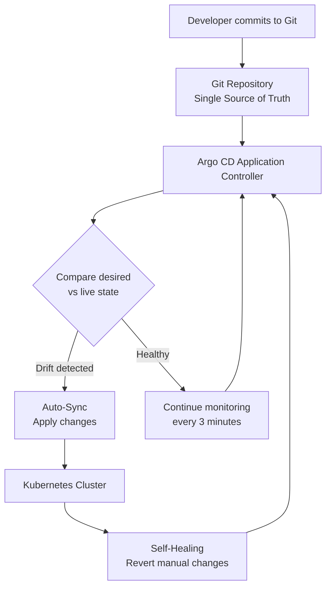

| Difficulty | Channel | Tags |
|---|---|---|
| beginner | devops | argocd, flux, declarative |

Picture 500,000 bare-metal servers running 5 million containers across more than 250 Kubernetes clusters. That is LinkedIn's everyday reality, where teams ship over 100,000 deployments each week using Argo CD to declare desired state in Git [1]. Here is the plot twist that should make every DevOps engineer sit up: despite a 3.7x explosion in deployment volume, infrastructure failures dropped from 925 to 63, and the median time to detect and conclude a failed deployment shrank from 16.1 minutes to just 2.45 minutes [1]. The secret was not more human vigilance—it was a fundamental shift in how changes reach production.

---

> ### Real-World Case — LinkedIn
>
> LinkedIn runs Kubernetes on 500,000+ bare-metal servers: 250+ clusters, 5 million containers, 4,000+ services and 100,000+ deployments per week. It started by giving each cluster its own Argo CD instance, with application teams declaring desired state as Helm charts in Git and Argo CD reconciling, auto-syncing and self-healing the live clusters.
>
> | | |
> |---|---|
> | **Challenge** | At scale, continuous reconciliation became the problem: a single shared watch per Kubernetes resource type meant churn from one app slowed every rollout (syncs under 3 minutes at 60,000 pods but over 10 minutes above 80,000 pods); stale repository cache could make Argo CD compute an unintended target revision; Kubernetes managedFields truncation after 10 field managers left zombie containers that PATCH-based apply failed to remove; and routine OutOfSync states were mistaken for real drift. Maintaining 200+ Argo CD instances turned upgrades into multi-week projects. |
> | **Solution** | LinkedIn replaced the shared-controller model with its own GitOps engine: a library running each deployment in an isolated ephemeral pod, with authoritative PUT (never PATCH) semantics, three-way drift detection, synchronous convergence and first-class error reporting, while keeping Argo CD for cluster add-ons and system services. |
> | **Outcome** | Despite a 3.7x increase in deployment volume, deployment-infrastructure failures fell from 925 to 63, and median time to detect and conclude a failed deployment dropped from 16.1 minutes to 2.45 minutes. Argo CD had still successfully onboarded 4,000 services across hundreds of clusters before the switch. |
> | **Lesson** | Declarative Git desired state and self-healing are powerful, but a long-running controller continuously reconciling shared watches can create false drift and fleet-wide slowdowns at extreme scale. Knowing when to stop extending a general-purpose tool and build a purpose-fit engine matters more than dogmatically applying GitOps patterns. |

---

## Hook — Everyone Says More Automation Means More Complexity. LinkedIn Proved the Opposite

Picture this: a developer runs kubectl apply directly against a production cluster at 3am to 'quickly fix' a failing pod. That one command creates an invisible crack—the live cluster now disagrees with what Git declares, and no version control system recorded the change. Multiply that risk across 250 clusters and 4,000 services, and the stakes become terrifying. LinkedIn stared into this exact abyss while managing half a million bare-metal servers [1]. 🔥 Hot Take: The biggest threat to production is not bad code—it is good intentions executed imperatively. You might think manual fixes are faster, but actually they are silent time bombs. So how does a team ship 100,000+ deploys per week without the whole thing unraveling? That question is where this story begins.

## Problem — The Silent Killer Hiding in Your kubectl Commands

Building on this tension, the core problem becomes painfully clear. Manual, imperative changes create three interconnected nightmares that compound at scale:

• **Configuration drift**: When kubectl commands bypass Git, environments slowly diverge. What runs in production no longer matches what anyone thinks should run.
• **Zero auditability**: Without a Git commit, there is no record of who changed what, when, or why. Debugging becomes archaeology.
• **Painful rollbacks**: Reverting an imperative change means knowing the exact inverse command. Good luck reconstructing that at 2am.

⚠️ Watch Out: Many developers think 'it is just a one-time fix,' but that one-time fix becomes tomorrow's incident. Sound familiar?

At LinkedIn's scale—4,000+ services and over 100,000 weekly deployments—these problems are not minor annoyances; they are existential threats. The old approach of logging into clusters and running commands simply cannot survive contact with that volume. Therefore, something has to change the fundamental contract between developers and infrastructure.

## Real-World Case — LinkedIn

Here is where the story takes a fascinating turn. LinkedIn did not start with some exotic custom tool. The team began by giving each Kubernetes cluster its own Argo CD instance, with application teams declaring desired state as Helm charts in Git [1]. Argo CD dutifully reconciled, auto-synced, and self-healed the live clusters—a textbook declarative GitOps setup.

The results were staggering:
• Deployment-infrastructure failures plummeted from 925 to 63
• Median time to detect and conclude a failed deployment dropped from 16.1 minutes to 2.45 minutes
• All of this happened despite a 3.7x increase in deployment volume [1]

💡 Insight: Notice the counterintuitive pattern—more deploys, fewer failures. That is the power of declarative reconciliation.

But wait, it gets better: Argo CD had already successfully onboarded 4,000 services across hundreds of clusters when the engineering team made a surprising decision. They replaced the vanilla Argo CD setup with a custom GitOps engine [1]. Why would a team abandon a tool that was clearly delivering results? The answer reveals a deeper lesson about scaling GitOps—and it starts with understanding what declarative really means.

## Deep Dive — Declarative vs Imperative, and Why the Distinction Changes Everything

This leads directly to the heart of the matter: what separates declarative from imperative approaches, and why does the distinction matter so much?

With the declarative approach, developers define the complete desired state in version control using YAML manifests, Helm charts, or Kustomize overlays [2][5][6]. Argo CD continuously monitors the cluster and reconciles actual state with that declared target [2]. Every change flows through a Git commit, which means every change is reviewable, attributable, and reversible.

In contrast, the imperative approach uses kubectl commands to make direct changes to the cluster [3]. The Git repository stops being the source of truth. Configuration drift creeps in, and rollbacks become manual guesswork.

Here is the real tradeoff:

| Aspect | Declarative (GitOps) | Imperative (kubectl) |
|--------|---------------------|---------------------|
| Source of truth | Git repository | Live cluster state |
| Audit trail | Automatic via commits | Manual logging required |
| Rollbacks | Git revert | Reconstruct inverse commands |
| Drift handling | Self-healing automatic | Manual detection and fix |
| Learning curve | Steeper upfront | Familiar to most developers |
| Best for | Teams, production, scale | Quick debugging, exploration |

🎯 Key Point: Declarative is not always better—it is better for repeatable, collaborative, production-grade work. Imperative still wins for one-off debugging sessions.

When would developers actually use each? Use declarative GitOps for anything that lives longer than a coffee break. Keep imperative commands in your back pocket for emergency debugging, but always commit the fix back to Git afterward.

Argo CD makes this concrete through an Application Custom Resource that points to a Git repository [2]. Auto-sync polls that repository on a configurable interval—typically every 1-5 minutes—and applies any differences. Self-healing goes further: if someone manually changes a resource, Argo CD reverts it automatically. Health checks ensure the controller knows when a deployment is truly healthy, not just when YAML was applied.

## Workflow — From Git Commit to Healthy Cluster in Six Steps

Building on these concepts, the practical workflow follows a clear path from commit to cluster. The Mermaid diagram below maps the entire reconciliation loop visually:



Here is the step-by-step journey:

1. **Declare**: application teams push Helm charts or Kustomize overlays to a Git repository [5][6].
2. **Define**: an Argo CD Application CRD points to that repository, specifying the target cluster and namespace [2].
3. **Detect**: the controller polls every 3 minutes (configurable), comparing desired state against live state.
4. **Reconcile**: on detecting drift, auto-sync applies the declared state to Kubernetes [3].
5. **Heal**: self-healing reverts any unauthorized manual changes, closing the loop.
6. **Verify**: health checks confirm the deployment is genuinely healthy.

💡 Insight: The loop never stops. That is the whole point—continuous reconciliation turns drift from a crisis into a non-event.

Many developers skip step 6, assuming 'synced' means 'working.' It does not. Health checks are what separate blindly applying YAML from actually running a healthy service.

## Code Example — Wiring Up Auto-Sync and Self-Healing

Now for the hands-on part. The bash script below creates a production-ready Argo CD Application with auto-sync, self-healing, and namespace creation enabled. It solves the exact problem described earlier: making Git the source of truth and preventing manual drift.

```bash
#!/bin/bash
# Create an Argo CD Application with auto-sync and self-healing

# Pipe the Application CRD directly into kubectl - no temp files needed
cat <<EOF | kubectl apply -f -
apiVersion: argoproj.io/v1alpha1
kind: Application
metadata:
  name: microservice-app
  namespace: argocd
spec:
  project: default
  source:
    repoURL: https://github.com/your-org/k8s-manifests.git
    targetRevision: HEAD          # Track the latest commit in Git
    path: overlays/production     # Kustomize overlay for production
  destination:
    server: https://kubernetes.default.svc
    namespace: production
  syncPolicy:
    automated:
      prune: true                 # Remove resources deleted from Git
      selfHeal: true              # Revert unauthorized manual changes
    syncOptions:
    - CreateNamespace=true        # Auto-create the namespace if missing
EOF

# Block until the app is healthy (5-minute timeout)
argocd app wait microservice-app --health --timeout 300

# Print the final sync state for verification
argocd app get microservice-app
```

The script works in four steps:
1. The cat heredoc pipes an Application CRD manifest directly into kubectl apply, avoiding temporary files.
2. The spec.source block points to the Git repository holding Helm charts or manifests, with targetRevision set to HEAD for the latest commit.
3. The syncPolicy.automated section enables prune (removing resources deleted from Git) and selfHeal (reverting manual changes)—this is the heart of the GitOps contract.
4. argocd app wait blocks until the deployment reports healthy, with a 5-minute timeout, then argocd app get prints the final state for verification.

⚠️ Watch Out: Set prune: false initially until the team trusts the setup. An accidental deletion in Git can wipe out production resources if prune is enabled.

## Lessons Learned — Battle Scars, Pro Tips, and What to Do Tomorrow

After following this journey from drift to declarative redemption, several battle-tested lessons emerge.

**Battle scars and how to avoid them:**

• **Forgetting to commit imperative fixes**: developers often debug with kubectl, fix the issue, and walk away. Always commit the corrected manifest back to Git, or self-healing will undo the fix at the next sync cycle.
• **Overly aggressive sync intervals**: polling every 10 seconds sounds responsive but can hammer the API server. Stick to 1-5 minutes for most workloads.
• **Ignoring health checks**: a synced application is not necessarily a healthy one. Configure custom health checks for CRDs that Argo CD does not understand out of the box.
• **No RBAC boundaries**: giving every developer full Argo CD admin rights defeats the audit benefits. Use Projects to scope access [2].

🔥 Hot Take: The most dangerous phrase in DevOps is 'just this once.' Declarative systems do not care about intentions—they care about declarations.

Here is the pro tip after debugging this pattern many times: start with self-healing disabled, observe sync behavior for a week, then enable it. Teams that flip everything on at once usually spend the first incident figuring out which knob broke what.

The LinkedIn story comes full circle here. Their journey from 925 failures to 63 was not magic—it was the disciplined application of declarative principles, even when the team eventually outgrew vanilla Argo CD [1]. If this feels overwhelming, you are not alone; every team starts with a single Application CRD and builds from there.

---

## GitOps Reconciliation Flow


<details>
<summary><strong>Original Interview Question</strong></summary>

**Q:** You're setting up GitOps for a microservices deployment. How would you configure ArgoCD to automatically sync changes from your Git repository to Kubernetes, and what's the difference between declarative and imperative approaches in this context?

**A:** I'd configure ArgoCD by setting up a Git repository containing Kubernetes manifests or Helm charts, creating an Application CRD that points to the Git repository, enabling auto-sync with a health check interval of 3 minutes, and implementing self-healing to automatically revert any manual changes. The declarative approach involves defining the desired state in Git through YAML manifests, Helm charts, or Kustomize configurations, where ArgoCD continuously reconciles the actual state with the desired state. In contrast, the imperative approach uses kubectl commands to make direct changes to the cluster, bypassing the Git repository as the single source of truth.

</details>

## Conclusion

So what should change tomorrow? Start by auditing one production service: does its live configuration match what Git declares? If the answer makes you uncomfortable, that discomfort is the beginning of your GitOps journey. Configure an Argo CD Application with auto-sync and self-healing, set a sensible 3-minute health check interval, and watch drift become a thing of the past. The memorable insight to share with any team: GitOps does not eliminate human mistakes—it makes them visible, reversible, and impossible to hide. LinkedIn turned 500,000 servers from a drift nightmare into a deployment machine by trusting declarations over commands [1]. Your team can start with a single Application CRD today. The next failed deploy does not have to be a 16-minute mystery—it can be a 2.45-minute blip.

---

## References

1. [LinkedIn incident report](https://www.linkedin.com/blog/engineering/infrastructure/how-we-scale-deployments-with-a-custom-gitops-engine) — article
2. [Argo CD GitHub Repository](https://github.com/argoproj/argo-cd) — documentation
3. [Kubernetes Objects Documentation](https://kubernetes.io/docs/concepts/overview/working-with-objects/kubernetes-objects/) — documentation
4. [GitOps - Wikipedia](https://en.wikipedia.org/wiki/GitOps) — documentation
5. [Helm GitHub Repository](https://github.com/helm/helm) — documentation
6. [Kustomize GitHub Repository](https://github.com/kubernetes-sigs/kustomize) — documentation
7. [Kubernetes Deployments Documentation](https://kubernetes.io/docs/concepts/workloads/controllers/deployment/) — documentation
8. [Flux CD GitHub Repository](https://github.com/fluxcd/flux2) — documentation

---

**Author:** Satishkumar Dhule — [GitHub](https://github.com/satishkumar-dhule) · [LinkedIn](https://linkedin.com/in/satishkumar-dhule) · [Website](https://satishkumar-dhule.github.io)
