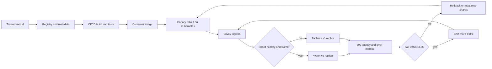

| Difficulty | Channel | Tags |
|---|---|---|
| beginner | devops | mlops, deployment |

Picture a dashboard where every gauge is green: fleet-wide CPU looks calm, the ads pipeline is shipping, and every deployment check passed. Then the timeout alerts start. Meta's ads inference platform discovered that its sharded, multi-model hosts hid a chronically overloaded top 5% behind a healthy average, and fixing that blind spot let the fleet absorb 35% more load without a single extra machine [1]. That is the real lesson behind model serving versus model deployment: one gets the model to production, the other decides whether production survives the model.

---

> ### Real-World Case — Meta
>
> Meta's ads delivery system routes each ad request to a sharded inference platform where every model is a shard and multiple models share hosts. The team discovered that fleet-wide average CPU utilization looked healthy while the top 5% of servers by utilization were chronically overloaded, timing out and forcing massive overprovisioning of the entire cluster.
>
> | | |
> |---|---|
> | **Challenge** | Load balancing relied on stale host-level load counters that assumed every replica did equal work, but multi-tenancy broke that assumption. Snapshot transitions (swapping newly deployed model versions into production) during peak traffic, reactive autoscaling lag, and memory-bandwidth stalls at 65-70% CPU all amplified the utilization tail. |
> | **Solution** | They redesigned the serving stack with 'power of two choices' routing using fresh polled load data, per-model load counters aligned across ServiceRouter, Shard Manager and ReplicaEstimator, memory-bandwidth-aware replica placement, snapshot-transition budgets that gate model rollouts when utilization is high, and predictive replica estimation up to two hours ahead. |
> | **Outcome** | The fleet absorbed up to 35% more load with no additional capacity, timeout error rates fell by two-thirds, and p99 latency was cut in half. |
> | **Lesson** | Average utilization hides the real constraint in model serving — the tail determines required headroom. Deployment mechanics like snapshot transitions and replica estimation must be capacity-aware or they destabilize runtime serving even when the fleet looks idle on paper. |

---

## Hook — The dashboard lied

A green dashboard is a wonderful thing, right up until the timeout alerts start firing. Picture a fleet where average CPU sits comfortably in the middle of the range, capacity planners are relaxed, and every model rollout passed CI. Underneath that calm average, a small set of shards is gasping for breath while the rest of the fleet idles.

💡 Insight: averages are great for storytelling and terrible for latency. The question that should keep you up at night is not 'what is the mean?' but 'what is the top 5% doing right now?'

That question turns a boring infrastructure distinction into a production thriller, and it is exactly where the deployment-versus-serving story begins.

## Problem — Two words that get mixed up until something breaks

Deployment and serving sound like synonyms in standups, so teams blur them into one giant 'ship the model' task [2]. But they answer different questions: deployment asks whether the artifact, config, infrastructure, and rollback path are reproducible, while serving asks whether a specific request gets a correct prediction back before the client gives up.

Here is what you need to know:
- Deployment covers CI/CD, image builds, infrastructure provisioning, registry metadata, monitoring hooks, and rollback strategy [3].
- Serving covers the hot path: request parsing, routing, model loading, batching, version pinning, and response serialization.
- Mixing them means a clean deploy can still produce a terrible user experience, because the model is present but the hot path is slow.

⚠️ Watch Out: a deployment that succeeds is not evidence that an inference request will meet its SLO. Teams have all been there: the rollout is green, p99 is on fire, and somebody is staring at a 500 error at 2am.

So where does the failure actually show up first?

## Real-World Case — Meta

Meta's ads delivery system routes each ad request to a sharded inference platform where every model is a shard and multiple models share physical hosts [1]. The average CPU number looked healthy, which is the sort of number that makes capacity planning meetings short. The trouble was that the top 5% of servers by utilization were chronically overloaded, timing out and quietly forcing the entire cluster to be overprovisioned just to keep the tail happy.

The fix was not 'add more GPUs', the obvious and expensive answer. Meta rebalanced placement so hot shards got room to breathe, which let the fleet absorb up to 35% more load with no additional capacity, cut timeout error rates by two-thirds, and halved p99 latency [1].

🔥 Hot Take: the cluster was not short on capacity. It was short on honesty about where that capacity was going.

This is the moment the distinction becomes real: deployment had placed models everywhere it was told to, while serving revealed which placements actually survived contact with traffic. Kubernetes autoscaling docs describe similar behavior when aggregate metrics mask per-replica pressure [4], and horizontal pod autoscaling only helps when the signal fed into it reflects the pain that matters [5].

## Deep Dive — The line between getting there and being there

Building on that discovery, treat deployment as the journey and serving as the destination. Deployment is the set of controls that make a change safe to attempt; serving is the runtime machinery that makes each request fast, correct, and observable.

| Question | Deployment answers | Serving answers |
|---|---|---|
| Artifact | Is the model, image, and config versioned? | Which version answers this request? |
| Traffic | How does the rollout reach the fleet? | Which replica handles this call? |
| Failure | Can the system roll back in minutes? | Can it fail over without a timeout? |
| Signal | Did the rollout succeed? | What are p99 and error rate right now? |

Tooling follows that split. MLflow tracks runs, metrics, and model versions [6]; TensorFlow Serving and TorchServe expose optimized inference endpoints for their ecosystems [7][8]; BentoML packages models into service containers with its own serving layer [9]. Envoy or NGINX sits in front for load balancing [10], managed platforms such as SageMaker collapse several deployment steps into one control plane [11], and gRPC over HTTP/2 is common on the hot path because multiplexing and binary frames reduce overhead [12].

Here is the tradeoff table nobody puts in the interview answer:

| Choice | Buys you | Costs you | Use it when |
|---|---|---|---|
| Real-time inference | Low latency per request | Idle accelerator time, tight budget | Ads, recommendations, fraud checks |
| Batch inference | High throughput, cheap compute | Stale predictions | Daily scoring, reports, backfills |
| Vertical scaling | Bigger model, fewer moving parts | Hard ceiling, expensive hosts | One large model needs more memory |
| Horizontal scaling | Fault tolerance, elastic capacity | Routing complexity, cold starts | Traffic is spiky or sharded |

💡 Insight: latency and throughput are not the same boss fight. Latency is a per-request promise; throughput is a fleet-level appetite. Optimizing one can quietly wreck the other.

Cold starts are the plot twist. A fresh replica looks healthy to a readiness probe but has not warmed its weights, JIT, or caches, so the first real requests pay the tax. Many developers think autoscaling fixes this until they watch a scale-up event produce a latency spike instead of relief.

When would a dedicated model server beat a thin FastAPI wrapper? Choose it when model versioning, batching, and hardware-aware scheduling matter more than application flexibility; otherwise a small service with a model client is perfectly respectable.

## Workflow — From registry to a p99 that behaves

This leads to the part that actually runs at 3am: the workflow. The diagram below connects the deployment track, from registry to rollout, with the serving track, from routing to warm fallbacks and feedback.

Step by step:
1. Register the model with its version, metrics, and lineage before any container exists [6].
2. Build and test the image in CI; treat config as versioned code, not a midnight environment-variable edit.
3. Roll out as a canary, not a fleet-wide flip, so a bad shard is a small incident instead of a headline.
4. Keep at least one previous version warm as a fallback, because cold starts are a latency trap.
5. Route through a proxy that can shed or shift traffic based on per-shard health, not fleet averages [10].
6. Watch p99, timeout rate, inflight requests, and model version together; a single golden metric hides exactly the Meta failure mode.
7. Feed the signal back into placement and autoscaling, and only then widen the rollout.

🎯 Key Point: every arrow back to the rollout is a deployment action triggered by a serving signal. That loop is the whole job.

## Code Example — A tail-aware router in Python

Building on the workflow, here is a small but production-shaped router that refuses to send traffic to a cold or saturated shard. It is deliberately dependency-light so the pattern is easy to read, and the final call stands in for TensorFlow Serving, TorchServe, or BentoML [7][8][9]. The full snippet lives in the `codeExample` field.

What matters is not the math; it is the control flow. A per-shard inflight counter is guarded by a lock, so the admission decision is atomic under concurrency. Exceed the cap and traffic goes to a warm fallback version instead of piling onto the hot shard. Bounded workers prevent a traffic spike from creating an unbounded number of threads, which is a classic way to turn a latency problem into an outage [13]. Finally, elapsed time is recorded on every path, including failures, so the p99 curve reflects reality rather than only successes.

⚠️ Watch Out: never let a fallback version silently serve forever. Emit a metric for fallback usage and alert on it, or the workaround becomes the new normal.

## Lessons Learned — What to do tomorrow morning

The journey from a green dashboard to Meta's 35% capacity win comes down to a handful of habits.

- Measure tails, not averages. Track p95/p99, timeout rate, inflight requests, cache hit rate, and fallback usage per model version.
- Split ownership clearly: deployment owns reproducibility and rollback; serving owns routing, warm state, and latency SLOs.
- Keep a warm previous version and practice the rollback. A rollback that has never been exercised is a slide, not a strategy.
- Prefer canaries and traffic splitting over big-bang releases, especially when models share hosts.
- Batch when latency allows; go real-time when the product demands it, and be honest about the cost.
- Treat cold starts as a first-class failure mode: pre-warm on scale-up, and never route to a replica before weights are loaded.

💡 Insight: the most expensive model in the fleet is the one everyone assumes is fine because the average says so.

Battle scars to avoid: shipping a model without a versioned config, autoscaling on CPU when the bottleneck is GPU memory, skipping the readiness check on a fresh replica, and celebrating a 99% success rate while the unlucky 1% is the paying customer.

So what changes tomorrow? Add one dashboard panel that shows per-shard p99 and utilization side by side. Then ask the uncomfortable question: if the top 5% of hosts disappeared, would the fleet notice, or would customers?

---

## Deployment-to-Serving Flow

<strong>Original Interview Question</strong>

**Q:** Explain the key differences between model serving and model deployment in ML systems, including specific technologies, scaling considerations, and real-world implementation patterns?

**A:** Deployment encompasses CI/CD pipelines, infrastructure setup, and monitoring using tools like Kubernetes, MLflow, and SageMaker. Serving focuses on runtime inference APIs with frameworks like TensorFlow Serving, TorchServe, or BentoML, handling request routing, model versioning, and autoscaling. Key trade-offs include latency vs throughput, batch vs real-time inference, and cold start optimization.

## Conclusion

The moral of the story is simple: deployment gets the model to the party, while serving decides whether it can hold a conversation. Meta's fleet looked healthy in aggregate and still hid a tail that was timing out, because averages are polite and p99 is honest [1]. The next improvement probably does not live in a new algorithm; it lives in the unglamorous loop of versioned rollouts, warm fallbacks, per-shard metrics, and rollbacks that actually get tested.

One insight to take to your team: never trust a fleet-wide average to tell you how a single request feels.

---

## References

1. [Meta incident report](https://engineering.fb.com/2024/07/10/production-engineering/tail-utilization-ads-inference-meta) — article
2. [Machine Learning Operations (MLOps): Overview, Definition, and Architecture](https://arxiv.org/abs/2205.02302) — paper
3. [Towards ML Engineering: A Brief History Of TensorFlow Extended (TFX)](https://arxiv.org/abs/2010.02013) — paper
4. [Kubernetes: Autoscaling](https://kubernetes.io/docs/concepts/workloads/autoscaling/) — documentation
5. [Kubernetes: Horizontal Pod Autoscaling](https://kubernetes.io/docs/tasks/run-application/horizontal-pod-autoscale/) — documentation
6. [MLflow source repository](https://github.com/mlflow/mlflow) — documentation
7. [TensorFlow Serving source repository](https://github.com/tensorflow/serving) — documentation
8. [TorchServe source repository](https://github.com/pytorch/serve) — documentation
9. [BentoML source repository](https://github.com/bentoml/BentoML) — documentation
10. [Envoy proxy source repository](https://github.com/envoyproxy/envoy) — documentation
11. [AWS SageMaker documentation](https://docs.aws.amazon.com/sagemaker/latest/dg/whatis.html) — documentation
12. [RFC 7540: Hypertext Transfer Protocol Version 2 (HTTP/2)](https://datatracker.ietf.org/doc/html/rfc7540) — documentation

---

**Author:** Satishkumar Dhule — [GitHub](https://github.com/satishkumar-dhule) · [LinkedIn](https://linkedin.com/in/satishkumar-dhule) · [Website](https://satishkumar-dhule.github.io)
