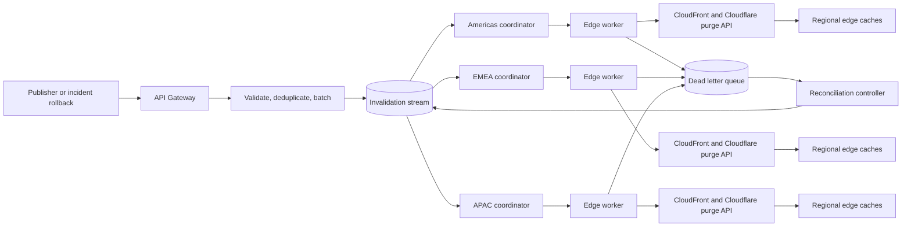

| Difficulty | Channel | Tags |
|---|---|---|
| intermediate | system-design | edge, caching, purging |

Cloudflare's original purge path had a geography problem: a purge issued in Australia could travel to a central core data center, then back across the Pacific, before edge caches ever heard about it [1]. As the network grew to hundreds of data centers and millions of purge API calls each day, that hub-and-spoke design turned invalidation into a latency tax, a disk-space tax, and a reliability risk [1]. The lesson reaches far beyond one company: a purge that looks like a simple POST request is actually a distributed coordination race against stale content. The journey below follows the path from hard limits to a design that chases a 5-second global SLA while surviving 10,000 invalidations per second.

---

> ### Real-World Case — Cloudflare
>
> Cloudflare's original cache purge system, built over a decade ago, distributed invalidations from centralized 'core' data centers using their Quicksilver hub-and-spoke configuration store. As the network grew to hundreds of data centers with thousands of customers issuing millions of purge API calls daily, the system hit hard limits: a purge from Australia had to cross the Pacific and back, central write bottlenecks added latency, and storing purge history ate into cache disk space on every machine.
>
> | | |
> |---|---|
> | **Challenge** | Deliver truly global cache invalidation that propagates in well under 5 seconds while scaling to millions of purge requests per day — without latency or storage costs growing linearly with throughput, and without a single central ingest point becoming a bottleneck. |
> | **Solution** | They rebuilt it as 'Coreless Purge': ingest moved to the edge using Cloudflare Workers and Durable Objects with peer-to-peer distribution instead of hub-and-spoke. They introduced CacheDB, a Rust sidecar service built on RocksDB running on every cache machine, which maintains per-machine indexes of cached files plus a local purge queue for immediate 'active purge' (the proxy checks the queue on cache HIT). Kafka queues, batching, and 'lazy purge' were interim stopgaps — once per-machine RocksDB indexing proved feasible, they reversed the lazy-purge decision entirely. |
> | **Outcome** | Global P50 purge latency fell from 1,570ms (May 2022) to 149ms (August 2024) — a 90.5% improvement — across 330+ cities in 120+ countries. Regional gains ranged from 78.66% (Africa) to 88.99% (Western Europe). The redesign saved 10x storage, improved cache hit ratios, and enabled opening tag/hostname/prefix purges to all plan types (previously Enterprise-only). Single-file purges hit 234ms P50. |
> | **Lesson** | Centralized control planes optimize for consistency but become the scaling bottleneck at global scale — pushing ingest to the edge with per-machine indexes eliminates both transoceanic round trips and central write contention. And revisit 'settled' architecture decisions: lazy purge was abandoned once RocksDB made active purge efficient enough. |

---

## Hook — The round trip that made stale content global

Ever wondered why a one-line CDN purge can make a senior engineer reach for a map? Picture a newsroom publishing a corrected headline, a shop changing a price, or a team rolling back a bad deploy while thousands of edge caches keep serving yesterday's bytes. For example, Cloudflare's old system pushed invalidations from centralized core data centers through a hub-and-spoke configuration store, so distance became part of the API call [1]. Content delivery networks exist to move data close to users [7], but the purge path in that design moved coordination far away from them.

💡 Insight: The scary part is not the average case; it is the tail when a regional operator waits on a transoceanic round trip while customers refresh a stale page. The next question is simple: what breaks when that pattern repeats 10,000 times per second?

## Problem — 10,000 invalidations per second is not a loop

That distance becomes a real system problem the moment the requirements stack up: fewer than 5 seconds for global propagation, 10,000 invalidations per second, 99.99% availability, and consistency that developers can reason about. At that scale, every purge is a write to distributed state, every retry is extra pressure, and every provider call has a cost. However, HTTP caching defines freshness and revalidation rules, not magic global erase buttons [8].

Many developers discover this the hard way: a 200 response from a purge API means accepted, not propagated. Short headers such as `Cache-Control: max-age=2, must-revalidate` reduce the blast radius [3], while documented invalidation flows explain how providers accept purge requests [2], but neither removes the need for coordination.

⚠️ Watch Out: Treating every invalidation as an individual synchronous call is the classic trap. A single call is harmless; 10,000 concurrent calls are a self-inflicted denial of service with a cloud bill attached.

Use this design when stale data has business cost: breaking-news media, product pricing, flash sales, feature flags, or incident rollbacks. The stakes are highest when a wrong byte is worse than a slow request. So where does the bottleneck actually live?

## Real-World Case — Cloudflare

Building on that pressure, Cloudflare's original cache purge system, built over a decade ago, had three distinct constraints. First, invalidations were distributed from centralized core data centers using Quicksilver, the company's hub-and-spoke configuration store [1]. Second, a purge initiated in Australia could cross the Pacific and come back before the edge began purging. Third, storing purge history consumed cache disk space on every machine, which meant the system paid a storage tax for coordination metadata.

The numbers show why this was not an academic exercise. Across more than 330 cities and 120 countries, global P50 purge latency fell from 1,570ms in May 2022 to 149ms in August 2024, a 90.5% improvement [1]. Regional improvements ranged from 78.66% in Africa to 88.99% in Western Europe, single-file purges reached 234ms P50, and the redesign saved 10x storage while improving cache hit ratios [1].

Moreover, the plot twist is that the win came from rethinking ownership and locality, not from simply making the old central path faster. The redesign also opened tag, hostname, and prefix purges to all plan types, turning a former Enterprise-only capability into a baseline expectation [1]. If the biggest gain came from moving coordination outward, what exactly should be moved?

## Deep Dive — Topology, TTLs, queues, and truth

The Cloudflare story points to a broader rule: purge propagation is a topology problem before it is an API problem. A CDN keeps content near users [7], therefore a purge system should keep decisions near regions too. Central control is still useful for auditing, deduplication, and batching, but regional coordinators should own the final fan-out. Consequently, a purge system that looks elegant on a whiteboard can still fail if it makes Australia wait on a distant core.

### The tradeoff table

| Decision | Option A | Option B | Real tradeoff |
|---|---|---|---|
| Coordination | Central coordinator | Regional coordinators | Central is simple but adds cross-region latency; regional is faster but needs reconciliation |
| Invalidation scope | Exact URLs | Wildcard or tag purges | Exact is safer; patterns purge more content and can erase popular objects unnecessarily |
| Freshness | Short TTL | Instant purge | Short TTL is cheap resilience; purge is precise but creates API load |
| Delivery | Synchronous per purge | Queued batch stream | Immediate feedback feels good; queues protect throughput and provider limits |

When should this be used? Use regional coordinators when users span continents, use short TTLs when stale data must have a hard ceiling, use pattern purges when a whole content family is truly invalid, and use dead letter queues when replay matters more than pretending every call succeeds.

💡 Insight: A 2-second TTL is not an admission of defeat. It is a seatbelt: when the purge path trips, stale content has a short maximum life. HTTP caching standards already define how freshness and revalidation behave [8], and MDN documents the header semantics teams actually ship [3].

The queue is the shock absorber. Stream-style systems with consumer groups, or managed queues such as Amazon SQS [5], let 10,000 raw events become 100 batched calls when each batch holds 100 paths. API Gateway can absorb ingress and authentication [4], but only the queue can smooth bursts and give retries a durable place to live.

🔥 Hot Take: Strong consistency across every region at 10,000 invalidations/sec is less like a switch and more like a carefully negotiated contract. Network partitions force choices, so production designs pair fast regional convergence with reconciliation and observability; Kubernetes' controller pattern is a useful mental model for that continuous correction loop [6].

For implementation, edge workers can coordinate regional fan-out close to the CDN surface [10], while CloudFront-style invalidation APIs remain provider-specific [2]. Specifically, the next step is turning these ideas into a sequence that can be operated at 3am without folklore.

## Workflow — From publisher click to fresh edge bytes

With those tradeoffs clear, the workflow becomes a relay race. The diagram below shows how an invalidation moves from a publisher to regional edge coordinators, then into provider purge APIs and local caches.

Step by step, the flow works like this:

1. Accept and validate: the API gateway authenticates callers, normalizes paths, and rejects malformed wildcards before they pollute the queue [4].
2. Deduplicate and batch: repeated paths collapse into one event, and batches of 100 become the unit of work; this is where cost drops by up to 90% compared with per-file calls.
3. Fan out regionally: each regional coordinator pulls from its own consumer group, and only affected regions are purged, so APAC does not wait behind Americas or EMEA [5].
4. Purge at the edge: edge workers call provider APIs with backoff and jitter, using fetch-style requests and bounded timeouts [9].
5. Reconcile: failed batches land in a dead letter queue, health checks drain the backlog, and controllers compare expected versions with served versions [6].

🎯 Key Point: The SLA clock should start at user-visible change time and end when a sampled edge request returns fresh content, not when a provider API says 200 OK. Once measurement is honest, code can be shaped around the real bottleneck.

## Code Example — Batching invalidations without melting the API

The workflow needs code that protects the provider API instead of worshiping it. The TypeScript example in the codeExample field implements four pieces of that protection: a circuit breaker, bounded retries with jitter, a 100-path batch split, and a dead letter sink.

Specifically, the batching loop turns 10,000 paths into 100 calls, which is the difference between a controlled rollout and an incident with a pager attached. The Cloudflare adapter uses the documented fetch flow [9] and the provider's purge endpoint pattern [2]; the same interface can wrap CloudFront or another provider.

⚠️ Watch Out: Retrying every failure forever turns a provider outage into a self-written denial-of-service attack. Three retries, jitter, and a circuit breaker are calmer and cheaper. What should happen to the paths that still fail?

## Lessons Learned — Build the failure path first

After the architecture and code are in place, the lessons are less about exotic APIs and more about disciplined operations.

- Measure freshness at the edge. Cloudflare's 1,570ms to 149ms journey shows why percentile targets beat vague claims like fast [1].
- Batch before optimizing anything else. A four-to-six engineer platform team can usually get more win from batching and deduplication than from rewriting the queue.
- Keep a replayable failure trail. Dead letter queues are not graveyards; they are the evidence locker and the retry mechanism [5].
- Respect cache headers. Short TTLs with revalidation limit the damage when invalidation is slow or partial [3], and standards-based caching keeps behavior legible [8].
- Purge narrowly. Pattern purges are powerful, but broad wildcards can turn a correction into a self-inflicted cache miss storm.

🔥 Hot Take: Many teams buy more CDN capacity to fix a purge problem, then discover the bottleneck was coordination. Capacity helps traffic; purge speed comes from locality, batching, and truthful telemetry.

Common battle scars include accepting a purge API response as success, forgetting to deduplicate repeated paths, and allowing retries without jitter. Avoid them by tracking every path as a versioned event, using bounded retries, and comparing sampled edge responses against the expected version. Pro tip: log a trace identifier with every batch so edge samples can be tied back to the exact invalidation event.

🎯 Key Point: Design the failure path first. If failed invalidations can be replayed, observed, and explained, the happy path becomes almost boring. Boring is excellent for a 99.99% availability target.

---

## Invalidation Propagation Flow

<strong>Original Interview Question</strong>

**Q:** How would you design a multi-region CDN cache purging system that guarantees content propagation within 5 seconds while handling 10,000 concurrent invalidations per second?

**A:** Implement Cloudflare API + AWS CloudFront with distributed invalidation queue, edge compute coordination, and 2-second TTL. Use batch invalidation, exponential backoff, and regional cache headers for 5-second SLA.

## Conclusion

The Cloudflare journey began with a purge crossing an ocean and ended with a global P50 of 149ms [1]. The moral is not 'buy a faster CDN'; it is 'move coordination to where the bytes live, batch ruthlessly, and measure freshness where users actually see it.' Tomorrow, audit one purge path: count calls per invalidation, check whether headers provide a short safety net, and add a replayable failure queue. Leave your team with one sentence: a purge SLA is won at the coordination layer, not at the API endpoint.

---

## References

1. [Cloudflare incident report](https://blog.cloudflare.com/instant-purge/) — article
2. [Amazon CloudFront invalidation documentation](https://docs.aws.amazon.com/AmazonCloudFront/latest/DeveloperGuide/Invalidation.html) — documentation
3. [MDN Cache-Control header](https://developer.mozilla.org/en-US/docs/Web/HTTP/Headers/Cache-Control) — documentation
4. [Amazon API Gateway developer guide](https://docs.aws.amazon.com/apigateway/latest/developerguide/welcome.html) — documentation
5. [Amazon SQS developer guide](https://docs.aws.amazon.com/AWSSimpleQueueService/latest/SQSDeveloperGuide/welcome.html) — documentation
6. [Kubernetes controller pattern](https://kubernetes.io/docs/concepts/architecture/controller/) — documentation
7. [Wikipedia: Content delivery network](https://en.wikipedia.org/wiki/Content_delivery_network) — documentation
8. [RFC 9111: HTTP Caching](https://datatracker.ietf.org/doc/html/rfc9111) — documentation
9. [MDN Fetch API](https://developer.mozilla.org/en-US/docs/Web/API/Fetch_API) — documentation
10. [Cloudflare Workers SDK on GitHub](https://github.com/cloudflare/workers-sdk) — documentation

---

**Author:** Satishkumar Dhule — [GitHub](https://github.com/satishkumar-dhule) · [LinkedIn](https://linkedin.com/in/satishkumar-dhule) · [Website](https://satishkumar-dhule.github.io)
