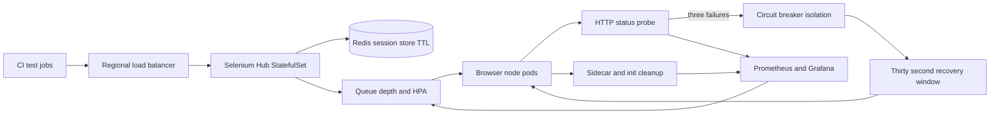

| Difficulty | Channel | Tags |
|---|---|---|
| advanced | system-design | selenium, webdriver, grid |

A test suite that used to take more than an hour dropped to six minutes at Zalando after the Engineering Productivity team stopped treating Selenium Grid like a permanent pet and started treating it like disposable infrastructure [1]. Their grid mixed dockerized Selenium nodes with paid Sauce Labs accounts, while Chrome and Firefox dominated and Safari, IE, and Edge waited in the long tail [1]. Keeping every browser/platform combination stable felt like herding cats, and sending the whole suite to the cloud made the bill look like a phone number. The hidden lesson is bigger than one company: at 10,000 concurrent sessions and 99.9% uptime, a grid lives or dies by session lifecycle control, observability, and graceful failure recovery.

---

> ### Real-World Case — Zalando
>
> Zalando's Engineering Productivity team ran UI tests on a mix of a dockerized Selenium Grid and paid Sauce Labs accounts, with Chrome/Firefox dominating and Safari/IE/Edge as a long tail. Keeping a static grid stable across every browser/platform combination was painful, and sending the whole suite to the cloud was expensive.
>
> | | |
> |---|---|
> | **Challenge** | Scale browser test execution elastically while preventing flaky state, zombie sessions, and memory leaks in long-lived nodes, and cover rare browser capabilities without paying cloud rates for every test. |
> | **Solution** | They built and open-sourced Zalenium: a Selenium Grid extension that creates a fresh docker-selenium container on demand for each session and destroys it the moment the test ends, making leaked memory and stale state structurally impossible. Capabilities the local grid cannot satisfy are transparently proxied to Sauce Labs, BrowserStack, TestingBot, CrossBrowserTesting, or LambdaTest; it runs in Docker and Kubernetes with video recording, live VNC preview, and a dashboard. |
> | **Outcome** | Official project site reports a user's test-suite runtime dropped from over an hour to six minutes; benchmark docs measured 50 tests at 10 threads in ~3m30s on an AWS c3.4xlarge and found degradation beyond ~16-18 concurrent containers. The project accumulated ~1,970 commits and its key features were folded into Selenium Grid 4. |
> | **Lesson** | The most reliable fix for browser-grid memory leaks is not GC tuning or cleanup sidecars but eliminating long-lived nodes entirely: one disposable container per session, destroyed on completion. Pair that with cloud fallback only for the rare capabilities, not the whole suite. |

---

## Hook — When ten thousand browsers knock at once

Release day turns that six-minute win into a cliffhanger when 10,000 sessions arrive at once. Every queue depth graph looks calm until it is not; then stale Chrome processes, half-closed WebDriver connections, and one forgotten browser volume turn into a queue that refuses to drain. Teams have all been there: green this morning, red by lunch, and a dashboard that says nothing useful. The stakes are simple and brutal: 99.9% uptime allows only about 43 minutes of downtime per month [16], so a slow leak is not a cosmetic bug. So what breaks first when the queue finally moves?

## Problem — The static grid that quietly rots

Building on that release-day pressure, the core challenge is not 'can Selenium Grid start browsers?' It is 'can the grid retire them reliably at scale?' Static dockerized nodes are easy on day one and brittle by month three: browser images drift, sessions orphan themselves when a CI runner dies, and memory climbs until the node becomes a slow, angry pet. Cloud-only accounts remove maintenance, but cost explodes when long-tail browsers and thousands of sessions enter the picture.

Many developers think more nodes solve latency; however, browser density has a cliff. Zalando benchmark docs measured 50 tests at 10 threads finishing in about 3m30s on an AWS c3.4xlarge, with degradation beyond roughly 16 to 18 concurrent containers [1]. Therefore, capacity planning without lifecycle planning is just expensive guesswork.

When would this actually be useful? Use this architecture when UI tests are a release gate, not a hobby project: parallel browser suites, frequent deploys, and multi-platform matrices turn session cleanup into a production concern. Here is the real tradeoff:

| Option | When it shines | Real tradeoff |
|---|---|---|
| Static docker grid | Small suites with stable browser images | Drift, memory creep, and 2 a.m. node babysitting |
| Cloud-only browsers | Rare Safari, IE, or Edge checks | High per-session cost at 10,000 runs |
| Kubernetes-backed grid | Bursty CI and multi-browser release gates | Requires TTLs, probes, quotas, and real ownership |

⚠️ Watch Out: a grid without TTLs is a memory leak wearing a load balancer costume. If 20% of 10,000 daily sessions are long-tail browser runs, that is 2,000 paid cloud sessions per day; keeping those runs on disposable capacity is where the savings live. But how did one team turn that expensive balancing act into a reusable grid?

## Real-World Case — Zalando

That pressure is exactly what Zalando faced. The Engineering Productivity team ran UI tests across a hybrid of dockerized Selenium Grid nodes and paid Sauce Labs accounts; Chrome and Firefox carried most of the work, while Safari, IE, and Edge formed the awkward long tail [1]. Keeping a static grid stable across every browser/platform combination was painful, yet sending the entire suite to a paid cloud provider was financially unattractive.

The fix became Zalenium: a disposable, flexible Selenium Grid layer that could combine local Docker capacity with cloud overflow. The official project site reports one user's test-suite runtime falling from over an hour to six minutes, while the benchmark docs captured the 50-test, 10-thread c3.4xlarge result and the degradation beyond roughly 16 to 18 containers [1]. The project accumulated about 1,970 commits, and key ideas eventually folded into Selenium Grid 4 [1][2].

🔥 Hot Take: the winning move was not 'rent more browsers.' It was making browser infrastructure temporary, observable, and replaceable. Zalando did not publish a dollar savings figure in the source, but the cost curve is obvious: rare browsers should not become permanent infrastructure. The obvious next question: what does that design look like when multiplied by fifty?

## Deep Dive — Sessions, capacity, and failure domains

Building on Zalando's disposable-grid lesson, a 10,000-session architecture rests on four contracts: capacity, session lifetime, health, and failure isolation. Start with the arithmetic. If a browser node safely handles 50 concurrent sessions, 10,000 sessions require at least 200 nodes. At 2GB RAM and 1 CPU per pod, the baseline is 400GB of memory; add a 30% buffer and the cluster target becomes roughly 520GB [4].

Capacity alone is not enough, so the second contract is lifecycle control. Redis stores session metadata with TTL-based expiration, connection pooling, and automated key scans, which makes abandoned sessions expire instead of haunting the grid forever [6]. 💡 Insight: treat every WebDriver session as a lease with an exit door, not as a process that might politely clean itself up. Recycling nodes through rolling updates, watching memory at 80%, and tuning garbage collection close the loop [11].

The third contract is health. Kubernetes probes can check a Selenium /status endpoint every 10 seconds and remove a node after three consecutive failures [5]. Prometheus then records memory trends, session duration, and node churn, turning vague suspicion into graphs developers can argue with productively [7]. Circuit breakers isolate unhealthy nodes for about 30 seconds, with Hystrix-style patterns preventing one bad node from poisoning every request [17].

The fourth contract is failure isolation across data centers and availability zones. Regional load balancing targets P99 session initiation under 2 seconds [10], while cluster autoscaling adds browser capacity from queue depth rather than hope [3][9]. Pod Disruption Budgets preserve at least 85% capacity during voluntary disruptions [8], and Kubernetes leases help prevent split-brain decisions during network partitions [13].

⚠️ Watch Out: resource quotas and CPU limits without memory limits are half a seatbelt [4]. For a two-to-four-person platform team, the practical order is TTL first, probes second, autoscaling third, and fancy dashboard art last. Pro tip: canary new browser images on a small traffic slice before promoting them across the fleet. Could a simple flow keep all of it honest?

## Workflow — From test request to clean exit

This leads to the operational choreography that turns architecture diagrams into boring, beautiful reality. The Mermaid diagram below, labelled Grid Session Lifecycle, shows the path from a CI request to a clean exit.

1. A CI job asks the regional load balancer for a browser session; traffic lands near the caller instead of wandering across data centers [10].
2. The Selenium hub creates a session lease in Redis with a TTL, renews it while active, and lets expiration handle orphaned callers [6].
3. Weighted scheduling selects a browser pod based on capacity and recent response time; queue depth feeds the horizontal pod autoscaler [3].
4. Each browser pod runs with explicit CPU and memory limits so a runaway Chrome process cannot eat the neighborhood [4].
5. A health check hits /status every 10 seconds; three consecutive failures remove the node from rotation [5].
6. A circuit breaker isolates the failing node for a 30-second recovery window, then allows a cautious return [17].
7. Init containers and sidecars clear stale volumes and session residue, while Prometheus captures memory and session-duration metrics [7][12].
8. Pod Disruption Budgets protect minimum capacity during maintenance, and rolling updates replace nodes without turning the grid into a campfire [8][11].

🎯 Key Point: the workflow is not one giant controller; it is a chain of small leases, probes, budgets, and cleanup steps that each fail safely. What does that lifecycle loop look like in code?

## Code Example — TTLs and circuit breakers that actually fire

Now that the choreography is clear, the implementation focuses on the part that prevents the slow bleed: session TTLs plus node isolation. Python's asyncio is enough to drive the periodic monitor loop, while Redis handles lease expiry [6][14]. The complete snippet lives in the codeExample field; the walkthrough below explains the moving parts.

1. Constants set a 30-minute session TTL, a 10-second probe cadence, a 30-second quarantine window, and a three-failure threshold.
2. CircuitBreaker tracks consecutive health failures, clears state after a healthy probe, and blocks nodes whose quarantine window is still open.
3. create_session writes a Redis hash and attaches an expiry, so a crashed CI runner cannot leave a session behind forever.
4. close_session deletes healthy completions immediately instead of waiting for expiration.
5. sweep_orphans scans for keys that vanished between discovery and inspection, acting as a safety net rather than the primary cleanup mechanism.
6. monitor_nodes checks every browser node, applies breaker state, and sleeps between rounds; in production, probe_node should become a short HTTP fetch to /status with strict timeouts [5][15].

⚠️ Watch Out: TTL renewal must be explicit for long tests; otherwise a healthy 35-minute run can be evicted at minute 30. Consequently, treat expiry as a lease boundary and renew it like a heartbeat. Which habits survive that kind of pressure?

## Lessons Learned — What to change tomorrow

After tracing the journey from an hour-long suite to a six-minute one and then to a 10,000-session design, the durable lessons are unglamorous. Grid reliability comes from boring mechanics repeated relentlessly, not from a heroic dashboard nobody opens.

- 💡 Insight: sessions are leases. Give them TTLs, renewals, explicit close paths, and orphan sweeps.
- ⚠️ Battle scar: scaling CPU while memory leaks only produces faster failure. Add memory limits, 80% alerts, weekly rolling restarts, and cleanup containers [4][7][12].
- ⚠️ Battle scar: unhealthy nodes kept in rotation create cascading retries. Use 10-second probes, three-failure removal, and 30-second circuit breakers [5][17].
- ⚠️ Battle scar: maintenance drains capacity at the worst moment. Pod Disruption Budgets and staged rollouts protect the fleet when humans touch it [8][11].
- 🔥 Hot Take: multi-data-center grids fail from coordination bugs before they fail from raw load. Leader election and lease logic matter [13].

Moreover, be honest about ownership. If this feels overwhelming, you are not alone; start with TTLs, health probes, and memory alerts before promising 99.9% uptime to everyone. Specifically, write the cleanup path before adding the next browser image. 🎯 Key Point: a grid that recycles aggressively behaves more like cattle and less like a collection of temperamental pets.

---

## Grid Session Lifecycle

<strong>Original Interview Question</strong>

**Q:** Design a scalable Selenium Grid architecture to handle 10,000 concurrent test sessions with 99.9% uptime, ensuring zero memory leaks through automatic session lifecycle management, real-time monitoring, and graceful node failure recovery across multiple data centers?

**A:** Deploy Kubernetes cluster with auto-scaling node pools, Redis session store with TTL policies, Prometheus metrics for memory monitoring, circuit breakers for node isolation, and sidecar containers for session cleanup. Implement health checks, resource quotas, and rolling updates.

## Conclusion

Zalando's six-minute suite did not come from a magic browser; it came from treating sessions as temporary citizens with leases, eviction, and a soft landing when nodes misbehaved [1]. The journey from static grid pain to a 10,000-session design runs through capacity math, TTL-backed Redis leases, queue-depth autoscaling, health probes, circuit breakers, and cleanup paths that survive real failures. Tomorrow, write down TTLs, probe thresholds, disruption budgets, and renewal rules before adding another browser image. The memorable rule to share with the team: never let a test own a browser forever; give it a lease, a watchdog, and an exit door.

---

## References

1. [Zalando incident report](https://engineering.zalando.com/posts/2017/02/zalenium-a-disposable-and-flexible-selenium-grid-infrastructure.html) — article
2. [SeleniumHQ Selenium repository](https://github.com/SeleniumHQ/selenium) — documentation
3. [Kubernetes Horizontal Pod Autoscaling](https://kubernetes.io/docs/tasks/run-application/horizontal-pod-autoscale/) — documentation
4. [Kubernetes resource management for containers](https://kubernetes.io/docs/concepts/configuration/manage-resources-containers/) — documentation
5. [Kubernetes liveness, readiness, and startup probes](https://kubernetes.io/docs/tasks/configure-pod-container/configure-liveness-readiness-startup-probes/) — documentation
6. [Redis](https://en.wikipedia.org/wiki/Redis) — documentation
7. [Prometheus (software)](https://en.wikipedia.org/wiki/Prometheus_(software)) — documentation
8. [Kubernetes Pod Disruption Budgets](https://kubernetes.io/docs/tasks/run-application/configure-pdb/) — documentation
9. [AWS EC2 Auto Scaling](https://docs.aws.amazon.com/autoscaling/ec2/userguide/what-is-amazon-ec2-auto-scaling.html) — documentation
10. [AWS Application Load Balancer introduction](https://docs.aws.amazon.com/elasticloadbalancing/latest/application/introduction.html) — documentation
11. [Kubernetes rolling update tutorial](https://kubernetes.io/docs/tutorials/kubernetes-basics/update/update-intro/) — documentation
12. [Kubernetes init containers](https://kubernetes.io/docs/concepts/workloads/pods/init-containers/) — documentation

---

**Author:** Satishkumar Dhule — [GitHub](https://github.com/satishkumar-dhule) · [LinkedIn](https://linkedin.com/in/satishkumar-dhule) · [Website](https://satishkumar-dhule.github.io)
