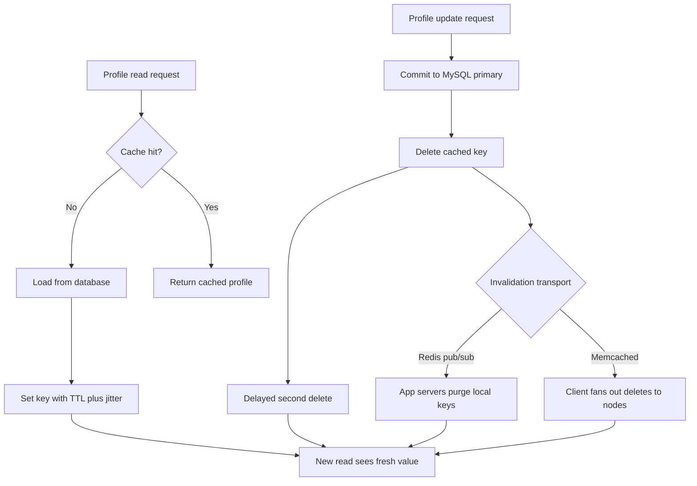

| Difficulty | Channel | Tags |
|---|---|---|
| beginner | backend | redis, memcached, cache-invalidation |

Seventeen thousand database queries per second is not always a DDoS attack; sometimes it is one expired profile key and a thousand well-meaning servers trying to be helpful. Meta faced exactly that class of problem at a scale most teams never see: billions of requests per second, trillions of cached items, and a read-heavy social graph where reads outnumbered writes by roughly two orders of magnitude [1]. The uncomfortable lesson is that caching is easy until data changes, and invalidation is where tidy architecture diagrams go to die. This story follows that failure mode from a stale profile to a fix you can actually ship.

---

> ### Real-World Case — Meta (Facebook)
>
> Facebook served highly read-heavy profile and social-graph data from a demand-filled memcached look-aside cache; reads outnumbered writes by roughly two orders of magnitude. When data changed, the web app updated MySQL and deleted the cached key, but concurrent readers could refill the cache with stale values, and globally replicated regions could serve stale data before replication caught up.
>
> | | |
> |---|---|
> | **Challenge** | Implement cache invalidation that avoided stale sets, thundering herds, and cross-region read-after-write anomalies without turning the cache into the source of truth or writing new values directly into cache. |
> | **Solution** | Facebook kept Memcached intentionally simple and pushed consistency logic into the client/infrastructure: deletes were preferred over cache sets, a 64-bit lease token was issued on cache misses and invalidated on delete, an invalidation daemon called McSqueal tailed MySQL commit logs and batch-forwarded deletes through mcrouter, and remote markers routed reads to the master region while local replicas were potentially stale. The approach shows that Redis-style pub/sub alone would not have solved the hard part: coordinating cache fills, deletes, and replication lag. |
> | **Outcome** | The system handled billions of requests per second, stored trillions of items, and served more than a billion users. Leases reduced peak database query rate for thundering-herd-prone keys from 17K/s to 1.3K/s, about a 92% reduction. |
> | **Lesson** | TTL plus delete-on-write is not enough at scale; invalidation is a concurrency and replication problem. The 'simpler' Memcached architecture can win on raw caching, but the cost is building explicit lease, invalidation-stream, and marker machinery to preserve correctness. |

---

## Hook — The deploy looked fine. Then the database started melting.

Picture the scene: a routine profile update ships, the cache key is deleted as designed, and then the database graph climbs like a rollercoaster. No schema migration, no bad query plan, just a cache miss that every application server noticed at the same instant. Meta's demand-filled look-aside memcached cache handled billions of requests per second, so a single unlucky key could become a swarm [1].

⚠️ Watch Out: the dangerous part is that nobody wrote broken code. Each server correctly read the database and refilled the cache. The system failed because correct local decisions added up to a global stampede.

Here is the tension that drives the rest of this story: you can delete the right key at the right time and still serve stale data. So what is actually going wrong?

## Problem — Two copies of the truth, and no referee

Building on that stampede, the core challenge is simple to state and brutally hard to solve: a cache and a database are two copies of the same fact, and nothing automatically keeps them in agreement [2]. A profile update must change the durable copy and remove the fast copy, but the ordering, timing, and concurrency of those actions decide whether users see the new bio or yesterday's.

Consider the classic stale-set race. The web app commits the update to MySQL and deletes the cached key, but a reader that started before the delete can still be holding the old value. That reader writes the stale profile back after the deletion, and the cache now confidently serves outdated data until the TTL expires. This is not a rare edge case; it is the default outcome under load.

� Insight: TTLs are not invalidation, they are a deadline on being wrong. HTTP caching made the same trade-off explicit with freshness lifetimes and validation [7], and browser caches still teach the same lesson [8]. A five-to-thirty-minute profile TTL bounds the damage but does not remove it.

Consequently, three questions should be on your mind before choosing a tool: how fast must a change become visible, how many servers need to hear about it, and what happens when a hot key disappears? The next stop is a company that answered all three at planetary scale.

## Real-World Case — Meta (Facebook)

However, theory this tidy rarely survives contact with a social graph. In the deployment described in Meta's NSDI paper, profile and social-graph data were served from a demand-filled memcached look-aside cache, with reads outnumbering writes by roughly two orders of magnitude [1]. When data changed, the web application updated MySQL and deleted the cached key, exactly the pattern most tutorials recommend.

The twist was concurrency: readers could refill the cache with stale values after the delete, and globally replicated regions could keep serving stale data until replication caught up. To make matters worse, a popular key expiring meant a thundering herd of database queries from every server at once. Meta's lease mechanism reduced peak query rates for those herd-prone keys from roughly 17K/s to about 1.3K/s, a reduction of around 92 percent [1].

At full scale that system handled billions of requests per second, stored trillions of items, and served more than a billion users [1]. The fix was not a faster cache; it was coordination, versioning, and retries that respected the shape of the workload. So how does a team translate that into an ordinary profile service without rebuilding Facebook?

## Deep Dive — Write-through, cache-aside, and the tool choice

This leads to the practical design question: which pattern should your service actually run? Cache-aside means reads check the cache first and load from the database on a miss, while write-through means the write path updates the cache alongside the database [3]. Most profile services use cache-aside for reads and an explicit delete on writes, because writing the cache first can publish data that has not been committed yet.

🔥 Hot Take: the most dangerous cache invalidation bug is the one where the cache is updated correctly. If the cache is written before the database transaction commits, a rollback leaves the fast copy more authoritative than the durable one. Delete after commit, then defend against the refill race.

Here is what you need to know about the race fix:

- Invalidate after the database commit, not before, so a failed transaction cannot leave a phantom cache entry.
- Use a short delayed second delete to sweep stale values written by readers that were already in flight.
- Add jitter to TTLs so a million keys do not expire in the same second.
- Version your cache keys when a change must be instantly visible to every region.

Now for the fork in the road, Redis or Memcached. Redis offers pub/sub for distributed invalidation, optional persistence, and richer data structures; Memcached stays deliberately simple, with lower overhead and straightforward horizontal scale [4]. Memcached's original design treats values as opaque bytes and relies on clients for coordination [5], while Redis grew into a multi-purpose data store with messaging primitives [6].

| Option | Real tradeoff | When would you actually use this? |
| --- | --- | --- |
| Redis | Pub/sub fan-out, persistence, advanced structures; more moving parts | You need cross-server invalidation, durability, or versioned keys |
| Memcached | Lower memory overhead, simpler scaling, no persistence | Pure caching where clients can coordinate deletes themselves |

🎯 Key Point: choose based on how invalidation travels across your fleet, not on which store benchmarks faster. The next step is turning that choice into an ordered workflow.

## Workflow — A write path that survives concurrency

Building on the trade-offs above, the workflow below treats invalidation as a small distributed protocol rather than a single cache.delete call. Each step has a job, and skipping one is how stale profiles become customer support tickets.

1. **Commit first.** Write the profile change to the primary database and let the transaction finish.
2. **Delete the key.** Remove the cached profile immediately so new reads must load the committed value.
3. **Fan out the invalidation.** With Redis, publish the user ID to a channel every app server subscribes to; with Memcached, coordinate deletes across the nodes yourself.
4. **Guard the refill race.** Schedule a delayed second delete for readers that started before the commit.
5. **Load safely on misses.** Fill the cache with a bounded TTL plus jitter, and avoid overwriting a newer value with an older one.
6. **Watch the metrics.** Track hit rate, miss storms, and database query rate per hot key.

The diagram below tells the whole journey, including the two paths that can fight each other:

💡 Insight: the diagram's ugly branch is the reader path that begins before the delete and finishes after it. That branch is precisely why a delayed second delete exists. The code example next makes that branch harmless.

## Code Example — Write-through invalidation with a double delete

Consequently, the implementation should be boring on purpose. The complete Python example in the code block uses a write-through update, cache-aside reads, a short negative-cache TTL, and a delayed double delete. It solves the exact race described in the problem section: a stale reader cannot resurrect an old profile after the cache has been invalidated.

Read the code in three passes. First, notice that `update_profile` commits through `save_to_db` before touching the cache; a failed transaction therefore leaves the cached value intact instead of inventing a new truth. Second, `read_profile` fills misses with `nx=True`, so a racing reader cannot overwrite a value a writer just installed. Third, the second `cache.delete` after a short delay is the cheap, production-friendly way to sweep stale refills without adding a distributed lock.

⚠️ Watch Out: sleeping inside a request thread is a simplification for illustration. In production, hand the delayed delete to a job queue, and keep the delay longer than your typical database-to-cache round trip. Python's standard library offers other caching tools [9], but cross-process invalidation needs a shared store like the one used here.

## Lessons Learned — Battle scars and better defaults

However, patterns only help once the common mistakes are named. Teams often discover these the hard way, usually while staring at a dashboard during an incident review.

**Battle scars worth avoiding:**

- **Deleting before the commit.** A rolled-back transaction now has no cache entry and a suspiciously confident database.
- **Trusting a single delete.** Concurrent readers can refill stale data microseconds later; the delayed second delete exists for them.
- **Uniform TTLs.** Identical expirations create synchronized misses and thundering herds.
- **Pushing invalidation to humans.** With Memcached, manual fan-out across nodes gets forgotten under pressure; Redis pub/sub moves that coordination into the infrastructure [6].
- **Ignoring replicas.** A local delete does not fix data served from another region until replication or versioned keys catch up [1].

🎯 Key Point: every concept here answers the same practical question. Use a bounded TTL when a few minutes of staleness is tolerable, add pub/sub when many servers must agree immediately, and use versioned keys when correctness across regions is non-negotiable.

Moreover, monitoring is part of the design, not decoration. A rising miss rate or a hot key suddenly generating thousands of queries per second is the earliest warning that invalidation and workload have drifted apart. If this feels overwhelming, start with the two-line fix: commit, delete, then delete again shortly after.

---

## Cache Invalidation Flow

<strong>Original Interview Question</strong>

**Q:** You're building a user profile service that caches frequently accessed profiles. How would you implement cache invalidation when a user updates their profile, and what trade-offs would you consider between Redis and Memcached?

**A:** Implement write-through caching with TTL-based expiration. On profile update, invalidate the cache by deleting the key and writing new data to both the database and cache. Redis offers pub/sub for automatic distributed invalidation, while Memcached requires manual coordination across nodes.

## Conclusion

The story started with 17,000 queries per second caused by a cache doing exactly what it was told [1]. The journey ends with a quieter truth: invalidation is not a single API call, but a small protocol that respects commit order, concurrency, and geography. Tomorrow, move one thing: commit before deleting, add a delayed second delete, put jitter on every TTL, and let Redis pub/sub carry the invalidation signal when many servers need to agree. The memorable insight to share with your team is this: a cache is not a copy of the truth, it is a promise with an expiry date, and every update renegotiates that promise.

---

## References

1. [Meta (Facebook) incident report](https://www.usenix.org/system/files/conference/nsdi13/nsdi13-final170.pdf) — article
2. [Cache (computing) - Wikipedia](https://en.wikipedia.org/wiki/Cache_(computing)) — documentation
3. [What is Amazon ElastiCache? - AWS Documentation](https://docs.aws.amazon.com/AmazonElastiCache/latest/dg/WhatIs.html) — documentation
4. [Comparing ElastiCache engine options - AWS Documentation](https://docs.aws.amazon.com/AmazonElastiCache/latest/dg/selecting.html) — documentation
5. [memcached source repository - GitHub](https://github.com/memcached/memcached) — documentation
6. [Redis source repository - GitHub](https://github.com/redis/redis) — documentation
7. [RFC 7234: HTTP/1.1 Caching](https://datatracker.ietf.org/doc/html/rfc7234) — documentation
8. [HTTP caching - MDN Web Docs](https://developer.mozilla.org/en-US/docs/Web/HTTP/Caching) — documentation
9. [functools - Python 3 documentation](https://docs.python.org/3/library/functools.html) — documentation

---

**Author:** Satishkumar Dhule — [GitHub](https://github.com/satishkumar-dhule) · [LinkedIn](https://linkedin.com/in/satishkumar-dhule) · [Website](https://satishkumar-dhule.github.io)
