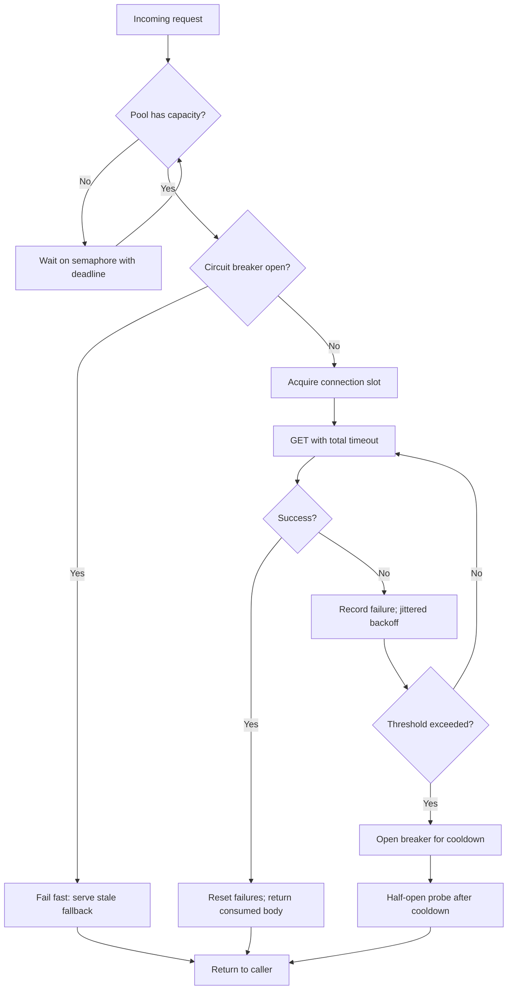

| Difficulty | Channel | Tags |
|---|---|---|
| advanced | backend | asyncio, aiohttp, concurrency |

In 2011, Netflix was serving roughly 20,000 requests per second at peak, more than a billion a day, with each API call fanning out about six times into dozens of backend services [1]. A bug left Java objects partially populated in the shared cache; engineers bypassed the cache, traffic slammed straight into the database, and the database promptly throttled them. The database-select circuit hit an 80% error rate, yet video views per second stayed essentially flat, because 157 of 200 instances quietly served local-cache fallbacks [1]. That is the whole art of a resilient connection pool: when the downstream world turns hostile, your code keeps its promises anyway.

---

> ### Real-World Case — Netflix
>
> In 2011 Netflix's API served ~20,000 requests/second at peak (over 1 billion/day), fanning out roughly 1:6 into dozens of backend services. When engineers found a bug that left Java objects partially populated in the shared cache, they bypassed the cache and sent traffic straight to the database — which immediately throttled them, turning a small caching bug into a self-inflicted, full-scale cascade.
>
> | | |
> |---|---|
> | **Challenge** | With ~30 dependencies each at 99.99% uptime, aggregate availability would be only ~99.7% (2+ hours of downtime/month). A single latent dependency could saturate every Tomcat request thread in seconds and take down the whole API, so they needed bounded concurrency, aggressive timeouts, and graceful degradation instead of retry storms and connection piles. |
> | **Solution** | They built a dependency decorator — later open-sourced as Hystrix — combining non-blocking 'tryable' semaphores and per-dependency bounded thread pools/queues to cap concurrent calls, aggressive network and thread-level timeouts, and a circuit breaker that trips at a ~50% error rate over a 10-second rolling window. Tripped circuits short-circuit requests to fallbacks (local query cache, fail-silent, or fail-fast), with half-open probe requests testing recovery before closing the circuit. |
> | **Outcome** | During the incident the database-select circuit hit an 80% error rate and 157 of 200 instances served local-cache fallbacks, yet video views/second were essentially flat versus the prior week. The pattern later ran at Netflix scale: tens of billions of thread-isolated and hundreds of billions of semaphore-isolated calls per day, with dramatically improved uptime. |
> | **Lesson** | Hystrix creator Ben Christensen's counterintuitive verdict: the circuit breaker is 'just icing on the cake' — a reactive release valve. The real protection is the semaphore/thread-pool concurrency limits plus aggressive timeouts; when a dependency is latent you must shed load and let it recover, NOT add more connections, threads, or queue capacity, which only deepens the overload. |

---

## Hook — The moment the cache lied

Twenty thousand requests per second, roughly six downstream calls each, and one cache quietly handing back half-built objects [1]. The fix looked innocent: skip the cache, ask the database, move on. Instead, the database throttled the API, the database-select circuit climbed to an 80% error rate, and a local bug became a self-inflicted stampede. Sound familiar? The pager fires at 2am, latency graphs go vertical, and every well-meaning retry adds more fuel to the fire.

💡 Insight: the dangerous moment is not when one request fails. It is when thousands fail in perfect sync and all decide to try again at the same millisecond.

## Problem — A thousand retries walk into a bar

Building on that stampede, the core challenge is not making connections faster. It is deciding which requests are allowed to exist at all. A connection pool is a shared budget of reusable sockets [2], but an async service can spawn coroutines far faster than a TCP handshake completes. An asyncio.Semaphore is the natural app-level gate [3], and aiohttp's connector adds a second, socket-level gate [4].

Do the arithmetic and the stakes become uncomfortably clear. At 20,000 rps with a 1:6 fan-out, roughly 120,000 downstream calls leave the API every second. If a healthy call takes 50 ms, about 6,000 calls must be in flight simultaneously. Cap the pool at 100 and the backlog grows by roughly 119,900 calls per second. Stretch the total timeout to 30 seconds and a stalled upstream can pin over three million coroutines in memory.

⚠️ Watch Out: a semaphore without a timeout is just a very polite way to queue forever. Connection leaks, missing session.close() on shutdown, skipped SSL validation, and swallowed exceptions round out the usual battle scars [9].

When would teams actually use this? Any service with fan-out greater than one, any third-party API with unpredictable latency, and any endpoint where a stale cached answer beats a hard failure [10].

## Real-World Case — Netflix

However, Netflix had already run this exact experiment in production, and the outcome is still one of the best resilience stories in backend engineering [1]. In 2011 the API was serving about 20,000 requests per second at peak, over a billion per day, with each request fanning out roughly six times into dozens of backend services. When a bug left Java objects partially populated in the shared cache, engineers bypassed that cache and sent traffic straight to the database. The database immediately throttled them.

The plot twist is where most teams look for a hero and find something quieter. The database-select circuit hit an 80% error rate, yet video views per second stayed essentially flat against the prior week. Around 157 of 200 instances served local-cache fallbacks instead of joining the pile-on [1]. The pattern that made this possible later ran at tens of billions of thread-isolated and hundreds of billions of semaphore-isolated calls per day, with dramatically improved uptime [1]. Netflix open-sourced the underlying isolation library as Hystrix, which is essentially this pattern wearing a Java costume [6].

🔥 Hot Take: the fix was not faster code. It was a deliberate, engineered refusal to do work.

## Deep Dive — Four guardrails, one honest trade-off

This leads to the machinery. Four guardrails do the heavy lifting, and none of them works alone. The table below shows what each one actually controls and where it disappoints.

| Option | What it controls | Real tradeoff | Use it when |
| --- | --- | --- | --- |
| asyncio.Semaphore | Concurrent calls in your app [3] | Unbounded waiting if no deadline exists | Fan-out must be throttled before sockets are opened |
| aiohttp TCPConnector(limit=...) | Physical connections per host [4] | Does not stop queued coroutines from piling up | Keep-alive reuse and a hard socket budget matter |
| Circuit breaker | Whether the call happens at all [6] | Stale fallbacks can be wrong data | Errors cross a threshold for a sustained window |
| Exponential backoff with jitter | When a retry happens [5] | Too many retries amplify the outage | Failures look transient, such as 429 or 503 [7][8] |

Specifically, a circuit breaker moves through three states. Closed means calls flow normally. Open means the service returns a fallback immediately. Half-open means one probe is allowed through to test the water; if it succeeds, traffic resumes.

Moreover, timeouts need to be honest. A total timeout caps the whole request lifecycle, while a connect timeout only caps the handshake; confusing the two is how a 30-second budget silently becomes a multi-minute one [4]. asyncio.TimeoutError and aiohttp.ClientError should be caught deliberately, with context attached, instead of being allowed to vanish halfway up the async stack [9].

💡 Insight: retries are a loan taken against future capacity. Jitter is the interest payment that keeps every borrower from showing up at the same door.

## Workflow — From request to fallback in seven steps

With those trade-offs settled, the request path becomes a short, predictable story. The Mermaid flowchart below maps it end to end:

1. A request arrives and the breaker is checked first, so a known-bad downstream never gets a queue slot.
2. The semaphore grants a slot, or the request waits with a deadline attached.
3. aiohttp reuses a keep-alive connection from the connector and issues the GET with a total timeout [4].
4. Success resets the failure counter and returns the consumed body.
5. A timeout or 5xx response records a failure and triggers a jittered backoff [5][8].
6. Crossing the threshold opens the breaker for a cooldown window.
7. During cooldown, callers receive a stale local fallback, which is graceful degradation rather than a cascading 500.

🎯 Key Point: order matters. Checking the breaker before acquiring the slot is what turns a broken downstream into a fast local answer instead of a slow, shared queue. That single ordering decision is the difference between the Netflix incident above and the one nobody writes about.

## Code Example — A pool that knows when to say no

Building on that sequence, the implementation below keeps the guardrails small enough to reason about. The full version lives in the code block; here is the part that decides whether a call happens at all:

```python
async with self.slots:
    async with self.session.get(url) as response:
        body = await response.text()
```

Line by line, the outer `async with self.slots` acquires the semaphore and releases it even if the request raises. The inner `async with self.session.get(url)` releases the connection back to the connector, but only after the body has been read. Reading the body before returning is the fix for a classic trap: returning a ClientResponse from inside a closed context manager gives callers a response whose stream is already gone [4]. The `_is_open` check runs before the semaphore, so fail-fast never waits in line. `_record_failure` opens the breaker after the threshold, and the jittered sleep in `fetch` keeps synchronized retries from marching into the downstream together [5].

When would someone reach for this exact shape? When an upstream is shared by many callers, when latency is unpredictable, and when a cached answer from five seconds ago is better than a timeout. Start the session once during application startup and close it during shutdown; creating a ClientSession per request quietly defeats keep-alive and leaks sockets.

## Lessons Learned — What the next outage will teach you

However, patterns only pay off once they survive contact with production. Netflix's 80% error rate with flat video views was not luck; it was fallbacks, isolation, and strict limits applied in that order [1]. Here are the battle scars worth avoiding:

- **Returning a live ClientResponse from a closed context.** Consume the body first, or hand back a plain value object [4].
- **Retries without jitter.** Ten thousand clients retrying on the same 100 ms schedule will find a way to ruin the day [5].
- **Unbounded queues.** A semaphore with no request deadline converts load into memory pressure.
- **Missing cleanup.** Close the ClientSession and connector on shutdown, and validate SSL instead of disabling it to 'fix' a certificate error.
- **Binary breaker state.** Without a half-open probe, services flap between total traffic and total denial.
- **Swallowed errors.** Attach context when re-raising through the async stack [9].

💡 Insight: capacity is a policy, not a hope. The teams that survive high load decide in advance which calls get dropped, which get cached, and which get a second chance.

The practical next step is small: add one total timeout, cap concurrency at both the app and connector layers, wrap the riskiest downstream call in a breaker with a fallback, and add jitter to every retry. Measure error rate, queue depth, and fallback usage before tuning thresholds.

---

## Connection Pool Request Flow



<details>
<summary><strong>Original Interview Question</strong></summary>

**Q:** How would you implement a connection pool manager for aiohttp that handles graceful degradation under high load and connection timeouts?

**A:** Implement a connection pool manager for aiohttp using a semaphore to limit concurrent connections, exponential backoff for retrying failed requests, and circuit breaker pattern to gracefully degrade under high load and connection timeouts.

</details>

## Conclusion

Picture the same 2am pager from the opening. This time the cache lies, the database throttles, and yet video views stay flat, because the pool refuses to stampede [1]. The journey from panic to resilience runs through semaphore limits, honest timeouts, circuit breakers, and jittered retries: boring guardrails that turn a cascade into a hiccup. Tomorrow, pick one downstream call and ask what happens when it gets slow. If the answer is 'everything waits,' you already know what to fix.

Remember this line when explaining it to your team: a resilient pool is not one that never fails; it is one that fails small, fast, and on purpose, while users keep streaming.

---

## References

1. [Netflix incident report](https://netflixtechblog.com/making-the-netflix-api-more-resilient-a8ec62159c2d) — article
2. [Connection pool - Wikipedia](https://en.wikipedia.org/wiki/Connection_pool) — documentation
3. [asyncio synchronization primitives - Python documentation](https://docs.python.org/3/library/asyncio-sync.html) — documentation
4. [aiohttp source repository - GitHub](https://github.com/aio-libs/aiohttp) — documentation
5. [Exponential backoff - Wikipedia](https://en.wikipedia.org/wiki/Exponential_backoff) — documentation
6. [Netflix Hystrix - GitHub](https://github.com/Netflix/Hystrix) — documentation
7. [RFC 9110: HTTP Semantics - IETF Datatracker](https://datatracker.ietf.org/doc/html/rfc9110) — documentation
8. [503 Service Unavailable - MDN Web Docs](https://developer.mozilla.org/en-US/docs/Web/HTTP/Status/503) — documentation
9. [asyncio exceptions - Python documentation](https://docs.python.org/3/library/asyncio-exceptions.html) — documentation
10. [HTTP caching - MDN Web Docs](https://developer.mozilla.org/en-US/docs/Web/HTTP/Caching) — documentation

---

**Author:** Satishkumar Dhule — [GitHub](https://github.com/satishkumar-dhule) · [LinkedIn](https://linkedin.com/in/satishkumar-dhule) · [Website](https://satishkumar-dhule.github.io)
