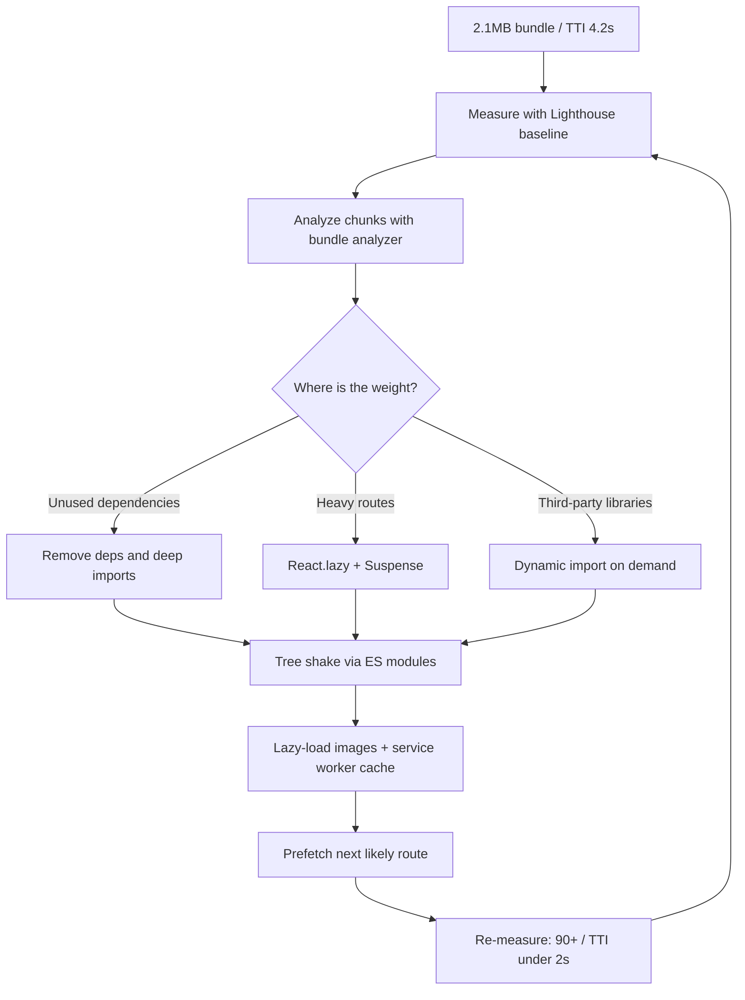

| Difficulty | Channel | Tags |
|---|---|---|
| intermediate | frontend | lighthouse, bundle, lazy-loading |

When Netflix examined its logged-out desktop homepage — the entry point where new users sign up or sign in — the team found a React-rendered page shipping roughly 300KB of JavaScript that took about seven seconds to load over simulated 3G [1]. Every kilobyte was a tax on the very users the company most wanted to convert. The fix was not a faster server or a new framework; it was a ruthless rethinking of what the browser actually needed to download. That same playbook is what separates a Lighthouse score of 65 from a score of 90+.

---

> ### Real-World Case — Netflix
>
> Netflix's logged-out desktop homepage — the entry point where new users sign up or sign in — was server-rendered with React and hydrated in the browser, shipping roughly 300KB of JavaScript including React, Lodash, and hydration state. Simulating a 3G connection in Chrome DevTools/Lighthouse showed the simple landing page taking ~7 seconds to load, at a time when a growing share of new members were signing up on mobile devices over poor connections.
>
> | | |
> |---|---|
> | **Challenge** | Improve Lighthouse/Time-to-Interactive for the signup entry point without breaking the consistency of Netflix's universal (server-rendered) React architecture, and avoid making the heavy SPA signup flow slow on the next navigation. |
> | **Solution** | Instead of adding more client-side React code splitting, the team disabled JavaScript to see what genuinely needed interactivity, then rewrote the small widgets (tabs, language switcher, cookie banner, client-side logging, sandboxed ads) in vanilla JS and kept React only on the server to generate HTML. This removed React, Lodash, and hydration data from the client payload (~200KB). For the subsequent signup flow, which is a much heavier SPA, they prefetched its HTML, CSS, and React JS from the lightweight landing page using link prefetch and XHR during idle time. |
> | **Outcome** | Loading and Time-to-Interactive on the logged-out desktop homepage dropped by 50%; the JavaScript bundle shrank by 200KB (from ~300KB); prefetching cut Time-to-Interactive by a further 30% for future navigations into the signup flow. |
> | **Lesson** | Profile before optimizing: for mostly-static pages the winning move may be shipping no framework to the client at all rather than lazily splitting it, while keeping server-side React for developer consistency and prefetching the heavy SPA bundle so the next navigation feels instant. |

---

## Hook — The page that made users wait seven seconds

Seven seconds is an eternity when the only thing standing between a visitor and a signup form is a landing page. That was the reality on Netflix's logged-out desktop homepage, where a React-rendered page shipped roughly 300KB of JavaScript and crawled along a simulated 3G connection [1]. Now picture your own app: 2.1MB of JavaScript, a Time to Interactive of 4.2s, and a Lighthouse score of 65 staring back from CI. Sound familiar? The uncomfortable truth is that many developers respond by tweaking server headers or blaming the framework, when the real culprit is sitting inside the bundle. This is the story of how that bottleneck becomes a measurable, fixable thing — and why the first move is counterintuitive.

## Problem — Your bundle is the bottleneck, not your framework

Building on that tension, the problem is not "React is slow" — it is that browsers must download, parse, and execute every byte before anything meaningful happens. On a single-page application, the initial JavaScript payload grows with every feature, and a 2.1MB bundle means millions of instructions competing for the main thread before a single click can be handled [2]. TTI at 4.2s is where users abandon the funnel; Lighthouse treats it as a core signal because it measures when the page actually responds, not when pixels appear [3].

Here is what you need to know:

- The parse cost is real: JavaScript compilation can dominate load time on mid-range mobile hardware.
- Third-party libraries are usually the bulk: charts, date pickers, and analytics SDKs arrive fully loaded even on routes that never use them.
- Hydration adds a second pass: server-rendered markup still needs client JavaScript to become interactive.
- Every unused export that survives bundling is a tax you pay forever.

⚠️ Watch Out: Optimizing images or enabling gzip while leaving a monolithic bundle intact is like repainting a car with a broken engine. The score barely moves.

So where does the weight actually hide? That question leads to the measurement phase — but first, a documented case that shows what is possible.

## Real-World Case — Netflix

However, the stakes become clearer when a team with real traffic puts numbers on the problem. Netflix's logged-out desktop homepage was server-rendered with React and hydrated in the browser, shipping roughly 300KB of JavaScript that included React, Lodash, and hydration state [1]. Simulating 3G in Chrome DevTools and Lighthouse exposed a simple landing page taking about seven seconds to load, at a time when a growing share of new members were signing up on mobile devices over poor connections [1].

Many developers assume the fix is a smaller framework. Netflix did something less glamorous: the team removed the large dependencies from the critical path, cut about 200KB from the bundle, and prefetched the JavaScript needed for the next step in the signup flow [1].

The impact is worth reading twice:

- Load and Time-to-Interactive on the logged-out homepage dropped by roughly 50% [1].
- The JavaScript bundle shrank by about 200KB, down from roughly 300KB [1].
- Prefetching cut Time-to-Interactive by a further 30% for future navigations into signup [1].

🔥 Hot Take: The most impressive part was not a framework choice; it was the willingness to treat a landing page as a delivery problem rather than a rendering problem. Knowing the destination does not explain the route, though — the deep dive does.

## Deep Dive — The mechanisms behind a smaller bundle

Building on this result, the optimization playbook rests on a few mechanisms that reward teams who understand the trade-offs.

Here is what you need to know:

- Bundle analysis first: webpack-bundle-analyzer renders chunks as a treemap, so the largest dependencies become impossible to ignore [4].
- Route-based splitting: each route becomes a separate chunk, so the login page never downloads the analytics dashboard.
- Component-based splitting: heavy widgets load on demand via dynamic import, which browsers fetch as separate modules [3].
- Tree shaking: unused exports are dropped when modules are ES modules; CommonJS defeats this entirely [5].
- Image lazy loading: Intersection Observer defers offscreen images until they approach the viewport [6].
- Service worker caching: previously fetched chunks can be served from cache, making repeat navigations nearly instant [7].

| Option | What it fixes | Real tradeoff |
| --- | --- | --- |
| Route-based splitting | Initial payload | Requires Suspense boundaries and a loading state per route |
| Component-based splitting | Heavy widgets on light pages | Extra network round trip on first interaction |
| Tree shaking | Dead exports | Breaks with CommonJS or side-effectful imports |
| Prefetching | TTI on the next navigation | Can waste bandwidth if the user never navigates |

💡 Insight: Dynamic imports are not free. Many developers discover that splitting too finely creates a waterfall of tiny chunks, where each request waits for the previous one. Group related features into a single chunk instead.

⚠️ Watch Out: A barrel file that re-exports everything can pull entire libraries into the initial bundle even when only one function is used. Import from the specific path instead.

Therefore, the sequence matters more than any single technique. The workflow below turns these principles into a repeatable loop — and it starts before a single line of code changes.

## Workflow — From baseline to 90+ in six moves

Building on the mechanisms above, the workflow is a measurement loop rather than a one-time refactor. Start by recording a Lighthouse baseline with throttling enabled; Lighthouse is the same engine behind the score in Chrome DevTools, available as an open-source CLI [8]. Next, generate a bundle report and rank chunks by size. Then remove unused dependencies, switch imports to ES module paths, and configure the bundler to preserve tree shaking. After that, wrap routes in React.lazy() and Suspense, move heavy third-party libraries behind dynamic imports, and defer offscreen images. Finally, add service worker caching and prefetch the most likely next route, then re-measure.

The diagram below maps that path from a 2.1MB monolith to a 90+ score:

1. Measure: capture Lighthouse score, TTI, and largest contentful paint under simulated 3G.
2. Analyze: run webpack-bundle-analyzer and list the top five chunks [4].
3. Cut: delete unused dependencies and replace barrel imports with deep imports.
4. Split: apply route-based React.lazy() boundaries, then component-level lazy loading.
5. Shake: verify ES module configuration so dead code is actually removed [5].
6. Cache and prefetch: use service workers for repeat visits and prefetch the signup route [7].

🎯 Key Point: Each step should be verified with a fresh measurement. A change that looks correct in source code can still ship the same bytes. But how does this look in an actual React application? That is where the code earns its keep.

## Code Example — Route splitting with a safety net

Building on the workflow, here is the pattern that turns a monolith into on-demand chunks:

```javascript
const Dashboard = React.lazy(() => import('./routes/Dashboard'));
const Analytics = React.lazy(() => import('./routes/Analytics'));
const HeavyChart = React.lazy(() => import('./components/HeavyChart'));

class ChunkErrorBoundary extends React.Component {
  state = { hasError: false };

  static getDerivedStateFromError() {
    return { hasError: true };
  }

  render() {
    if (this.state.hasError) return <p>That section could not load. Try again.</p>;
    return this.props.children;
  }
}

function App() {
  const [showChart, setShowChart] = React.useState(false);

  return (
    <ChunkErrorBoundary>
      <Suspense fallback={<LoadingSpinner />}>
        <Routes>
          <Route path="/dashboard" element={<Dashboard />} />
          <Route path="/analytics" element={<Analytics />} />
        </Routes>
        {showChart && <HeavyChart />}
      </Suspense>
      <button onClick={() => setShowChart(true)}>Load report</button>
    </ChunkErrorBoundary>
  );
}
```

Line by line: React.lazy() defers the module fetch until the component is actually rendered, and import() creates the split point that emits a separate chunk [3]. Suspense supplies a fallback while that chunk is in flight, so the page never freezes. The error boundary catches a failed network request, keeping one broken chunk from blanking the entire session. Finally, showChart keeps the heavy chart out of the initial render entirely — the "when would I actually use this?" answer is any feature hidden behind a button, tab, or modal. The complete, runnable version with imports sits in the code example below.

## Lessons Learned — Battle scars worth keeping

Building on the code, the lessons are less about React APIs and more about discipline. If this feels overwhelming, developers have all been there — staring at a bundle report wondering how a todo app gained two megabytes.

Here is what you need to know:

- Battle scar #1: splitting every component creates chunk waterfalls. Group by route or feature instead.
- Battle scar #2: forgetting Suspense boundaries makes lazy components throw during render.
- Battle scar #3: barrel imports silently defeat tree shaking [5].
- Battle scar #4: prefetching everything wastes bandwidth; prefetch only the next likely route [7].
- Battle scar #5: measuring on a fast laptop hides the mobile problem. Throttle the network and CPU.
- Battle scar #6: adding a library to "save time" often costs more in parse time than it saves in development hours.

🔥 Hot Take: A 90+ Lighthouse score is a side effect of shipping less work, not a trophy earned by tuning metrics.

So what changes tomorrow? Add a bundle budget to CI, fail builds that exceed it, and make a bundle report part of every performance review rather than a once-a-year cleanup. That single habit turns a heroic refactor into routine hygiene.

---

## Bundle Optimization Flow



<details>
<summary><strong>Original Interview Question</strong></summary>

**Q:** You're tasked with improving a React app's Lighthouse performance score from 65 to 90+. The bundle size is 2.1MB and Time to Interactive is 4.2s. What specific steps would you take to optimize the bundle and implement lazy loading?

**A:** Implement code splitting with React.lazy() and Suspense, analyze bundle composition with webpack-bundle-analyzer to identify largest chunks, remove unused dependencies and optimize imports, add dynamic imports for heavy components and third-party libraries, implement route-based splitting for better initial load times, and utilize tree shaking with proper ES module configuration.

</details>

## Conclusion

Remember the seven-second landing page that opened this story? Netflix showed that the fastest way to improve a React app is not to render faster, but to send less JavaScript [1]. From a 2.1MB bundle and 4.2s TTI, the path runs through measurement, analysis, splitting, shaking, lazy loading, and prefetching — the same steps that cut about 200KB and halved load and TTI on a real signup funnel [1]. The one insight worth carrying to your team: treat every kilobyte as a user waiting, and make the browser earn its work one route at a time.

---

## References

1. [Netflix incident report](https://medium.com/dev-channel/a-netflix-web-performance-case-study-c0bcde26a9d9) — article
2. [Single-page application](https://en.wikipedia.org/wiki/Single-page_application) — documentation
3. [Dynamic import operator — MDN Web Docs](https://developer.mozilla.org/en-US/docs/Web/JavaScript/Reference/Operators/import) — documentation
4. [webpack-bundle-analyzer GitHub repository](https://github.com/webpack-contrib/webpack-bundle-analyzer) — documentation
5. [Tree shaking — MDN Web Docs glossary](https://developer.mozilla.org/en-US/docs/Glossary/Tree_shaking) — documentation
6. [Intersection Observer API — MDN Web Docs](https://developer.mozilla.org/en-US/docs/Web/API/Intersection_Observer_API) — documentation
7. [Service Worker API — MDN Web Docs](https://developer.mozilla.org/en-US/docs/Web/API/Service_Worker_API) — documentation
8. [Lighthouse GitHub repository](https://github.com/GoogleChrome/lighthouse) — documentation
9. [Web performance — MDN Web Docs](https://developer.mozilla.org/en-US/docs/Web/Performance) — documentation
10. [React GitHub repository](https://github.com/facebook/react) — documentation

---

**Author:** Satishkumar Dhule — [GitHub](https://github.com/satishkumar-dhule) · [LinkedIn](https://linkedin.com/in/satishkumar-dhule) · [Website](https://satishkumar-dhule.github.io)
