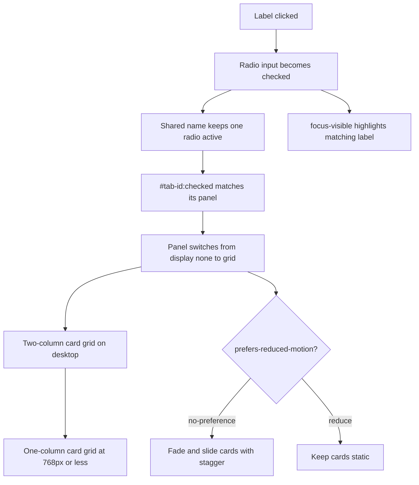

| Difficulty | Channel | Tags |
|---|---|---|
| beginner | frontend | css, flexbox, grid, animations |

Before Fluent 2 shipped to Office, Windows, and Teams, Microsoft's Office Engineering and Experiences team hit a documentation wall: earlier frameworks and CMSs made the docs site rigid, costly to maintain, and awkward for a Figma-to-docs workflow [1]. The team rebuilt the site as a lightweight static docs platform, shipping over 200 pages in 10 months and cutting new-page effort roughly in half [1]. That story matters to any frontend team tempted to reach for a JavaScript widget when CSS can carry the interaction. A humble radio input, a few labels, and a responsive grid can produce tabbed docs that stay fast, keyboard-friendly, and boring in the best possible way.

---

> ### Real-World Case — Microsoft
>
> Microsoft's Office Engineering and Experiences team needed to rebuild the docs site for Fluent 2, the design system behind Office, Windows, and Teams. Earlier attempts with other frameworks and CMSs were too rigid, painful to maintain, and poorly aligned with their Figma-to-docs workflow. They wanted a lightweight, low-maintenance site that could still document a React-based component library.
>
> | | |
> |---|---|
> | **Challenge** | Ship a fast, secure, scalable docs platform with 200+ pages without a heavy JavaScript runtime or a backend that could be knocked over by DDoS attacks, while preserving React component examples and legacy Storybook iframes during migration. |
> | **Solution** | They rebuilt the Fluent 2 site on Astro's islands architecture, which ships zero JavaScript by default and emits fully static files hosted on Azure. Most of the site — including component demos and layout — is plain HTML/CSS, with JS hydrated only where genuinely needed; React stayed for the component library itself, and Storybook iframes were phased out gradually. |
> | **Outcome** | Over 200 pages were built in 10 months, new pages took half the time versus the previous stack, and simple Figma designs could be implemented in 20-30 minutes. Fully static output on Azure removed backend dependency for security and scalability, and Fluent 2 now underpins Office, Windows, and Teams. |
> | **Lesson** | For content-heavy design-system docs, default to HTML/CSS and hydrate only real interactivity: pure-CSS patterns like radio-driven tabs, :checked sibling selectors, Grid, and aspect-ratio are enough for most UI, and static output is simultaneously faster and more resilient. |

---

## Hook — The hidden state machine in a quiet docs page

A design-system docs page looks innocent: four cards, two tabs, a tidy grid. Then the interaction layer arrives with a bundle, a hydration step, and three new ways for the UI to disagree with itself. Sound familiar?

For example, a tab panel is a tiny state machine: one option is active, the rest wait their turn. Browsers have carried that exact idea since the days of radio buttons, so many developers discover that the smallest solution is hiding in plain sight. Radio inputs are native state containers [3], and labels activate them without custom event handlers [4].

The stakes are not glamorous. Docs either feel instant and accessible, or they feel like a demo app wearing a design system costume. What if the browser already had the state machine?

## Problem — The JavaScript tax on tiny interactions

Building on that quiet state machine, the core problem is simple: tabs need state, but state usually brings JavaScript. That makes sense for async panels, URL-synced views, or dynamic tab sets. For a static design-system docs page with known content, however, it can be overkill.

⚠️ Watch Out: every script adds a failure path. The page can load before hydration, an exception can block interaction, and keyboard behavior can drift from native expectations.

Here is what teams usually need to know:

- A shared `name` makes radio inputs mutually exclusive.
- A `` gives each tab a clickable, focus-friendly control [4].
- The `:checked` pseudo-class exposes which radio is active to CSS [5].
- Sibling combinators connect input state to panels that come later in the DOM [6].
- `aspect-ratio: 16 / 9` locks image areas without manual height math [7].
- `:focus-visible` keeps keyboard outlines while avoiding mouse-click noise [8].

Therefore, the real question is not "Can JavaScript do it?" JavaScript obviously can. The better question is whether the browser can do it with less machinery. What does that lighter version look like in production?

## Real-World Case — Microsoft

That question is exactly where Microsoft's Fluent 2 docs rebuild became instructive. The Office Engineering and Experiences team needed documentation for the design system behind Office, Windows, and Teams, but earlier attempts with other frameworks and CMSs were too rigid, painful to maintain, and poorly aligned with their Figma-to-docs workflow [1].

Consequently, the team moved toward a lightweight, low-maintenance static site that could still document a React-based component library. More than 200 pages were built in 10 months, new pages took about half the time compared with the previous stack, and simple Figma designs could be implemented in 20 to 30 minutes [1]. Fully static output on Azure also removed backend dependency for security and scalability [1].

🔥 Hot Take: the plot twist was not "use less technology." It was "put the right technology at the right layer." Static output handled content scale; native browser state can handle small interactions like tabs.

So what does this pattern look like under the hood?

## Deep Dive — Native state, grid, and motion

Building on Microsoft's push for a lighter docs workflow, the CSS-only tab pattern works because CSS already sees input state. A checked radio becomes a conditional switch, and the general sibling combinator lets that switch reach panels later in the document [5][6].

Here is the real tradeoff:

| Option | Best fit | Real tradeoff |
|---|---|---|
| CSS radio tabs | Static docs, small tab sets, pre-rendered content | Fast and resilient, but limited deep linking and advanced ARIA tab semantics |
| JavaScript tabs | Async content, dynamic tab sets, URL-synced state | More control, but more code, hydration, and failure modes |

💡 Insight: many developers think tabs require click handlers, but actually a radio group already gives single-selection behavior, keyboard activation, and form semantics for free [3].

The layout side is just as practical. CSS Grid handles the desktop 2×2 card structure with `repeat(2, 1fr)`, then a media query collapses it to one column on narrow screens [2][11]. Each card image uses `aspect-ratio: 16 / 9`, so thumbnails reserve space before images load and do not cause layout jumps [7].

Motion needs the same restraint. A 300 ms fade-slide with 90 ms increments feels polished, but only when `prefers-reduced-motion: no-preference` allows it [9][10]. Otherwise, the cards should appear immediately.

🎯 Key Point: use this pattern when the docs are static, the tab count is small, and the content is known at build time. Avoid it when tabs must be deep-linked, loaded on demand, or modeled as a full ARIA tab widget.

Battle scars usually come from DOM order. Specifically, placing radios inside separate wrappers breaks sibling selectors; hiding radios with `display: none` breaks keyboard focus; and forgetting the reduced-motion query turns a subtle entrance into an accessibility problem.

With those principles clear, the next step is turning them into a repeatable flow.

## Workflow — From radio click to staggered cards

This leads to a simple build sequence. First, place all radio inputs at the top of the tabs container so every panel is a later sibling. Second, give them one shared `name` so only one tab can be active. Third, render the labels in a tab bar and style the matching label when its radio is checked or keyboard-focused.

Fourth, hide every panel by default with `display: none`. Then reveal only the matching panel with a selector such as `#tab-overview:checked ~ .panel--overview`; this works because the radio and panel share the same parent chain [6]. Fifth, make the panel a two-column grid, then override it to one column at 768 px or below [2][11]. Sixth, apply animation only under `prefers-reduced-motion: no-preference` [9].

The `Tab State Flow` diagram below follows one label click from radio state to card animation:

Before the code arrives, one question is worth asking: how can this stay maintainable when a docs page has dozens of tab fragments?

## Code Example — Generate the static tabs fragment

Now that the flow is clear, the example below generates the HTML and CSS at build time. That matters: the runtime still ships no tab JavaScript, but the docs generator can create consistent markup for every page.

The `sections` array is the content model. The `escapeHtml` helper prevents content from breaking the generated markup. `renderHtml` puts radios first, then labels, then panels, which is the ordering the sibling selectors depend on. The `showRules`, `focusRules`, and `activeLabelRules` variables generate one selector per tab, so adding a third tab does not require hand-editing CSS.

The CSS hides panels by default, then reveals the selected panel with generated `:checked ~ .panel--id` rules. `.tabs__radio` is visually clipped but remains focusable, and `:focus-visible` moves the outline to the matching label [8]. The card image uses `aspect-ratio`, the panel grid collapses at 768 px, and the stagger lives safely inside the reduced-motion guard [7][9].

⚠️ Watch Out: keep the checked default on the first radio. Without a default, a CSS-only tab group can render with no visible panel.

The final section covers the mistakes that show up after the demo works.

## Lessons Learned — Battle scars and tomorrow's move

After the build, the lesson is not that JavaScript is bad. The lesson is that interaction should sit at the lowest useful layer.

- Do not hide focusable radios with `display: none`; visually clip them and move the focus ring to the label.
- Do not scatter radios across nested wrappers; sibling selectors need them before the panels.
- Do not animate unconditionally; `prefers-reduced-motion` is a requirement, not a decoration [9].
- Do not forget `min-inline-size: 0` on grid children when long titles try to widen a column.
- Do not promise full ARIA tab semantics from this pattern; use JavaScript tabs when complexity demands them.

💡 Insight: the Microsoft rebuild succeeded by removing rigidity from the docs pipeline [1]. A CSS-only tab panel applies the same principle at component scale: fewer moving parts, less maintenance, and fewer places for bugs to hide.

Use this tomorrow on static docs, component galleries, onboarding pages, and small comparison tables. Measure the result: fewer shipped bytes, fewer runtime errors, clearer keyboard focus, and a card grid that still looks right at 320 px.

The memorable line to share with the team: a tab does not need a framework when the browser already knows which radio is checked. That is the whole trick.

---

## Tab State Flow

<strong>Original Interview Question</strong>

**Q:** Build a CSS-only tab panel for a design-system docs page. Use radio inputs to switch tabs (no JavaScript). Desktop: a 2x2 grid of cards under each tab; mobile: single column. Each card has a fixed 16:9 image area, a title, and a short meta line. Add a subtle entrance animation with a stagger and keep focus-visible outlines; ensure prefers-reduced-motion is respected?

**A:** Use a set of radio inputs with a shared `name` attribute and corresponding `` elements for each tab section. The `:checked` state of each radio controls visibility of its associated panel via adjacent sibling selectors. Each panel renders a 2×2 card grid on desktop and collapses to a single column on mobile. Cards use `aspect-ratio: 16/9` for fixed image containers, with a title and meta line below.

## Conclusion

The Fluent 2 docs rebuild showed what happens when a team removes avoidable rigidity from a docs pipeline [1]. A CSS-only tab panel brings that same mindset to a small UI component: native radio state, semantic labels, resilient grids, visible focus, and motion that respects user preferences. The next time a docs tab set appears in the backlog, start with the browser's built-in state machine and add JavaScript only when the requirements truly outgrow it.

---

## References

1. [Microsoft incident report](https://astro.build/case-studies/microsoft/) — article
2. [MDN: CSS Grid Layout](https://developer.mozilla.org/en-US/docs/Web/CSS/CSS_grid_layout) — documentation
3. [MDN: radio input](https://developer.mozilla.org/en-US/docs/Web/HTML/Element/input/radio) — documentation
4. [MDN: label element](https://developer.mozilla.org/en-US/docs/Web/HTML/Element/label) — documentation
5. [MDN: :checked](https://developer.mozilla.org/en-US/docs/Web/CSS/:checked) — documentation
6. [MDN: general sibling combinator](https://developer.mozilla.org/en-US/docs/Web/CSS/General_sibling_combinator) — documentation
7. [MDN: aspect-ratio](https://developer.mozilla.org/en-US/docs/Web/CSS/aspect-ratio) — documentation
8. [MDN: :focus-visible](https://developer.mozilla.org/en-US/docs/Web/CSS/:focus-visible) — documentation
9. [MDN: prefers-reduced-motion](https://developer.mozilla.org/en-US/docs/Web/CSS/@media/prefers-reduced-motion) — documentation
10. [MDN: Using CSS animations](https://developer.mozilla.org/en-US/docs/Web/CSS/CSS_animations/Using_CSS_animations) — documentation
11. [MDN: Using media queries](https://developer.mozilla.org/en-US/docs/Web/CSS/CSS_media_queries/Using_media_queries) — documentation

---

**Author:** Satishkumar Dhule — [GitHub](https://github.com/satishkumar-dhule) · [LinkedIn](https://linkedin.com/in/satishkumar-dhule) · [Website](https://satishkumar-dhule.github.io)
