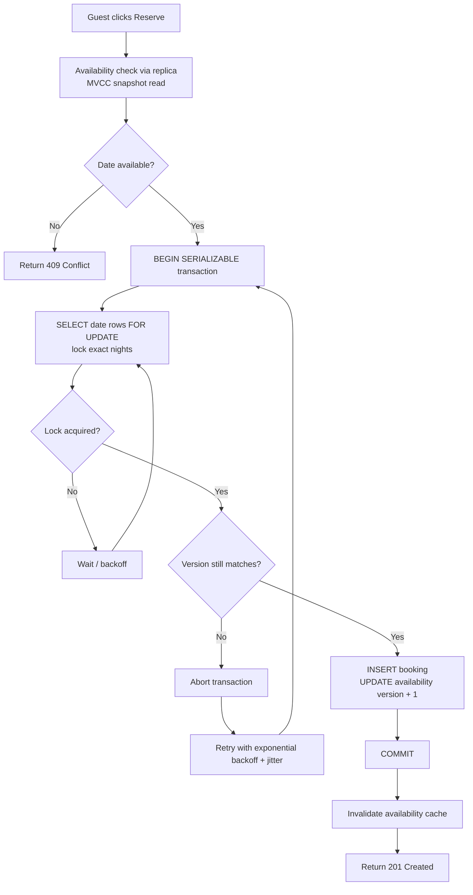

| Difficulty | Channel | Tags |
|---|---|---|
| intermediate | database | acid, isolation-levels, mvcc |

20TB of reservation data. 99.999% availability. Three regions. Those are the numbers Booking.com now runs for its 'Connected Trip' Order Platform [1], but getting there required a humbling admission: the database that had rescued them from sharded MySQL failovers could not be trusted with a simple reservation. Cassandra's row-level isolation buckled under multi-step, read-modify-write operations that crossed rows and partitions. The fix turned a booking from a hopeful INSERT into a carefully choreographed transaction — and that journey is exactly the one this article unpacks.

---

> ### Real-World Case — Booking.com
>
> While building the 'Connected Trip,' Booking.com centralized all reservation data into an Order Platform that orchestrates checkout, payment, and fulfillment for millions of bookings daily. It was originally built on Cassandra (after painful sharded MySQL failovers), but engineers hit a wall: reservation data is transactional by nature, and Cassandra's row-level isolation could not safely handle multi-step read-modify-write operations across rows and partitions.
>
> | | |
> |---|---|
> | **Challenge** | Make concurrent reservation state changes atomic and correct—so a booking can't be partially applied or double-committed—without the ambiguity of Cassandra lightweight transactions that timed out, leaving no way to tell a legitimate condition failure from a real infrastructure fault, while still meeting strict availability and SOX/PCI requirements. |
> | **Solution** | They migrated the Order Platform to CockroachDB, a distributed SQL database that provides multi-row ACID transactions at SERIALIZABLE isolation by default (optimistic concurrency with automatic transaction retries). Native CDC and secondary indexes replaced the Cassandra/OpenSearch replication pipeline, letting them delete extra cross-check services. The managed cluster spans three regions—Frankfurt, London, and Ireland. |
> | **Outcome** | The platform now holds ~20TB of reservation data at 99.999% availability across three regions, with a 99.99998% write SLI. Nodes can fail without customer-visible disturbance, capacity scales by adding nodes, and the removal of duplicate replication services sharply reduced operational cost and cognitive load. |
> | **Lesson** | Choosing an AP database for 'high availability' is a false economy when the core invariant is 'this reservation must commit atomically.' Trading a sliver of theoretical write availability for serializable ACID guarantees removed fragile application-level locking, actually improving real-world availability and simplicity. |

---

## Hook — Two Guests, One Cabin, One Race Condition

The numbers above are not bragging rights — they are the aftermath of a very specific fear. Imagine two travelers eyeing the same seaside villa for the same Saturday night. Both tap 'Confirm.' Both see a green checkmark. Then both show up at the door. Sound familiar? That is the double-booking bug, and it is the booking-system equivalent of a boss fight. A lost update is not just a row in a table; it is a refund, a support ticket, and a review that lives forever. The stakes climb fast when availability is the product: a property can only be sold once per night, so every concurrent request is a tiny wager on whether the database will keep its promise. Reading the basics of database transactions [2] is where most developers start, but the docs alone do not explain what happens when a lock queue backs up. That tension — correctness versus always-on availability — is the story worth following.

## Problem — When 'Available' Is a Lie

Building on that tension, the concrete nightmare is simpler than it sounds. An availability check reads 'free,' a payment starts, and a confirmation is written — three steps, three round trips, and a dozen chances for another request to slip between them. Each step is individually correct; the sequence is not. In database terms, a transaction is meant to be a unit of work satisfying ACID guarantees [10], yet default isolation levels quietly permit anomalies like non-repeatable reads [3]. Many developers discover this the hard way when a load test books the same night twice and nobody can reproduce it locally.

Here is what you need to know before reaching for a lock:
- A read-then-write with no guard is a race condition waiting for traffic.
- Locking everything fixes correctness but wrecks availability — the very thing the product sells.
- The fix has to be granular, versioned, and willing to retry.

So the real question becomes: how does a system stay both correct and available when hundreds of guests want the same dates?

## Real-World Case — Booking.com

However, the most instructive version of this story did not begin with a duplicate reservation; it began with a database that could not reliably say 'no.' While building the 'Connected Trip,' Booking.com centralized all reservation data into an Order Platform that orchestrates checkout, payment, and fulfillment for millions of bookings daily [1]. The platform was originally built on Cassandra — chosen after painful sharded MySQL failovers — but engineers hit a wall: reservation data is transactional by nature, and Cassandra's row-level isolation could not safely handle multi-step read-modify-write operations across rows and partitions [1]. Same race condition, just wearing a distributed-system costume.

The plot twist is that scale was not the problem; scale was the reason the old design existed. Cassandra scales by adding nodes [8], but the guarantee teams needed was atomicity across a reservation's lifecycle, not merely fast writes to a single row. Moving to a transactional, distributed SQL foundation let the platform hold roughly 20TB of reservation data at 99.999% availability across three regions, with a 99.99998% write SLI [1]. Nodes can now fail without customer-visible disturbance, and removing duplicate replication services sharply cut operational cost and cognitive load [1]. Five nines of availability did not come from giving up consistency — it came from choosing a system that could enforce it.

## Deep Dive — Isolation Levels, Narrow Locks, and Optimistic Guards

Building on Booking.com's pivot, the technical toolkit for safe bookings rests on a handful of ideas that sound academic until money is involved.

SERIALIZABLE is the strictest isolation level: it forces concurrent transactions to behave as if they ran one after another [4]. That is exactly the guarantee a booking needs, and it is also the most expensive — the database may abort transactions that would have been fine under weaker settings. Correctness is not free; it is paid for in retries.

💡 Insight: Under the hood, most modern databases use multiversion concurrency control (MVCC), which lets readers see a consistent snapshot while writers append new row versions instead of blocking readers [5]. MVCC is why an availability check stays fast while a booking commits quietly in the background. Here is the thing though: a snapshot read is only as honest as the moment it was taken. A row read at time T can be stale by the time the booking writes at T+50ms.

That is where optimistic concurrency control enters. Instead of locking early, each row carries a version number; the writer checks that the version has not changed before committing [6]. If it changed, the transaction fails fast and retries. Pessimistic locking via SELECT ... FOR UPDATE takes the opposite approach: reserve the rows first, then work [7] — the exact lock modes are documented in the PostgreSQL source tree [9]. Both are valid; they simply disagree about when to be paranoid.

Here is the real tradeoff, stripped of jargon:

| Option | Strength | Cost | Use it when |
|---|---|---|---|
| Pessimistic lock (FOR UPDATE) | No retry storms, deterministic | Holds locks longer, hurts hot properties | Contention is high and transactions are short |
| Optimistic version check | Minimal lock time, great for reads | Wasted work on conflict, needs retries | Conflicts are rare, reads dominate |
| Full SERIALIZABLE | Strongest correctness, simplest reasoning | Aborts under contention | Booking paths where correctness is non-negotiable |

For example, a read replica can serve the casual 'is this place free?' browse using MVCC snapshots, while the actual reservation writes go to the primary with SERIALIZABLE isolation [4]. Treat them as two different promises: the browse is a hint, the booking is a contract.

🔥 Hot Take: an availability cache with no version check is just a faster way to display incorrect data. Write-through caching with invalidation on success is wonderful — until an invalidation fails and a cached 'available' outlives a confirmed booking.

## Workflow — From Availability Check to Commit

Consequently, the design stops being a single query and becomes a choreographed flow. The Booking Transaction Flow diagram included with this article traces one reservation from the first availability peek to the final cache invalidation — follow it once and the retry loop stops looking arbitrary.

1. Check availability cheaply. Serve the browse from a read replica using an MVCC snapshot [5]. Fast, slightly stale, explicitly labeled as a hint rather than a promise.
2. Open a SERIALIZABLE transaction. The moment money is involved, escalate to the strictest isolation level [4]. Every critical read and write now lives in one atomic unit.
3. Lock only the date rows. Use SELECT ... FOR UPDATE on the availability calendar for exactly the requested nights [7]. Locking the whole property table is the classic rookie mistake — it turns a busy weekend into a traffic jam.
4. Verify the version. Compare the fetched version against the expected value. A mismatch means someone got there first, so abort and retry with exponential backoff.
5. Write the reservation and bump the version. Insert the booking, increment the version column, and commit in one shot [6].
6. Invalidate the cache and observe. Purge availability cache only after a successful commit, and watch lock contention like a hawk.

⚠️ Watch Out: retries without jitter are a thundering herd in disguise. Add randomness to the backoff, or a hot property will keep colliding on the exact same millisecond. Pro tip: after debugging this pattern many times, the most reliable fixes are the boring ones — bounded retries, a clean 409 response, and a circuit breaker for properties getting hammered.

This answers the 'when would I actually use this?' question: use it on the checkout path, not the browse path. 🎯 Key Point: strong isolation belongs at the moment of commitment, not on every read.

## Code Example — A Booking Function That Fails Loudly

Building on that flow, the implementation turns each step into a guardrail. The reserve_dates function opens a SERIALIZABLE transaction, locks the exact availability rows, checks the optimistic version, and writes the reservation in a single atomic unit.

- `with connect(dsn)` commits on success and rolls back on any exception.
- `SET TRANSACTION ISOLATION LEVEL SERIALIZABLE` raises the guarantee to the level Booking.com's Order Platform needed [1].
- `SELECT ... FOR UPDATE` locks only the requested date rows, never the entire property [7].
- The version comparison is the optimistic check — a mismatch raises SerializationFailure and triggers a bounded retry [6].
- The `UPDATE` bumps the version so the next snapshot sees the change [5].
- Exponential backoff with jitter spreads retries out, preventing the herd described earlier.

🔥 Hot Take: a booking endpoint that never returns 409 is usually a booking endpoint that silently overbooks. Say no loudly.

## Lessons Learned — Battle Scars and Better Defaults

Coming full circle, the journey from two guests and one cabin to a five-nines platform is really a story about choosing where to spend correctness. Booking.com did not reach 99.999% availability by relaxing guarantees; it got there by moving the guarantees to a layer that could enforce them across rows and regions [1]. Your version of that decision is smaller, but the logic is identical.

Battle scars worth avoiding:
- Locking too broadly. A table-wide lock solves double bookings by making everyone wait. Lock the date range, then move on.
- Trusting stale snapshots. An MVCC read is a point-in-time truth, not a promise [5]. Pair it with a version check before writing.
- Skipping bounded retries. SERIALIZABLE aborts are normal, not errors [4]. Cap retries, add jitter, return a clean conflict.
- Caching without invalidation discipline. Purge on success, monitor staleness, never let a cached 'available' outlive a committed booking.

💡 Insight: the best concurrency design is the one that fails fast and often instead of succeeding quietly and wrongly. If this feels overwhelming, start with one change — add a version column to the availability table and a bounded retry loop. Everything else can follow.

🎯 Key Point: availability is a promise, and promises need boundaries.

---

## Booking Transaction Flow

<strong>Original Interview Question</strong>

**Q:** You're building a booking system for Airbnb where multiple users can reserve the same property simultaneously. How would you design the transaction handling to prevent double bookings while maintaining high availability?

**A:** Use SERIALIZABLE isolation with optimistic concurrency control. Implement row-level locks on property availability tables, use MVCC snapshot reads for checking availability, and apply application-level validation to ensure atomic booking operations.

## Conclusion

The next time two guests click 'Confirm' at the same millisecond, the difference between a delightful trip and a refund nightmare is a transaction boundary. Booking.com's 20TB, three-region platform proves that high availability and strong consistency are not enemies — they are teammates when the right layer owns the promise [1]. Tomorrow, pick one checkout path and ask a simple question: where exactly is the line between a hint and a contract? Draw that line with SERIALIZABLE, a narrow lock, a version check, and a bounded retry. One memorable insight to take to your team: eventually consistent is fine for suggestions, never for reservations.

---

## References

1. [Booking.com incident report](https://www.cockroachlabs.com/customers/booking-com/) — article
2. [Database transaction — Wikipedia](https://en.wikipedia.org/wiki/Database_transaction) — documentation
3. [Isolation (database systems) — Wikipedia](https://en.wikipedia.org/wiki/Isolation_(database_systems)) — documentation
4. [Serializability — Wikipedia](https://en.wikipedia.org/wiki/Serializability) — documentation
5. [Multiversion concurrency control — Wikipedia](https://en.wikipedia.org/wiki/Multiversion_concurrency_control) — documentation
6. [Optimistic concurrency control — Wikipedia](https://en.wikipedia.org/wiki/Optimistic_concurrency_control) — documentation
7. [Database lock — Wikipedia](https://en.wikipedia.org/wiki/Database_lock) — documentation
8. [Apache Cassandra — Wikipedia](https://en.wikipedia.org/wiki/Apache_Cassandra) — documentation
9. [PostgreSQL source repository — GitHub](https://github.com/postgres/postgres) — documentation
10. [ACID — Wikipedia](https://en.wikipedia.org/wiki/ACID) — documentation

---

**Author:** Satishkumar Dhule — [GitHub](https://github.com/satishkumar-dhule) · [LinkedIn](https://linkedin.com/in/satishkumar-dhule) · [Website](https://satishkumar-dhule.github.io)
