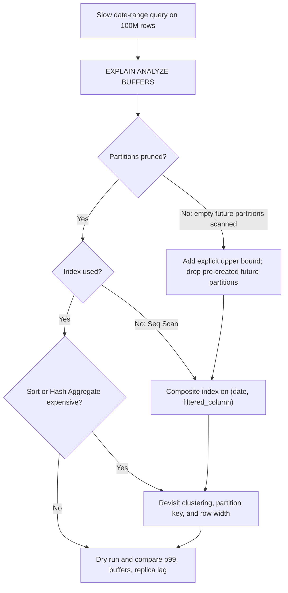

| Difficulty | Channel | Tags |
|---|---|---|
| intermediate | database | explain, query-plan, partitioning |

CoinGecko's hourly crypto price table on PostgreSQL RDS had grown past 1TB after eight years of data, and queries were averaging more than 30 seconds [1]. Raising IOPS to 24K did not save the day: the budget breached daily, request queues piled up, Apdex sank, and replica lag started threatening the API SLO [1]. Then the team found a single query written as `created_at > ?` with no upper bound, which scanned every partition, including empty future ones, and no amount of hardware could hide that mistake [1]. The fix cut p99 from 4.13s to 578ms, an 86% drop, while dry runs showed queries running 6-8x faster [1].

---

> ### Real-World Case — CoinGecko
>
> CoinGecko's hourly crypto price table on PostgreSQL RDS grew past 1TB after 8 years of data, with queries averaging over 30 seconds. IOPS was raised to 24K but breached daily, request queues grew, Apdex dropped, and replica lag appeared — threatening their API SLO/SLA.
>
> | | |
> |---|---|
> | **Challenge** | Speed up narrow date-range queries on a massive table where adding indexes failed: the data lived in a JSONB column keyed by currency, so indexing every key was impractical and write amplification was unacceptable. |
> | **Solution** | They range-partitioned the table by month on the timestamp column so queries spanning at most four months would touch only four partitions. They migrated 1.2TB using a Foreign Data Wrapper from a pre-warmed separate host, used triggers for zero-downtime dual writes, prewarmed with pg_prewarm, and flipped via an atomic table rename. |
> | **Outcome** | p99 response time dropped from 4.13s to 578ms (86% reduction), IOPS fell 20% across all replicas, replica lag disappeared, and dry runs showed 6-8x faster queries. Crucially, one query regressed badly after the switch: written as `created_at > ?` with no upper bound, it scanned every partition including empty future ones — fixed only by rewriting the query and dropping the pre-created future partitions. |
> | **Lesson** | Partitioning only pays off when the planner can prune, which requires bounded predicates on the partition key in the WHERE clause. A query missing those bounds can scan all partitions and run worse than on an unpartitioned table — so always verify pruning in EXPLAIN and avoid pre-creating empty future partitions. |

---

## Hook — The pager did not care that the table was partitioned

Picture the dashboard at 3 a.m.: latency climbing, Apdex falling, and replicas drifting further behind the primary. CoinGecko had eight years of hourly crypto prices in a PostgreSQL RDS table past 1TB, with queries averaging over 30 seconds [1]. More IOPS looked like the obvious rescue, so the team pushed to 24K, and still breached the daily budget while request queues grew [1]. Here is the uncomfortable part: the table was already partitioned by date, which many developers treat as a magic speed button. Partitioning had been handed the blame, but the real culprit was hiding inside the query plan.

## Problem — When partitioning promises speed but delivers scans

Building on that tension, the pain is rarely the raw row count; it is the gap between what partitioning promises and what the planner actually does. A 100M-row table sliced by date can answer a January window by touching January partitions only, but only when the predicate can be proved against the partition key [2]. Add a second filter such as `status = 'completed'`, and a date-only index may still force the engine to wade through millions of rows before discarding them [3]. Many developers discover this the hard way: a partitioned table without a useful index is just a bookshelf with no labels. Expensive sorts and hash aggregates are the next villains, because ordering or grouping rows after pruning can dominate runtime [4]. When would this matter? Any dashboard, export job, or API endpoint filtering recent data by date plus a status, tenant, or category sits squarely in this trap.

## Real-World Case — CoinGecko

Now the abstract pain becomes a concrete incident. CoinGecko's hourly price table on Amazon RDS had crossed 1TB after eight years, with average query times above 30 seconds and an API SLO under threat [1]. Raising provisioned IOPS to 24K did not repair the access pattern; the daily IOPS budget was breached, queues lengthened, Apdex dropped, and replicas began lagging [1]. Dry runs of the partitioning change showed queries 6-8x faster, and after the switch p99 response time fell from 4.13s to 578ms, an 86% reduction, while IOPS dropped roughly 20% across replicas and lag disappeared [1]. Then came the plot twist: one query regressed badly after the migration. It was written as `created_at > ?` with no upper bound, so the planner could not rule out empty future partitions and scanned them anyway [1].

| Signal | Before | After |
| --- | --- | --- |
| p99 API response | 4.13s | 578ms |
| Queries in dry runs | Baseline | 6-8x faster |
| IOPS across replicas | Budget breached | About 20% lower |
| Replica lag | Present | Gone |

## Deep Dive — Pruning, composite indexes, and the nodes below the scan

Building on the incident, the first question is not "how big is the table?" but "how many partitions survived pruning?" Partition pruning lets the planner eliminate partitions whose constraints cannot satisfy the WHERE clause [2]; an open-ended `created_at > ?` gives the planner no upper boundary, so every future partition stays in play even when empty [1]. The second question is which access path survives: a B-tree index on the date column helps, but a composite index on `(event_date, status)` matches both predicates and can turn a broad sequential scan into a narrow index scan [3]. Those moves are not interchangeable, as the tradeoff table shows.

| Option | Wins | Real tradeoff |
| --- | --- | --- |
| Date-only index | Cheap, small, ideal for pure time windows | Still filters status row by row |
| Composite `(date, status)` index | Serves both predicates, fewer buffers | Larger index, slower writes, more disk |
| Physical clustering | Near-sequential reads for one access pattern | Rewrites the table; pick only the dominant pattern |

Third, inspect the nodes after the scan. A `Sort` that spills to disk or a `Hash Aggregate` with a huge batch can cost more than the scan itself, especially when `SELECT *` drags wide rows through the pipeline [4]. Fourth, verify the partition key matches the workload; partitioning by month for a service that filters by hour is a beautiful design for the wrong problem [9]. For the truly curious, the planner's pruning logic is visible in the PostgreSQL source tree [5]. When is clustering worth it? Use it for a stable, read-heavy path where one index dominates, and skip it when writes or ad-hoc filters rule the roost. Managed PostgreSQL adds one more wrinkle: instance metrics can reveal the symptom, but they never rewrite the predicate for you [6][7].

## Workflow — From slow query to measured fix

With those concepts in place, the debugging path becomes a repeatable ritual instead of a lucky guess. The Mermaid diagram below, "Partitioned Query Optimization Flow", maps the same route a senior engineer takes when a date-range query misbehaves.

1. Capture evidence with `EXPLAIN (ANALYZE, BUFFERS)`; estimates without execution miss spills and real row counts [4].
2. Count the partitions in the plan. If January is the only target but the plan lists empty future partitions, fix the predicate before touching indexes [1].
3. Inspect scan nodes: an unexpected `Seq Scan` on a large partition means the index is missing, stale, or not sargable [3].
4. Look below the scan for `Sort`, `HashAggregate`, and disk spills; those nodes often explain the last two seconds of a 30-second query [4].
5. Add the composite index concurrently, refresh statistics, and compare buffers in a dry run before calling the work done [6].
6. Track replica lag and p99 through RDS Performance Insights, since a plan that helps the primary can still starve replicas [7].

When would teams actually run this workflow? On any query whose latency doubled after a data-volume milestone, or right before pre-creating partitions for the next year.

## Code Example — A reproducible plan check

The bash snippet below turns that workflow into a script. SQL lives inside heredocs, so the script stays valid bash while still running production-style commands. Notice the explicit upper bound: that is the exact habit CoinGecko's regression demanded [1]. The composite index mirrors the two predicates from the question, and `CONCURRENTLY` keeps writers running during creation [3].

```bash
#!/usr/bin/env bash
set -euo pipefail

# 1) Capture the real plan: ANALYZE executes, BUFFERS shows disk and cache cost.
psql "$DATABASE_URL" <<'SQL'
EXPLAIN (ANALYZE, BUFFERS, VERBOSE)
SELECT *
FROM events
WHERE event_date >= DATE '2024-01-01'
  AND event_date < DATE '2024-02-01'  -- upper bound keeps pruning honest
  AND status = 'completed';
SQL

# 2) Serve both predicates without blocking writers.
psql "$DATABASE_URL" <<'SQL'
CREATE INDEX CONCURRENTLY IF NOT EXISTS idx_events_date_status
ON events (event_date, status);
SQL

# 3) Refresh statistics so the planner sees the new index.
psql "$DATABASE_URL" -c "ANALYZE events;"

# 4) Re-run the same plan and compare scans, buffers, and sorts.
psql "$DATABASE_URL" <<'SQL'
EXPLAIN (ANALYZE, BUFFERS)
SELECT *
FROM events
WHERE event_date >= DATE '2024-01-01'
  AND event_date < DATE '2024-02-01'
  AND status = 'completed';
SQL
```

## Lessons Learned — The scars worth keeping

The CoinGecko story circles back to a simple truth: partitioning is a promise, not a guarantee. Here are the battle scars worth keeping.

- Add both bounds. A half-open range such as `>= start AND < end` is easier to prune and avoids the future-partition trap [1].
- Judge plans with buffers, not vibes. Shared hit and read counts explain why a plan feels slow long before latency graphs do [4].
- Match indexes to the whole WHERE clause. A date-only index on a date-plus-status query is half a solution [3].
- Pre-created future partitions are not free. Empty partitions still appear in plans when the predicate cannot exclude them [1].
- Measure replicas, not just the primary. Scaling reads while lag grows only hides the problem [7].

Battle scars from real teams: adding an index concurrently and immediately judging it before `ANALYZE` runs, clustering on a secondary access pattern that nobody queries, and raising IOPS until the bill hurts more than the latency. Sharding and partitioning solve different scaling axes, so choose deliberately [8].

One memorable line to share with your team: a partition is a door, and a predicate is the key. Tomorrow, pick one slow date-range query, run EXPLAIN with BUFFERS, and write down how many partitions it touches. If that number surprises you, the rest of the optimization conversation just got shorter.

---

## Partitioned Query Optimization Flow



<details>
<summary><strong>Original Interview Question</strong></summary>

**Q:** You have a PostgreSQL table with 100M rows partitioned by date. A query filtering on a specific date range is still slow. What would you check in the EXPLAIN plan and how would you optimize it?

**A:** Check partition pruning effectiveness, index utilization patterns, and expensive sort operations. Create composite indexes on (date, filtered_columns) and evaluate clustering strategies for optimal data access.

</details>

## Conclusion

The journey started with a 1TB table and 30-second queries, moved through a 24K IOPS dead end, and ended with a missing upper bound doing more damage than eight years of data [1]. The lesson is not "partition everything"; it is "prove the planner kept its promise." Tomorrow, bring EXPLAIN into code review, require explicit time bounds, and treat buffer counts as a first-class performance metric. Developers who do that will find the 86% win hiding in a query they already thought was fine.

---

## References

1. [CoinGecko incident report](https://dev.to/coingecko/scaling-postgresql-performance-with-table-partitioning-136o) — article
2. [Partition (database) - Wikipedia](https://en.wikipedia.org/wiki/Partition_(database)) — documentation
3. [Database index - Wikipedia](https://en.wikipedia.org/wiki/Database_index) — documentation
4. [Query optimization - Wikipedia](https://en.wikipedia.org/wiki/Query_optimization) — documentation
5. [PostgreSQL source repository on GitHub](https://github.com/postgres/postgres) — documentation
6. [Amazon RDS for PostgreSQL - AWS Documentation](https://docs.aws.amazon.com/AmazonRDS/latest/UserGuide/CHAP_PostgreSQL.html) — documentation
7. [Amazon RDS Performance Insights - AWS Documentation](https://docs.aws.amazon.com/AmazonRDS/latest/UserGuide/USER_PerfInsights.html) — documentation
8. [Understanding Database Sharding - DigitalOcean](https://www.digitalocean.com/community/tutorials/understanding-database-sharding) — blog
9. [datetime - Python documentation](https://docs.python.org/3/library/datetime.html) — documentation

---

**Author:** Satishkumar Dhule — [GitHub](https://github.com/satishkumar-dhule) · [LinkedIn](https://linkedin.com/in/satishkumar-dhule) · [Website](https://satishkumar-dhule.github.io)
