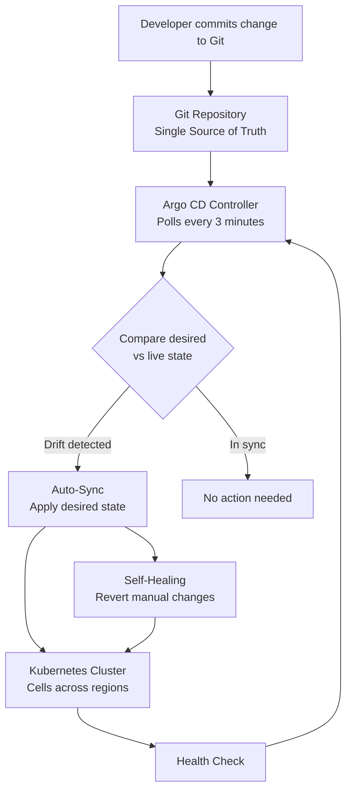

| Difficulty | Channel | Tags |
|---|---|---|
| beginner | devops | argocd, flux, declarative |

A deploy looked fine, then 478 services vanished across every region in 4.5 hours [1]. On 25 August 2021, a peer-reviewed, merged change to a root templating file — intended as a complete no-op — cascaded through Argo CD's auto-reconciliation loop and wiped out Skyscanner's global Kubernetes cells. Here is the twist that makes this story worth your attention: the same GitOps machinery that caused the catastrophe also restored the namespaces in under an hour once Git was corrected. This is the double-edged sword of declarative GitOps, and every team running Argo CD needs to understand both edges.

---

> ### Real-World Case — Skyscanner
>
> Skyscanner ran a global 'cells' architecture: multiple Kubernetes clusters per region on AWS Spot instances, with Argo CD auto-reconciling cluster config from Git. On 25 August 2021 an engineer made a change intended to be a no-op to a root templating file that drove namespace generation across every cell; it was peer reviewed, merged, and automatically rolled out worldwide.
>
> | | |
> |---|---|
> | **Challenge** | Automating declarative sync across all clusters without manual kubectl meant Argo CD had authority to prune anything missing from desired state. The change dropped the {{ }} template delimiters, so templating stopped applying and every namespace was re-rendered invalid — and because the root file was rarely touched, this failure mode was never tested or considered. |
> | **Solution** | Argo CD's automated reconciliation did exactly what Git told it: with no valid namespaces in the rendered config, it deleted all workloads it no longer saw in desired state. Recovery reverted the Git commit so Argo CD restored the namespaces, then required manual, per-cluster restoration of Deployments/Services from backups, prioritizing critical services in a single region. Afterwards they added staged rollout 'channels' (dev/alpha/beta/main) so template changes hit one cluster at a time, plus template unit tests and rewritten runbooks. |
> | **Outcome** | A 4.5-hour total global outage: 478 services deleted across all namespaces, availability zones and regions; skyscanner.net and the mobile app were unusable for all travellers and partners. By ~20:30 GMT all traffic was being served from a single restored region; other regions and non-critical services were recovered over the next two days. The same GitOps loop that caused the deletion also brought namespaces back in under an hour once Git was corrected. |
> | **Lesson** | Declarative GitOps is not automatically safe Git: auto-sync and prune are faithful amplifiers, so a two-character mistake in a shared template can become a global deletion in minutes. Treat templating as code with tests, and constrain reconciliation's blast radius with staged rollouts — self-healing only protects you when desired state is correct. |

---

## Hook — When a No-Op Is Anything But

Picture a Friday afternoon where everything is green on the dashboards. A developer merges a tiny change to a root templating file that drives namespace generation — reviewed by peers, approved by automation, and confidently labeled a no-op. Within minutes, Argo CD's controller sees the new desired state in Git and faithfully reconciles every cell, every availability zone, every region [1]. The result is not a small hiccup; it is a 4.5-hour global outage where skyscanner.net and the mobile app become unusable for every traveller and partner. Sound familiar? Many developers discover too late that automation does not care about intent — it only cares about declared state. And that raises a question worth sitting with: if Git is your single source of truth, what happens when the truth itself is wrong?

## Problem — The Automation Paradox

Building on this tension, the core challenge of GitOps is not the setup — it is the speed and scale at which mistakes propagate. Argo CD continuously watches your Git repository and compares declared state against the live cluster, typically every one to five minutes [2]. Consequently, a bad merge does not stay contained; it becomes a global event before anyone reaches for the cancel button. Teams often stumble here because they treat GitOps as a faster deployment tool rather than a change-management contract. The imperative approach — running kubectl apply or kubectl delete directly — feels safer in a crisis because a human is holding the keys [3]. However, that same direct access creates configuration drift, destroys auditability, and makes rollbacks a memory game. You end up with clusters that no longer match Git, and nobody can explain exactly how they got there. This leads to the next question: how does a declarative system actually decide what to change, and why does it sometimes get it catastrophically wrong?

## Real-World Case — Skyscanner's Global Cells

The numbers behind the Skyscanner incident make the abstract concrete. The company ran a global 'cells' architecture: multiple Kubernetes clusters per region on AWS Spot instances, with Argo CD auto-reconciling cluster configuration from Git [1]. On 25 August 2021, an engineer modified a root templating file that generated namespaces across every cell. The change was peer reviewed and merged — a textbook GitOps workflow. Yet because the templating change affected namespace generation globally, Argo CD deleted 478 services across all namespaces, availability zones, and regions. By approximately 20:30 GMT, all traffic was being served from a single restored region while other regions recovered over the following two days [7]. But wait, it gets better: once Git was corrected, the same reconciliation loop brought namespaces back in under an hour. The mechanism that caused the outage also powered the recovery — a reminder that GitOps is neutral about whether the state is right or wrong.

## Deep Dive — Declarative Versus Imperative, For Real

This leads to the architectural heart of the matter. In the declarative approach, you define the complete desired state in version control using YAML manifests, Helm charts, or Kustomize overlays [5]. Argo CD then continuously monitors and reconciles actual cluster state against that declaration [4]. Every change flows through a Git commit, which means you get audit trails, code review, and reproducible rollbacks. In contrast, the imperative approach uses direct kubectl commands to mutate the cluster, bypassing Git entirely [3]. Sound familiar? Most teams start imperative because it feels faster — until the 3am debugging session where nobody knows what changed. Here is the thing though: declarative does not mean safe by default. Skyscanner proved that a bad declaration propagates just as efficiently as a good one [1]. The real tradeoff comes down to guardrails, summarized below:

| Aspect | Declarative (Argo CD) | Imperative (kubectl) |
|--------|----------------------|---------------------|
| Source of truth | Git repository | Live cluster |
| Change speed | Automated, 1-5 min | Manual, immediate |
| Auditability | Full Git history | Minimal |
| Rollback | Git revert | Manual reconstruction |
| Blast radius | Global by default | Local to operator |
| Drift | Self-healed | Accumulates |

When would you actually use each? Declarative wins for production workloads where auditability and reproducibility matter. Imperative has a place in debugging, one-off migrations, and local development — but always with a plan to commit the final state back to Git.

## Workflow — Wiring the Reconciliation Loop

Building on the tradeoffs above, a production Argo CD setup follows a deliberate sequence. First, you organize your Git repository with Kubernetes manifests, Helm charts, or Kustomize overlays that represent the desired state [5]. Second, you create an Application Custom Resource that points Argo CD at that repository and defines the target cluster [4]. Third, you enable automated sync with a health check interval — three minutes is a common choice — so drift is corrected without manual intervention. Fourth, you configure self-healing so any unauthorized manual change gets reverted automatically. The diagram below shows how these pieces connect into a continuous reconciliation loop across a Kubernetes environment [6]. Notice that the loop does not distinguish between a good change and a bad one; it simply enforces whatever Git says. That is why the next section focuses on what to actually write in that Application CRD.

## Code Example — Configuring the Application CRD

Now that the flow is clear, here is a production-grade bash script that creates the Argo CD Application, enables auto-sync with a three-minute health interval, and turns on self-healing. The script uses kubectl to apply an Application manifest directly — an ironic but practical use of imperative tooling to bootstrap a declarative system. Each section is annotated so you can see the reasoning behind the choices. The explanation below walks through every line.

## Lessons Learned — Battle Scars and Better Guardrails

Circling back to the Skyscanner outage, the journey from a no-op to a global blackout teaches several hard-won lessons [1]. First, treat your Git repository like production — a bad commit is a production deploy, no matter how harmless it looks. Second, scope your Argo CD Applications tightly; a single root template driving every namespace is a blast radius waiting to happen [4]. Third, use Kustomize overlays or Helm values to isolate regional changes so one edit cannot touch all cells at once [5]. Fourth, test templating changes in a staging cell that mirrors production topology before merging. Here are the battle scars teams commonly collect:

- ⚠️ Watch Out: Enabling `prune: true` without verified manifests can delete resources you still need — audit your source tree first.
- 💡 Insight: Auto-sync with self-healing is powerful, but add a sync window or manual gate for high-risk namespaces.
- 🔥 Hot Take: GitOps does not eliminate human error; it scales it. Your review process must match your blast radius.
- 🎯 Key Point: The same loop that breaks things can fix them — invest in a fast, tested rollback path in Git.

Moreover, monitor your Argo CD controller metrics — sync duration, drift frequency, and failed syncs often reveal problems before they become outages [8]. If this feels overwhelming, you are not alone; every team starts somewhere, and Git history is always there to help you rewind.

---

## GitOps Reconciliation Flow

<strong>Original Interview Question</strong>

**Q:** You're setting up GitOps for a microservices deployment. How would you configure ArgoCD to automatically sync changes from your Git repository to Kubernetes, and what's the difference between declarative and imperative approaches in this context?

**A:** I'd configure ArgoCD by setting up a Git repository containing Kubernetes manifests or Helm charts, creating an Application CRD that points to the Git repository, enabling auto-sync with a health check interval of 3 minutes, and implementing self-healing to automatically revert any manual changes. The declarative approach involves defining the desired state in Git through YAML manifests, Helm charts, or Kustomize configurations, where ArgoCD continuously reconciles the actual state with the desired state. In contrast, the imperative approach uses kubectl commands to make direct changes to the cluster, bypassing the Git repository as the single source of truth.

## Conclusion

The Skyscanner story is not a cautionary tale about GitOps being broken — it is proof that GitOps works exactly as designed [1]. The same automation that deleted 478 services restored them in under an hour because Git remained the source of truth. So what should you do tomorrow? Audit your Argo CD Applications for over-broad scopes, add a staging cell for template changes, and make your rollback path as automated as your deploy path. Leave your team with this one memorable insight: in GitOps, your repository is not just code — it is production, and every commit is a deploy button.

---

## References

1. [Skyscanner incident report](https://medium.com/@SkyscannerEng/how-a-couple-of-characters-brought-down-our-site-356ccaf1fbc3) — article
2. [Kubernetes Concepts Overview](https://kubernetes.io/docs/concepts/overview/) — documentation
3. [Declarative Management of Kubernetes Objects](https://kubernetes.io/docs/tasks/manage-kubernetes-objects/declarative-config/) — documentation
4. [Argo CD GitHub Repository](https://github.com/argoproj/argo-cd) — documentation
5. [Kustomize Documentation](https://kubernetes.io/docs/concepts/overview/working-with-objects/kustomization/) — documentation
6. [Kubernetes on Wikipedia](https://en.wikipedia.org/wiki/Kubernetes) — documentation
7. [Amazon EKS User Guide](https://docs.aws.amazon.com/eks/latest/userguide/what-is-eks.html) — documentation
8. [Kubernetes GitHub Repository](https://github.com/kubernetes/kubernetes) — documentation

---

**Author:** Satishkumar Dhule — [GitHub](https://github.com/satishkumar-dhule) · [LinkedIn](https://linkedin.com/in/satishkumar-dhule) · [Website](https://satishkumar-dhule.github.io)
