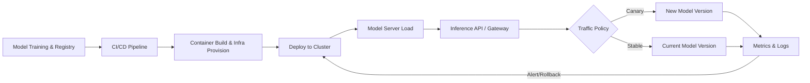

| Difficulty | Channel | Tags |
|---|---|---|
| beginner | devops | mlops, deployment |

When Netflix rebuilt its ML routing layer, the stakes were not academic. Its centralized serving platform handles roughly 1 million inference requests per second across hundreds of models, powering everything from Continue Watching ranking to payment fraud detection [1]. To support 30+ client services running A/B experiments, canaries, shadow mode, and instant rollbacks without client changes, Netflix routed traffic through a custom gateway called Switchboard [1]. That real-world pressure exposes a distinction many teams miss: deploying a model and serving a model are related, but they solve very different problems.

---

> ### Real-World Case — Netflix
>
> Netflix's centralized ML serving platform handles ~1 million inference requests/sec across hundreds of model types and versions (Continue Watching ranking, payment fraud detection, etc.). To let 30+ client microservices run A/B experiments, canaries, shadow mode, and instant rollbacks without changing client code, all traffic was routed through a custom API gateway called Switchboard.
>
> | | |
> |---|---|
> | **Challenge** | Switchboard had to deserialize and re-serialize large request payloads at 1M rps to route on user/device/locale/A/B-cell context, adding 10–20ms per request and amplifying tail latency enough to cause user-visible timeouts. It also became a single point of failure, a noisy-neighbor risk across tenants, and obscured request origins so real and test traffic were hard to separate. |
> | **Solution** | They decoupled the fast-changing deployment config from the request path: Switchboard Rules (JavaScript/JSON, published via Netflix's Gutenberg pub-sub with versioning and rollback) define model variants, experiments, and traffic splits. Lightbulb now resolves only minimal context into a routingKey header plus ObjectiveConfig (model ID), while existing Envoy sidecars read the header and route the untouched payload directly to the serving cluster VIP, with client-side fallback/caching. |
> | **Outcome** | Preserved the single integration point and 1M req/sec scale for 30+ client services while removing the 10–20ms serialization hop and tail-latency amplification, eliminating the shared-gateway failure domain and noisy-neighbor coupling, and retaining canary splitting, shadow testing, and instant rollback. Config now ships on its own release cycle independent of serving code deploys. |
> | **Lesson** | Model deployment metadata (which model, which experiment cell, which shard VIP) changes far more often than serving code. Put it in a versioned control plane, but execute routing in infrastructure already in the data path (Envoy) — a router that perfectly solves model versioning can become your latency budget and biggest availability risk at scale. |

---

## Hook — The 3 a.m. Pager That Wasn't a Model Bug

Picture this: the model passed every offline evaluation, the release pipeline turned green, and the feature shipped on time. Then latency spikes hit production, canary traffic misroutes, and rollback takes minutes instead of seconds. The model is fine — the system around it is not. This is where the deployment-versus-serving divide becomes painfully real. Deployment gets the model into a reliable, observable production environment; serving decides how that model answers live requests under pressure [2][3]. Understanding both is the difference between a demo that works and a platform that survives traffic.

## Problem — Why Teams Confuse Deployment and Serving

Many developers treat "deploying a model" as a single step: package it, push it, call it done. However, production ML systems have two distinct lifecycles. **Deployment** covers the path to production: containerization, CI/CD pipelines, infrastructure provisioning, environment configuration, monitoring hooks, and rollback strategies [2][3]. **Serving** covers runtime behavior: loading models, exposing inference APIs, routing requests, managing versions, batching inputs, and autoscaling under load [4][5]. When teams blur these boundaries, they optimize the wrong layer. A perfectly deployed model can still fail users if the serving layer cannot meet latency targets or handle traffic spikes. Conversely, a fast inference API is useless if releases are brittle and unobservable.

## Real-World Case — Netflix

Netflix's experience makes the distinction concrete. Its centralized ML serving platform processes about 1 million inference requests per second across hundreds of model types and versions, supporting use cases like Continue Watching ranking and payment fraud detection [1]. To let 30+ client microservices run A/B experiments, canaries, shadow mode, and instant rollbacks without changing client code, all traffic flowed through a custom API gateway called Switchboard [1]. Over time, that architecture introduced a 10–20ms serialization hop, tail-latency amplification, and a shared-gateway failure domain with noisy-neighbor coupling. By rethinking routing in the serving layer, Netflix preserved the single integration point and 1M req/sec scale while removing those bottlenecks and keeping canary splitting, shadow testing, and instant rollback. Crucially, config could ship on its own release cycle independent of serving code deploys — a clear example of separating operational concerns for speed and safety [1].

## Deep Dive — Technologies, Trade-offs, and Scaling Decisions

Building on the Netflix case, the technical split becomes easier to see. Deployment is infrastructure- and process-heavy: Docker and Kubernetes package and orchestrate workloads, while tools like MLflow and SageMaker help manage model lifecycle, registry, and release workflows [2][3][7]. Serving is runtime-heavy: frameworks like TensorFlow Serving, TorchServe, and BentoML expose inference endpoints, manage model loading, and support versioned rollouts [4][5][6].

| Dimension | Model Deployment | Model Serving |
|---|---|---|
| Primary goal | Ship models reliably to production | Deliver predictions fast and safely |
| Core tools | Kubernetes, Docker, MLflow, SageMaker [2][3][7] | TensorFlow Serving, TorchServe, BentoML, FastAPI [4][5][6] |
| Key concerns | CI/CD, infrastructure, monitoring, rollback | Latency, throughput, routing, versioning, autoscaling |
| Scaling focus | Replica management, resource provisioning | Request batching, GPU/CPU allocation, cold starts |
| Typical metrics | Deployment frequency, rollback rate, drift alerts | P95/P99 latency, QPS, error rate, saturation |

The key trade-offs are classic but consequential. **Latency vs. throughput**: real-time recommendations may need sub-100ms responses, while batch scoring can tolerate seconds but optimize for volume [4]. **Real-time vs. batch inference**: real-time serving demands always-on endpoints and careful autoscaling; batch jobs can use scheduled compute and simpler routing. **Cold start optimization**: loading large models on demand can spike tail latency, so teams pre-warm replicas or keep hot pools ready. MLOps practices tie these layers together, but they do not erase the distinction — they make the handoff between them disciplined and observable [8].

## Workflow — From Commit to Prediction

This leads to a practical workflow you can apply. First, package and validate the model artifact, then push it through CI/CD with automated tests and environment checks. Next, deploy infrastructure and register the model version. Finally, promote it into the serving layer with controlled routing, observability, and rollback policies. The diagram below shows where deployment ends and serving takes over.



Notice the feedback loop: monitoring signals from serving can trigger deployment actions like rollback or scaling updates [2][3]. That loop is healthy when ownership and interfaces are clear. It becomes dangerous when one opaque system hides both responsibilities, as Netflix discovered when routing logic and serving concerns were too tightly coupled [1].

## Code Example — A Simple Serving Layer Behind a Deployment

To make this tangible, here is a minimal Python example using FastAPI to expose a model for real-time inference. The deployment pipeline would build and run this service in a container orchestrated by Kubernetes, while the code below represents the serving layer: request handling, model loading, and prediction responses [2][4].

```python
from fastapi import FastAPI, HTTPException
from pydantic import BaseModel
import joblib
import time

app = FastAPI(title="Model Serving API")

# Load model once at startup to reduce per-request latency (serving concern)
# In production, this artifact would be delivered by your deployment pipeline.
MODEL_PATH = "/app/models/churn_model.joblib"
model = None

class PredictRequest(BaseModel):
    features: list[float]

@app.on_event("startup")
def load_model():
    global model
    start = time.time()
    model = joblib.load(MODEL_PATH)  # Avoid cold-loading on every request
    print(f"Model loaded in {time.time() - start:.2f}s")

@app.get("/health")
def health_check():
    # Deployment/platform probes use this to verify readiness
    return {"status": "ok", "model_loaded": model is not None}

@app.post("/predict")
def predict(payload: PredictRequest):
    if model is None:
        raise HTTPException(status_code=503, detail="Model not loaded")

    # Serving concern: transform request into model input and return prediction
    prediction = model.predict([payload.features])[0]
    probability = float(max(model.predict_proba([payload.features])[0]))

    return {
        "prediction": int(prediction),
        "confidence": round(probability, 4),
        "model_version": "v1.2.0"  # Version metadata supports safe rollouts
    }
```

The key design decisions are intentional. Loading the model at startup reduces repeated I/O and cold-start penalties during requests. The `/health` endpoint gives deployment platforms a readiness signal for safe rollouts and restarts. Returning `model_version` in responses makes canaries, debugging, and rollbacks easier to trace. In a full production setup, this service would sit behind a gateway or load balancer, with autoscaling, metrics, and traffic-splitting policies managed by the surrounding platform [2][4][5].

## Lessons Learned — What to Do Differently Tomorrow

The biggest lesson is simple: treat deployment and serving as separate but coordinated systems. Deployment answers, "Can we safely release and operate this model?" Serving answers, "Can we return the right prediction fast, at scale, under changing conditions?" Netflix's routing evolution shows that even strong platforms pay a price when those concerns get tangled [1].

Here is what to take back to your team:
- **Define boundaries early:** Document which components own CI/CD, infrastructure, routing, and inference runtime [2][3].
- **Design for rollback and experimentation:** Version models, support canaries, and make traffic policies configurable without redeploying code [1][4].
- **Measure what matters:** Track deployment health and serving health separately — rollback rate is not the same as P99 latency [7][8].
- **Plan for scale before you need it:** Cold starts, noisy neighbors, and tail latency rarely show up in demos, but they define production [1][4].

If this feels overwhelming, you are not alone. Many teams learn the distinction the hard way. The good news? Once you separate the concerns, debugging gets clearer, releases get safer, and scaling stops feeling like guesswork.

---

## Deployment-to-Serving Workflow


<details>
<summary><strong>Original Interview Question</strong></summary>

**Q:** Explain the key differences between model serving and model deployment in ML systems, including specific technologies, scaling considerations, and real-world implementation patterns?

**A:** Deployment encompasses CI/CD pipelines, infrastructure setup, and monitoring using tools like Kubernetes, MLflow, and SageMaker. Serving focuses on runtime inference APIs with frameworks like TensorFlow Serving, TorchServe, or BentoML, handling request routing, model versioning, and autoscaling. Key trade-offs include latency vs throughput, batch vs real-time inference, and cold start optimization.

</details>

## Conclusion

Model deployment gets your model into production; model serving determines whether it performs when real users and real traffic show up. Netflix's routing evolution is a reminder that scale exposes blurry boundaries fast [1]. The next time you ship a model, ask two separate questions: "How does it get released safely?" and "How does it serve predictions reliably?" Teams that answer both clearly build ML systems that don't just work in demos — they hold up at 3 a.m.

---

## References

1. [Netflix incident report](https://netflixtechblog.com/state-of-routing-in-model-serving-16e22fe18741) — article
2. [Kubernetes Concepts Documentation](https://kubernetes.io/docs/concepts/) — documentation
3. [MLflow Documentation](https://mlflow.org/docs/latest/index.html) — documentation
4. [TensorFlow Serving GitHub Repository](https://github.com/tensorflow/serving) — documentation
5. [TorchServe GitHub Repository](https://github.com/pytorch/serve) — documentation
6. [BentoML GitHub Repository](https://github.com/bentoml/BentoML) — documentation
7. [Amazon SageMaker Documentation](https://docs.aws.amazon.com/sagemaker/) — documentation
8. [MLOps - Wikipedia](https://en.wikipedia.org/wiki/MLOps) — article

---

**Author:** Satishkumar Dhule — [GitHub](https://github.com/satishkumar-dhule) · [LinkedIn](https://linkedin.com/in/satishkumar-dhule) · [Website](https://satishkumar-dhule.github.io)
