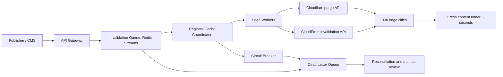

| Difficulty | Channel | Tags |
|---|---|---|
| intermediate | system-design | edge, caching, purging |

The deploy looked clean, then the old pricing page kept loading in Sydney while Frankfurt had already moved on. In 2022, Cloudflare's flexible purge system was storing millions of daily purge keys on every machine, quietly eating disk reserved for customer content, while replication crawled from a handful of core data centers [1]. A customer in Australia watched requests cross the Pacific before local users saw fresh content. That architectural debt became the opening chapter of a rewrite that dropped global P50 purge latency from 1,570 ms to 149 ms [1].

---

> ### Real-World Case — Cloudflare
>
> Cloudflare's original flexible purge system (tags, hostnames, prefixes) relied on Quicksilver replication from a few core data centers plus 'lazy purge': storing purge history on every machine and pretending matching files were cache misses. By 2022, millions of daily purge keys were consuming disk meant for customer content, Kafka queues added to throttle writes introduced latency, and a customer in Australia had to cross the Pacific before local users saw fresh content.
>
> | | |
> |---|---|
> | **Challenge** | Invalidate content consistently across data centers in 330 cities without serving stale prices or news in some regions, keep purge-triggered origin traffic from becoming a thundering herd, and decouple purge throughput from storage cost and central-bottleneck latency. |
> | **Solution** | They rebuilt it as 'coreless purge': Workers authenticate and filter the request at the nearest data center and Durable Objects queue and fan it out peer-to-peer, eliminating the core round trip. They replaced lazy purge with CacheDB, a Rust service backed by RocksDB running as a sidecar on every cache machine, indexing hostnames, tags, and URLs locally; the cache proxy checks CacheDB on every HIT so purges take effect instantly, while a local queue actively deletes matching files and Consul tracks peer health. |
> | **Outcome** | Global P50 purge latency dropped from 1,570 ms in May 2022 to 149 ms in August 2024, a 90.5% improvement across all 330 cities in 120+ countries (regional gains of 79-89%); purge-history storage fell 10x, improving cache hit ratios and cutting origin egress, and tag/hostname/prefix purge became available to all plans. |
> | **Lesson** | The counterintuitive win was reversing a decade-old assumption: active deletion with per-machine indexes was faster and 10x more storage-efficient than lazy expiry with globally replicated purge timestamps, and moving ingest to the edge removed both the central write bottleneck and the long-haul round trip. |

---

## Hook — The page that refused to die

The deploy looked clean, then the old pricing page kept loading in Sydney twelve seconds after release, while Frankfurt had already moved on. Sound familiar? Many developers discover that cache invalidation is the quiet villain of system design: too aggressive and the origin melts, too timid and users quote stale prices back at support. A CDN lives at the edge precisely to avoid round trips [6], yet that distance is exactly what turns a purge into a trust problem. So what if the fastest purge is the one that never travels?

## Problem — Five seconds, 10,000 invalidations, and one very angry origin

Building on that tension, the requirements turn a simple DELETE into a distributed systems exam. The target is global propagation under five seconds, 10,000 invalidations per second, 99.99 percent availability, and strong consistency across regions. HTTP caching already defines freshness and revalidation rules [5], and a header as small as `Cache-Control: max-age=2, must-revalidate` can bound staleness without any purge call at all [4]. CloudFront treats invalidation as a separate control-plane operation with its own limits and propagation behavior [2], while Cloudflare exposes pattern-based purging through a single API call. Many teams reach for immediate purging first, then discover that batching 100 keys per call cuts API cost by roughly 90 percent while keeping the SLA intact. The real question is not whether to purge, but which layer should own the truth.

## Real-World Case — Cloudflare

This leads straight to Cloudflare's own reckoning, which is the best-documented version of the trap just described. The original flexible purge system supported tags, hostnames, and prefixes, but it depended on Quicksilver replication from a few core data centers plus a lazy purge trick: every machine stored purge history and pretended matching files were cache misses [1]. By 2022, millions of daily purge keys were consuming disk meant for customer content, and Kafka queues added to throttle writes introduced their own latency. Consequently, an Australian customer's update had to cross the Pacific before local users saw fresh content. The rewrite pushed coordination to the edge and replaced history hoarding with tighter invalidation semantics; global P50 purge latency fell from 1,570 ms in May 2022 to 149 ms in August 2024, a 90.5 percent improvement across 330 cities in more than 120 countries, with regional gains of 79 to 89 percent [1]. Moreover, purge-history storage dropped tenfold, cache hit ratios improved, origin egress fell, and tag, hostname, and prefix purge became available on all plans. Here is the plot twist: the win came less from faster APIs and more from deleting work nobody needed to do.

## Deep Dive — The counterintuitive math of invalidation

However, that plot twist only lands once the tradeoffs are made explicit. A CDN is a distributed cache [6], and a web cache trades memory for speed by keeping copies close to readers [7]. Freshness is governed by headers and RFC rules [3], while expiration policies decide how long an object may live before revalidation [11]. Therefore, every design choice is a bet on whether staleness or origin load hurts more.

| Approach | Propagation | Real tradeoff | When to use |
| --- | --- | --- | --- |
| Short TTL plus revalidate | Bounded by TTL, zero API fan-out | Extra origin traffic and stampede risk | Dynamic pages with forgiving freshness |
| Explicit pattern purge | Near-immediate, highly targeted | API limits and partial regional failures | Releases, price changes, breaking news |
| Lazy purge with stored history | Fast locally, cheap per edge | Disk bloat and replication lag | Legacy fallback only |

The hidden tax is coordination. Redis Streams with consumer groups give ordered delivery and replay [9], and edge workers can coordinate regional fan-out without a central bottleneck [8]. Fetch calls to provider APIs must be batched and guarded [10]. Smart invalidation purges only affected regions, and a circuit breaker that trips after five consecutive failures stops a bad provider from cascading. Sound boring? Boring is what keeps 99.99 percent uptime.

Here is the thing though: strong consistency across 330 cities is usually the wrong mental model. Cloudflare's own numbers describe a P50 journey, not a universal instant, and the system still leans on reconciliation during partitions [1]. Define the SLA as a per-region percentile, design versioned cache keys so old content ages out naturally, and purge only when business logic demands immediate correction. When would developers actually use this? Price changes, headlines, and feature-flag rollouts need the purge path; a documentation typo can ride a two-second TTL and never touch the control plane.

## Workflow — From publish event to fresh edge in five seconds

Building on the split between immediate purge and patient TTL, the request path becomes a pipeline rather than a single API call. The System Flow diagram traces it end to end: a publisher emits an event, the API Gateway validates it, Redis Streams queues it with consumer groups [9], regional coordinators fan out, and edge workers call both Cloudflare and CloudFront in batches of 100 [2].

- Step 1: accept the invalidation and attach a trace ID so every region can be audited.
- Step 2: write to the stream, letting consumer groups handle replay and backpressure.
- Step 3: resolve the affected regions first; purge the whole planet only for a genuine global change.
- Step 4: edge workers batch up to 100 paths per provider call and retry with exponential backoff plus jitter.
- Step 5: trip the circuit breaker after five consecutive failures, then route the batch to the dead letter queue.
- Step 6: reconcile partitions with periodic health checks and verify response headers against the freshness rules [4].

Notice that the queue is a shock absorber, not a bottleneck. That distinction is what makes 10,000 invalidations per second survivable.

## Code Example — Batching, jitter, and a dead letter escape hatch

The workflow becomes concrete in the batching loop below. `enqueue` collects paths, `flush` drains them 100 at a time, and `purgeBatch` talks to the Cloudflare purge endpoint with `fetch` [10]. Notice that retries use exponential backoff with random jitter, so 10,000 concurrent invalidations do not arrive as 10,000 synchronized punches. On the third failed retry the batch moves to the dead letter handler instead of blocking the stream, which follows the same spirit as Cloudflare's move away from endless purge history [1]. If this feels overwhelming, start by reading the loop from the bottom up: paths in, bounded batches out, failures parked safely.

## Lessons Learned — Battle scars and the next deploy

Having followed the event from queue to edge, the lessons are less about SDKs and more about discipline.

- Battle scar: purging every key on every deploy. Fix: purge affected paths or regions only; Cloudflare's regional gains came from doing less work [1].
- Battle scar: retry storms without jitter. Fix: exponential backoff with a random slice, capped at three retries, plus a circuit breaker after five consecutive failures.
- Battle scar: treating purge history as permanent truth. Fix: versioned keys and short windows; Cloudflare cut history storage tenfold [1].
- Battle scar: ignoring freshness headers. Fix: pair purges with `Cache-Control: max-age=2, must-revalidate` and RFC-compliant revalidation [5][4].
- Battle scar: promising strong consistency globally. Fix: publish per-region P50 and P99 targets, then reconcile partitions later [1].

Pro tip: after debugging this pattern many times, measure the purge path at the edge, not in the control plane, because that is where your users experience time. Teams that adopt versioned keys usually delete half their invalidation traffic within a sprint. The one insight worth sharing in the next design review: the fastest purge is the one you design out of the system.

---

## Global Purge Flow

<strong>Original Interview Question</strong>

**Q:** How would you design a multi-region CDN cache purging system that guarantees content propagation within 5 seconds while handling 10,000 concurrent invalidations per second?

**A:** Implement Cloudflare API + AWS CloudFront with distributed invalidation queue, edge compute coordination, and 2-second TTL. Use batch invalidation, exponential backoff, and regional cache headers for 5-second SLA.

## Conclusion

The Sydney page finally goes stale because someone stopped treating propagation as a single global switch. The journey ran from a 1,570 ms P50 and a Pacific-crossing purge to 149 ms across 330 cities, achieved by batching calls, capping retries, and deleting purge history that had quietly become a second cache [1]. Tomorrow, measure purge latency per region, pair every purge with `Cache-Control: max-age=2, must-revalidate`, and try versioned keys on one high-traffic route. Then take that memorable line to your next design review: the fastest purge is the one you design out of the system.

---

## References

1. [Cloudflare incident report](https://blog.cloudflare.com/instant-purge/) — article
2. [Amazon CloudFront invalidation documentation](https://docs.aws.amazon.com/AmazonCloudFront/latest/DeveloperGuide/Invalidation.html) — documentation
3. [MDN HTTP caching guide](https://developer.mozilla.org/en-US/docs/Web/HTTP/Caching) — documentation
4. [MDN Cache-Control header reference](https://developer.mozilla.org/en-US/docs/Web/HTTP/Headers/Cache-Control) — documentation
5. [RFC 9111: HTTP Caching](https://datatracker.ietf.org/doc/html/rfc9111) — documentation
6. [Wikipedia: Content delivery network](https://en.wikipedia.org/wiki/Content_delivery_network) — documentation
7. [Wikipedia: Web cache](https://en.wikipedia.org/wiki/Web_cache) — documentation
8. [Cloudflare Workers SDK on GitHub](https://github.com/cloudflare/workers-sdk) — documentation
9. [Redis source repository on GitHub](https://github.com/redis/redis) — documentation
10. [MDN Fetch API documentation](https://developer.mozilla.org/en-US/docs/Web/API/Fetch_API) — documentation
11. [Amazon CloudFront expiration documentation](https://docs.aws.amazon.com/AmazonCloudFront/latest/DeveloperGuide/Expiration.html) — documentation

---

**Author:** Satishkumar Dhule — [GitHub](https://github.com/satishkumar-dhule) · [LinkedIn](https://linkedin.com/in/satishkumar-dhule) · [Website](https://satishkumar-dhule.github.io)
