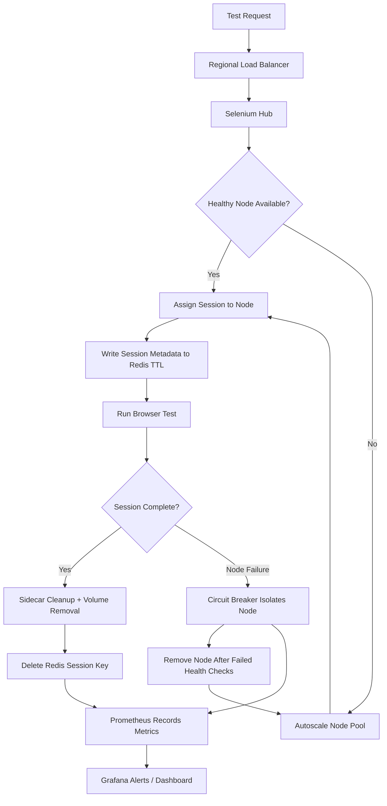

| Difficulty | Channel | Tags |
|---|---|---|
| advanced | system-design | selenium, webdriver, grid |

In 2013, Salesforce's CI pipeline was running roughly 13.6 million test executions a day, including about 1 million Selenium runs from 75,000 distinct tests spread across 52 auto-builds with up to 70 parallel sub-runs [1]. Behind that impressive scale sat an uncomfortable truth: a static pool of around 1,200 Selenium VMs was only about 50% utilized, and reusable hosts left stale browser state that made test results flaky [1]. If you have ever watched a test grid buckle under load, leak memory, or quietly poison results with leftover state, this story should feel uncomfortably familiar.

---

> ### Real-World Case — Salesforce
>
> By 2013 Salesforce's CI ran roughly 13.6 million test executions a day, including about 1 million Selenium runs from 75,000 distinct tests across 52 auto-builds with up to 70 parallel sub-runs. Its static pool of ~1,200 Selenium VMs sat at about 50% utilization, and reusable hosts left stale browser state that made results flaky.
>
> | | |
> |---|---|
> | **Challenge** | Absorb enormous bursts of code-change-triggered UI tests while keeping every session isolated and deterministic, without letting a central hub become a bottleneck or single point of failure. |
> | **Solution** | They deliberately rejected the standard hub-and-node Selenium Grid (a literal 'Why NOT Selenium Grid?' chapter in the talk) and built a Dynamic Grid: jClouds-driven, on-demand provisioning of identical VM testbeds from browser-specific gold masters across EC2 and OpenStack, triggered by Perforce changelists. Each host is destroyed after its run, flaky tests are auto-rerun and filed as bugs, and capacity is shifted between clouds to handle bursts. |
> | **Outcome** | Sustained ~1M Selenium runs/day across 75,000 distinct Selenium tests with up to 70 parallel sub-runs, replacing a static 1,200-VM pool that was only ~50% utilized with isolated, disposable testbeds and elastic multi-cloud burst capacity. |
> | **Lesson** | At extreme scale the grid hub is the wrong abstraction; destroying the entire environment after each run eliminates leaked state and turns capacity into an elastic cloud resource rather than a fleet to babysit. |

---

## Hook — When the Test Grid Becomes the Bottleneck

Picture a release day where every team is pushing commits, pipelines are queued, and the one system meant to validate confidence becomes the source of chaos. Tests time out, sessions hang, nodes fail silently, and engineers start rerunning jobs hoping for a green result instead of trusting it. That is the hidden cost of an under-designed Selenium Grid: it does not just slow delivery, it erodes trust in the signal your tests produce [2]. Salesforce's experience shows the stakes clearly — at massive scale, static infrastructure and unmanaged session state turn into both a cost problem and a reliability problem [1]. The question is not whether you can run Selenium at scale; it is whether you can run it predictably, cleanly, and cheaply enough to trust every result.

## Problem — Why 10,000 Concurrent Sessions Break Naive Grids

Scaling a Selenium Grid to 10,000 concurrent sessions is not just a matter of adding more machines. The real challenge is coordinating four moving targets at once: session lifecycle, resource isolation, node health, and cross-datacenter resilience. Without strict lifecycle management, browser processes outlive their tests, memory leaks accumulate, and nodes degrade until they collapse under load. Without smart scheduling and health checks, traffic keeps flowing to unhealthy nodes, turning isolated failures into cascading outages. The math makes the pressure concrete: 10,000 sessions at 50 sessions per node requires at least 200 nodes; at 2GB RAM and 1 CPU per node, that is 400GB baseline memory, or roughly 520GB with a 30% buffer. Add a P99 session initiation target under 2 seconds and a 99.9% uptime goal, and the architecture has to be deliberate at every layer [2][6].

## Real-World Case — Salesforce's Elastic Selenium Transformation

By 2013, Salesforce had pushed its CI system to extraordinary scale: roughly 13.6 million test executions per day, including about 1 million Selenium runs from 75,000 distinct tests across 52 auto-builds with up to 70 parallel sub-runs [1]. The existing approach relied on a static pool of about 1,200 Selenium VMs that averaged only around 50% utilization. Worse, reusable hosts carried stale browser state between runs, creating flaky results that teams could not fully trust [1]. The impact of rethinking this architecture was significant: Salesforce moved toward isolated, disposable testbeds and elastic multi-cloud burst capacity, sustaining around 1 million Selenium runs per day while escaping the waste and flakiness of a fixed VM pool [1]. The lesson for modern teams is timeless — at scale, session isolation and elastic capacity are not optimizations; they are prerequisites for reliability.

## Deep Dive — The Architecture Behind a Reliable 10,000-Session Grid

A scalable design starts with a hub-node pattern deployed on Kubernetes, where the hub coordinates session routing and browser nodes run as managed workloads across multiple availability zones [3]. Kubernetes StatefulSets or carefully managed node pools provide predictable identity and rollout behavior, while horizontal pod autoscaling reacts to queue depth so capacity tracks demand instead of lagging behind it [7]. Session state belongs in a Redis cluster with TTL-based expiration and connection pooling, ensuring abandoned or crashed sessions do not linger forever and consume resources [4]. 

Memory management needs both prevention and cleanup. Prevention comes from CPU and memory limits per pod (for example, 2GB RAM and 1 CPU per node), memory alerts at 80%, garbage collection tuning, and weekly rolling restarts to stop slow leaks from becoming outages. Cleanup comes from sidecar containers or init routines that remove stale Docker volumes, while Redis key expiration scans every few minutes purge orphaned session metadata [4]. Prometheus metrics and Grafana dashboards make the invisible visible by tracking memory trends, session duration, queue depth, and node health in real time [5]. 

Reliability depends on isolating failure quickly. Health checks against an HTTP `/status` endpoint every 10 seconds, with immediate removal after three consecutive failures, keep bad nodes out of rotation. Circuit breakers add another layer by isolating failing nodes for a short recovery window, preventing retry storms and cascading failures [6]. For 99.9% uptime, multi-AZ deployment, Pod Disruption Budgets that maintain at least 85% capacity, and rolling or canary updates reduce the blast radius of both infrastructure failures and bad releases [3][8].

## Workflow — From Session Request to Clean Teardown

The workflow below ties the architecture together into a single operational path. A test request hits the load balancer, which uses weighted round-robin based on node capacity and response time. The hub checks cluster health and queue depth, then schedules the session onto a healthy node. Session metadata is written to Redis with a TTL so every session has an expiration boundary from the moment it is created [4]. During execution, Prometheus scrapes metrics from nodes and sidecars, feeding dashboards and alerts that catch memory pressure before it becomes a node failure [5].

When a session ends normally, the sidecar cleans browser artifacts and ephemeral volumes. When a node fails health checks, the circuit breaker isolates it, the scheduler stops routing new sessions there, and Kubernetes replaces or recovers capacity through autoscaling and rolling updates [6][7]. The Mermaid diagram below shows this flow, including the cleanup and failure-recovery paths that keep the grid stable under pressure.

## Code Example — Session Lifecycle Manager with TTL and Cleanup

The code below illustrates a practical session lifecycle manager. It registers sessions in Redis with a TTL, monitors memory usage, and triggers cleanup when sessions expire or nodes exceed safe thresholds. While a production system would integrate directly with Kubernetes APIs and Selenium Grid internals, this pattern captures the core control loop: every session gets a deadline, every node gets watched, and no cleanup is left to chance.

## Lessons Learned — What to Do Differently Tomorrow

First, treat session cleanup as a first-class feature, not an afterthought. Salesforce's flaky results were not caused by test logic alone; stale state on reused hosts poisoned confidence in the pipeline [1]. Second, size the system with explicit math. Knowing that 10,000 sessions imply 200 nodes and roughly 520GB of cluster memory turns vague scaling fears into an actionable capacity plan. Third, assume nodes will fail and design for fast isolation. Health checks, circuit breakers, and Pod Disruption Budgets keep local failures from becoming global incidents [6][8]. Fourth, make observability part of the control plane. Prometheus metrics are not just for dashboards; they are the signals that drive autoscaling, alerting, and operational decisions [5]. The big takeaway is simple: at scale, a Selenium Grid is a distributed system, not a test tool. Build it like one, and your CI pipeline stops being a bottleneck and starts being a competitive advantage.

---

## Scalable Selenium Grid Session Flow

<strong>Original Interview Question</strong>

**Q:** Design a scalable Selenium Grid architecture to handle 10,000 concurrent test sessions with 99.9% uptime, ensuring zero memory leaks through automatic session lifecycle management, real-time monitoring, and graceful node failure recovery across multiple data centers?

**A:** Deploy Kubernetes cluster with auto-scaling node pools, Redis session store with TTL policies, Prometheus metrics for memory monitoring, circuit breakers for node isolation, and sidecar containers for session cleanup. Implement health checks, resource quotas, and rolling updates.

## Conclusion

Salesforce's 2013 Selenium infrastructure story is a reminder that test grids fail in predictable ways: static capacity wastes money, reused state creates flakiness, and missing lifecycle controls turn growth into instability [1]. The path to 10,000 concurrent sessions with 99.9% uptime is not a single clever trick; it is a system of disciplined choices — elastic Kubernetes capacity, Redis-backed session TTLs, Prometheus-driven observability, circuit breakers, and relentless cleanup [3][4][5][6][7]. If there is one change to make tomorrow, make session lifecycle explicit. Give every session a deadline, every node a health signal, and every failure a fast exit path. That is how a test grid earns back trust at scale.

---

## References

1. [Salesforce incident report](https://confpad.io/conferences/selenium-conference-2013/the-selenium-infrastructure) — article
2. [Selenium Grid Documentation](https://www.selenium.dev/documentation/grid/) — documentation
3. [Kubernetes StatefulSets](https://kubernetes.io/docs/concepts/workloads/controllers/statefulset/) — documentation
4. [Redis EXPIRE Command Documentation](https://redis.io/docs/latest/commands/expire/) — documentation
5. [Prometheus Overview](https://prometheus.io/docs/introduction/overview/) — documentation
6. [Circuit breaker design pattern](https://en.wikipedia.org/wiki/Circuit_breaker_design_pattern) — article
7. [Kubernetes Horizontal Pod Autoscaling](https://kubernetes.io/docs/tasks/run-application/horizontal-pod-autoscale/) — documentation
8. [High availability](https://en.wikipedia.org/wiki/High_availability) — article

---

**Author:** Satishkumar Dhule — [GitHub](https://github.com/satishkumar-dhule) · [LinkedIn](https://linkedin.com/in/satishkumar-dhule) · [Website](https://satishkumar-dhule.github.io)
