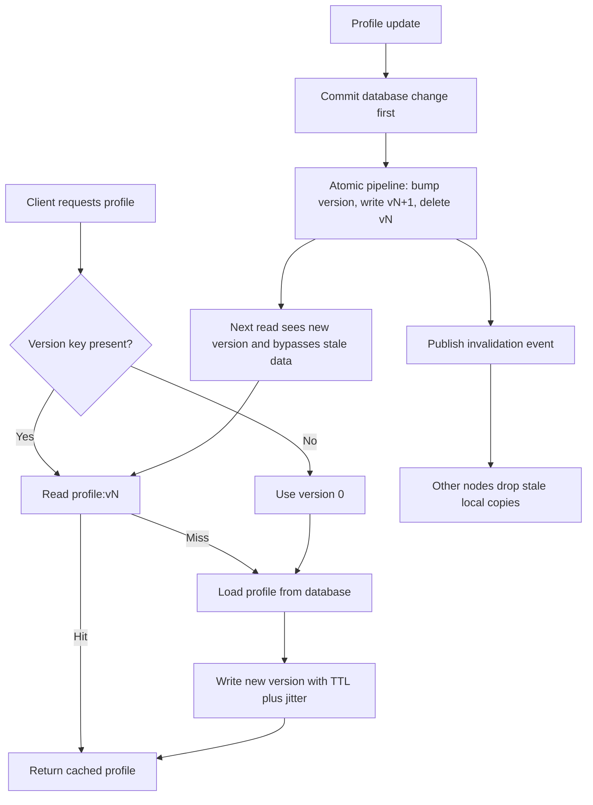

| Difficulty | Channel | Tags |
|---|---|---|
| beginner | backend | redis, memcached, cache-invalidation |

Four million authorization requests per second sounds like a cache success story until the cache starts telling lies. Netflix's Access and Identity Management team centered those decisions in PACS, cached the answers in large Memcached clusters, and still watched users refresh fast enough to see stale identity data before asynchronous deletes landed [1]. The team swapped event-driven eviction for a tiny dirty marker written at the source, cutting server traffic to roughly 400,000 RPS while keeping changes visible almost immediately [1]. Cache invalidation, it turns out, is less about deleting keys and more about controlling what readers are allowed to trust.

---

> ### Real-World Case — Netflix
>
> Netflix's Access and Identity Management team centralized authorization decisions in a service called PACS, whose results were cached in large Memcached clusters and read by clients at roughly 4 million requests per second. When a user's identity/profile data changed, the first approach streamed events from the identity provider to asynchronously delete cached entries — but that failed because users refreshed pages fast enough to see stale answers before the deletes landed.
>
> | | |
> |---|---|
> | **Challenge** | Achieve near-synchronous cache invalidation for user profile changes without tightly coupling the identity provider to PACS's many derived cache record types, and without sending every request to the authorization servers. |
> | **Solution** | Instead of deleting or updating every cached decision, the identity provider writes a single tiny 'dirty record' (the account ID) directly into Memcached at write time. PACS clients issue a bulk read that always includes that account's dirty key alongside the cached decision; if the dirty marker is present, they ignore the cached value and recompute it from PACS. This works purely with Memcached's flat key model — no pub/sub, no fan-out of deletes, and a one-key contract between systems. |
> | **Outcome** | PACS sustained about 4 million RPS at the clients while only about 400,000 RPS reached the servers (roughly a 10x load reduction via caching), with near-immediate reflection of user data changes instead of the unacceptable lag of async event-based eviction. |
> | **Lesson** | At scale, trying to eagerly invalidate every derived cache key is both brittle and too slow. Writing one version/dirty marker at the source and checking it on every read gives near-synchronous correctness with minimal coupling — a lesson especially relevant when choosing Memcached, whose lack of native pub/sub pushes invalidation logic into the read path rather than into the cache layer. |

---

## Hook — Four million answers a second, and a cache that lied

Building on that opening scene, picture your profile service on a normal Tuesday. Clients ask for the same handful of profiles again and again, Memcached or Redis answers in microseconds, and the database barely notices. Then a user edits a display name, refreshes the page, and sees the old one. Refresh again. Still old. The cache was not broken; it was faithfully serving a copy that no longer matched reality. That gap between fast and correct is where cache invalidation lives, and at Netflix scale it lasted just long enough for users to notice [1].

💡 Insight: A stale cache is not a performance problem. It is a truth problem with a latency budget. If your product can tolerate five minutes of staleness, the design is easy. If users can refresh in 300 milliseconds, the design gets interesting fast.

## Problem — The tiny window where your data becomes fiction

However, every cache turns into a time machine the moment the source of truth changes. A profile cached at 10:00:00 remains valid until somebody evicts it or its TTL expires, even if the database changed at 10:00:01. A cache hit is a reuse decision, and reuse only makes sense while the stored copy is fresh [2]. HTTP caching frameworks formalize the same idea with freshness, age, validation, and invalidation rules [6][7].

Here is what you need to know before touching a key:

- Write-through writes to cache and backing store together; write-back delays the backing write and adds coherence complexity [2].
- Cache-aside reads check the cache first, load from the database on a miss, then repopulate the cache.
- Delete-on-update removes the old value, but a concurrent reader can still repopulate it from a stale replica.
- TTL is a safety net, not a consistency strategy; 5-30 minutes works for profiles only when occasional staleness is acceptable.

⚠️ Watch Out: Many developers treat TTL as the invalidation plan. At 4 million RPS, even a two-second lag is millions of wrong answers. The scary part is that the cache is doing exactly what it was told.

## Real-World Case — Netflix

This leads directly to Netflix's Product Access Service, PACS. Clients read authorization decisions from large Memcached clusters, so roughly 4 million requests per second reached clients while only about 400,000 per second reached PACS servers, roughly a 10x load reduction [1]. The first invalidation attempt streamed identity-provider events and asynchronously deleted cached entries. That approach failed because page refreshes happened faster than deletes landed, leaving users staring at stale answers [1].

The plot twist was the fix: instead of teaching the identity provider about every cache key, the team wrote a single dirty record containing the account identifier into the cache at write time. Every PACS client bulk-read that dirty key alongside the decision; if the marker was present, the cached answer was ignored and the server recalculated. Near-synchronous visibility arrived without tight coupling, because the identity provider only needed to know that data had changed, not which of PACS's many record types needed deletion [1].

🔥 Hot Take: Fast deletion is not always the fastest invalidation. Sometimes a one-line marker read on every lookup beats a fleet-wide delete race.

## Deep Dive — Redis, Memcached, and the shape of trust

Building on the Netflix twist, the real question is not which cache is fastest. It is which cache lets your team express the rule that decides when an answer is trustworthy. Redis is an in-memory key-value database and message broker with optional durability, rich data structures, transactions, and pub/sub [3][4]. Memcached is a high-performance, multithreaded, event-based key/value cache intended for distributed systems, with a deliberately small surface area [5].

| Option | What it gives you | Real tradeoff | Reach for it when |
| --- | --- | --- | --- |
| Redis | Pub/sub, persistence, rich data types [3][4] | More moving parts; durability must be configured and understood | Distributed invalidation, shared state, restart tolerance, or complex keys |
| Memcached | Simple multithreaded key/value caching [5] | No pub/sub and no persistence; coordination stays in application code | Pure hot-key caching with very large clusters like Netflix's [1] |

Consequently, Redis buys you pub/sub fan-out for invalidation messages [4] and snapshot or append-only persistence options [3]. Memcached buys operational simplicity and a design that stays out of the way; its tutorial material shows the classic check-cache-then-query-database flow [9].

🎯 Key Point: Use Redis when invalidation logic needs a shared communication channel. Use Memcached when the cache is a disposable acceleration layer and your application already owns coordination.

But wait, it gets better: a versioned key beats a blind delete. Writing profile:v7 while readers still hold profile:v6 means nobody sees a half-updated value. Add an atomic version bump, TTL jitter to avoid synchronized expiry, and a pub/sub notification for other nodes, and the cache becomes a state machine instead of a bag of keys. When would this actually be used? Any time two services can write the same profile and a slow replica could otherwise resurrect stale data.

## Workflow — A versioned, observable update path

With those trade-offs in mind, the safe path has six steps. First, treat the database as the source of truth and commit the profile change before advertising it. Second, read the current version key. Third, write the new value under a new version and delete the old key in one atomic operation. Fourth, publish an invalidation event so other nodes can clean up local state. Fifth, give every cached value a bounded TTL with jitter. Sixth, measure hit rate, miss latency, and staleness separately.

The Mermaid diagram below, labeled Profile Cache Update Flow, tells the visual story: reads stay on the left, writes cross into the atomic swap, and invalidation fans out to other nodes. Notice that the read path never trusts an unversioned key.

- Read path: version lookup, cache hit, database fallback on miss, TTL write-back.
- Write path: database commit, version bump, new-version write, old-version delete.
- Coordination: pub/sub notification, negative marker or dirty record for fast rejection.

⚠️ Watch Out: Pub/sub is a notification, not a delivery guarantee. Treat it as an optimization; the version check or dirty marker is what keeps readers correct.

## Code Example — Versioned profile caching in Python

Now that the sequence is visible, the implementation below turns it into a small production-shaped class. Reads use cache-aside behavior, writes commit to the database first, and the Redis pipeline performs the version bump, new-value write, and stale-key delete as one isolated batch.

```python
import json
import random
from typing import Any

PROFILE_TTL = 900  # 15 minutes inside the 5-30 minute profile window

class ProfileCache:
    def __init__(self, redis_client: Any, db: Any) -> None:
        self.redis = redis_client
        self.db = db

    def _version_key(self, user_id: str) -> str:
        return f"profile_version:{user_id}"

    def _profile_key(self, user_id: str, version: int) -> str:
        return f"profile:{user_id}:v{version}"

    def _ttl(self) -> int:
        return PROFILE_TTL + random.randint(0, 120)  # jitter avoids lockstep expiry

    def _current_version(self, user_id: str) -> int:
        return int(self.redis.get(self._version_key(user_id)) or 0)

    def get_profile(self, user_id: str) -> dict[str, Any]:
        version = self._current_version(user_id)
        cached = self.redis.get(self._profile_key(user_id, version))
        if cached is not None:
            return json.loads(cached)  # cache-aside hit: no database call
        profile = self.db.fetch_profile(user_id)  # miss falls back to source of truth
        self.redis.setex(self._profile_key(user_id, version), self._ttl(), json.dumps(profile))
        return profile

    def update_profile(self, user_id: str, updates: dict[str, Any]) -> dict[str, Any]:
        updated = self.db.update_profile(user_id, updates)  # commit database first
        old_version = self._current_version(user_id)
        new_version = old_version + 1
        pipe = self.redis.pipeline()
        pipe.set(self._version_key(user_id), new_version)
        pipe.setex(self._profile_key(user_id, new_version), self._ttl(), json.dumps(updated))
        pipe.delete(self._profile_key(user_id, old_version))
        pipe.execute()  # atomic swap: readers see old or new, never half-written state
        self.redis.publish(
            "profile:invalidate",
            json.dumps({"user_id": user_id, "version": new_version}),
        )
        return updated

    def listen_for_invalidations(self) -> None:
        pubsub = self.redis.pubsub()
        pubsub.subscribe("profile:invalidate")
        for message in pubsub.listen():
            if message["type"] == "message":
                payload = json.loads(message["data"])
                self.redis.delete(
                    self._profile_key(payload["user_id"], payload["version"] - 1)
                )
```

Step by step: the version key acts as a pointer to the currently trusted snapshot. `get_profile` reads that pointer first, so an old-version entry cannot be served after the swap. `update_profile` commits the database change before publishing cache state, which prevents a cache hit from advertising data that is not durable yet. The pipeline makes the pointer change and value write indivisible, while `publish` gives other services a chance to clean up local caches [4]. Finally, `listen_for_invalidations` removes the previous version after receiving a notice; because the version pointer already moved, a missed message degrades to harmless extra memory until TTL cleanup, not stale reads.

💡 Insight: Local memoization tools expose hit and miss counters, such as `cache_info()` in Python's `functools` [8]. Distributed caches deserve the same instrumentation: if hit rate climbs while users report stale data, the cache is winning the wrong game.

## Lessons Learned — What to change tomorrow

The journey comes full circle: Netflix started with a cache that delivered a 10x load reduction, discovered that asynchronous deletes lost a race against page refreshes, and solved it by making staleness visible at read time [1]. Your profile service can borrow that pattern without operating four million RPS.

- 💡 Insight: Put the invalidation signal where the write happens, not where a stream consumer eventually processes it.
- ⚠️ Watch Out: Never delete the key before the database commit; a concurrent reader can repopulate the old value.
- ⚠️ Watch Out: Fixed TTLs create synchronized expiry waves. Jitter them by a minute or two.
- 🔥 Hot Take: A dirty marker beats a perfect delete when readers refresh faster than your event pipeline can deliver.
- 🎯 Key Point: Track hit rate, p99 cache latency, and time-to-visibility as separate metrics.

Translation for tomorrow's standup: decide the maximum staleness your product actually accepts, choose Redis or Memcached based on the coordination that decision requires [3][4][5], and make every cached value carry either a version or a dirty check. If this feels overwhelming, start with one profile endpoint, add a version key, and watch the miss rate before expanding. Sound familiar? That is usually the moment teams realize the cache was never the hard part; the contract around it was.

---

## Profile Cache Update Flow



<details>
<summary><strong>Original Interview Question</strong></summary>

**Q:** You're building a user profile service that caches frequently accessed profiles. How would you implement cache invalidation when a user updates their profile, and what trade-offs would you consider between Redis and Memcached?

**A:** Implement write-through caching with TTL-based expiration. On profile update, invalidate the cache by deleting the key and writing new data to both the database and cache. Redis offers pub/sub for automatic distributed invalidation, while Memcached requires manual coordination across nodes.

</details>

## Conclusion

The Netflix story started with a cache doing an impressive job: 4 million client RPS, roughly 400,000 server RPS, and a 10x load reduction [1]. It nearly failed because correctness arrived asynchronously while users refreshed synchronously. The lesson to carry into your next profile endpoint is blunt: pick the maximum staleness your product accepts, encode it in a version or dirty marker that every read consults, then choose Redis or Memcached based on how much coordination that rule needs [3][4][5]. Tomorrow, add one version key and one metric for time-to-visibility. Your future on-call self will thank you.

---

## References

1. [Netflix incident report](https://www.infoq.com/presentations/authorization-scalability/) — article
2. [Cache (computing) - Wikipedia](https://en.wikipedia.org/wiki/Cache_(computing)) — documentation
3. [Redis - Wikipedia](https://en.wikipedia.org/wiki/Redis) — documentation
4. [redis/redis GitHub repository](https://github.com/redis/redis) — documentation
5. [memcached/memcached GitHub repository](https://github.com/memcached/memcached) — documentation
6. [HTTP caching - MDN Web Docs](https://developer.mozilla.org/en-US/docs/Web/HTTP/Caching) — documentation
7. [RFC 7234: Hypertext Transfer Protocol (HTTP/1.1): Caching](https://datatracker.ietf.org/doc/html/rfc7234) — documentation
8. [functools - Python standard library documentation](https://docs.python.org/3/library/functools.html) — documentation
9. [How To Install and Use Memcache on Ubuntu 14.04 - DigitalOcean](https://www.digitalocean.com/community/tutorials/how-to-install-and-use-memcache-on-ubuntu-14-04) — blog

---

**Author:** Satishkumar Dhule — [GitHub](https://github.com/satishkumar-dhule) · [LinkedIn](https://linkedin.com/in/satishkumar-dhule) · [Website](https://satishkumar-dhule.github.io)
