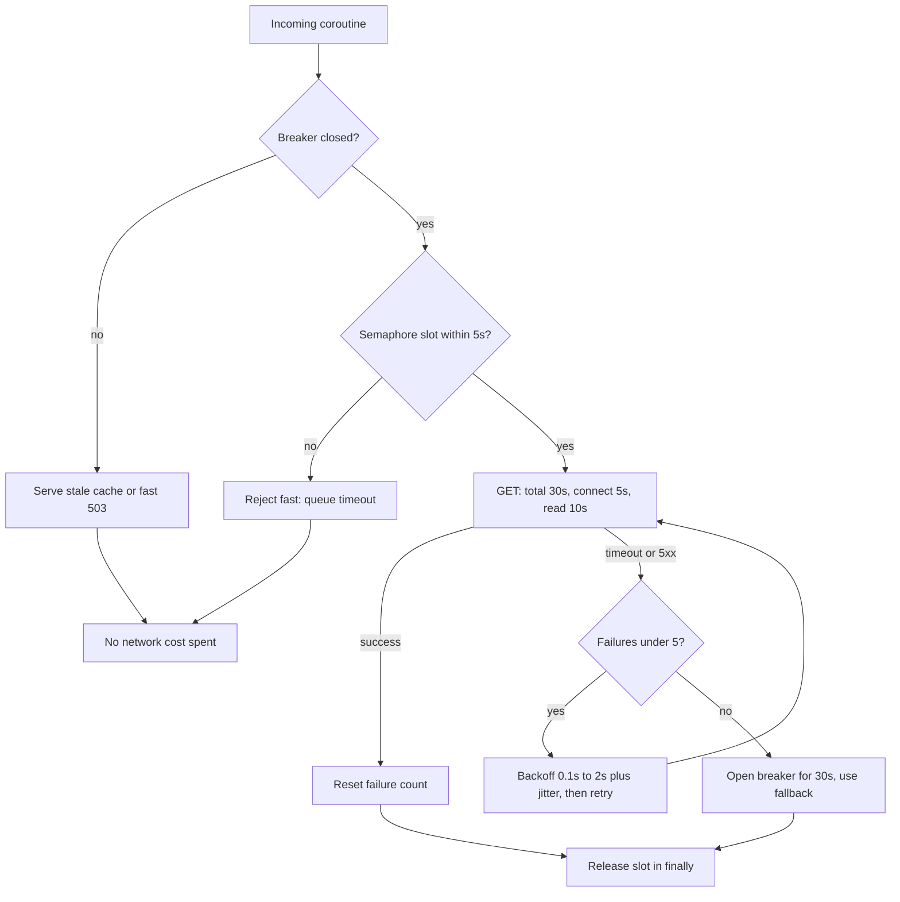

| Difficulty | Channel | Tags |
|---|---|---|
| advanced | backend | asyncio, aiohttp, concurrency |

Netflix's API gateway once took over a billion incoming calls per day and fanned each one out roughly six times across dozens of backend subsystems, peaking above 100,000 dependency requests per second on thousands of EC2 instances [1]. When one dependency slowed down, blocked request threads could fill the container's thread pool in seconds and take the whole API with them [1]. Teams running aiohttp services face the same plot twist in a different costume: one slow host, an unbounded queue of waiters, and a retry loop that turns a hiccup into an outage. The fix is not a bigger instance; it is a pool that knows when to say no.

---

> ### Real-World Case — Netflix
>
> Netflix's API gateway handled over 1 billion incoming calls per day, fanning out to several billion calls (roughly 1:6) across dozens of backend subsystems, with peaks above 100,000 dependency requests per second on thousands of EC2 instances. When a single dependency became slow, blocked request threads could saturate the entire container thread pool in seconds and take down the whole API.
>
> | | |
> |---|---|
> | **Challenge** | Prevent one latent or failing downstream service from cascading into a full API outage, while keeping the system responsive under high concurrency and frequent connection timeouts instead of letting retries and held connections hammer a struggling dependency. |
> | **Solution** | Netflix built Hystrix, wrapping each dependency call with network timeouts and bounded retries, per-dependency thread pools and semaphores as bulkheads that cap concurrent access to a fraction of total resources, and circuit breakers that trip at error thresholds (e.g. 50% errors in 10 seconds) to shed load and fail fast. Every call path also got a fallback handler for graceful degradation: stale cached data, defaults, fail-silent, or fail-fast. |
> | **Outcome** | At peak Hystrix ran 100+ command types across 40+ thread pools, executing 10+ billion thread-isolated and 200+ billion semaphore-isolated calls daily. In a real incident where a caching bug caused database throttling, the circuit breaker tripped and fallbacks from a local query cache kept member experience essentially unchanged. Netflix also showed that without these protections, 30 dependencies each at 99.99% uptime would yield only 99.7% composite uptime — 2+ hours of downtime per month. |
> | **Lesson** | Isolate every outbound call with a concurrency cap (semaphore/bulkhead), aggressive timeouts, and a circuit breaker, then serve a degraded fallback instead of retrying into a failing dependency — shedding load gives the downstream service room to recover rather than prolonging the outage. |

---

## Hook — One slow dependency away from a very bad afternoon

Picture a Tuesday afternoon: traffic is normal, dashboards are green, and then a downstream endpoint starts taking 12 seconds instead of 120 milliseconds. Every coroutine in the service piles up waiting for a connection, timeouts fire late, retries multiply the traffic, and the dependency that was merely slow is now buried. Netflix documented exactly this failure mode at gateway scale: a single slow dependency could saturate a thread pool in seconds and collapse the entire API [1]. That is the tension: under load, the most dangerous request is often the one that refuses to give up. Sound familiar? Many developers discover the hard way that a timeout without an admission policy is just a polite way to wait in line.

## Problem — When the timeout is not the real problem

Building on that near-miss, the real problem is not opening connections; aiohttp already pools them through its connector [2]. The problem is deciding who gets a connection, how long they wait, and what happens when the answer is no. Python's Semaphore can cap concurrent users of a resource [3], but a bare semaphore has no memory of a failing host and no idea when to stop. asyncio.wait_for can bound a wait [10], yet without a circuit breaker, timed-out requests still march back into the same broken dependency. Many developers think the fix is simply raising the pool limit; actually, raising it often deepens the outage by pushing more load onto a service already on its knees. Consequently, an aiohttp pool needs four distinct jobs: admission control, time budgets, failure memory, and a graceful exit. Miss one, and connection leaks or a missing shutdown hook will quietly turn a bad day into a long night.

## Real-World Case — Netflix

That scenario was not hypothetical. Netflix's gateway handled more than 1 billion incoming calls per day and fanned them out roughly 1:6 to dozens of subsystems, with peaks above 100,000 dependency requests per second across thousands of EC2 instances [1]. Hystrix isolated those calls in 40+ thread pools and 100+ command types, running 10+ billion thread-isolated and 200+ billion semaphore-isolated calls daily [9]. The counterintuitive lesson: bulkheads, not blind optimism, kept the blast radius small. During an incident where a caching bug triggered database throttling, the circuit breaker tripped and fallbacks from a local query cache kept the member experience essentially unchanged [1]. Netflix also published the math that makes this non-negotiable: 30 dependencies each at 99.99% uptime combine to only 99.7% uptime, or more than two hours of downtime per month [1]. When even perfect-looking nines multiply into a bad month, graceful degradation stops being a nice-to-have.

## Deep Dive — Bulkheads, breakers, and the math of retries

This leads to the obvious question: which guard belongs where? A semaphore limits concurrency, the connector owns keepalive sockets, and the breaker protects the rest of the system from a failing dependency. The table below keeps those responsibilities from getting tangled.

| Guard | What it stops | What it does not stop | Real cost |
|---|---|---|---|
| Semaphore [3] | Too many simultaneous callers | Slow responses inside an acquired slot | Waiters queue up, so bound the wait |
| Connector limit [2] | Too many TCP sockets | Logical pileups before the socket | Tuning both is easy to get wrong |
| Circuit breaker [4] | Repeated calls to a known-bad host | The first few failures | False positives need half-open probes |
| Exponential backoff [5] | Retry storms | A dependency that is simply dead | Adds latency; cap it and add jitter |
| Queue timeout [10] | Unbounded waiting | Network slowness | Requires a real fallback or a 503 |

Here is the thing though: retries are not free. AWS guidance recommends capped exponential backoff with jitter [6], and HTTP semantics treat safe methods as the sensible candidates for automatic replay [7]. Retrying a non-idempotent POST because of a vague read timeout is how a retry becomes a duplicate order. Moreover, keepalive cuts TCP setup work [8], but it also means a stale socket can look healthy until the first request on it fails. 🔥 Hot Take: a connection pool without a circuit breaker is mostly a very organized waiting room. When does this pattern actually earn its keep? Semaphore-only is fine for one well-behaved host; breaker plus fallback pays off once fan-out crosses a handful of services or an SLA is shared with strangers. ⚠️ Watch Out: SSL verification belongs on; disabling it to speed up a lab test has a habit of surviving into production.

## Workflow — From request arrival to graceful fallback

With those tradeoffs mapped, the request's journey becomes a small, predictable story. The Mermaid flowchart in the diagram field, 'Request Admission Flow', draws the same path: admission, attempt, failure, backoff, and release.

1. **Admit or reject at the door.** Check the breaker first; an open breaker returns a cached value or a fast 503 instead of spending a network call.
2. **Wait, but only briefly.** Acquire a semaphore slot with a 5-second deadline; a queue that never expires is just a slower outage [10].
3. **Spend a fixed time budget.** Use a 30-second total timeout with a 5-second connect timeout and a 10-second socket-read timeout; keepalive reduces handshake overhead on the reuse path [8].
4. **Remember failures.** Five failures in a row open the breaker for 30 seconds, then a single half-open probe decides whether to close it again [4].
5. **Back off with jitter.** Delays grow from 0.1s to 0.2s to 0.4s, capped at 2s, with up to 50ms of randomness so every client does not retry in lockstep [5][6].
6. **Release unconditionally.** The slot returns in a `finally` block, and the session closes during shutdown; Kubernetes lifecycle hooks can give that cleanup a fighting chance during pod termination [11].

💡 Insight: the fallback is part of the design, not an afterthought. A stale cache hit at 20ms beats a perfect answer at 30 seconds, every single time. But wait, it gets better: the same breaker that protects the dependency also protects the event loop from becoming a parking lot.

## Code Example — A pool that knows when to stop

Now the design becomes concrete. The implementation below keeps the response body inside the `async with` block, so no half-consumed response escapes to leak a connection [2]. The semaphore is acquired with a timeout and released in `finally`, which is the pattern Python's docs encourage for shared resources [3].

- `start()` builds one session and a bounded connector; keepalive stays enabled and SSL verification stays on.
- `_allow_request()` implements closed, open, and half-open states under a lock so concurrent coroutines do not race on the counter [4].
- `fetch_json()` retries only transient failures, adds jittered backoff, and calls the fallback when the breaker is open or retries are exhausted [5][6].
- `close()` is the shutdown hook teams forget; without it, pooled sockets outlive the work that created them.

🎯 Key Point: the fallback receives no URL and performs no network call. That is intentional, because a fallback that calls the same broken dependency is a plot twist nobody enjoys.

## Lessons Learned — Battle scars and tomorrow's checklist

After the dust settles, the memorable lesson is that degradation is a design decision made before the incident, not a heroic patch during it. Netflix's 99.99% dependencies adding up to 99.7% composite uptime is the number to tape above the monitor [1]. Battle scars worth avoiding: connection leaks from returning a live response object, missing `close()` on shutdown, unbounded queues, SSL verification switched off in a hurry, retrying non-idempotent methods [7], and backoff without jitter [6]. Every one of those shows up as 'the network is flaky' until someone reads the code. 🎯 Key Point: tell the team one sentence — a pool limits concurrency, a breaker limits persistence, and a fallback limits the blast radius. So what changes tomorrow? Add a 5-second admission timeout, a five-failure breaker, and a cache-backed fallback to the next fan-out service touched; measure 503 rate and p99 latency before and after. If this feels overwhelming, start with the breaker and the `finally` block, because those two pieces buy more reliability than another round of capacity tuning.

---

## Request Admission Flow

<strong>Original Interview Question</strong>

**Q:** How would you implement a connection pool manager for aiohttp that handles graceful degradation under high load and connection timeouts?

**A:** Implement a connection pool manager for aiohttp using a semaphore to limit concurrent connections, exponential backoff for retrying failed requests, and circuit breaker pattern to gracefully degrade under high load and connection timeouts.

## Conclusion

Netflix's billion-call gateway survived because slow dependencies were treated as expected weather, not rare emergencies [1]. You do not need thousands of EC2 instances to borrow the idea: bound the queue, budget the time, remember failures, and give every rejection somewhere softer to land. The next time one host gets slow, your service will not be a cautionary tale; it will be the boring, healthy one that everyone forgets to page about.

---

## References

1. [Netflix incident report](http://benjchristensen.com/2012/03/01/fault-tolerance-in-a-high-volume-distributed-system/) — article
2. [aiohttp client reference and connector implementation](https://github.com/aio-libs/aiohttp) — documentation
3. [Python asyncio synchronization primitives: Semaphore](https://docs.python.org/3/library/asyncio-sync.html#asyncio.Semaphore) — documentation
4. [Circuit breaker design pattern](https://en.wikipedia.org/wiki/Circuit_breaker_design_pattern) — documentation
5. [Exponential backoff](https://en.wikipedia.org/wiki/Exponential_backoff) — documentation
6. [AWS retry with backoff and jitter guidance](https://docs.aws.amazon.com/prescriptive-guidance/latest/cloud-design-patterns/retry-backoff.html) — documentation
7. [RFC 9110: HTTP Semantics](https://datatracker.ietf.org/doc/html/rfc9110) — documentation
8. [MDN: Connection management in HTTP/1.x](https://developer.mozilla.org/en-US/docs/Web/HTTP/Guides/Connection_management_in_HTTP_1.x) — documentation
9. [Netflix Hystrix repository](https://github.com/Netflix/Hystrix) — documentation
10. [Python asyncio.wait_for documentation](https://docs.python.org/3/library/asyncio-task.html#asyncio.wait_for) — documentation
11. [Kubernetes container lifecycle hooks](https://kubernetes.io/docs/concepts/containers/container-lifecycle-hooks/) — documentation

---

**Author:** Satishkumar Dhule — [GitHub](https://github.com/satishkumar-dhule) · [LinkedIn](https://linkedin.com/in/satishkumar-dhule) · [Website](https://satishkumar-dhule.github.io)
