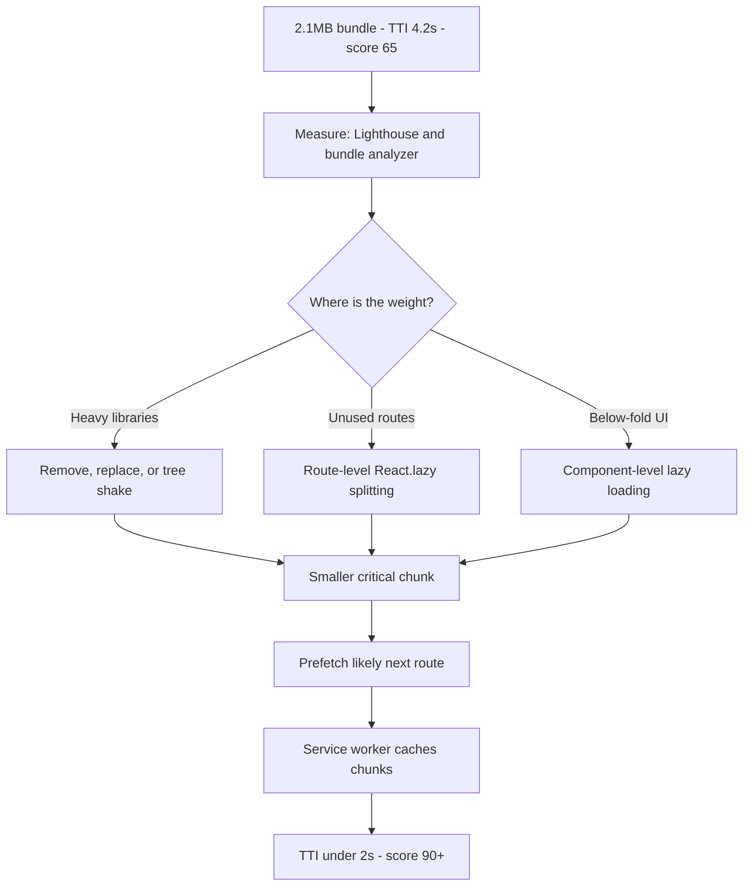

| Difficulty | Channel | Tags |
|---|---|---|
| intermediate | frontend | lighthouse, bundle, lazy-loading |

Picture a signup page that is mostly static text and a button, yet downloads 300KB of JavaScript before a visitor can click anything. That was Netflix's logged-out desktop homepage, where React, Lodash, and hydration data pushed a 3G-throttled Lighthouse run to a 7-second load [1]. Teams cut client JavaScript by more than 200KB, dropped TTI by over half, and saw fast input handling reach 97% of desktop users [1]. The twist: React itself was only about 45KB — the real weight was everything developers dragged along with it.

---

> ### Real-World Case — Netflix
>
> Netflix's logged-out desktop homepage — the sign-up/sign-in landing page most new users hit — shipped roughly 300KB of JavaScript (React, Lodash, hydration context data) for what was mostly static HTML. Lighthouse with 3G throttling showed a 7-second load, and since many new members arrived on poor mobile connections, this slow first page directly threatened signup conversion.
>
> | | |
> |---|---|
> | **Challenge** | Cut Time-to-Interactive on the entry page while keeping the server-side-rendered React architecture consistent with the rest of Netflix.com, without degrading the richer React SPA used for the rest of the signup flow. |
> | **Solution** | Rather than only splitting bundles, the team disabled JavaScript to see which elements genuinely needed it, then rewrote the remaining small widgets (tabs, language switcher, cookie banner, analytics logging, ad attribution) in vanilla JS — the language switcher alone took under 300 lines. React stayed as a server-side renderer for the initial HTML, while React, Lodash, and hydration code were removed from the client. The counterintuitive twist: they prefetched React and the heavy signup SPA bundle while users lingered on the landing page, using `` for HTML and XHR prefetching (95% cache-hit success) for JS/CSS. |
> | **Outcome** | Client JavaScript dropped by over 200KB (React itself was only ~45KB, but its dependencies and app code were the real cost). TTI fell more than 50% — from ~7s to under 3.5s desktop TTI in Lighthouse — and Chrome User Experience Report data showed fast First Input Delay for 97% of desktop users. Prefetching cut TTI a further 30% on the next signup page, and faster interaction correlated with a higher signup-button click-through rate. |
> | **Lesson** | The fastest bundle is the one you never ship: for simple routes, question whether a framework is needed at all, then lazy-load or prefetch it for the heavy flows that follow. Code splitting is a tool, not the goal — measuring what actually blocks interactivity found a bigger win than splitting alone would have. |

---

## Hook — The button that arrived after the patience expired

Picture this: a visitor taps Get Started on a signup page, and nothing happens for seven seconds. Not because the network is down, but because a mostly static page is busy parsing and executing 300KB of JavaScript [1]. Sound familiar? That is the moment a performance ticket stops being a vanity metric and starts being a revenue problem.

The stakes are simple: every second of delay on the first page is a second where a potential customer can leave. But here is the twist that makes this story worth following — the fix was not write less React. It was ship less React at the wrong time. Keep that thought, because the same pattern hides inside almost every 2.1MB bundle.

## Problem — 2.1MB of JavaScript, 4.2 seconds of silence

Building on that tension, a React app sitting at a Lighthouse score of 65 with Time to Interactive at 4.2s is not broken — it is bloated. Web performance is ultimately about how quickly a page becomes useful, not how quickly it finishes moving bytes [9]. On a fast laptop, 2.1MB feels fine; on throttled 3G, that same bundle creates a long, silent stretch where the UI looks ready but ignores taps.

Many developers discover the pain is concentrated in three places:

- **Parse and execute cost:** JavaScript must be downloaded, parsed, compiled, and run before handlers attach.
- **Hydration overhead:** server-rendered markup needs client context before it responds to input.
- **Unused code:** analytics dashboards, charting libraries, and date pickers ship on pages nobody visits.

⚠️ **Watch Out:** A higher score is not the goal by itself. The real target is a faster path to the first meaningful interaction. Teams that chase 90 without measuring conversion often optimize the wrong screen. So which bytes deserve the axe first? That question leads straight into the documented case.

## Real-World Case — Netflix

However, the clearest proof comes from Netflix's logged-out desktop homepage — the sign-up and sign-in landing page most new users hit — which shipped roughly 300KB of JavaScript for what was essentially static HTML [1]. The payload included React, Lodash, and hydration context data. Under Lighthouse with 3G throttling, the page took about 7 seconds to load [1]. Because many new members arrived over poor mobile connections, that delay sat directly in the signup funnel.

Then came the counterintuitive discovery. React itself accounted for only about 45KB; its dependencies and application code were the expensive part [1]. Teams removed unnecessary client-side React from that page, cut client JavaScript by more than 200KB, and pushed TTI down by over 50% — from roughly 7s to under 3.5s desktop TTI in Lighthouse [1]. Chrome User Experience Report data showed fast First Input Delay for 97% of desktop users, and prefetching shaved another 30% off TTI on the next signup page [1].

🔥 **Hot Take:** Faster interaction correlated with a higher signup-button click-through rate [1]. Performance work rarely gets a clearer business receipt than that. But how does a team reproduce that result on an app carrying 2.1MB? The next section unpacks the mechanics.

## Deep Dive — Where the bytes actually hide

Building on the Netflix lesson, the first rule is to stop treating the bundle as one indivisible blob. Code splitting breaks application code and third-party dependencies into chunks that can load independently [3]. Dynamic `import()` is the primitive behind it: unlike a static import, it is evaluated only when needed and returns a promise [2].

Here is the part that surprises people. Splitting alone does not make an app smaller; it changes *when* bytes arrive. Tree shaking — a bundler's removal of dead code via static `import` and `export` analysis — is what actually deletes unused modules [4]. Consequently, a CommonJS-heavy dependency can quietly defeat tree shaking even after a seemingly successful split. ES module configuration is not busywork; it is the switch that enables deletion.

Lazy loading complements both ideas by marking non-critical resources and fetching them only when needed, shortening the critical rendering path [5]. Once chunks exist, service workers add fine-grained control: they intercept requests, update assets, and serve cached responses on repeat visits [6].

### Route splitting vs component splitting — the real tradeoff

| Option | Best for | Tradeoff |
| --- | --- | --- |
| Route-based splitting | Whole screens like `/dashboard` | Navigation shows a fallback; prefetch repairs most of it |
| Component-based splitting | Charts, editors, modals below the fold | More Suspense boundaries to manage |
| Tree shaking only | Utility libraries with ES modules | Useless against side-effectful CommonJS packages |
| Static import | Shell, layout, auth guard | Ships on first paint, so keep it tiny |

💡 **Insight:** When would a team actually use each? Route splitting is the default for multi-screen apps, component splitting is for expensive widgets that may never open, tree shaking is continuous hygiene, and service workers reward repeat visitors. 🎯 **Key Point:** split by user behavior, not by folder structure — a chunk nobody defers is just a chunk with extra steps.

## Workflow — From score 65 to score 90+

With the concepts mapped, the journey becomes a repeatable loop rather than a guessing game. The **Bundle Diet Flow** diagram shows the whole arc; the steps below expand it.

1. **Measure before cutting.** Run Lighthouse under mobile and 3G throttling, then record TTI, LCP, and total JavaScript. Generate a stats file and open the treemap from webpack-bundle-analyzer, which reports parsed, gzip, and Brotli sizes so decisions rest on real numbers [7].
2. **Rank the offenders.** Sort by parsed size and ask: is this library needed on first paint? Full lodash builds, moment-style date utilities, and icon packs are recurring culprits.
3. **Delete before splitting.** Replace heavy utilities with targeted imports or smaller alternatives, and confirm ES modules so tree shaking can do its job [4].
4. **Split by route.** Wrap route components in `React.lazy()` and place one Suspense boundary near the router.
5. **Split by interaction.** Lazy-load charts, editors, and modals behind a click or scroll, and use `loading="lazy"` for offscreen media [5].
6. **Prefetch the likely next step.** Hover, focus, or idle-time `import()` calls warm the next chunk — the same trick that cut TTI a further 30% in the Netflix case [1].
7. **Cache the chunks.** A service worker caches versioned chunks so repeat visits skip the network [6].
8. **Guard the budget.** Fail CI when the initial chunk crosses an agreed threshold, because regressions are silent otherwise.

This leads to the implementation — including one boundary that stops a failed chunk from taking down the entire app.

## Code Example — Lazy routes with a safety net

This leads to working code built on the production React composition pattern [8]. The snippet uses `createElement` so it stays plain JavaScript, wraps lazy screens in an error boundary, and prefetches on hover. What each block does:

- **`React.lazy()` calls:** each returns a component backed by a dynamic import, so its chunk is fetched on first render rather than at boot [2].
- **Preload functions:** calling `import()` on hover warms the browser cache before navigation, the Netflix prefetch idea in practice [1].
- **`ChunkBoundary`:** a class component implementing `getDerivedStateFromError` catches a failed chunk and renders a retry message instead of a blank page.
- **`Suspense` fallback:** a skeleton shows while the chunk is in flight, which keeps the page feeling responsive.
- **`ChartPanel`:** state gates a heavy widget behind a click, so component-level splitting follows actual intent.

⚠️ **Watch Out:** the boundary must sit *outside* Suspense for React to catch load failures reliably. Placing it inside leaves errors uncaught and users staring at a dead route.

## Lessons Learned — The playbook worth keeping

Consequently, the biggest win is a change in instinct: reach for measurement before architecture. The Netflix story shows that deleting unnecessary client code beat any clever framework tweak, and that React's 45KB was never the villain [1][10].

Here are the battle scars worth memorizing:

- **Battle scar 1 — Splitting without deleting.** Twenty chunks totaling the same 2.1MB is a pile of network waterfalls, not a performance fix.
- **Battle scar 2 — Over-eager prefetch.** Warming every chunk at once recreates the original problem with extra HTTP requests. Prefetch only likely next steps.
- **Battle scar 3 — CommonJS regressions.** A single side-effectful dependency can break tree shaking; recheck the treemap after every major upgrade [4].
- **Battle scar 4 — Invisible cache staleness.** Without versioned caches, service workers serve yesterday's chunks to today's users [6].

🔥 **Hot Take:** Teams often debate route splitting versus component splitting for weeks, then ship a 600KB icon pack that dwarfs both decisions. Humility, measured in kilobytes, scales better than ideology.

The journey that started with a seven-second signup button ends with a simple rule: ship the smallest thing that can answer the visitor, then bring reinforcements only when invited. That is the transformation — from bundle as luggage to bundle as concierge.

---

## Bundle Diet Flow

<strong>Original Interview Question</strong>

**Q:** You're tasked with improving a React app's Lighthouse performance score from 65 to 90+. The bundle size is 2.1MB and Time to Interactive is 4.2s. What specific steps would you take to optimize the bundle and implement lazy loading?

**A:** Implement code splitting with React.lazy() and Suspense, analyze bundle composition with webpack-bundle-analyzer to identify largest chunks, remove unused dependencies and optimize imports, add dynamic imports for heavy components and third-party libraries, implement route-based splitting for better initial load times, and utilize tree shaking with proper ES module configuration.

## Conclusion

The journey began with a seven-second signup button and ends with a practical rule: ship the smallest thing that can answer the visitor, then bring reinforcements only when invited. Tomorrow, open the treemap, pick the largest chunk that never appears on first paint, and defer it behind a route or a click. Set a budget so the win survives the next sprint. The memorable insight to bring to the team: a bundle is not a library of code you own, it is a bill you send to every visitor — and Netflix proved that trimming the invoice can lift conversion.

---

## References

1. [Netflix incident report](https://medium.com/dev-channel/a-netflix-web-performance-case-study-c0bcde26a9d9) — article
2. [MDN: import() dynamic import operator](https://developer.mozilla.org/en-US/docs/Web/JavaScript/Reference/Operators/import) — documentation
3. [MDN Glossary: Code splitting](https://developer.mozilla.org/en-US/docs/Glossary/Code_splitting) — documentation
4. [MDN Glossary: Tree shaking](https://developer.mozilla.org/en-US/docs/Glossary/Tree_shaking) — documentation
5. [MDN: Lazy loading guide](https://developer.mozilla.org/en-US/docs/Web/Performance/Guides/Lazy_loading) — documentation
6. [MDN: Service Worker API](https://developer.mozilla.org/en-US/docs/Web/API/Service_Worker_API) — documentation
7. [GitHub: webpack-bundle-analyzer](https://github.com/webpack/webpack-bundle-analyzer) — documentation
8. [GitHub: React library source](https://github.com/facebook/react) — documentation
9. [Wikipedia: Web performance](https://en.wikipedia.org/wiki/Web_performance) — documentation
10. [Wikipedia: React (JavaScript library)](https://en.wikipedia.org/wiki/React_(JavaScript_library)) — documentation

---

**Author:** Satishkumar Dhule — [GitHub](https://github.com/satishkumar-dhule) · [LinkedIn](https://linkedin.com/in/satishkumar-dhule) · [Website](https://satishkumar-dhule.github.io)
