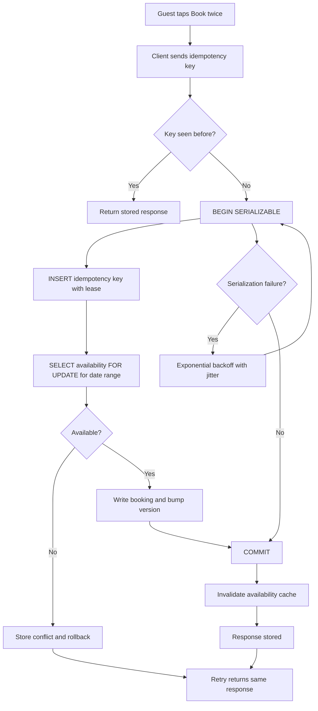

| Difficulty | Channel | Tags |
|---|---|---|
| intermediate | database | acid, isolation-levels, mvcc |

A guest taps Book, the network hiccups, the client retries, and suddenly two charges are in flight. During its migration to a service-oriented architecture, Airbnb hit exactly this class of race condition across payment and booking flows, where double-clicks, aggressive retries, and lost responses threatened duplicate requests [1]. The team's answer was an idempotency framework that gave each request exactly-once semantics, and it kept payments consistent while volume doubled. That story is the perfect map for anyone designing a booking system that must never sell the same night twice.

---

> ### Real-World Case — Airbnb
>
> As Airbnb migrated to a service-oriented architecture, payment and booking flows became distributed transactions spanning multiple microservices. The team faced race conditions where users could click "Book" twice, clients could retry aggressively, or responses could be lost, risking double payments or duplicate booking requests in a distributed system.
>
> | | |
> |---|---|
> | **Challenge** | How to guarantee exactly-once processing for booking/payment requests in a distributed microservice architecture, preventing duplicate charges or duplicate booking actions when concurrent or retried identical requests arrive. |
> | **Solution** | Airbnb built "Orpheus," a generic idempotency framework. Each API request carries an idempotency key and must acquire a database row-level lock (expiring lease) before proceeding, preventing concurrent duplicates. Requests are split into Pre-RPC, RPC, and Post-RPC phases, with Pre/Post phases wrapped in atomic database transactions and no network calls inside DB transactions. Responses are classified as retryable or non-retryable, enabling safe client retries with eventual consistency. |
> | **Outcome** | The framework provided exactly-once request semantics for distributed payment operations, preventing double payments and duplicate request processing caused by retries, timeouts, or double-click race conditions across Airbnb's payments microservices. |
> | **Lesson** | In distributed systems, application-level check-then-write is not enough; correctness requires an authoritative coordination point. Database row-level locks on idempotency keys, expiring leases, and atomic transaction boundaries turn unreliable retries and concurrent requests into safe, eventually consistent operations. |

---

## Hook — The click that charged twice

In 2019, as Airbnb moved billing and payments into a service-oriented architecture, a simple Book click could fan out into a distributed transaction across multiple services [1]. A double-click, an aggressive client retry, or a response lost on the way back could leave two payment attempts racing toward the same reservation. Picture the support ticket: one guest, one listing, two charges. That is not a database trivia question; that is a trust economy problem, and the stakes are very real.

## Problem — Two promises pulling in opposite directions

Building on that tension, a booking system has to satisfy two promises that pull in opposite directions. First, correctness: a night is sold once, a payment is captured once, and a retry must not create a second order. Second, availability: guests browsing calendars should not wait behind a queue of writers, especially during a flash sale when a popular cabin gets 500 requests in a minute.

Transactions provide atomicity, consistency, isolation, and durability, but the isolation part is where the plot thickens [3]. Guidelines such as SERIALIZABLE describe schedules that behave as if transactions ran one after another [4]. Many developers reach for the strictest level everywhere, then discover that throughput collapses faster than a cheap suitcase zipper.

Here is the thing though: a database transaction alone cannot fix an external side effect. If a payment processor already charged the card and the response was lost, rolling back a local row does not magically uncharge the guest. Idempotence, the property that repeated calls produce the same effect, matters as much as locking [2]. HTTP POST does not even guarantee idempotence by default, so the key has to be explicit [10].

⚠️ Watch Out: A retry is not a new user intent. Treat every retry as the same logical request, or the system will politely duplicate the damage.

## Real-World Case — Airbnb

This is where the Airbnb story stops being abstract and starts getting specific. The 2019 write-up describes a framework named Orpheus that turned 'process this payment once' into a reusable library across payments services [1]. Each request carried an idempotency key, acquired a database row-level lock, and received an expiring lease; the lease had to outlive the RPC timeout so a slow processor did not hand the same request to a second worker.

💡 Insight: The clever part was not a bigger lock. Orpheus split work into three phases: Pre-RPC wrote request state, RPC talked to external services, and Post-RPC recorded the response. No network calls in the first and last phases, and no database calls during the remote call. That boundary kept transactions short while still making retries deterministic.

🔥 Hot Take: Reading an idempotency record from a replica is not 'eventually consistent'; it is a loaded gun. The article notes that a replica that has not caught up can answer 'does not exist' and allow the same payment to run twice [1].

The payoff was concrete: the framework delivered five nines (99.999%) consistency for payments while annual payment volume doubled. Sound familiar? That is the kind of result that turns a library into infrastructure.

## Deep Dive — Locks, snapshots, and the retry budget

Consequently, the next question is not 'which isolation level sounds strongest?' but 'which guarantee belongs on which path?' MVCC lets readers see a consistent snapshot while writers append new row versions, so availability browsing stays fast [5]. However, a snapshot is a photograph, not a promise; a check taken from stale data must never be the final authority for a paid reservation.

SERIALIZABLE is the bodyguard at the door. It prevents write skew and other anomalies by making concurrent transactions behave as if serialized, which is ideal when two guests fight for the last night [6]. Use it only on the critical commit path. Put it on every read and the system will spend its life apologizing to users.

💡 Insight: Optimistic concurrency control assumes conflict is rare. A version column lets the database notice that another writer changed the row first [7]. When conflicts are below roughly 1-5%, optimistic retries usually cost less than holding locks; above that, switch to pessimistic row locks before the retry loop becomes a denial-of-service attack with good manners.

Here is the real tradeoff:

| Option | Sweet spot | Cost | When to reach for it |
| --- | --- | --- | --- |
| MVCC snapshot read | Calendar browsing, search results | Can be stale [5] | Any read-heavy path where a slow refresh is acceptable |
| SELECT ... FOR UPDATE | Narrow date-range locks on a hot property | Lock contention, deadlocks | When two writers can touch the same nights |
| Optimistic version check | Low-conflict bookings | Retry churn | When conflicts are rare and latency matters |
| SERIALIZABLE commit | Payment and reservation atomicity [4] | Abort rate under load | When correctness outranks throughput |
| Idempotency key lease | Any client-visible write [2] | Extra key table and cleanup | Every Book, Pay, or Cancel endpoint |

As planning numbers for a 6-8 engineer team, target p99 availability reads under 150 ms, p99 commits under 400 ms, up to 3 retries with full jitter, and a 30-60 second cache TTL; shifting roughly 80% of read traffic to replicas is a common first cost lever. Model 1,000 booking attempts per second on launch day, then measure lock wait time instead of guessing.

⚠️ Watch Out: Read replicas are excellent for browsing and dangerous for decisions. A replica lag of even 200 ms can show an available night that was booked 50 ms ago, so route the final check to the primary or to a consistency-aware store.

Cache invalidation deserves its own plot twist. Write-through caching with a versioned key makes stale reads obvious; bump a property generation on commit and old cache entries simply age out. Circuit breakers for hot listings keep one celebrity property from turning the whole booking service into a queue at a theme park.

🎯 Key Point: The strongest design is layered. Idempotency stops duplicate intent, row locks stop overlapping writers, SERIALIZABLE stops anomaly-shaped surprises, and replicas plus caches keep the read path fast.

## Workflow — From double-click to one booking

With the tradeoffs clear, the flow becomes almost boring, which is exactly what you want when money is involved. Figure 1 maps the journey from a double-click to a single stored booking.

1. The client generates one idempotency key before the first attempt and reuses it on every retry; HTTP POST alone does not grant idempotence [10].
2. The API checks the key table on the primary. If a completed response exists, it returns that response immediately and skips the booking path entirely.
3. Otherwise the request acquires or renews a lease with an expiration longer than the RPC timeout, mirroring Airbnb's rule [1].
4. A SERIALIZABLE transaction locks only the requested nights using SELECT ... FOR UPDATE, then verifies each availability row and version [4].
5. The booking row is inserted, availability rows are bumped, the idempotency record is marked done, and the transaction commits.
6. The cache generation changes after commit, and any failed serialization attempt goes through exponential backoff with full jitter before one of the three permitted retries.

But wait, it gets better: the same flow that prevents double bookings also gives support teams a debugging superpower. Every request has a key, a state, and a stored response, so 'did the booking happen?' becomes a query instead of a séance. The only question left is what this looks like in code.

## Code Example — A booking transaction that forgives retries

Here is the shape of the critical section; the complete runnable-style snippet follows in the structured example below.

```python
with conn.transaction():
    conn.execute("SET LOCAL transaction_isolation = 'serializable'")
    prior = conn.execute(
        "SELECT status, response FROM idempotency_keys WHERE key = %s FOR UPDATE",
        (key,),
    ).fetchone()
    ...
```

Line by line, `SET LOCAL` scopes strict isolation to this transaction instead of the whole session. The `SELECT ... FOR UPDATE` on the key row serializes duplicate attempts and exposes any stored response. The ellipsis hides the lease check, the night locks, and the bounded retry wrapper, all of which matter because a partial booking is still a broken promise. The full version keeps every mutation inside one transaction and treats commit as the single point of truth [3].

## Lessons Learned — What to change tomorrow

Building on the journey from a double-click to a durable booking, the lesson is not 'turn on SERIALIZABLE and go home.' It is that correctness lives at the boundaries: request identity, transaction scope, lock scope, and cache invalidation.

- **Battle scar: retrying without a key.** Two attempts look like two customers. Put an idempotency key on every client-visible write and return the stored response [2].
- **Battle scar: reading the key from a replica.** Stale reads reintroduce the exact Airbnb failure mode [1]. Read idempotency state from the primary.
- **Battle scar: locking the whole property.** A table-wide lock turns one busy cabin into a citywide traffic jam. Lock only date rows.
- **Battle scar: leases shorter than RPC timeouts.** The first attempt is still working when the second one is allowed through. Keep lease expiration above the RPC timeout.
- **Battle scar: infinite retries.** Add a hard cap of 3 attempts, full jitter, and a circuit breaker for hot properties; backoff timing can use Python's standard timing facilities [9].

🔥 Hot Take: Availability checks are marketing; the write decision is the contract. Treat everything before commit as advisory and everything after commit as immutable history.

Tomorrow, pick one endpoint, add an idempotency key, draw the transaction boundary, and measure lock wait time before arguing about isolation levels. The team that does this will sleep better, and so will the guest who clicked once.

---

## Booking Idempotency Flow



<details>
<summary><strong>Original Interview Question</strong></summary>

**Q:** You're building a booking system for Airbnb where multiple users can reserve the same property simultaneously. How would you design the transaction handling to prevent double bookings while maintaining high availability?

**A:** Use SERIALIZABLE isolation with optimistic concurrency control. Implement row-level locks on property availability tables, use MVCC snapshot reads for checking availability, and apply application-level validation to ensure atomic booking operations.

</details>

## Conclusion

The double-click that started this story is still a double-click; what changes is the system's memory. Airbnb showed that idempotency plus disciplined transaction boundaries can hold five nines while volume doubles [1]. Your version of that journey starts with one key, one narrow lock, and one honest cache invalidation. The line to take back to your team: retries are not new requests, they are echoes, and correctness means answering an echo with the same answer.

---

## References

1. [Airbnb incident report](https://medium.com/airbnb-engineering/avoiding-double-payments-in-a-distributed-payments-system-2981f6b070bb) — article
2. [Idempotence - Wikipedia](https://en.wikipedia.org/wiki/Idempotence) — documentation
3. [Database transaction - Wikipedia](https://en.wikipedia.org/wiki/Database_transaction) — documentation
4. [Isolation (database systems) - Wikipedia](https://en.wikipedia.org/wiki/Isolation_(database_systems)) — documentation
5. [Multiversion concurrency control - Wikipedia](https://en.wikipedia.org/wiki/Multiversion_concurrency_control) — documentation
6. [Serializability - Wikipedia](https://en.wikipedia.org/wiki/Serializability) — documentation
7. [Optimistic concurrency control - Wikipedia](https://en.wikipedia.org/wiki/Optimistic_concurrency_control) — documentation
8. [psycopg 3 repository](https://github.com/psycopg/psycopg) — documentation
9. [Python time module documentation](https://docs.python.org/3/library/time.html) — documentation
10. [RFC 7231: HTTP/1.1 Semantics and Content](https://datatracker.ietf.org/doc/html/rfc7231) — documentation

---

**Author:** Satishkumar Dhule — [GitHub](https://github.com/satishkumar-dhule) · [LinkedIn](https://linkedin.com/in/satishkumar-dhule) · [Website](https://satishkumar-dhule.github.io)
