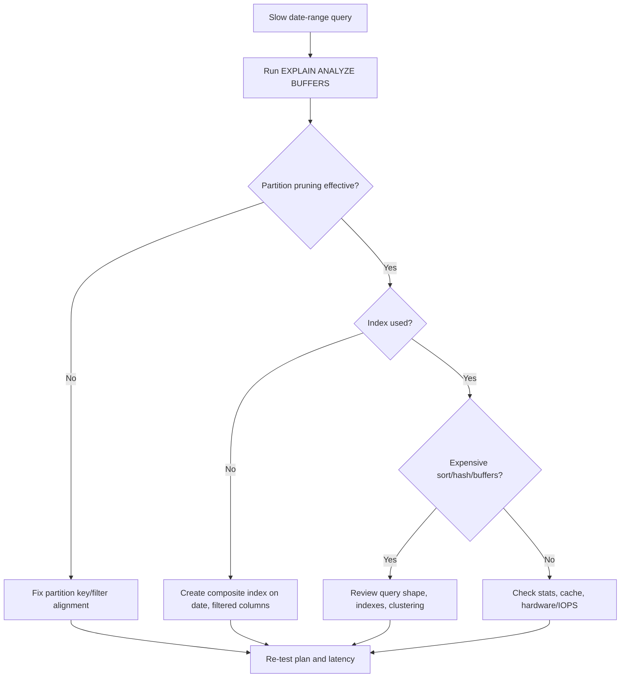

| Difficulty | Channel | Tags |
|---|---|---|
| intermediate | database | explain, query-plan, partitioning |

In 2025, CoinGecko's 1TB+ PostgreSQL `prices` table—eight years of hourly crypto data—had slowed date-range queries to over 30 seconds on average, pushing IOPS to a 24K ceiling and causing replica lag [1]. Picture this: the table is partitioned by date, the query filters on a date range, and it is still slow. That is the moment when "we already partitioned it" stops being comforting and real diagnosis begins.

---

> ### Real-World Case — CoinGecko
>
> CoinGecko's 1TB+ PostgreSQL 'prices' table stored eight years of hourly crypto price data. Date-range queries had degraded to an average of over 30 seconds, drove IOPS to a 24K ceiling, increased request queues, lowered Apdex, and caused replica lag despite attempts to solve it with indexes.
>
> | | |
> |---|---|
> | **Challenge** | Make common timestamp-range queries touch only the relevant monthly data, avoid expensive full-table scans and JSONB-key-specific indexing, and migrate the live table without downtime or a cold-cache performance cliff. |
> | **Solution** | They range-partitioned the table by month on the timestamp key, built a new partitioned table with composite keys, copied data using a prewarmed helper database via foreign data wrappers, warmed primary and replica caches with pg_prewarm, and swapped tables with triggers. After go-live, they found queries missing proper date bounds were scanning every partition (and even empty future partitions), so they added lower/upper timestamp limits and removed premature future partitions. |
> | **Outcome** | The migration cut p99 response time from 4.13s to 578ms (about 86%), reduced IOPS by 20%, eliminated replica lag, and delivered 6-8x faster queries in dry runs. Partition prewarming took 3 hours versus 10 hours for the original table. |
> | **Lesson** | Partitioning pays off only when the planner can prune. A query that omits the partition-key range can be slower on a partitioned table than on a flat one, so the EXPLAIN plan's partition list and scan pattern matter as much as the indexes. |

---

## Hook — The Pager-Worthy Query That Should Have Been Fast

You know the feeling: a query looks innocent, the table is partitioned, and yet latency spikes like it is auditioning for an incident report. CoinGecko lived this when request queues grew, Apdex dropped, and alerts fired daily despite throwing more IOPS at the problem [1]. The stakes are familiar to any team running large PostgreSQL workloads: slow reads do not just annoy users, they cascade into replica lag, SLA risk, and wasted infrastructure spend [1][7]. So what do you check when partitioning alone is not enough?

## Problem — Why Date Partitioning Still Lets Slow Queries Through

Partitioning is not a magic speed button; it is a data organization strategy. If PostgreSQL cannot prune partitions, or if it prunes but still scans too many rows inside each partition, the query pays a heavy price [2]. Building on that, a date filter alone may not match the access pattern—especially when additional predicates like `status = 'completed'` force extra filtering or when sorting and aggregation add expensive steps [3]. The core problem is a mismatch between how data is stored, how it is indexed, and how the query actually asks for it. Before changing anything, you need evidence from the execution plan, not hunches.

## Real-World Case — CoinGecko

CoinGecko's engineering team faced exactly this pattern at scale. Their hourly crypto price table had grown beyond 1TB after eight years, and adding indexes alone did not solve the problem because query patterns and data shape were more complex than a single-column fix [1]. They chose range partitioning by time, but the real win came from disciplined execution: dry runs, cache warm-up, careful cutover, and query validation. The result was dramatic—p99 response time dropped from 4.13s to 578ms (about 86%), IOPS fell by 20%, and replica lag disappeared [1]. The lesson: partitioning works best when paired with query-plan-driven optimization and operational rigor.

## Deep Dive — What to Read in EXPLAIN Before Touching Anything

Start with `EXPLAIN (ANALYZE, BUFFERS)` to see what PostgreSQL actually did, not what you hoped it would do [3]. First, verify **partition pruning**: the plan should show only relevant partitions. If many partitions appear, the filter may not align with the partition key or may be written in a non-prunable way [2]. Second, check **index utilization**: look for sequential scans on large partitions where an index scan or bitmap index scan would be expected. A missing or mismatched index often hides here [4]. Third, hunt for **expensive sorts, hash aggregates, or large buffer reads**. High `Buffers: shared read` counts and slow sort nodes reveal where time and I/O are going [3]. Finally, evaluate whether a **composite index** matching the query predicate—such as `(event_date, status)`—can turn filtering into a tight index lookup [5][9]. If the table's physical order matters for range scans, clustering on the index can improve locality, though it has maintenance trade-offs [6].

## Workflow — A Practical Diagnosis-to-Fix Path

The workflow below turns a vague "slow query" complaint into a repeatable debugging loop. Begin by reproducing the query with `EXPLAIN (ANALYZE, BUFFERS)`, then confirm pruning and scan strategy. If the plan shows unnecessary partitions or sequential scans, inspect index coverage and predicate order. Next, prototype a composite index concurrently to avoid blocking writes, validate the new plan, and only then consider physical layout changes like clustering [3][5][6]. CoinGecko's experience also adds an operational checkpoint: warm caches or prewarm partitions before judging performance, because cold data can distort results [1].

## Code Example — Inspecting the Plan and Applying Targeted Fixes

The code below mirrors the real debugging sequence: measure first, then optimize. The `EXPLAIN (ANALYZE, BUFFERS)` output reveals whether pruning worked, which scans were chosen, and where time was spent. The composite index targets the common pattern of filtering by date and status. Clustering is optional and should be evaluated carefully, since it rewrites the table and is not a set-and-forget fix for highly updated workloads [5][6].

## Lessons Learned — Make the Plan Prove It

The biggest takeaway: partitioning reduces the search space, but indexes and query shape decide whether PostgreSQL actually moves fast inside that space [2][4]. Treat `EXPLAIN (ANALYZE, BUFFERS)` as your source of truth, not your intuition [3]. Build composite indexes that match real filters, watch for sort and buffer costs, and validate changes with warm-cache measurements like CoinGecko did during dry runs [1]. Most importantly, avoid "fixes" that look good in isolation—an index that helps one query can be useless for another, and a partitioning strategy can backfire when queries lack proper bounds [1]. Tomorrow, pick one slow query, capture its plan, and let the evidence drive the next change.

---

## Query Diagnosis Flow

<strong>Original Interview Question</strong>

**Q:** You have a PostgreSQL table with 100M rows partitioned by date. A query filtering on a specific date range is still slow. What would you check in the EXPLAIN plan and how would you optimize it?

**A:** Check partition pruning effectiveness, index utilization patterns, and expensive sort operations. Create composite indexes on (date, filtered_columns) and evaluate clustering strategies for optimal data access.

## Conclusion

A slow query on a partitioned table is not a betrayal—it is a clue. Start with the plan, prove pruning, confirm index usage, and fix the exact bottleneck the database shows you. The next time a date-range query drags, let EXPLAIN lead before you throw hardware at the problem.

---

## References

1. [CoinGecko incident report](https://dev.to/coingecko/scaling-postgresql-performance-with-table-partitioning-136o) — article
2. [PostgreSQL Documentation: Table Partitioning](https://www.postgresql.org/docs/current/ddl-partitioning.html) — documentation
3. [PostgreSQL Documentation: Using EXPLAIN](https://www.postgresql.org/docs/current/using-explain.html) — documentation
4. [PostgreSQL Documentation: Indexes](https://www.postgresql.org/docs/current/indexes.html) — documentation
5. [PostgreSQL Documentation: CREATE INDEX](https://www.postgresql.org/docs/current/sql-createindex.html) — documentation
6. [PostgreSQL Documentation: CLUSTER](https://www.postgresql.org/docs/current/sql-cluster.html) — documentation
7. [Amazon RDS Best Practices](https://docs.aws.amazon.com/AmazonRDS/latest/UserGuide/CHAP_BestPractices.html) — documentation
8. [Wikipedia: Partition (database)](https://en.wikipedia.org/wiki/Partition_(database)) — documentation
9. [PostgreSQL Documentation: Multicolumn Indexes](https://www.postgresql.org/docs/current/indexes-multicolumn.html) — documentation

---

**Author:** Satishkumar Dhule — [GitHub](https://github.com/satishkumar-dhule) · [LinkedIn](https://linkedin.com/in/satishkumar-dhule) · [Website](https://satishkumar-dhule.github.io)
