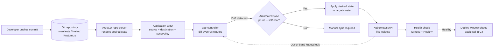

| Difficulty | Channel | Tags |
|---|---|---|
| beginner | devops | argocd, flux, declarative |

Twelve clusters is a weekend project. A thousand is a lifestyle change. Okta (Auth0) watched its private-cloud platform grow from roughly a dozen hand-configured customer clusters to nearly 1,000 — all under a single ArgoCD install managing 800–2,000 Applications and 2–3 million Kubernetes resources [1]. The snowflake configuration that worked at small scale became a deploy-window nightmare, so the team rebuilt around Git as the single source of truth and now pushes hundreds of deploys a day [1]. Here is why declarative reconciliation beats a terminal full of kubectl commands, and what it really takes to configure ArgoCD to enforce that promise.

---

> ### Real-World Case — Okta (Auth0)
>
> Auth0's private-cloud platform started with roughly a dozen customer clusters and hand-applied, snowflake configuration. As the product took off, the team had to upgrade customer environments under agreed deploy windows while scaling toward 1,000 clusters — with no manual operator step per cluster.
>
> | | |
> |---|---|
> | **Challenge** | ArgoCD's textbook auto-sync was unusable: a release was a bundle of image tags, Terraform code, manifests and custom plugins, and configs/secrets depended on Terraform outputs that don't exist in Git. Syncing on every Git change would also fire outside customer-approved windows, and continuous reconciliation across ~2,000 Applications risked overwhelming the controller. |
> | **Solution** | They kept the declarative model — Git as source of truth, one ArgoCD Application per cluster, Kustomize overlays and custom plugins — but built a homegrown scheduler and deploy manager that triggers sync through Argo Workflows: pre-flight checks, Terraform plan/apply, plugin-generated ConfigMaps/secrets, then an ArgoCD CLI wrapper that classifies errors as retryable vs. fatal, enforces timeouts, and prioritizes dev before prod. Sync waves ordered dependencies, and they disabled hard/soft refreshes plus forked Kustomize to inline plugins. |
> | **Outcome** | Scaled from ~12 to nearly 1,000 customer clusters under a single ArgoCD install managing 800–2,000 Applications and 2–3 million Kubernetes resources with 32 app-controller, 24 repo-server and 8 server pods; inlining plugins cut Kustomize refresh from minutes to seconds, and the platform now runs hundreds of daily deploys. |
> | **Lesson** | Declarative doesn't mean 'let the controller sync whenever Git changes.' At scale, the sync trigger itself must be declarative and gated on infrastructure dependencies, customer deploy windows and blast radius — reconciliation is a control plane problem, not just a checkbox in syncPolicy.automated. |

---

## Hook — The command nobody committed

At 2am a deploy window opens and an on-call developer runs `kubectl set image` to stop the bleeding. The dashboard goes green, the pager stops screaming, and the incident channel exhales. Then the next reconciliation cycle quietly restores the old image, because Git never agreed to that change. Sound familiar? That is configuration drift, and it is exactly what Okta's Auth0 platform had to eliminate before customer clusters numbered in the hundreds [1]. 🔥 Hot take: the winning GitOps platform is not the one with the prettiest UI. It is the one that makes the out-of-band command pointless. Many developers think GitOps means 'deploying from Git'; actually, it means Git is the only thing allowed to change state, with a controller continuously undoing everything else [5]. The real question is not whether to adopt it, but what exactly gets handed to ArgoCD — and what happens to every command someone runs behind its back.

## Problem — Two ways to change a cluster, one of them is a trap

Kubernetes gives you two ways to mutate state, and the gap between them is the entire argument. Imperative management tells the API server what to do right now — `kubectl create`, `kubectl scale`, `kubectl edit` — while declarative management hands it a manifest describing the state you want and lets the system work out the steps [3][4]. Both approaches work on a laptop. Only one leaves an audit trail a reviewer can read six months later. ⚠️ Watch Out: committing YAML to Git is not the same as GitOps. Plenty of teams commit manifests and then run a pipeline that applies them once; that is imperative infrastructure wearing a declarative costume, because the cluster still accepts out-of-band writes and nothing reconciles them [5]. When would you actually use the imperative path? During incident triage, local debugging, or a one-off bootstrap, `kubectl edit` is the fastest tool in the box — the mistake is letting an emergency action become the permanent design. Here is the thing though: the danger compounds with cluster count. At three clusters drift is an annoyance; at three hundred it is an archaeological dig. The worst version is not a slow deploy but a partial one. In 2012, Knight Capital rolled new trading software to eight servers, one kept running the old logic, and the mismatch burned $440 million in 45 minutes [8]. Modern reconciliation cannot rewrite that history, but it does make the equivalent mistake — one cluster disagreeing with the declared state — visible instead of invisible.

## Real-World Case — Okta (Auth0)

Okta's Auth0 team needed true single-tenant private cloud for large enterprises, and generation one was hand-operated: roughly 12 customer clusters, snowflake configuration, operator-driven updates, and no safe way to upgrade everyone inside agreed deploy windows [1]. The struggle was not Kubernetes itself; it was the human step attached to every cluster. Generation two rebuilt the platform cloud-native around ArgoCD for reconciliation, Argo Workflows for orchestration, and Terraform for cluster creation, with one Application per customer so a bad manifest could not fan out across the fleet [1]. Here is the plot twist: at nearly 1,000 clusters the team did not simply flip built-in auto-sync and walk away. Terraform had to generate infrastructure and secrets before any sync could succeed, and each customer had its own deploy window, so the control plane drove its own 'auto-sync' through Argo Workflows instead [1]. The numbers explain why that mattered: a single ArgoCD install managed 800–2,000 Applications and 2–3 million Kubernetes resources, scaled to 32 app-controller, 24 repo-server and 8 server pods, and still pushed hundreds of deploys a day [1]. 💡 Insight: inlining plugins cut Kustomize refresh from minutes to seconds — proof that at this scale the bottleneck is the controller, not Git. What breaks first in your own setup when the fleet doubles?

## Deep Dive — Reconciliation, Application CRDs, and the self-healing loop

Building on Okta's experience, ArgoCD is best understood as a reconciliation controller rather than a deployment script. You declare the desired state in Git, an Application CRD binds that source to a destination cluster and namespace, and the controller keeps diffing live objects against the declaration [2]. Enable `syncPolicy.automated` with `prune` and `selfHeal`, set the poll interval to a practical three minutes, and any manual `kubectl` edit gets reverted on the next pass [2]. 🎯 Key Point: self-healing only works when the cluster has exactly one writer. Keep humans out of the write path and make Git the single source of truth, the same principle Kubernetes docs describe for declarative object management [3][5]. This leads to the real tradeoff, which is less about YAML syntax and more about who owns truth:

| Option A — Declarative + ArgoCD | Option B — Imperative kubectl | The real tradeoff |
|---|---|---|
| Desired state in Git: YAML, Helm charts, Kustomize overlays [7] | Desired state in terminal history [4] | Reviewability versus raw speed |
| Controller reconciles continuously | One-shot command, then silence | Drift is caught in minutes or never |
| Rollback is `git revert` plus sync | Re-derive the old state from memory | Recovery time, not deploy time |
| Scale: ~1,000 clusters under one install [1] | Scale: one operator per cluster | Human cost grows linearly |
| Best for: production fleets, repeat environments | Best for: incident triage, local debugging | Use both, but never mix them in production |

So when would you actually use each option? For production microservices, declarative wins every time, because every change is reviewable and reversible. For a broken pod at 2am, imperative wins for about ninety seconds — then that change belongs in Git or the controller will undo it. Teams running a managed control plane such as Amazon EKS get exactly the same reconciliation semantics [9]. Flux CD is a credible alternative if the team prefers a Git-first toolkit built around controllers and Kustomize [6].

## Workflow — From commit to converged cluster

Building on that mental model, the path from commit to converged cluster has six steps. First, store the desired state in Git as a Kustomize overlay per environment, so production differs from staging by a small, reviewable diff [7]. Second, register the target cluster with ArgoCD — on a managed service such as Amazon EKS this means pointing the controller at the cluster API [9]. Third, create the Application CRD with `source.repoURL`, `source.path`, `destination.server`, and an automated `syncPolicy` [2]. Fourth, choose the reconciliation cadence; three minutes is a sane default for a microservices fleet, since faster polls mostly burn repo-server CPU. Fifth, add guardrails: sync windows for customer-facing releases, `ignoreDifferences` for controller-owned fields, and a hard limit on retry backoff. Sixth, verify convergence with `Synced` and `Healthy` status instead of trusting a green pipeline. The whole loop is drawn in the GitOps Reconciliation Flow diagram: commit, render, diff, sync, health check, and the dotted out-of-band edit that gets erased. ⚠️ Watch Out: at scale, one giant Application is one giant blast radius. Okta chose one Application per customer for precisely that reason [1].

## Code Example — Bootstrapping the Application CRD

The script in the codeExample block bootstraps the exact Application CRD described above against a live cluster, then forces and verifies the first reconciliation. It is production-shaped: it fails fast, prunes resources removed from Git, enables self-heal, caps retry backoff, and waits for `Synced/Healthy` before declaring success. Here are the lines that carry the weight:

- `set -euo pipefail` makes the script fail loudly instead of half-configuring a cluster.
- The heredoc builds an `argoproj.io/v1alpha1` Application with `source`, `destination`, and `syncPolicy`, the three fields ArgoCD actually reconciles against [2].
- `prune: true` deletes resources removed from Git; `selfHeal: true` reverts manual edits on the next poll.
- `allowEmpty: false` prevents an accidentally empty source directory from wiping the namespace.
- `retry.backoff` keeps a transient repo-server hiccup from turning into a hot loop.
- The `refresh=hard` annotation skips the three-minute wait for the very first sync.
- The polling loop mirrors ArgoCD's own health check, so CI can gate on real convergence.

Run it with `kubectl` pointed at the target cluster, and commit the same manifest to Git — otherwise the controller will happily self-heal your bootstrap away. What is the smallest change that would make this safe in your own pipeline?

## Lessons Learned — Battle scars and the so-what

Here are the battle scars worth carrying into tomorrow's design review. Every one of them was learned the hard way, including during Okta's 12-to-1,000 climb [1].

- **Treat Git as the only writer.** If two paths can change production, you do not have a source of truth; you have a source of arguments.
- **Do not confuse declarative with GitOps.** Committed YAML plus a one-shot pipeline is still imperative behavior [5].
- **Self-heal is not permission to skip reviews.** Your controller will faithfully reconcile a bad commit at fleet speed; code review is the brake.
- **Budget for the controller, not just the manifests.** Okta needed 32 app-controller and 24 repo-server pods to keep hundreds of daily deploys honest [1].
- **Keep imperative access as break-glass, not workflow.** The Knight Capital partial rollout is the extreme version of two truths running at once [8].
- **Answer 'when would you actually use this?' honestly.** Auto-sync is excellent until ordering or customer deploy windows matter, at which point an orchestrator such as Argo Workflows must drive it, as Okta discovered [1].

💡 Insight: the line to take to your team is simple — GitOps does not make changes faster, it makes every change boring, reviewable, and reversible. That is the entire difference between a fleet that scales and a fleet that needs an archaeologist.

---

## GitOps Reconciliation Flow

<strong>Original Interview Question</strong>

**Q:** You're setting up GitOps for a microservices deployment. How would you configure ArgoCD to automatically sync changes from your Git repository to Kubernetes, and what's the difference between declarative and imperative approaches in this context?

**A:** I'd configure ArgoCD by setting up a Git repository containing Kubernetes manifests or Helm charts, creating an Application CRD that points to the Git repository, enabling auto-sync with a health check interval of 3 minutes, and implementing self-healing to automatically revert any manual changes. The declarative approach involves defining the desired state in Git through YAML manifests, Helm charts, or Kustomize configurations, where ArgoCD continuously reconciles the actual state with the desired state. In contrast, the imperative approach uses kubectl commands to make direct changes to the cluster, bypassing the Git repository as the single source of truth.

## Conclusion

Twelve hand-configured clusters became nearly 1,000 under a single ArgoCD install [1]. The journey ran from a 2am `kubectl` fix nobody committed, through the trap of calling committed YAML 'GitOps,' to a controller that diffs every three minutes and reverts anything Git did not authorize. You do not need Okta's fleet size to benefit: put one service's manifests in Git, create an Application CRD with `prune` and `selfHeal`, and watch what happens the next time someone edits the cluster by hand. Here is the one insight worth sharing with your team tomorrow: a cluster is not a scratchpad — every change that matters should arrive through Git, with a controller that politely but relentlessly undoes everything else.

---

## References

1. [Okta (Auth0) incident report](https://thenewstack.io/how-okta-scaled-from-12-to-1000-kubernetes-clusters-with-argo-cd/) — article
2. [Argo CD — GitHub Repository](https://github.com/argoproj/argo-cd) — documentation
3. [Kubernetes — Declarative Management of Objects Using Configuration Files](https://kubernetes.io/docs/tasks/manage-kubernetes-objects/declarative-config/) — documentation
4. [Kubernetes — Imperative Management of Objects Using Configuration Files](https://kubernetes.io/docs/tasks/manage-kubernetes-objects/imperative-config/) — documentation
5. [Wikipedia — GitOps](https://en.wikipedia.org/wiki/GitOps) — documentation
6. [Flux CD — GitHub Repository](https://github.com/fluxcd/flux2) — documentation
7. [Kustomize — GitHub Repository](https://github.com/kubernetes-sigs/kustomize) — documentation
8. [Wikipedia — Knight Capital Group](https://en.wikipedia.org/wiki/Knight_Capital_Group) — documentation
9. [AWS — What is Amazon EKS?](https://docs.aws.amazon.com/eks/latest/userguide/what-is-eks.html) — documentation
10. [Wikipedia — Continuous deployment](https://en.wikipedia.org/wiki/Continuous_deployment) — documentation

---

**Author:** Satishkumar Dhule — [GitHub](https://github.com/satishkumar-dhule) · [LinkedIn](https://linkedin.com/in/satishkumar-dhule) · [Website](https://satishkumar-dhule.github.io)
