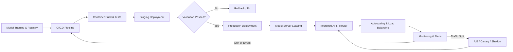

| Difficulty | Channel | Tags |
|---|---|---|
| beginner | devops | mlops, deployment |

Picture this: your recommendation model works flawlessly in a notebook, but the moment real users hit it, latency spikes and rollbacks become a nightmare. At Netflix, this exact tension led to building 'Switchboard,' a centralized ML serving platform handling hundreds of model types and over 1 million inference requests per second across 30+ client services [1]. That experience exposes a truth many teams learn the hard way: getting a model into production and keeping it responsive at runtime are two very different engineering challenges. This is the story of that gap—and how to bridge it.

---

> ### Real-World Case — Netflix
>
> Netflix's centralized ML serving platform handles hundreds of model types and versions at over 1 million inference requests per second for 30+ client services. They built 'Switchboard' as a single proxy entry point to decouple apps from model sharding and to enable A/B tests, canaries, shadow mode, and instant rollbacks.
>
> | | |
> |---|---|
> | **Challenge** | Switchboard sat directly in the hot request path, forcing full payload deserialization and re-serialization just to make a routing decision. That added 10–20ms of latency per request, created a single point of failure for every ML-powered experience, and made tenant isolation and test-traffic separation nearly impossible. |
> | **Solution** | They split routing into two pieces: a lightweight 'Lightbulb' sidecar that reads only minimal request context to resolve a routingKey and model config, and Envoy (already used for all egress) which performs the actual VIP routing from the routingKey header. The full request payload never passes through the sidecar, and control-plane config (model selection, experiments, traffic splits) was separated from the data plane. |
> | **Outcome** | The platform sustains 1M+ requests/second across 30+ services, eliminates the 10–20ms proxy hop, removes a shared single point of failure, and enables client-side fallback/caching plus isolated test traffic while keeping the same single-integration abstraction. |
> | **Lesson** | Centralized control does not require a centralized data plane: keep deployment/config resolution in a control plane, but make the runtime serving path as thin as possible. A general-purpose proxy in the inference hot path trades latency and availability for convenience — at scale, that trade flips. |

---

## Hook — When "It Works on My Machine" Meets a Million Requests

Shipping a machine learning model feels like crossing a finish line. The model trains, metrics look great, and the demo impresses stakeholders. Then production traffic arrives, and the real race begins. Suddenly, questions surface that notebooks never answered: How fast can the model respond? What happens when a new version breaks? Can the system handle a traffic surge during peak hours?

Netflix faced these questions at massive scale. Its centralized serving platform needed to support hundreds of model types and versions while sustaining over 1 million inference requests per second for 30+ services [1]. The stakes were clear: without a clean separation between deployment infrastructure and runtime serving, every model update risked cascading failures. Understanding this distinction is the difference between a model that exists in production and a model that performs in production.

## Problem — Two Jobs, One Confusing Name

Many developers use "deployment" and "serving" interchangeably, but conflating them creates blind spots in system design. **Deployment** is everything that gets a model into a runnable environment: packaging artifacts, provisioning infrastructure, configuring CI/CD pipelines, and setting up monitoring and rollback strategies [2]. It answers the question, "How does this model reach production safely?"

**Serving**, on the other hand, is what happens after deployment. It focuses on runtime inference: exposing APIs, routing requests, loading model versions into memory, managing autoscaling, and optimizing response times [2]. It answers, "How does this model handle real traffic reliably?"

When teams blur these boundaries, they end up with brittle systems. A deployment pipeline that ignores serving constraints can push a model that is too large for GPU memory. A serving layer without deployment discipline can make rollbacks slow and risky. The cost is measured in latency spikes, failed requests, and 3am incidents.

## Real-World Case — Netflix and the Switchboard Platform

Netflix's journey illustrates the problem at scale. As its machine learning footprint grew, dozens of client services needed access to hundreds of model types and versions. Without a unified approach, each integration risked tight coupling between applications and model infrastructure, making A/B tests, canaries, and rollbacks operationally painful [1].

The solution was 'Switchboard,' a single proxy entry point that decoupled client applications from model sharding and routing complexity. The platform sustains 1M+ requests per second across 30+ services while eliminating a 10–20ms proxy hop, removing a shared single point of failure, and enabling client-side fallback, caching, and isolated test traffic [1]. The key insight: deployment and serving need distinct architectures that work together through clean contracts. Netflix could roll out new model versions through controlled deployment pipelines while the serving layer handled routing, shadow mode, and instant rollbacks independently.

## Deep Dive — Technologies, Trade-offs, and Scaling Decisions

Building on the Netflix lesson, the technical split becomes clearer when you examine the tools and trade-offs on each side.

**Deployment stack and patterns:** Deployment typically involves containerization with Docker, orchestration with Kubernetes, and infrastructure-as-code with tools like Terraform. ML-specific platforms such as MLflow and Amazon SageMaker streamline experiment tracking, model registry, and automated rollout pipelines [3][4][5]. A solid deployment workflow includes CI/CD triggers, artifact validation, environment promotion, and monitoring hooks.

**Serving stack and patterns:** Serving focuses on low-latency inference. Frameworks like TensorFlow Serving and TorchServe provide optimized model loading, batching, and version management out of the box [6][7]. Teams often wrap these with FastAPI or gRPC endpoints behind load balancers to handle request routing and authentication.

| Dimension | Deployment | Serving |
|---|---|---|
| Primary goal | Safely deliver model artifacts to production | Reliably handle inference requests at runtime |
| Key tools | Kubernetes, MLflow, SageMaker, CI/CD [3][4][5] | TensorFlow Serving, TorchServe, FastAPI, gRPC [6][7] |
| Scaling focus | Rollout strategy, replicas, environment parity | QPS, latency, autoscaling, batching |
| Failure mode | Bad release, config drift, broken pipeline | Latency spikes, cold starts, overload |
| Core metrics | Deploy success rate, rollback time | P99 latency, throughput, error rate |

**The critical trade-offs:** Latency vs. throughput is the classic tension. Real-time systems may target sub-100ms responses, while batch inference can tolerate seconds but optimize for volume [8]. Horizontal scaling (more pod replicas) handles traffic bursts, while vertical scaling (bigger GPUs) helps with large models. Cold starts—when a model loads into memory for the first request—can ruin tail latency, so teams use warm pools, model preloading, or request batching. A/B testing and canary releases add another layer: the serving system must split traffic intelligently while deployment ensures each version is reproducible and traceable [2].

## Workflow — From Commit to Inference Response

This leads to a practical workflow that separates concerns without losing coordination. The deployment pipeline owns artifact integrity and environment readiness; the serving layer owns runtime performance and traffic management. The Mermaid flow below maps this end-to-end journey.



A robust workflow follows these steps:

1. **Register and version the model**: Store artifacts and metadata in a registry like MLflow so every deployment is traceable [4].
2. **Automate CI/CD**: Build containers, run smoke tests, and validate schema compatibility before promotion [3].
3. **Deploy with safety nets**: Use rolling updates, canaries, or blue-green deployments in Kubernetes to minimize blast radius [3].
4. **Load into serving infrastructure**: The serving layer pulls the approved version, warms it, and exposes inference endpoints [6][7].
5. **Route and scale traffic**: Load balancers and autoscalers adjust to demand while maintaining latency SLOs.
6. **Observe and iterate**: Monitor P99 latency, error rates, drift, and resource utilization; feed incidents back into the pipeline [5].

💡 **Insight:** Treat the model artifact as immutable. Deployment moves immutable artifacts through environments; serving decides which immutable version answers which request.

## Code Example — A Minimal Serving API with Deployment-Aware Versioning

The following example shows a simple FastAPI-based serving layer that exposes a health check, a model version endpoint, and a prediction route. It illustrates serving concerns—request handling, version routing, and latency-conscious structure—while assuming the model artifact was delivered by a deployment pipeline.

```python
from fastapi import FastAPI, HTTPException
from pydantic import BaseModel
import time
import os

# Initialize the API app - this is the serving entry point
app = FastAPI(title="ML Serving API")

# Simulated model registry loaded at startup (artifact delivered by deployment pipeline)
MODEL_REGISTRY = {
    "v1": lambda features: sum(features) / len(features),  # simple baseline model
    "v2": lambda features: (sum(features) / len(features)) * 1.05,  # improved model
}

# Default active model version; in production this could come from config or service discovery
ACTIVE_MODEL_VERSION = os.getenv("MODEL_VERSION", "v2")

class PredictRequest(BaseModel):
    features: list[float]  # input features for inference
    model_version: str | None = None  # optional override for A/B or canary testing

class PredictResponse(BaseModel):
    prediction: float
    model_version: str
    latency_ms: float

@app.get("/health")
def health_check():
    # Health endpoint used by load balancers and orchestrators during deployment/serving
    return {"status": "ok", "active_model": ACTIVE_MODEL_VERSION}

@app.post("/predict", response_model=PredictResponse)
def predict(request: PredictRequest):
    start = time.perf_counter()

    # Resolve model version: explicit request override or active deployment default
    version = request.model_version or ACTIVE_MODEL_VERSION
    model = MODEL_REGISTRY.get(version)
    if model is None:
        raise HTTPException(status_code=400, detail=f"Unknown model version: {version}")

    if not request.features:
        raise HTTPException(status_code=422, detail="features cannot be empty")

    # Run inference - in production, replace with real model.predict() call
    prediction = float(model(request.features))

    latency_ms = (time.perf_counter() - start) * 1000
    return PredictResponse(
        prediction=prediction,
        model_version=version,
        latency_ms=round(latency_ms, 3),
    )
```

**How it works:** The app separates runtime concerns from deployment concerns. The `MODEL_REGISTRY` represents artifacts that a deployment pipeline would promote and make available. The `/health` endpoint gives orchestrators like Kubernetes a signal for readiness and liveness probes [3]. The `/predict` endpoint handles serving responsibilities: validating input, selecting a model version, executing inference, and returning latency metadata. The optional `model_version` field enables traffic-splitting experiments, a pattern Netflix uses to isolate test traffic and support canaries [1]. In production, you would replace the lambdas with loaded model objects from TensorFlow Serving or TorchServe, add request batching, authentication, and observability hooks for P99 latency and error rates [6][7].

## Lessons Learned — Build the Bridge, Not Just the Model

The journey from notebook to production is really two journeys stitched together. Deployment is the disciplined path of getting models safely into environments; serving is the relentless work of making them fast, reliable, and scalable under real traffic. Netflix's Switchboard story shows what happens when teams take that separation seriously: cleaner rollouts, safer experiments, and resilience at million-request scale [1].

⚠️ **Watch Out:** The most common failure mode is treating serving as an afterthought. Teams invest heavily in training and CI/CD, then discover cold starts, memory limits, or routing gaps only after users complain.

🎯 **Key takeaways:**
- **Separate responsibilities clearly:** Deployment handles delivery and rollback; serving handles inference, routing, and runtime scaling [2].
- **Design for rollback from day one:** Version everything—models, configs, and schemas—so serving can switch instantly when deployment introduces a bad artifact [4].
- **Measure what matters:** Track deployment success and rollback time, but also P99 latency, throughput, error rate, and saturation in serving [5].
- **Plan for trade-offs explicitly:** Real-time vs. batch, latency vs. throughput, horizontal vs. vertical scaling—document the choices before traffic forces them [8].

If this feels overwhelming, you are not alone. The good news is that you do not need Netflix-scale infrastructure to apply the principle. Start small: define a clean contract between your deployment pipeline and your serving layer, add versioned rollouts, and instrument latency from day one. The model that wins in production is rarely just the most accurate one—it is the one your system can deploy safely and serve reliably.

---

## Deployment to Serving Workflow


<details>
<summary><strong>Original Interview Question</strong></summary>

**Q:** Explain the key differences between model serving and model deployment in ML systems, including specific technologies, scaling considerations, and real-world implementation patterns?

**A:** Deployment encompasses CI/CD pipelines, infrastructure setup, and monitoring using tools like Kubernetes, MLflow, and SageMaker. Serving focuses on runtime inference APIs with frameworks like TensorFlow Serving, TorchServe, or BentoML, handling request routing, model versioning, and autoscaling. Key trade-offs include latency vs throughput, batch vs real-time inference, and cold start optimization.

</details>

## Conclusion

Model deployment gets your model to the stage; model serving determines how it performs under the spotlight. Netflix's Switchboard journey proves that separating these concerns enables scale, safer rollouts, and faster recovery when things go wrong [1]. Tomorrow, audit your ML system: can you deploy a new model version without disrupting inference, and can you roll back instantly without redeploying everything? If the answer is no, start by drawing a clean boundary between your deployment pipeline and your serving layer—and make that contract explicit.

---

## References

1. [Netflix incident report](https://netflixtechblog.com/state-of-routing-in-model-serving-16e22fe18741) — article
2. [MLOps - Wikipedia](https://en.wikipedia.org/wiki/MLOps) — documentation
3. [Kubernetes Deployments Documentation](https://kubernetes.io/docs/concepts/workloads/controllers/deployment/) — documentation
4. [MLflow: Open Source Platform for the Machine Learning Lifecycle](https://github.com/mlflow/mlflow) — documentation
5. [Amazon SageMaker - How Deployment Works](https://docs.aws.amazon.com/sagemaker/latest/dg/how-it-works-deployment.html) — documentation
6. [TensorFlow Serving](https://github.com/tensorflow/serving) — documentation
7. [TorchServe: Model Serving for PyTorch](https://github.com/pytorch/serve) — documentation
8. [Clipper: A Low-Latency Online Prediction Serving System](https://arxiv.org/abs/1612.03079) — paper

---

**Author:** Satishkumar Dhule — [GitHub](https://github.com/satishkumar-dhule) · [LinkedIn](https://linkedin.com/in/satishkumar-dhule) · [Website](https://satishkumar-dhule.github.io)
