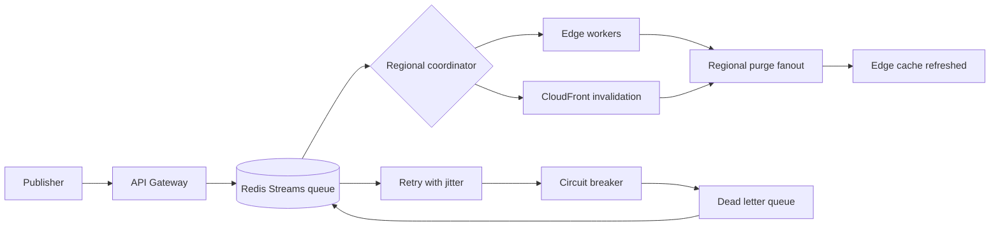

| Difficulty | Channel | Tags |
|---|---|---|
| intermediate | system-design | edge, caching, purging |

The deploy looked fine. Then the hero image changed in Sydney while Frankfurt kept serving last week's banner, because Cloudflare's original flexible purge sent a request from Australia across the Pacific to a core data center before fanning out to every point of presence [1]. By 2022, millions of daily purge API calls were filling cache disks with purge history and saturating Quicksilver writes, pushing global P50 purge latency to 1,570 ms in May 2022 [1]. That number is the starting point of a 90.5% journey to 149 ms, and the route there is a masterclass in designing invalidation that keeps a five-second promise.

---

> ### Real-World Case — Cloudflare
>
> Cloudflare's original flexible purge system reused its Quicksilver config database in a hub-and-spoke model: a purge issued in Australia had to cross the Pacific to a core data center before fanning out to every point of presence. By 2022, millions of daily purge API calls were consuming cache disk space for purge history, saturating Quicksilver's write throughput, and forcing Kafka buffering and batching that added latency.
>
> | | |
> |---|---|
> | **Challenge** | Invalidate cache-tags, hostnames, and URL prefixes uniformly across 270+ data centers and thousands of cache machines in seconds (ideally sub-second), without a centralized ingest bottleneck or purge-history storage that steals space from customer content. |
> | **Solution** | They rebuilt it as 'coreless purge': requests are accepted at the nearest data center by Cloudflare Workers, queued through Durable Objects, then broadcast peer-to-peer to every data center instead of backhauling to a core. To replace Quicksilver they built CacheDB, a Rust sidecar on each cache machine backed by RocksDB over Unix domain sockets, which indexes cached files by tag/hostname/URL, keeps a local purge queue, and makes the cache proxy force a MISS on any pending matching purge before physically deleting files; Consul tracks peer health for last-mile fan-out. |
> | **Outcome** | Global P50 purge latency fell from 1,570 ms (May 2022) to 149 ms (August 2024), a 90.5% improvement across 330 cities in 120+ countries, with regional P50s of 115–303 ms and single-file purges at ~234 ms. Replacing lazy purge also saved 10x storage, enabled immediate deletion, improved cache-hit ratios, cut origin egress, and let Cloudflare offer tag/hostname/prefix purges to all plan tiers. |
> | **Lesson** | The counterintuitive win was removing the centralized control plane: per-machine RocksDB indexes plus peer-to-peer fan-out beat a globally replicated database, and checking a local pending-purge queue on cache HIT makes invalidation visible instantly even while deletion of millions of files continues in the background. |

---

## Hook — Ever wondered why a purge succeeds while users still see yesterday's banner?

Ever wondered why a purge reports success while a user in another continent still sees yesterday's hero image? Many developers discover the hard way that a purge is not an API call; it is a distributed race against every cache between your origin and your users. Teams have all been there, staring at a dashboard that says 'purge successful' while the edge quietly serves stale bytes. The stakes are simple: a five-second SLA either holds in every region or it becomes a support ticket with your name on it. So what actually makes a purge travel the world in under five seconds?

## Problem — Ten thousand invalidations a second is a consistency problem

Building on that race, the first trap is treating invalidation as control-plane trivia. A modern edge spans hundreds of points of presence, and a single URL can be cached in dozens of them [7]. Now add 10,000 invalidations per second, a 99.99% availability target, and a requirement that every region agrees on what is current. The queue is the easy part; agreement is hard. Physics does not care about your SLA, which is why 'strong consistency in five seconds globally' is really a carefully engineered reconciliation window, not a database transaction with a bow on it. ⚠️ Watch Out: 2-second TTLs look like a consistency shortcut, but `Cache-Control: max-age=2, must-revalidate` only bounds staleness when caches obey it; RFC 9111 supplies the rules, not a guarantee [3][4]. When would you actually use this? Think flash-sale pricing, breaking-news imagery, feature flags, or any CMS publish where a stale response costs money. If content changes hourly, a long TTL and a quiet life are better engineering than a heroic purge pipeline.

## Real-World Case — Cloudflare

With the failure modes on the table, Cloudflare's own numbers show what scale does to a naive design. Its original flexible purge reused the Quicksilver configuration database in a hub-and-spoke pattern: a purge issued in Australia crossed the Pacific to a core data center before fanning out to every point of presence [1]. By 2022, millions of daily purge API calls were consuming cache disk space for purge history, saturating Quicksilver write throughput, and forcing Kafka buffering and batching that added latency [1]. The rebuild replaced lazy purge with immediate, regional deletion, and the outcome reads like a benchmark nobody believed: global P50 fell from 1,570 ms in May 2022 to 149 ms in August 2024, a 90.5% improvement across 330 cities in 120+ countries, with regional P50s of 115–303 ms and single-file purges near 234 ms [1]. 💡 Insight: the same work saved roughly 10x storage, improved cache-hit ratios, cut origin egress, and unlocked tag, hostname, and prefix purges for every plan tier [1]. Here is the plot twist: the win came less from faster hardware and more from deleting the global detour.

## Deep Dive — Why hub-and-spoke purging breaks at scale

That detour is the heart of the architecture, so it deserves a closer look. A hub-and-spoke purge pays a cross-region round trip before any edge does useful work, while a distributed coordinator lets each region invalidate locally and reconcile globally. 🔥 Hot Take: adding more Kafka partitions to a hub-and-spoke purge is like putting a bigger engine on a car with the handbrake on. The real levers are batching, locality, and failure isolation. Batch 100 invalidations into one provider call, use consumer groups so each worker owns a slice of the stream, and let exponential backoff with jitter absorb rate limits instead of amplifying them [5]. CloudFront invalidation calls are metered and rate-limited, so batching is both a cost decision and a latency decision [2]. Below is the tradeoff teams actually face:

| Option | What it buys | What it costs | When to pick it |
|---|---|---|---|
| Hub-and-spoke purge | One source of truth | Pacific round trips, write saturation | Low volume, single region |
| Distributed coordinators | Local purge, 115–303 ms regional P50 | Reconciliation logic | Global traffic, tight SLA |
| 2s TTL only | No purge API needed | Stale window, origin load | Cheap, tolerant content |
| Event-driven invalidation | Audit trail, retries, replay | Queue operations | 10K/sec workloads |

⚠️ Watch Out: a dead letter queue is not a junk drawer. Failed purges need replay tooling, alerting, and an owner, otherwise 'eventual consistency' quietly becomes 'forever inconsistent' [9]. The next question is how these pieces behave when the network splits mid-purge.

## Workflow — From one API call to 330 cities

When the network splits mid-purge, the Mermaid diagram titled 'System Flow' below becomes your map. Step 1: a CMS or deploy service publishes invalidation paths into API Gateway, which validates and authenticates before anything touches the queue [8]. Step 2: Redis Streams consumer groups accept the events, assign them to regional coordinators, and keep an ordered log so replay is possible. Step 3: each coordinator batches up to 100 paths, then calls Cloudflare Workers and CloudFront invalidation endpoints in parallel [2][6]. Step 4: edge workers fan the purge out to points of presence, keeping the operation regional instead of dragging it through a core data center [7]. Step 5: retries use capped exponential backoff with jitter, a circuit breaker opens after five consecutive failures, and poison batches land in a dead letter queue [5][9]. Step 6: health probes and reconciliation jobs compare regional state and repair gaps left by partitions. 🎯 Key Point: every hop in that diagram is designed to fail independently so one slow region cannot hold the other 329 hostage. The diagram shows the route; the next section shows the code that keeps the route from folding under retry storms.

## Code Example — Batching purges without melting the queue

Now translate that flow into code you can run. The snippet uses Node.js 18+ built-in fetch, so no SDK ceremony is required [11]. It batches paths, retries with jittered backoff, trips a breaker after five consecutive failures, and parks anything terminal in a dead letter record instead of dropping it on the floor.

```javascript
const BATCH_SIZE = 100;
const MAX_RETRIES = 3;

class CircuitBreaker {
  constructor(threshold = 5) {
    this.failures = 0;
    this.threshold = threshold;
    this.open = false;
  }

  async run(fn) {
    if (this.open) throw new Error('Circuit open: skipping purge window');
    try {
      const result = await fn();
      this.failures = 0; // success resets the consecutive failure count
      return result;
    } catch (error) {
      this.failures += 1;
      if (this.failures >= this.threshold) this.open = true; // fail fast under outage
      throw error;
    }
  }
}

const breaker = new CircuitBreaker();

async function deadLetter(files, reason) {
  console.error(JSON.stringify({ files, reason, at: Date.now() })); // durable queue in production
}

async function purgeWithRetry(files, attempt = 0) {
  const endpoint = `https://api.cloudflare.com/client/v4/zones/${process.env.CF_ZONE_ID}/purge_cache`;
  const response = await fetch(endpoint, {
    method: 'POST',
    headers: {
      Authorization: `Bearer ${process.env.CF_API_TOKEN}`,
      'Content-Type': 'application/json',
    },
    body: JSON.stringify({ files }), // wildcard patterns: /assets/*, /product/42/*
  });

  if (response.ok) return response.json();
  if (attempt >= MAX_RETRIES) throw new Error(`Dead letter: ${files.length} paths`); // stop retry storms
  const jitter = 0.85 + Math.random() * 0.3; // desynchronize concurrent workers
  const delay = Math.min(2000, 100 * 2 ** attempt) * jitter; // capped exponential backoff
  await new Promise((resolve) => setTimeout(resolve, delay));
  return purgeWithRetry(files, attempt + 1);
}

async function drainQueue(invalidations) {
  for (let i = 0; i < invalidations.length; i += BATCH_SIZE) {
    const chunk = invalidations.slice(i, i + BATCH_SIZE);
    try {
      await breaker.run(() => purgeWithRetry(chunk)); // one provider call per batch
    } catch (error) {
      await deadLetter(chunk, error.message); // keep the failure replayable
      breaker.open = false; // simplified half-open probe for the next window
    }
  }
}
```

Here is what each piece does, in order. First, BATCH_SIZE caps each provider call at 100 paths, matching the pattern that cut API calls by roughly 90% in the original design while staying under provider limits. Second, CircuitBreaker counts consecutive failures and opens after five, so a struggling CDN gets a break instead of a retry avalanche; ⚠️ Watch Out: a production breaker also needs a real clock, a half-open probe, and per-region state rather than one boolean. Third, purgeWithRetry sends an Authorization header, treats any non-ok response as retryable, and multiplies backoff by 85–115% jitter to avoid synchronized retries [5]. Fourth, MAX_RETRIES stops at three attempts, because retrying forever turns a bad purge into a self-inflicted denial of service. Fifth, deadLetter emits a structured record for replay tooling; production teams should write it to a durable queue [9]. 🎯 Key Point: the code does not pretend to guarantee global consistency; it guarantees that every failure is observable, bounded, and replayable, which is what actually protects the five-second SLA.

## Lessons Learned — Battle scars and the 5-second promise

Looking back at the Sydney banner and the 1,570 ms P50 from the opening, the transformation is less about exotic infrastructure and more about removing detours. Battle scars are predictable: purging the entire site for one changed image, retrying without jitter until rate limits become a wall, ignoring the dead letter queue until an audit, and treating a short TTL as a substitute for invalidation. Kubernetes controllers offer a useful mental model: observe desired state, act, reconcile drift, repeat [10]. 💡 Insight: measure propagation at the edge, not API acceptance, because '202 Accepted' says nothing about Frankfurt. Your five-second SLA lives or dies on three habits: batch aggressively, keep invalidation regional, and make every failure replayable. So what changes tomorrow? Pick one hot path, instrument time-to-propagated across three regions, and delete one cross-region hop from your purge flow. Then share the number with your team; a memorable line to take into your next design review is: 'a purge is not a request, it is a promise that every edge can prove.'

---

## System Flow



<details>
<summary><strong>Original Interview Question</strong></summary>

**Q:** How would you design a multi-region CDN cache purging system that guarantees content propagation within 5 seconds while handling 10,000 concurrent invalidations per second?

**A:** Implement Cloudflare API + AWS CloudFront with distributed invalidation queue, edge compute coordination, and 2-second TTL. Use batch invalidation, exponential backoff, and regional cache headers for 5-second SLA.

</details>

## Conclusion

Cloudflare's 1,570 ms purge began as a geography problem and ended as a design lesson [1]. When a request in Australia no longer has to cross the Pacific to be useful, 149 ms stops being a miracle and becomes an architecture choice [1]. Your next step is simple: map where your purge travels, batch what you can, isolate failure per region, and verify propagation where users actually see it. The hidden cost of a stale banner is never the banner; it is the trust you lose while debating whether the purge really worked.

---

## References

1. [Cloudflare incident report](https://blog.cloudflare.com/instant-purge/) — article
2. [Amazon CloudFront invalidation documentation](https://docs.aws.amazon.com/AmazonCloudFront/latest/DeveloperGuide/Invalidation.html) — documentation
3. [MDN Web Docs: Cache-Control](https://developer.mozilla.org/en-US/docs/Web/HTTP/Headers/Cache-Control) — documentation
4. [RFC 9111: HTTP Caching](https://datatracker.ietf.org/doc/html/rfc9111) — documentation
5. [Wikipedia: Exponential backoff](https://en.wikipedia.org/wiki/Exponential_backoff) — documentation
6. [GitHub: cloudflare/workers-sdk](https://github.com/cloudflare/workers-sdk) — documentation
7. [Wikipedia: Content delivery network](https://en.wikipedia.org/wiki/Content_delivery_network) — documentation
8. [Amazon API Gateway documentation](https://docs.aws.amazon.com/apigateway/latest/developerguide/welcome.html) — documentation
9. [Amazon SQS dead-letter queues](https://docs.aws.amazon.com/AWSSimpleQueueService/latest/SQSDeveloperGuide/sqs-dead-letter-queues.html) — documentation
10. [Kubernetes: Controller pattern](https://kubernetes.io/docs/concepts/architecture/controller/) — documentation
11. [MDN Web Docs: Fetch API](https://developer.mozilla.org/en-US/docs/Web/API/Fetch_API) — documentation

---

**Author:** Satishkumar Dhule — [GitHub](https://github.com/satishkumar-dhule) · [LinkedIn](https://linkedin.com/in/satishkumar-dhule) · [Website](https://satishkumar-dhule.github.io)
