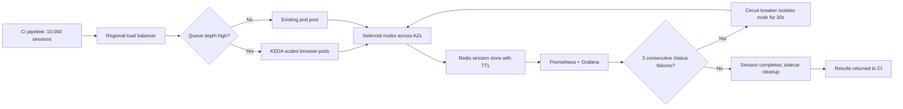

| Difficulty | Channel | Tags |
|---|---|---|
| advanced | system-design | selenium, webdriver, grid |

Imagine hundreds of browsers springing to life at once as an iPhone 16 offline-sales simulation kicks off across Indonesia, then vanishing just as quickly when the last assertion passes. Blibli, the Indonesian e-commerce company behind HelloStore, faced exactly that bursty reality on a static Selenoid setup with pre-provisioned VMs [1]. Their fixed fleet could not stretch for peak demand, yet it kept burning money while idle. The fix was not 'more VMs'; it was elastic, event-driven browser capacity that scaled to zero, delivering an estimated 40–50% cost saving [1]. That same tension sits at the heart of any 10,000-session, 99.9%-uptime Selenium Grid design.

---

> ### Real-World Case — Blibli (HelloStore)
>
> Blibli, one of Indonesia's largest e-commerce companies and operator of HelloStore (an Apple Authorized Reseller), ran thousands of automated UI test scenarios every hour on a static Selenoid setup with pre-provisioned VMs. During peak events like the iPhone 16 offline sales launch simulation across branches in Indonesia, their fixed infrastructure couldn't elastically handle sudden bursts of browser demand.
>
> | | |
> |---|---|
> | **Challenge** | They needed a Selenium Grid architecture that could scale browser capacity up and down on demand, avoid paying for idle VMs during off-peak hours, and reduce operational overhead from manually maintaining browser images and servers. |
> | **Solution** | They migrated from VM-based Selenoid to Selenium Grid on Google Kubernetes Engine, using KEDA's Selenium Grid scaler to autoscale browser pods based on GraphQL session queue metrics. Pods are spawned when tests request capabilities and drained/scaled down when sessions complete, with configuration managed centrally via Kubernetes deployments instead of per-VM maintenance. |
> | **Outcome** | The team could spin up hundreds of browsers simultaneously for the iPhone 16 launch simulation, eliminated manual VM/browser maintenance, and estimated 40-50% cost savings versus equivalent always-on Compute Engine VMs (N2 Standard, 8 vCPU/32GB at ~$371/month baseline), with actual savings higher due to scale-to-zero during idle periods. |
> | **Lesson** | Event-driven autoscaling turns browser test infrastructure from a fixed-cost bottleneck into elastic capacity: sizing for peak no longer means paying for peak 24/7, but you must design for graceful pod drain and warm capacity to avoid startup latency. |

---

## Hook — 10,000 browsers and the question nobody wants at 3am

Building on Blibli's burst of browsers, picture the moment a release train hits CI and 10,000 test sessions ask for a browser in the same second. Nothing is broken yet. The queue simply grows, latency creeps past 2 seconds, and someone starts whispering about 'just adding more VMs.' Then the subtle part arrives: the grid does not crash loudly, it degrades politely until the pipeline times out while the dashboard still insists everything is healthy. That is the 3am phone call nobody wants. The real question is not whether the grid can scale, but whether it can scale, clean up after itself, and survive a node disappearing mid-session — all while promising 99.9% uptime. Sound familiar? Hold that thought, because the obvious answer is usually the expensive one.

## Problem — The static grid that quietly bankrupts you

However, static infrastructure makes that question harder than it looks. Pre-provisioned VMs sit there spending budget while tests are idle, yet still cannot absorb a sudden burst when a launch simulation begins. Many developers discover this the hard way: capacity planning based on average load fails precisely at the moment load stops being average. Now add the details that turn a busy grid into a fragile one. Browsers leak memory after a few thousand sessions, orphaned volumes accumulate like digital dust, and a node that dies mid-test can leave a session key dangling forever. Kubernetes resource requests and limits (for example, 2GB RAM and 1 CPU per browser pod) are the first guardrail [4]. Consequently, failure is rarely a single dramatic crash; it is a slow bleed of RAM, stale state, and retry storms. Across multiple data centers the stakes rise further, because a network partition can make two hubs believe they are both in charge. What could go wrong? Pretty much everything, unless the design treats failure as a normal operating mode.

## Real-World Case — Blibli (HelloStore)

This leads directly to Blibli (HelloStore), where the theory became a bill. Teams there ran thousands of automated UI test scenarios every hour on a static Selenoid setup backed by pre-provisioned VMs [1]. When an iPhone 16 offline-sales launch simulation spun up across Indonesian branches, hundreds of browsers were needed at once, and the fixed fleet had no elastic answer [1]. Rather than buying more always-on Compute Engine VMs, the setup used event-driven autoscaling with KEDA to grow the browser pool on queue pressure and shrink it back to zero when the rush ended [5], while Selenoid supplied lightweight browser containers [8]. The estimated saving was 40–50% versus equivalent N2 Standard VMs (8 vCPU, 32GB) at roughly $371 per month each, with real savings even higher because idle time costs almost nothing [1]. Here is the twist: the money was saved not by optimizing tests, but by refusing to pay for browsers that were not running. If bursty workloads are your reality, when would a fixed fleet ever be the right call? That question shapes the architecture underneath.

## Deep Dive — Sessions, memory, and the art of failing gracefully

Building on that lesson, the architecture stops treating capacity as a fixed asset and starts treating it as a stream. At the top, a hub-node pattern distributes work, with Kubernetes Deployments or StatefulSets keeping browser pods aligned across availability zones [2]. Session state lives outside the pods in Redis, where TTL-based expiration makes cleanup automatic even when a worker vanishes mid-test [7]. Why Redis instead of in-memory maps? Because a session store that dies with the pod is a session store that lies to you. For example, a 30-minute TTL means stale keys evaporate without a custom garbage-collection script. However, elasticity without guardrails is just chaos with a cloud bill. Resource requests and limits pin each browser pod to roughly 2GB RAM and 1 CPU [4]; horizontal pod autoscaling watches queue depth rather than raw CPU, because a queue is the leading indicator of pain [3]. The math is refreshingly blunt: 10,000 sessions ÷ 50 sessions per node = 200 nodes minimum, and 200 × 2GB = 400GB baseline, plus a 30% buffer for roughly 520GB of cluster memory. Regional load balancing keeps P99 session initiation under 2 seconds, while Pod Disruption Budgets hold at least 85% capacity during voluntary updates [9]. Here is the real tradeoff, side by side:

| Option | What it buys | What it costs |
|---|---|---|
| Static VM fleet | Predictable, simple | Pays for idle; cannot absorb bursts; leaks accumulate |
| KEDA/Kubernetes browser pods | Scale to zero, elastic bursts | Operational complexity, TTL discipline, failure handling |

💡 Insight: circuit breakers are not pessimism, they are good manners. After three consecutive failures on a 10-second /status probe, a node is isolated for a 30-second recovery window instead of being handed more work. Prometheus scrapes memory trends and session duration so alerts fire at 80% memory, not at 100% panic [6]. Init containers sweep stale volumes before a pod starts, quietly closing another leak channel [12].

🔥 Hot Take: Netflix learned the hard way that hoping instances stay healthy is not a strategy; the Simian Army deliberately terminated production instances so teams would build systems that survive the hit [10]. Counterintuitively, the best way to keep a grid alive is to practice killing parts of it.

🎯 Key Point: use this pattern for bursty CI, launch simulations, and multi-region regression suites. For a tiny team with 50 nightly tests, a single Selenoid box is honestly fine [8] — complexity has a price too.

## Workflow — From test trigger to clean session in seven moves

Consequently, the design becomes a sequence you can rehearse rather than a diagram to hang on a wall. The Mermaid diagram labeled 'Elastic Grid Session Flow' shows the same path visually: trigger, scale, route, track, watch, isolate, clean.

1. A CI pipeline enqueues thousands of sessions; queue depth becomes the signal that matters.
2. KEDA reads that signal and scales Selenoid browser pods from zero upward across zones [5][8].
3. A regional load balancer applies weighted round-robin, favoring nodes with spare capacity and lower response time.
4. Each session is registered in Redis with a TTL, so even an abruptly terminated pod leaves no orphaned key [7].
5. Every 10 seconds, /status is probed; three consecutive failures trip the breaker for a 30-second cooldown.
6. Health trends and memory curves flow into Prometheus and Grafana, while alerts fire before 80% becomes 100% [6].
7. Pod Disruption Budgets protect 85% capacity during rolling updates, and sidecar/init containers remove stale volumes on termination [9][12].

⚠️ Watch Out: leader election matters during network partitions. Without it, split-brain hubs happily hand out conflicting sessions, and nobody notices until results stop matching. So how does this look when reduced to code that a team can actually ship?

## Code Example — A session lifecycle manager that refuses to leak

Building on the workflow, the snippet below implements the unglamorous part that prevents most incidents: session registration with TTL, failure counting, and a circuit breaker that refuses to route work to a sick node. The full Python implementation lives in the codeExample field; the logic is deliberately boring, because boring is what survives a 3am page.

First, Redis keys are written with an expiry, which turns cleanup into a guarantee instead of a to-do list [7]. Second, failure counters also expire, so a historically flaky node is not punished forever by a stale counter. Third, the breaker uses a monotonic clock, avoiding the classic bug where a wall-clock change keeps a node quarantined for hours. Finally, release is idempotent: the sidecar can call it twice without damage. When would you use this directly? Any stateful worker pool — browser sessions, WebSocket connections, render jobs — where a lost cleanup means a slow leak.

## Lessons Learned — Battle scars from the grid trenches

After following the journey from Blibli's bursty browsers to a 200-node grid, a few scars stand out. Here is what works when theory meets production:

- Treat cleanup as automatic, not hopeful. TTLs, init containers, and sidecars remove the human from the loop; manual cleanup scripts are how leaks become folklore.
- Scale on demand signals, not on CPU. Queue depth tells you the truth earlier than utilization does [3][5].
- Isolate fast, recover slowly. A 30-second breaker window is cheaper than ten minutes of retry storms.
- Protect capacity during churn. Pod Disruption Budgets and rolling updates mean maintenance does not look like an outage [9][2].
- Practice failure. Chaos experiments turn a terrifying unknown into a boring Tuesday [10].

⚠️ Watch Out: do not skip resource limits because they seem restrictive; a browser pod without a 2GB/1CPU boundary is how one runaway test starves 199 neighbors [4]. Moreover, remember the humble case: if the suite is small, keep a single Selenoid instance [8]. Architecture should fit the workload, not the résumé.

The memorable insight to share with your team: a resilient grid is not one that never fails; it is one where failure has an expiry date.

---

## Elastic Grid Session Flow

<strong>Original Interview Question</strong>

**Q:** Design a scalable Selenium Grid architecture to handle 10,000 concurrent test sessions with 99.9% uptime, ensuring zero memory leaks through automatic session lifecycle management, real-time monitoring, and graceful node failure recovery across multiple data centers?

**A:** Deploy Kubernetes cluster with auto-scaling node pools, Redis session store with TTL policies, Prometheus metrics for memory monitoring, circuit breakers for node isolation, and sidecar containers for session cleanup. Implement health checks, resource quotas, and rolling updates.

## Conclusion

The journey started with Blibli's browsers appearing and disappearing around an iPhone 16 launch simulation, with a 40–50% cost saving proving that idle capacity is a choice, not a fact [1]. It ended with 200 nodes, roughly 520GB of carefully bounded memory, TTL-based sessions, circuit breakers, and a grid that can lose a node without losing the pipeline. So what changes tomorrow? Pick one leak in your own setup — an orphaned key, an unbounded retry, a session that never closes — and give it an expiry, then measure it. Your future 3am self will thank you, and your team will have one less story to tell at standup.

---

## References

1. [Blibli (HelloStore) incident report](https://medium.com/bliblidotcom-techblog/scaling-selenium-grid-on-gcp-using-keda-which-saves-us-on-the-cost-too-b479c00c5526) — article
2. [Kubernetes Deployments documentation](https://kubernetes.io/docs/concepts/workloads/controllers/deployment/) — documentation
3. [Kubernetes Horizontal Pod Autoscaling documentation](https://kubernetes.io/docs/tasks/run-application/horizontal-pod-autoscale/) — documentation
4. [Kubernetes resource management for containers documentation](https://kubernetes.io/docs/concepts/configuration/manage-resources-containers/) — documentation
5. [KEDA GitHub repository](https://github.com/kedacore/keda) — documentation
6. [Prometheus GitHub repository](https://github.com/prometheus/prometheus) — documentation
7. [Redis overview](https://en.wikipedia.org/wiki/Redis) — documentation
8. [Selenoid GitHub repository](https://github.com/aerokube/selenoid) — documentation
9. [Kubernetes Pod Disruption Budgets documentation](https://kubernetes.io/docs/tasks/run-application/configure-pdb/) — documentation
10. [Netflix Simian Army GitHub repository](https://github.com/Netflix/SimianArmy) — documentation
11. [Selenium GitHub repository](https://github.com/SeleniumHQ/selenium) — documentation
12. [Kubernetes init containers documentation](https://kubernetes.io/docs/concepts/workloads/pods/init-containers/) — documentation

---

**Author:** Satishkumar Dhule — [GitHub](https://github.com/satishkumar-dhule) · [LinkedIn](https://linkedin.com/in/satishkumar-dhule) · [Website](https://satishkumar-dhule.github.io)
