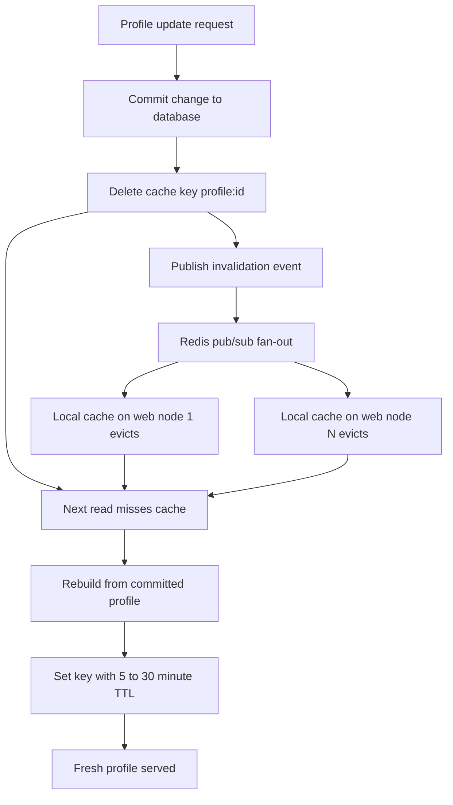

| Difficulty | Channel | Tags |
|---|---|---|
| beginner | backend | redis, memcached, cache-invalidation |

At Facebook, a single profile edit could leave a crowd of readers staring at yesterday's bio. As the social network passed a billion users, its memcached lookaside cache absorbed billions of requests per second and held trillions of items, and every mistimed delete turned into a correctness bug wearing a performance costume [1]. Teams answered with leases and a more reliable invalidation pipeline, proving that speed without a plan for stale data is just a faster way to be wrong [1]. You are about to travel that same road: the race, the fix, and the Redis-versus-Memcached choice waiting at the end.

---

> ### Real-World Case — Meta (Facebook)
>
> As Facebook grew to over a billion users, its profile and social graph data was read billions of times per second, making caching critical for performance. Their memcached-based lookaside cache faced consistency challenges during profile updates, including stale data, thundering herds, and unreliable invalidation across distributed regions.
>
> | | |
> |---|---|
> | **Challenge** | How to implement reliable cache invalidation for frequently accessed user data at massive scale while keeping latency low and avoiding stale reads after writes. |
> | **Solution** | Facebook kept Memcached as a simple, high-throughput lookaside cache and built invalidation infrastructure around it: on database writes, they deleted cache keys; they deployed mcsqueal to tail MySQL commit logs and replay deletes for reliable invalidation; and they introduced leases to prevent stale sets and thundering herds. For cross-region consistency, they routed invalidations through the storage layer rather than relying on cache-to-cache coordination. |
> | **Outcome** | The system scaled to support billions of requests per second and trillions of items cached, serving over a billion users. The lease mechanism reduced stale-set-related inconsistencies, and commit-log-driven invalidation improved reliability of cache deletes across their distributed deployment. |
> | **Lesson** | At extreme scale, a simpler cache like Memcached can outperform richer alternatives when paired with strong invalidation and consistency mechanisms; the hard part is often the invalidation pipeline, not the cache data structure. |

---

## Hook — The Bio That Refused to Change

Picture a user changing a profile photo, hitting refresh, and watching the old face stare back. The database is correct. The API returned 200. The cache, however, is having the time of its life serving a memory from three weeks ago. Teams have all been there: a green dashboard, a confident deploy, and a customer reporting something that plainly is not true. At 3am the pager does not care that the primary database is fine; it cares that the answer reaching users is ancient.

💡 Insight: a cache is a second copy of the truth, and every second copy is a promise that can be broken. The moment that promise breaks, your blazing-fast profile service becomes a very efficient lie machine.

The stakes are deceptively small at first. One stale bio becomes one confusing support ticket. Then the same pattern hits permissions, friend lists, or account state, and suddenly correctness is not a nice-to-have. So what exactly breaks when a billion readers and one writer share a single key? The trouble starts with timing, not hardware.

## Problem — Two Copies of Truth, One Terrible Race

Building on that uneasy feeling, the real villain is a race between a writer and a reader who disagree about what fresh means. In a cache-aside setup, a read miss triggers a database load, then a cache fill [2]. Now imagine a profile update deletes the key, a reader misses, loads an older value from a lagging replica, and writes it back after the delete. The invalidation did its job. The stale write came anyway. This is the classic stale-set problem, and it is why deleting a key once is not the same as guaranteeing freshness.

However, there is a second gremlin waiting in the wings. When a hot key expires, dozens or thousands of requests can all rush the database at once, a pattern known as the thundering herd [5]. Your cache miss just turned into a self-inflicted denial of service. HTTP caching has wrestled with the same freshness-versus-staleness tension for years, which is why standards define explicit expiration and revalidation rules [6] [10].

⚠️ Watch Out: a TTL of 5 to 30 minutes for profile data is a safety net, not a strategy. It caps how long a bad value can survive, but it also means a wrong answer can enjoy a very comfortable vacation. Consequently, distributed deployments add a third headache: a delete issued in one region must reach caches in every other region, and network partitions are excellent at turning that hope into fiction. The next question is unavoidable: how does an engine designed for raw speed grow the machinery to keep copies honest?

## Real-World Case — Meta (Facebook)

This leads directly to the most instructive caching story in modern infrastructure. In its 2013 NSDI paper Scaling Memcache at Facebook, Meta described a memcached-based lookaside store handling billions of requests per second, holding trillions of items, and serving more than a billion users [1]. At that scale, a stale set is not a curiosity; it is a daily operational reality.

Specifically, the team identified stale sets and thundering herds as core consistency challenges, then introduced leases: a cache miss hands out a token, and only the lease holder is allowed to populate the value [1]. That single mechanism converts a chaotic stampede into an orderly queue, and it prevents a late reader from overwriting a newer result. Moreover, invalidation had to travel beyond one cluster, so the system used an invalidation pipeline to relay deletes across the distributed deployment [1].

🔥 Hot Take: the paper's own public summary admits that replication and cache invalidation are not transactional [1]. Read that again. One of the largest caching systems ever built runs happily on semantics that are deliberately imprecise, because availability and simplicity beat theoretical perfection when the alternative is a slower, more fragile service. The discovery here is not that caches are broken; it is that good engineering accepts imprecision and then contains it. Which raises a practical question: when choosing the engine under your cache, what do those trade-offs actually cost you?

## Deep Dive — Redis and Memcached, Beyond the Benchmark

Building on Meta's lesson that imprecision must be contained, the engine choice becomes a question about which containment tools you get for free. Redis and Memcached both answer the same basic question — where does the hot value live — but they disagree loudly about everything else [3] [4].

| Dimension | Redis | Memcached | The real trade-off |
| --- | --- | --- | --- |
| Invalidation fan-out | Pub/sub and keyspace notifications [11] | Manual coordination between nodes | Redis gives you a broadcast channel; Memcached gives you a to-do list |
| Persistence | Optional RDB snapshots and AOF | None by design | Redis can survive a restart; a cold Memcached fleet means a thundering herd [5] |
| Data model | Strings, hashes, sorted sets, streams | Simple key-value blobs | Rich structures help versioning and metadata; simplicity helps latency |
| Memory overhead | Higher per-feature overhead | Lower overhead, multithreaded [8] | Pure caching workloads often favor Memcached's leanness |
| Scaling model | Replication and clustering [7] | Client-side consistent hashing, add nodes freely | Memcached scales out casually; Redis asks you to plan topology |
| Best fit | Complex invalidation, durability, structured state | High-QPS, disposable, uniform key-value cache | Choose the failure mode you can tolerate, not the benchmark you like |

Here is the thing though: Redis pub/sub is fire-and-forget. Subscribers that are disconnected when a message is published simply miss it [11]. Many developers discover this the hard way after treating pub/sub as a correctness channel. Use it to shave milliseconds off local-cache eviction, while the database commit, the key delete, and the TTL remain the actual correctness contract. A practical Redis setup tutorial is a fine starting point for the mechanics [12], and the Python standard library's functools cache is a useful reminder that even in-process memoization follows the same rules [9].

💡 Insight: when would each one actually earn its place? Choose Redis when invalidation must fan out to many nodes, when structured values or persistence matter, or when a warm cache after restart is worth extra memory. Choose Memcached when the cache is strictly disposable, the workload is simple key-value reads, and horizontal scale with minimal overhead is the goal.

⚠️ Watch Out: Redis keyspace notifications are best-effort too, so a missed event is normal behavior under load, not a bug. 🔥 Hot Take: TTL is not an invalidation strategy; it is an apology with a timer. The real strategy is the order of operations in the write path, which is where the next chapter goes.

## Workflow — The Write Path That Keeps Its Promises

Consequently, the fix lives in a boring little sequence that refuses to be clever. The diagram below, Profile Update Flow, traces one profile update from commit to fresh read. Follow it in order, because swapping two steps is how caches become time machines.

1. Commit the change to the database first. If the write fails, the cache stays untouched and nothing can be corrupted.
2. Delete the cache key rather than blindly overwriting it. A reader that loaded an older replica value must not find its stale write sitting comfortably in cache afterwards.
3. Publish an invalidation event so every web node drops its own local copy. This is latency optimization, not the correctness mechanism.
4. Let the next read rebuild the value through cache-aside, and give it a hard TTL ceiling of 5 to 30 minutes [2].
5. Add a second delete shortly after the first when replication lag is meaningful; the classic double-delete pattern catches readers that filled from a lagging replica.
6. Watch hit rate, miss storms, and delete latency. A sudden hit-rate drop after a deploy is often an invalidation bug wearing a costume.

💡 Insight: the most counterintuitive move is also the most powerful — after a successful write, the safest cache update is often no update at all. Delete, then let demand repopulate with the committed value. Plot twist delivered: writing fresh data into the cache is frequently the riskier choice.

But wait, it gets better. Once every node is subscribing and every key carries a TTL, the final boss is observability: a delete that never landed looks exactly like a cache that never got a write. So how does this look in code that a team could actually ship?

## Code Example — A Profile Update That Survives the Race

The Python implementation below turns that workflow into something concrete. It uses Redis for the shared cache, a tiny in-process cache for hot reads, and pub/sub only for fast local eviction.

- Lines 1-9 set up the client, the invalidation channel, a 15-minute Redis TTL, a 30-second local TTL, and the process-local store. The local layer is deliberately short-lived.
- Lines 12-13 define the key shape, profile colon user id, so every node derives the identical key from the same input.
- Lines 16-27 implement cache-aside reads. A fresh local hit returns immediately; otherwise Redis is checked, and only a miss triggers the database loader. The rebuilt value gets a TTL so no entry can live forever.
- Lines 30-41 handle writes. The database commit happens first, the key is deleted second, the local copy is dropped third, and only then is an invalidation event published. There is no optimistic cache write here — that omission is intentional.
- Lines 44-51 run a subscriber in a background process per web node. Each event evicts the matching local entry, which keeps cross-node staleness brief without making correctness depend on delivery.

⚠️ Watch Out: running watch_invalidations in the same request process without a thread is a classic mistake. Subscribers block while listening, so give them their own process or thread. 🎯 Key Point: notice what the code never does — it never assumes a pub/sub message arrived. Freshness comes from commit, delete, and TTL. The message merely makes the fix feel instant.

## Lessons Learned — Battle Scars and a Better Tomorrow

Returning to that stubborn profile photo, the journey from stale-set panic to a disciplined write path holds a handful of lessons worth carrying into the next design review.

- Order is correctness. Commit the database, delete the key, then fan out the invalidation. Reversing the first two steps lets a failed write poison a healthy cache.
- Delete, do not overwrite. A concurrent reader on a lagging replica can resurrect an old value after a cache set, which is exactly the stale-set pattern Meta had to tame with leases [1].
- TTL is your ceiling, not your plan. Keep profile TTLs in the 5 to 30 minute range, then rely on explicit invalidation for the moments that matter.
- Pub/sub is a speed trick. Redis makes distributed invalidation convenient [11], but at-most-once delivery means it must never be the only thing standing between a user and stale data.
- Pick the engine for the failure mode. Memcached's simplicity and low overhead are excellent when the cache is disposable [4] [8]; Redis earns its keep with structure, persistence, and fan-out [3] [7].
- Measure the invisible. Track hit rate, miss storms, delete latency, and stale-read reports. If this feels overwhelming, teams usually start with one metric: how many reads were served a value older than the last commit.

🔥 Hot Take: every cache is a distributed system pretending to be a dictionary. The moment a team forgets that, the dictionary starts making decisions for them. 💡 Insight: pro tip from repeated debugging sessions — when a cache bug seems impossible, draw the read and write timelines on the same axis. The race is almost always hiding in the gap between them.

---

## Profile Update Flow

<strong>Original Interview Question</strong>

**Q:** You're building a user profile service that caches frequently accessed profiles. How would you implement cache invalidation when a user updates their profile, and what trade-offs would you consider between Redis and Memcached?

**A:** Implement write-through caching with TTL-based expiration. On profile update, invalidate the cache by deleting the key and writing new data to both the database and cache. Redis offers pub/sub for automatic distributed invalidation, while Memcached requires manual coordination across nodes.

## Conclusion

The journey began with a stale photo and ended with a discipline: commit first, delete second, fan out third, and let TTL catch what the network drops. Meta proved at billion-user scale that a cache can be imprecise and still excellent, as long as the imprecision is contained rather than ignored [1]. So what changes tomorrow? Add a stale-read metric to your profile endpoint, draw the read and write timelines side by side, and check whether any code path writes a value to cache before the database has committed. One memorable insight to take to the team: a cache is not a faster database — it is a promise with an expiry date, and every write path either keeps that promise or quietly breaks it.

---

## References

1. [Meta (Facebook) incident report](https://www.usenix.org/conference/nsdi13/technical-sessions/presentation/nishtala) — article
2. [Cache (computing) - Wikipedia](https://en.wikipedia.org/wiki/Cache_(computing)) — documentation
3. [Redis - Wikipedia](https://en.wikipedia.org/wiki/Redis) — documentation
4. [Memcached - Wikipedia](https://en.wikipedia.org/wiki/Memcached) — documentation
5. [Thundering herd problem - Wikipedia](https://en.wikipedia.org/wiki/Thundering_herd_problem) — documentation
6. [HTTP caching - MDN Web Docs](https://developer.mozilla.org/en-US/docs/Web/HTTP/Caching) — documentation
7. [redis/redis - GitHub repository](https://github.com/redis/redis) — documentation
8. [memcached/memcached - GitHub repository](https://github.com/memcached/memcached) — documentation
9. [functools — Functional programming modules - Python docs](https://docs.python.org/3/library/functools.html) — documentation
10. [RFC 7234: Hypertext Transfer Protocol (HTTP/1.1): Caching](https://datatracker.ietf.org/doc/html/rfc7234) — documentation
11. [Publish–subscribe pattern - Wikipedia](https://en.wikipedia.org/wiki/Publish%E2%80%93subscribe_pattern) — documentation
12. [How To Install and Secure Redis on Ubuntu 22.04 - DigitalOcean](https://www.digitalocean.com/community/tutorials/how-to-install-and-secure-redis-on-ubuntu-22-04) — blog

---

**Author:** Satishkumar Dhule — [GitHub](https://github.com/satishkumar-dhule) · [LinkedIn](https://linkedin.com/in/satishkumar-dhule) · [Website](https://satishkumar-dhule.github.io)
