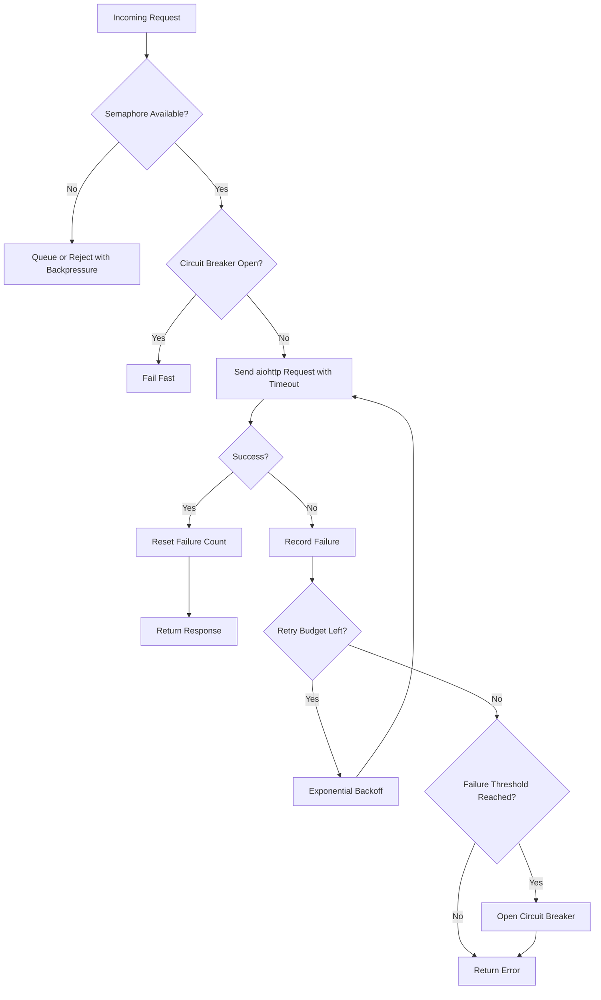

| Difficulty | Channel | Tags |
|---|---|---|
| advanced | backend | asyncio, aiohttp, concurrency |

Netflix's API once handled over 1 billion incoming calls per day, fanning out roughly 6:1 into billions of dependency requests, with peaks above 100,000 requests per second [1]. In that environment, a single slow dependency could exhaust every Tomcat request thread in seconds and take down the entire API [1]. If you build backend services with aiohttp, the same failure mode is closer than it looks: without limits, retries, and circuit breaking, high load turns minor latency into a full outage. This is the story of how to design a connection pool manager that degrades gracefully instead of collapsing.

---

> ### Real-World Case — Netflix
>
> Netflix's API handled over 1 billion incoming calls per day, fanning out roughly 6:1 into several billion calls to dozens of backend dependencies, with peaks above 100,000 dependency requests/second. Real incidents involving saturated connection and thread pools meant a single slow dependency could exhaust every Tomcat request thread in seconds and take down the entire API; even with dependencies at 99.99% uptime each, 30 of them mathematically allowed 2+ hours of downtime per month.
>
> | | |
> |---|---|
> | **Challenge** | Bound concurrent access to flaky, high-latency network dependencies and stop a failing backend from consuming all request threads in a cascading failure, while degrading gracefully rather than failing completely. |
> | **Solution** | Built Hystrix: each dependency call is wrapped and isolated by a bulkhead — per-dependency thread pools and non-blocking 'tryable' semaphores that reject immediately when full rather than queuing — combined with aggressive timeouts tuned just above the 99.5th percentile, network-level retries, and circuit breakers that short-circuit all calls after ~50% errors in a 10-second window then probe recovery via a half-open state. Every failure path (exception, timeout, pool/semaphore rejection, short-circuit) routes to a fallback such as stale cache data, stubbed defaults, or an empty response. |
> | **Outcome** | Hystrix now executes tens of billions of thread-isolated and hundreds of billions of semaphore-isolated calls daily at Netflix (operational reports cite 100+ command types, 40+ thread pools, 10B+ thread-isolated and 200B+ semaphore-isolated executions/day), with a reported dramatic improvement in uptime and resilience. During the October 2012 AWS EBS outage that took down many major sites, Netflix had very little customer impact and evacuated an affected Availability Zone in just 20 minutes. |
> | **Lesson** | The counterintuitive insight: when a pool is saturated, buffering requests makes overload worse. Netflix's semaphores use tryAcquire so excess calls fail fast into a cheap fallback instead of piling up and inflating latency — bounded concurrency plus a circuit breaker plus a no-network fallback turns a latent dependency into a degraded-but-working experience. |

---

## Hook — The 3 a.m. Cascade Nobody Planned For

Picture this: your service is healthy, dashboards are green, and then one downstream dependency starts responding 20x slower than usual. Requests pile up, connections stay open longer, and suddenly your own API stops responding. Sound familiar? This is not a hypothetical edge case; it is the default outcome when concurrency is unbounded. At Netflix scale, even dependencies with 99.99% uptime could mathematically combine into hours of downtime per month across dozens of services [1]. The stakes are simple: resilience is not about preventing every failure, it is about containing failure before it becomes systemic [2].

## Problem — Why Naive Connection Handling Breaks Under Load

The core challenge is that network calls are slow, unreliable, and shared. When your aiohttp client fires requests without a concurrency cap, a traffic spike or a sluggish dependency can consume sockets, memory, and event loop time. Building on that, connection timeouts that are too generous keep bad requests alive, while missing retries drop recoverable work. However, aggressive retries without backoff can amplify the outage by hammering an already struggling service [3].

Here is what you need to know:
- **Unbounded concurrency**: Too many in-flight requests exhaust file descriptors and overwhelm dependencies.
- **Timeout ambiguity**: Without clear connect/read/total timeouts, failures linger and resources leak.
- **Retry storms**: Immediate retries multiply load at the worst possible moment [3].
- **No failure isolation**: One bad dependency can poison the entire application, a classic cascading failure pattern [2].

The real question is not "How do you make requests?" but "How do you keep making useful requests when part of the system is unhealthy?"

## Real-World Case — Netflix

Netflix faced exactly this problem at massive scale. Its API handled over 1 billion incoming calls per day, fanning out roughly 6:1 into several billion calls to dozens of backend dependencies, with peaks above 100,000 dependency requests per second [1]. Real incidents showed that saturated connection and thread pools allowed a single slow dependency to exhaust every Tomcat request thread in seconds, taking down the entire API [1]. Even with each dependency at 99.99% uptime, 30 dependencies mathematically allowed more than two hours of downtime per month [1].

The response was Hystrix, a resilience library built around isolation, timeouts, and circuit breakers [1][2]. Netflix reported Hystrix executing tens of billions of thread-isolated and hundreds of billions of semaphore-isolated calls daily, with dramatic improvements in uptime and resilience [1]. During the October 2012 AWS EBS outage, Netflix experienced very little customer impact and evacuated an affected Availability Zone in just 20 minutes [1]. The lesson is clear: graceful degradation is an architectural feature, not an afterthought.

## Deep Dive — The Building Blocks of Graceful Degradation

This leads to the technical toolkit. A resilient aiohttp connection pool manager combines four patterns that work together.

**1. Concurrency limiting with semaphores**
A semaphore caps the number of simultaneous requests, creating a bulkhead that prevents one workload from consuming all capacity [4][5]. In asyncio, `asyncio.Semaphore` is a natural fit for limiting concurrent coroutines without blocking the event loop [5].

**2. Timeouts as contracts**
Every outbound request needs explicit timeouts. A total timeout bounds end-to-end latency, while connect and read timeouts catch stalled sockets early. Without them, degraded dependencies hold resources indefinitely.

**3. Exponential backoff for retries**
Retries should be selective and spaced out. Exponential backoff increases delay between attempts, reducing pressure on failing services and giving them room to recover [3]. Adding jitter avoids synchronized retry waves.

**4. Circuit breaker for failure isolation**
A circuit breaker tracks failures and temporarily stops calls to an unhealthy dependency, returning fast failures instead of waiting on doomed requests [2]. This protects local resources and allows the downstream service to recover.

| Pattern | Protects Against | Tradeoff |
|---|---|---|
| Semaphore | Resource exhaustion | Extra requests wait or fail fast |
| Timeout | Hanging requests | Too-low values cause false failures |
| Exponential backoff | Retry storms | Adds latency to recovery |
| Circuit breaker | Cascading failures | May reject requests during recovery window |

💡 Insight: These patterns are multiplicative, not redundant. A semaphore limits blast radius, timeouts bound pain, backoff reduces amplification, and a circuit breaker stops the bleeding [2][3][4].

## Workflow — From Request to Controlled Response

Building on these patterns, the runtime workflow should be explicit and observable. Every request passes through admission control, health checks, execution, and failure accounting. Specifically, the manager should decide *before* making a network call whether the system is in a safe state to try.



The key operational detail is state transitions. The circuit breaker moves between closed, open, and half-open states, while the semaphore continuously controls concurrency [2][5]. Consequently, you get predictable behavior under stress: some requests may be delayed or rejected, but the service stays alive.

## Code Example — A Practical aiohttp Pool Manager

Now let's turn the workflow into code. The example below uses `asyncio.Semaphore` for concurrency limits, `aiohttp.ClientTimeout` for bounded waits, exponential backoff for retries, and a simple circuit breaker. It is intentionally compact, but it reflects production patterns you can extend with metrics, jitter, and half-open probing [5][6][7].

```python
import asyncio
import time
import aiohttp
from typing import Optional

class ConnectionPoolManager:
    def __init__(
        self,
        max_connections: int = 100,
        failure_threshold: int = 5,
        recovery_timeout: int = 60,
        max_retries: int = 3,
    ):
        # Limit concurrent in-flight requests (bulkhead)
        self.semaphore = asyncio.Semaphore(max_connections)
        self.session: Optional[aiohttp.ClientSession] = None
        self.timeout = aiohttp.ClientTimeout(total=30, connect=5)
        self.failure_threshold = failure_threshold
        self.recovery_timeout = recovery_timeout
        self.max_retries = max_retries
        self.failures = 0
        self.last_failure_time = 0.0

    async def start(self) -> None:
        # Reuse a single session for connection pooling/keepalive
        if self.session is None:
            self.session = aiohttp.ClientSession(timeout=self.timeout)

    async def close(self) -> None:
        # Prevent connection leaks on shutdown
        if self.session:
            await self.session.close()
            self.session = None

    def _circuit_open(self) -> bool:
        # Open circuit when failures exceed threshold within recovery window
        if self.failures < self.failure_threshold:
            return False
        return (time.monotonic() - self.last_failure_time) < self.recovery_timeout

    def _record_success(self) -> None:
        self.failures = 0

    def _record_failure(self) -> None:
        self.failures += 1
        self.last_failure_time = time.monotonic()

    async def get(self, url: str) -> aiohttp.ClientResponse:
        if self.session is None:
            raise RuntimeError("Session not started. Call start() first.")

        async with self.semaphore:  # Admission control
            if self._circuit_open():
                raise aiohttp.ClientError("Circuit breaker open")

            delay = 0.5
            for attempt in range(1, self.max_retries + 1):
                try:
                    async with self.session.get(url) as response:
                        response.raise_for_status()
                        self._record_success()
                        return response
                except (asyncio.TimeoutError, aiohttp.ClientError):
                    self._record_failure()
                    if attempt == self.max_retries or self._circuit_open():
                        raise
                    # Exponential backoff before retrying
                    await asyncio.sleep(delay)
                    delay *= 2
```

**Walkthrough:**
- `asyncio.Semaphore` enforces a hard cap on concurrent requests, preventing resource exhaustion [5].
- A single `ClientSession` is reused, which supports connection pooling and keepalive in aiohttp [6].
- `_circuit_open()` implements a simple open/closed rule based on failure count and recovery time, inspired by the circuit breaker pattern [2].
- The retry loop applies exponential backoff, reducing pressure on unhealthy dependencies [3].
- `start()` and `close()` make lifecycle management explicit, avoiding connection leaks during shutdown [6].

⚠️ Watch Out: This minimal circuit breaker does not include a half-open state, jitter, or metrics. In production, add observability and tune thresholds based on real traffic patterns [1][7].

## Lessons Learned — Build for Failure, Not Just Success

Tying it back to the Netflix story, the goal is not zero failures; it is controlled failure [1]. When you design an aiohttp connection pool manager, you are deciding how your system behaves on its worst day.

Key takeaways:
- **Limit concurrency early**: Use semaphores or bulkheads so one dependency cannot consume all capacity [4][5].
- **Bound every network call**: Timeouts turn unknown waits into manageable failures.
- **Retry with restraint**: Exponential backoff prevents retry storms and supports recovery [3].
- **Fail fast when needed**: Circuit breakers protect your service and give dependencies breathing room [2].
- **Observe everything**: Track failure rates, queue depth, timeout counts, and circuit state so tuning is data-driven [1][7].

If this feels overwhelming, you are not alone. Many teams discover these patterns only after an outage. The practical next step is small: add a semaphore and strict timeouts to your hottest outbound call path tomorrow, then layer in backoff and a circuit breaker. The memorable insight to share with your team is this: **resilience is a feature you build into the request path, not a dashboard you check after the incident.**

---

## Resilient Request Flow


<details>
<summary><strong>Original Interview Question</strong></summary>

**Q:** How would you implement a connection pool manager for aiohttp that handles graceful degradation under high load and connection timeouts?

**A:** Implement a connection pool manager for aiohttp using a semaphore to limit concurrent connections, exponential backoff for retrying failed requests, and circuit breaker pattern to gracefully degrade under high load and connection timeouts.

</details>

## Conclusion

The next time a dependency slows down, your service does not have to go down with it. Start by bounding concurrency and timeouts, then add backoff and a circuit breaker where it matters most. The teams that survive incidents are not the ones with perfect dependencies — they are the ones that design their request paths to fail gracefully.

---

## References

1. [Netflix incident report](https://netflixtechblog.com/introducing-hystrix-for-resilience-engineering-13531c1ab362) — article
2. [Circuit breaker design pattern](https://en.wikipedia.org/wiki/Circuit_breaker_design_pattern) — documentation
3. [Exponential backoff](https://en.wikipedia.org/wiki/Exponential_backoff) — documentation
4. [Bulkhead (a design pattern)](https://en.wikipedia.org/wiki/Bulkhead_(a_design_pattern)) — documentation
5. [asyncio Synchronization Primitives — Semaphore](https://docs.python.org/3/library/asyncio-sync.html) — documentation
6. [aiohttp Client Reference](https://docs.aiohttp.org/en/stable/client_reference.html) — documentation
7. [Connection pool](https://en.wikipedia.org/wiki/Connection_pool) — documentation
8. [AWS Prescriptive Guidance — Retry with backoff pattern](https://docs.aws.amazon.com/prescriptive-guidance/latest/cloud-design-patterns/retry-backoff.html) — documentation

---

**Author:** Satishkumar Dhule — [GitHub](https://github.com/satishkumar-dhule) · [LinkedIn](https://linkedin.com/in/satishkumar-dhule) · [Website](https://satishkumar-dhule.github.io)
