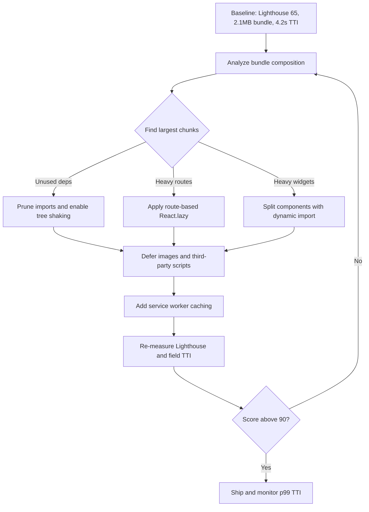

| Difficulty | Channel | Tags |
|---|---|---|
| intermediate | frontend | lighthouse, bundle, lazy-loading |

In 2017, Twitter rebuilt its mobile web experience as Twitter Lite for 328 million monthly users, many on 2G/3G connections in emerging markets, after its React/Redux build had collapsed into just three JavaScript assets totaling over 1MB (420KB gzipped) and a main bundle that took more than 5 seconds to load on simulated 3G [1]. The fix was not a shiny new framework; it was a ruthless campaign against bytes, caching, and time-to-interactive. Your 2.1MB React app with a 4.2s TTI and a Lighthouse score of 65 is facing the same trap. So what actually moves the needle to 90+?

---

> ### Real-World Case — Twitter
>
> In 2017 Twitter rebuilt its mobile web experience as Twitter Lite, the default mobile site for 328 million monthly users, over 80% of them on mobile and many on 2G/3G in emerging markets. Its React/Redux build had collapsed into just three JavaScript assets totaling over 1MB (420KB gzipped); the main bundle took over 5 seconds to load on a simulated 3G connection.
>
> | | |
> |---|---|
> | **Challenge** | Cut JavaScript transfer and parse cost enough to make the app interactive in under 5 seconds on low-end devices and flaky networks, without removing product features. |
> | **Solution** | The team fought CommonsChunkPlugin circular-dependency issues to split code by route into roughly 40 on-demand chunks (runtime, vendor, shared, main, i18n plus per-view chunks), lazy-loading only what the visible screen needed and preloading critical bundles. They shrank CDN images, and used a service worker to pre-cache the app shell and assets — but deliberately delayed service-worker registration so its ~50 precache requests would not saturate the browser's connection limit and block initial API calls. |
> | **Outcome** | Main bundle load fell from over 5s to barely 3s on simulated 3G and Lighthouse TTI roughly halved; p99 time-to-interactive dropped 50% and average load time 30%. Repeat loads went from ~6s to under 1.5s (75% faster); pages per session rose 65%, tweets sent 75%, bounce rate fell 20%, and the PWA shipped 600KB over the wire versus 23.5MB for the native Android app. |
> | **Lesson** | Route-based splitting can increase total app size yet still be a huge win because the cost is amortized across the session — and the performance fix itself can become the bottleneck, as service-worker precaching did here. |

---

## Hook — Three files, one million bytes, and 328 million users waiting

Picture this: a mobile site used by 328 million people a month, where more than 80% of traffic arrives on a phone and a large slice rides 2G or 3G in emerging markets [1]. Under the hood, the entire React/Redux experience sits in three JavaScript assets exceeding 1MB, with 420KB traveling over the wire after gzip. On a simulated 3G connection, the main bundle takes over 5 seconds to arrive before the app can even begin to feel interactive.

That is not a slow app. That is an app asking users to fund its download with their patience. When every extra 100KB costs real seconds on a weak network, the bundle becomes a product decision disguised as an engineering detail. The stakes are brutal: bounce rate, sessions, revenue, and the quiet judgment of a Lighthouse score that refuses to budge.

Many developers think the answer is to 'optimize React.' Actually, React is rarely the villain. The villain is everything teams accidentally ship with it. Ready to find where those bytes are hiding?

## Problem — Your 2.1MB bundle is a tax on every single visit

Building on that tension, a Lighthouse score of 65 with a 4.2s Time to Interactive is usually a symptom, not a diagnosis. A 2.1MB JavaScript bundle means the browser must download, parse, compile, and execute roughly two megabytes of code before buttons respond. On a laptop with a warm cache, that feels fine. On a mid-range Android phone over 3G, it feels like watching paint dry with a network meter attached.

The hidden cost is that JavaScript is more expensive than images per byte. Images decode; JavaScript occupies the main thread. This is why dynamic import syntax exists as a native way to split code into on-demand chunks [2], and why tree shaking can remove dead code entirely when ES modules are configured correctly [4].

Who pays for this? Every first-time visitor, every user on a flaky connection, and every team running paid acquisition into a landing page that loses people before hydration finishes. A 4.2s TTI is not a rounding error; it is a conversion leak with a console log.

Here is the thing though: throwing lazy loading at everything can make performance worse. Split too aggressively and users hit a waterfall of tiny requests and loading spinners. The real problem is deciding *what* to split, not *whether* to split.

## Real-World Case — Twitter Lite

However, the story gets more interesting once the numbers arrive. Twitter Lite shipped in 2017 as the default mobile site for 328 million monthly users, built with React and Redux but constrained by networks where 2G/3G was normal [1]. The original mobile web experience had accumulated three JavaScript assets over 1MB, and the main bundle needed more than 5 seconds to load on simulated 3G.

The team attacked the problem with code splitting, service worker caching, and a Progressive Web App approach that treated the network as a suggestion rather than a dependency. The results were not cosmetic. Main bundle load dropped from over 5s to barely 3s on simulated 3G, Lighthouse TTI roughly halved, p99 time-to-interactive fell 50%, and average load time fell 30%.

Repeat loads improved even more dramatically, from roughly 6s to under 1.5s, a 75% reduction. Engagement followed: pages per session rose 65%, tweets sent rose 75%, and bounce rate fell 20%. The PWA delivered about 600KB over the wire compared with 23.5MB for the native Android app [1]. That last comparison is the plot twist: the web app won by *not* installing anything.

The lesson is not 'build a PWA.' PWAs are one tool in the broader ecosystem of offline-capable web apps [8]. The lesson is that performance work compounds when it targets the exact moment users become able to act.

## Deep Dive — Where the bytes hide and what to do about them

This leads to the first serious question: what is actually inside those 2.1MB? Guessing is how teams spend weeks optimizing the wrong component. Start with a bundle analyzer such as webpack-bundle-analyzer [3] and look for the usual suspects: duplicated libraries, moment-style date utilities carrying full locale tables, icon sets imported wholesale, and polyfills shipping to browsers that do not need them.

💡 Insight: The biggest wins often come from one boring import. Replacing `import { Icon } from 'huge-icon-pack'` with a path-specific import can remove hundreds of kilobytes without touching a single feature.

Once the map exists, choose a splitting strategy deliberately:

| Strategy | Best for | Real tradeoff |
| --- | --- | --- |
| Route-based splitting | Dashboards, settings, analytics pages | Slight delay on navigation, huge win on first load |
| Component-based splitting | Charts, editors, maps, rich text | Loading state must be designed, not improvised |
| Third-party dynamic import | PDF generators, chart engines, SDKs | Deferred code may surprise code that assumes it is synchronous |
| No splitting | Small apps under ~150KB gzipped | Splitting overhead can exceed the benefit |

Route-based splitting works because users rarely need every screen immediately. Dynamic imports let those screens become separate chunks loaded only when the router asks for them [2]. Component-based splitting goes deeper, isolating expensive widgets behind a boundary so the rest of the page stays interactive.

⚠️ Watch Out: `React.lazy()` needs a `Suspense` boundary above it. Without one, the component simply fails to render, which is a spectacular way to turn an optimization into an incident. The React repository documents the lazy/suspense contract teams rely on in production [7].

Tree shaking is the quiet partner in this story. It only works reliably when modules remain in ES module form, because CommonJS exports are too dynamic for bundlers to prove what is unused [4]. That means verifying `module: false` in Babel configuration and avoiding deep CommonJS imports that silently defeat elimination.

Images and caches complete the picture. Native lazy loading and Intersection Observer patterns defer below-the-fold media [6] [9], while service workers cache previously visited assets so repeat loads stop touching the network [5]. Twitter Lite showed how large that repeat-visit win can be [1].

🔥 Hot Take: A Lighthouse score of 90+ is rarely achieved by deleting code. It is achieved by delivering less code *at the right time* and reusing what was already downloaded.

## Workflow — From 65 to 90+ without breaking the app

With those tradeoffs clear, the path becomes a repeatable loop rather than a heroic weekend of refactoring. The diagram below maps the journey from a bloated bundle to a measurable score.

Step one is measurement: capture Lighthouse lab data and field TTI before touching code. Step two is analysis: run the bundle analyzer and rank chunks by size and execution cost [3]. Step three is removal, because deleted code is faster than lazy-loaded code. Step four is splitting: routes first, then heavy components, then third-party libraries [2].

Step five handles everything that is not JavaScript: lazy-load images, preload the critical few, and audit third-party tags that block the main thread [6] [9]. Step six adds service worker caching for repeat visits [5]. Step seven re-measures; the loop repeats until the score holds.

🎯 Key Point: Always measure after each step. Batched changes produce great demos and terrible debugging sessions.

## Code Example — Production-style splitting with failure protection

Now the theory becomes concrete. The snippet below uses route-level splitting, a component error boundary, an Intersection Observer image loader, and service worker registration. It uses `React.createElement` so the example stays valid plain JavaScript while still mapping directly to JSX-based production code.

The important detail is not the syntax; it is the shape. Routes load on demand, failures stay contained, below-the-fold images wait for visibility, and repeat visits get cached assets. That is the same combination that helped Twitter Lite cut repeat loads by 75% [1].

Read the full walkthrough in the codeExample field, then adapt the pattern to your router and build tool. Notice how each optimization protects a different moment of the user journey rather than chasing a single number.

## Lessons Learned — Battle scars worth keeping

Building on the numbers above, the biggest lesson is that performance is a system property. Twitter Lite changed bundle load from over 5s to barely 3s, cut p99 TTI by 50%, and still had to pair code splitting with caching to make repeat loads 75% faster [1]. One trick never carries the whole story.

Common battle scars include:

- **Splitting everything.** Many teams discover the hard way that 40 tiny chunks create a request waterfall and a forest of spinners. Split at route boundaries first.
- **Forgetting error boundaries.** A failed lazy chunk without an `ErrorBoundary` can blank a whole screen. Always give failure a UI.
- **Breaking tree shaking.** CommonJS imports, side-effectful barrel files, and loose Babel config quietly push dead code back into the bundle [4].
- **Ignoring images.** A perfectly split bundle still loses to a 4MB hero image. Use native lazy loading and Intersection Observer for the rest [6] [9].
- **Caching too early.** Service workers can serve stale bundles if versioning is sloppy [5]. Cache after the build output has hashed filenames.
- **Trusting lab scores only.** Lighthouse is a simulation; field TTI on real devices is the score users actually feel.

If this feels overwhelming, you are not alone. The teams that win start with one analyzer report, one oversized chunk, and one measurement they refuse to argue with.

So what changes tomorrow? Open your analyzer, find the single largest chunk, and ask whether any user needs it on the first paint. Usually the answer is no, and that answer is where the 25 points are hiding.

---

## Bundle Optimization Journey

<strong>Original Interview Question</strong>

**Q:** You're tasked with improving a React app's Lighthouse performance score from 65 to 90+. The bundle size is 2.1MB and Time to Interactive is 4.2s. What specific steps would you take to optimize the bundle and implement lazy loading?

**A:** Implement code splitting with React.lazy() and Suspense, analyze bundle composition with webpack-bundle-analyzer to identify largest chunks, remove unused dependencies and optimize imports, add dynamic imports for heavy components and third-party libraries, implement route-based splitting for better initial load times, and utilize tree shaking with proper ES module configuration.

## Conclusion

Twitter Lite's journey started with the same unglamorous reality many teams face: too many bytes, too little patience, and a score stuck at 65 [1]. The way out was not magic. It was analysis, deletion, deliberate splitting, deferred media, and caching that turned repeat visits from ~6s into under 1.5s.

Tomorrow, run the analyzer before opening a pull request. Pick the largest chunk, ask whether it is needed for the first paint, and defer it if the answer is no.

Leave your team with this one line: performance is not about shipping less app, it is about shipping the right part of the app at the right moment.

---

## References

1. [Twitter incident report](https://paularmstrong.dev/blog/2017/04/11/twitter-lite-and-high-performance-react-progressive-web-apps-at-scale) — article
2. [MDN: Dynamic import operator](https://developer.mozilla.org/en-US/docs/Web/JavaScript/Reference/Operators/import) — documentation
3. [webpack-bundle-analyzer on GitHub](https://github.com/webpack-contrib/webpack-bundle-analyzer) — documentation
4. [Wikipedia: Tree shaking](https://en.wikipedia.org/wiki/Tree_shaking) — documentation
5. [MDN: Service Worker API](https://developer.mozilla.org/en-US/docs/Web/API/Service_Worker_API) — documentation
6. [MDN: Lazy loading](https://developer.mozilla.org/en-US/docs/Web/Performance/Guides/Lazy_loading) — documentation
7. [React repository on GitHub](https://github.com/facebook/react) — documentation
8. [Wikipedia: Progressive web app](https://en.wikipedia.org/wiki/Progressive_web_app) — documentation
9. [MDN: Intersection Observer API](https://developer.mozilla.org/en-US/docs/Web/API/Intersection_Observer_API) — documentation

---

**Author:** Satishkumar Dhule — [GitHub](https://github.com/satishkumar-dhule) · [LinkedIn](https://linkedin.com/in/satishkumar-dhule) · [Website](https://satishkumar-dhule.github.io)
