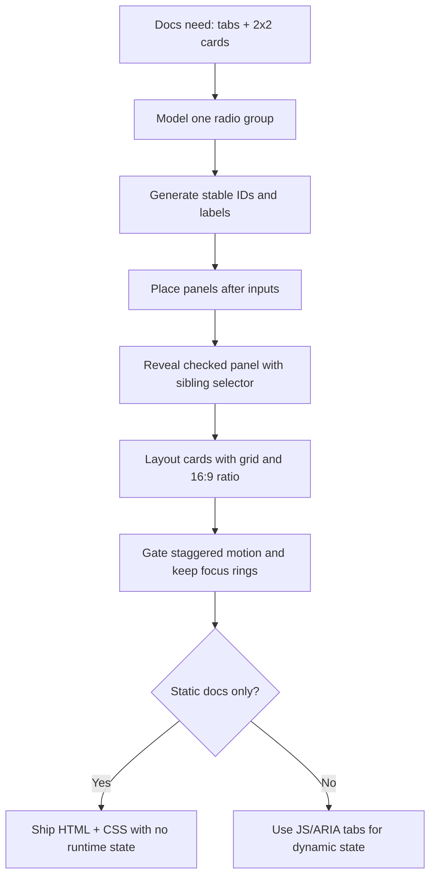

| Difficulty | Channel | Tags |
|---|---|---|
| beginner | frontend | css, flexbox, grid, animations |

Microsoft’s Office Engineering and Experiences teams had to rebuild Fluent 2, the design-system docs that keep Office, Windows, and Teams visually consistent; earlier frameworks and CMSs felt rigid, hard to maintain, and out of step with Figma-to-code work [1]. The rebuild took 10 months and produced 200+ pages, yet teams now create new pages in half the time and can implement a simple Figma design in 20–30 minutes [1]. That is the real stakes behind a seemingly tiny docs component: static pages that stay fast, accessible, and cheap to maintain. A CSS-only tab panel will not save an entire design system by itself, but it is a perfect place to prove the stack is doing the least possible work.

---

> ### Real-World Case — Microsoft
>
> Microsoft's Office Engineering and Experiences teams needed to rebuild the Fluent 2 design-system website — the docs that keep visual branding consistent across Office, Windows, and Teams. Earlier attempts with other frameworks and CMSs were too rigid, hard to maintain, or painful to migrate, and did not fit their Figma-to-code workflow.
>
> | | |
> |---|---|
> | **Challenge** | Build and maintain 200+ design-system documentation pages that were lightweight, secure, scalable, and free of unnecessary client-side JavaScript, while still supporting their published React component library and legacy Storybook code-example iframes. |
> | **Solution** | They built the Fluent 2 docs site with Astro, whose island architecture ships zero JavaScript by default and generates fully static files. That let them lean on plain HTML/CSS for content and components, keep the React design-system library and Storybook iframes during migration, and host the whole site statically on Azure. |
> | **Outcome** | The site was designed and built over 10 months with 200+ pages of new content. The team builds new pages in half the time compared with their previous stack, and can implement a simple Figma design in 20–30 minutes. Fully static output also removed back-end dependencies for DDoS protection and scalability. |
> | **Lesson** | For design-system docs, zero-JS-by-default wins: ship static HTML/CSS and hydrate only what truly needs interactivity. Pages become faster to build, faster to load, and safer to host — the same reasoning that favors CSS-only interactive patterns such as radio-driven tabs over JavaScript widgets. |

---

## Hook — The 20-minute docs page that changed the stakes

Microsoft’s Fluent 2 rewrite makes this more than a toy CSS trick. The Office Engineering and Experiences teams were maintaining design-system docs for Office, Windows, and Teams, and earlier frameworks and CMSs were too rigid, hard to maintain, and misaligned with Figma-to-code work [1]. The stakes sound boring until a docs platform slows every product team trying to ship a consistent button. Picture the quiet cost: 200+ pages, ten months of rebuilding, and a need for new pages that do not require a framework archaeology expedition. The question hiding inside that mess is simple: how small can an interactive docs component be before it stops being a liability?

## Problem — When a tab panel becomes a dependency

Building on that pressure, a tab panel looks innocent: click a label, see another set of cards. Then the requirements arrive. Desktop needs a 2×2 grid under each tab, mobile needs one column, every card needs a fixed 16:9 image area, titles and meta lines must line up, focus-visible outlines must survive keyboard navigation, and motion must respect user preferences. Many developers reach for JavaScript because tabs feel interactive. However, radio inputs are already native one-of-N state machines, and labels are designed to activate those inputs [2][8]. That means the browser can handle the click, the checked state, arrow-key movement, and focus behavior before a framework bundle even wakes up. So what breaks when a docs site adds a few kilobytes of JavaScript just to switch panels?

## Real-World Case — Microsoft

However, the backstory is where the lesson gets interesting. Microsoft’s Fluent 2 site was designed and built over 10 months with more than 200 pages of new content [1]. Teams now build new pages in half the time compared with their previous stack, and a simple Figma design can become an implemented page in 20–30 minutes [1]. The fully static output also removed back-end dependencies for DDoS protection and scalability, which is the kind of infrastructure win nobody notices until it is gone [1]. Here is the plot twist: the performance came from removing machinery, not from adding a smarter runtime. If a whole docs platform benefits from fewer moving parts, what might that same mindset do for one tab component?

## Deep Dive — Radios, sibling selectors, and the layout contract

This leads to the core mechanism. Give every radio the same `name`, connect each `` with `for`/`id`, and the browser guarantees that only one option is checked [2][8]. That is not a hack; it is the normal behavior of a radio group, borrowed for a docs UI. Consequently, a click on a label becomes a state change without an event handler. The panel switch comes from the general sibling combinator: a checked input can select panels that appear later in the same parent [7]. In production, generated rules such as `#tab-overview:checked ~ .docs-tabs__panels .docs-tabs__panel[data-panel='overview']` are more maintainable than a giant hand-written stylesheet.

Moreover, the grid must be boring in the best possible way. `repeat(2, minmax(0, 1fr))` gives two equal desktop columns while stopping long titles from forcing overflow, and a `48rem` media query collapses the same markup to one column [3]. The image container uses `aspect-ratio: 16 / 9`, so each card reserves space before assets load and the layout does not jitter like a bad GIF [4].

Accessibility is where the counterintuitive part appears. Visually hiding a radio with `display: none` removes it from keyboard interaction, so the control should be clipped but focusable, with `:focus-visible` moving the outline to its adjacent label [5]. Motion should live inside `@media (prefers-reduced-motion: no-preference)`, with short delays around 100ms steps for the stagger; otherwise the animation becomes an accessibility tax [6][9]. Here is the real tradeoff:

| Option | Superpower | Real tradeoff | Use when |
|---|---|---|---|
| CSS radio tabs | Zero runtime, native arrow-key behavior | Static tab set; selectors get verbose | Docs pages, component galleries, marketing tabs |
| JavaScript or ARIA tabs | Dynamic panels, async content, URL state | Hydration, focus, and keyboard bugs | App dashboards and stateful product UI |
| `` | Semantic disclosure with zero JavaScript | Not a true tab group | FAQs and expandable guidance |

When would this actually be used? Reach for it when the tabs are known at build time and the content is already on the page. If panels load from an API or need deep-linkable state, JavaScript earns its keep. So how does this mechanism become a repeatable workflow instead of a clever one-off?

## Workflow — From Figma grid to static panel

Building on those mechanics, the workflow should look like a small assembly line, not a treasure hunt. First, model each tab and card in the docs source. Second, generate stable IDs from tab names so labels, radios, and CSS rules agree. Third, emit all radios and labels before the panel container, because sibling selectors can only look forward. Fourth, render each hidden panel with four cards in a predictable order. Fifth, add the grid, the 16:9 media boxes, the visible focus ring, and the reduced-motion-gated stagger. Sixth, ship static HTML and CSS, then verify with a keyboard and a screen reader. The diagram below, `CSS-Only Tab Build Flow`, shows the visual story from requirement to static output.

If this feels like a lot of ceremony for a tab strip, consider the alternative: debugging a hydration mismatch inside a docs page at 2am. Which failure mode sounds more fun?

## Code Example — Static output, zero runtime tabs

Consequently, the implementation should be generated at build time and shipped as plain markup and CSS. The TypeScript below is a renderer, not a runtime tab controller: its output uses radio inputs and CSS selectors for every interaction. The `Tab` type defines the content contract, while `slugify` and `escapeHtml` keep generated IDs selector-safe and text safe. `radiosAndLabels` emits one shared radio group with the first tab checked, and `panels` emits the 2×2 card content. The `checkedRules` list is the heart of the pattern: each checked radio reveals exactly one panel later in the DOM. Finally, the CSS hides radios without making them unfocusable, moves focus rings to labels, collapses the grid on narrow screens, reserves 16:9 image space, and staggers cards only when motion is allowed. But what happens when a team copies the pattern without these guardrails?

## Lessons Learned — Battle scars and tomorrow's default

After the mechanics are in place, the battle scars are mostly about small details that look harmless in review. 💡 Insight: a radio group is already a state machine, so using it for static tabs removes a surprising amount of application code. ⚠️ Watch Out: never use `display: none` on the radio, never omit `for`/`id`, and never add `role='tab'` unless the full keyboard contract is implemented. Another common scar is using `repeat(2, 1fr)` without `minmax(0, 1fr)`, which lets long content stretch columns past the viewport. Motion has its own trap: delays above roughly 300–400ms make panels feel sluggish, so keep the stagger subtle and put it behind `prefers-reduced-motion` [6]. 🔥 Hot Take: if a docs tab needs a state manager, the problem is probably the docs tab, not the state manager.

🎯 Key Point: this pattern is not a universal replacement for ARIA tabs. It is the right default when content is static, the tab count is small, and keyboard behavior should come from native controls. The practical next step is to inventory one static interaction in your docs site, delete its JavaScript path, and rebuild it with radios, labels, sibling selectors, and visible focus. Microsoft’s 20–30 minute Figma-to-code workflow was not magic; it was the result of reducing friction everywhere, including the boring parts [1]. What else in your UI is still paying rent for JavaScript it does not need?

---

## CSS-Only Tab Build Flow

<strong>Original Interview Question</strong>

**Q:** Build a CSS-only tab panel for a design-system docs page. Use radio inputs to switch tabs (no JavaScript). Desktop: a 2x2 grid of cards under each tab; mobile: single column. Each card has a fixed 16:9 image area, a title, and a short meta line. Add a subtle entrance animation with a stagger and keep focus-visible outlines; ensure prefers-reduced-motion is respected?

**A:** Use a set of radio inputs with a shared `name` attribute and corresponding `` elements for each tab section. The `:checked` state of each radio controls visibility of its associated panel via adjacent sibling selectors. Each panel renders a 2×2 card grid on desktop and collapses to a single column on mobile. Cards use `aspect-ratio: 16/9` for fixed image containers, with a title and meta line below.

## Conclusion

The moral of the story: Microsoft’s 10-month Fluent 2 rebuild was not about making tabs fancy; it was about removing friction from every page, including the tiny interactive ones [1]. Tomorrow, choose one static component in your docs site and ask whether the browser already owns the state it needs. The memorable insight to share with your team is this: native controls are not the fallback when JavaScript is unavailable; they are often the fastest, most accessible architecture available from the start.

---

## References

1. [Microsoft incident report](https://astro.build/case-studies/microsoft/) — article
2. [MDN: input type radio](https://developer.mozilla.org/en-US/docs/Web/HTML/Element/input/radio) — documentation
3. [MDN: CSS Grid Layout](https://developer.mozilla.org/en-US/docs/Web/CSS/CSS_grid_layout) — documentation
4. [MDN: aspect-ratio](https://developer.mozilla.org/en-US/docs/Web/CSS/aspect-ratio) — documentation
5. [MDN: :focus-visible](https://developer.mozilla.org/en-US/docs/Web/CSS/:focus-visible) — documentation
6. [MDN: prefers-reduced-motion](https://developer.mozilla.org/en-US/docs/Web/CSS/@media/prefers-reduced-motion) — documentation
7. [MDN: General sibling combinator](https://developer.mozilla.org/en-US/docs/Web/CSS/General_sibling_combinator) — documentation
8. [MDN: label element](https://developer.mozilla.org/en-US/docs/Web/HTML/Element/label) — documentation
9. [MDN: animation-delay](https://developer.mozilla.org/en-US/docs/Web/CSS/animation-delay) — documentation

---

**Author:** Satishkumar Dhule — [GitHub](https://github.com/satishkumar-dhule) · [LinkedIn](https://linkedin.com/in/satishkumar-dhule) · [Website](https://satishkumar-dhule.github.io)
