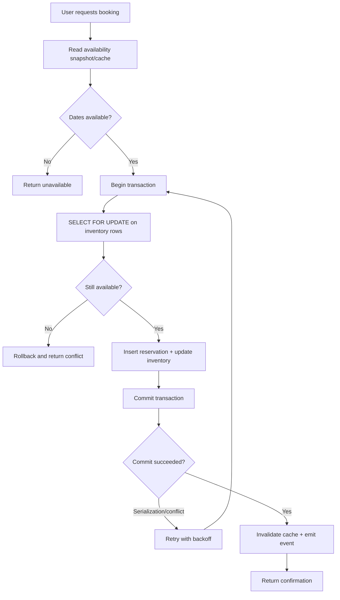

| Difficulty | Channel | Tags |
|---|---|---|
| intermediate | database | acid, isolation-levels, mvcc |

Picture this: two travelers hit "Book Now" on the same beachfront room at the exact same millisecond, and both get a confirmation email. When Booking.com built its centralized Order Platform to power every hotel, flight, and car reservation for its "Connected Trip," the team ran into exactly this kind of concurrency nightmare. Their Cassandra-based system, adopted after painful MySQL failovers, could not enforce multi-row, multi-step reservation invariants, and a custom lock layer built on lightweight transactions started timing out ambiguously [1]. That real-world struggle is the perfect doorway into one of the hardest problems in distributed systems: preventing double bookings while keeping the system fast and available.

---

> ### Real-World Case — Booking.com
>
> Booking.com's centralized Order Platform — the system that orchestrates every hotel, flight and car reservation for its 'Connected Trip' — was originally built on Cassandra after years of painful master failovers on sharded MySQL. As it grew, the team found that Cassandra's row-level isolation could not enforce the multi-row, multi-step invariants of a reservation, and their custom lock layer built on lightweight transactions started timing out ambiguously.
>
> | | |
> |---|---|
> | **Challenge** | Guarantee that a booking is all-or-nothing: check availability, update inventory, record the order and kick off payment/fulfillment across many rows and partitions, without losing high availability. With only row-level isolation, a timeout could mean either 'the condition failed' or 'something else broke,' and the missing secondary indexes forced a parallel OpenSearch copy that had to be kept in sync. |
> | **Solution** | They migrated the Order Platform to a distributed SQL database providing ACID transactions at SERIALIZABLE isolation with MVCC-based optimistic concurrency and automatic retry on serialization conflicts, replacing application-level locks and denormalized atomicity tricks. Native CDC and secondary indexes removed the extra cross-checks and duplicate replication, and the managed cluster spans Frankfurt and London with Ireland as a third region. |
> | **Outcome** | Migrated roughly 20TB of reservation data under SOX controls; the case study reports 99.999% availability and a 99.99998% write SLI, with nodes failing without customer-visible disruption. The team is moving off Cassandra entirely and extending the platform to the Basket application. |
> | **Lesson** | When the invariant is 'never sell the same night twice,' enforce it in the database's transaction boundary — weak isolation pushes the rule into fragile application locks where timeouts become indistinguishable from real conflicts. You do not have to trade away five-nines availability to get serializable correctness. |

---

## Hook — Two Clicks, One Room, Zero Margin for Error

Imagine a flash sale on a popular property: hundreds of users refresh the page, availability flickers to "1 room left," and two requests race through the stack. Without the right safeguards, both succeed, and the business is left apologizing, refunding, and losing trust. This is not a hypothetical edge case; it is the default behavior of concurrent systems that lack explicit coordination [2]. The stakes are real: overbookings create customer support costs, partner disputes, and reputational damage. The question is not whether race conditions will happen, but how the system behaves when they do.

## Problem — Why Double Bookings Are a Concurrency Trap

At its core, a double booking is a lost-update or write-skew problem disguised as a business bug. Two transactions read the same availability state, both decide the room is free, and both write a reservation. Under default isolation levels, each transaction may see a consistent snapshot but still commit conflicting outcomes [2][3]. The challenge gets harder when availability spans multiple rows or date ranges, because a single-row check is no longer enough. Add high traffic, distributed replicas, and latency-sensitive user flows, and the naive "check then write" pattern collapses under pressure. Teams need correctness guarantees from the database, not hope from application timing.

## Real-World Case — Booking.com

Booking.com's Order Platform illustrates how quickly booking correctness can outgrow a database's guarantees. After moving from sharded MySQL to Cassandra to avoid painful master failovers, the team discovered that Cassandra's row-level isolation could not enforce the multi-row, multi-step invariants required for reservations. Their custom lock layer built on lightweight transactions produced ambiguous timeouts, making it hard to know whether a booking failed safely or needed recovery [1]. The migration to CockroachDB moved roughly 20TB of reservation data under SOX controls, and the case study reports 99.999% availability with a 99.99998% write SLI. The takeaway is sharp: reservation systems need strong transactional semantics and operational resilience, not just horizontal scale.

## Deep Dive — Isolation, Locks, and MVCC: The Tools That Actually Work

Preventing double bookings starts with choosing the right consistency model. ACID transactions provide the foundation: atomicity ensures a booking either fully succeeds or fully fails, and isolation prevents concurrent transactions from stepping on each other [6]. PostgreSQL's SERIALIZABLE isolation level gives the strongest guarantee by ensuring concurrent transactions behave as if executed in some serial order, detecting dangerous read/write patterns and aborting one transaction to preserve correctness [2][5].

However, SERIALIZABLE is not a free lunch. Conflicting transactions may be rolled back, so applications must implement retries with backoff. A pragmatic pattern combines techniques: use row-level locking with `SELECT ... FOR UPDATE` when locking a specific inventory row or date range, and use optimistic concurrency control with version columns when contention is low or when updates can be retried cleanly [4][7]. Under the hood, MVCC lets readers see consistent snapshots without blocking writers, which preserves read performance for availability checks while writes coordinate safely [3][8]. The art is in balancing strict correctness for the critical booking write path with scalable reads for browsing and search.

## Workflow — A Booking Flow That Fails Safe

A robust booking workflow separates fast availability reads from a carefully guarded write transaction. First, check availability using snapshot reads or replicas for speed. Second, begin a transaction and lock the target inventory rows for the requested date range. Third, revalidate availability inside the transaction, create the reservation, and commit. If a conflict or serialization failure occurs, retry with exponential backoff and jitter. Finally, invalidate caches and emit events so downstream systems stay consistent.

This flow keeps the critical section small: only the recheck-and-write steps need strict coordination. Everything else can be optimized for latency and availability.

## Code Example — Guarding the Critical Section

The code below shows a simplified PostgreSQL booking transaction in Python. It uses `SERIALIZABLE` isolation, locks inventory rows, rechecks availability, and retries on serialization conflicts. The pattern is intentionally boring in the best way: correctness lives in the database transaction boundary, while the application handles retries and user-facing outcomes.

## Lessons Learned — What to Do Before the Next Flash Sale

Double-booking prevention is less about a single clever trick and more about layering the right guarantees. Use strong isolation or explicit locks for the write path, keep transactions short, and make retries a first-class part of the design [2][4]. Treat caches as accelerators, not sources of truth, and invalidate them after successful commits. Monitor lock contention and hot inventory rows, because a correct system that queues everyone into timeouts is still a bad experience. Most importantly, learn from Booking.com's journey: when business invariants span multiple rows and steps, the database must enforce them [1]. The next time someone suggests "just check availability first," the right response is: "And what happens when two people check at the same time?"

---

## Booking Transaction Flow

<strong>Original Interview Question</strong>

**Q:** You're building a booking system for Airbnb where multiple users can reserve the same property simultaneously. How would you design the transaction handling to prevent double bookings while maintaining high availability?

**A:** Use SERIALIZABLE isolation with optimistic concurrency control. Implement row-level locks on property availability tables, use MVCC snapshot reads for checking availability, and apply application-level validation to ensure atomic booking operations.

## Conclusion

The moral of the Booking.com story is simple: when two users race for the last room, the database has to be the referee. Build the booking path around strong transactional guarantees, keep the critical section tight, and design retries as part of normal operation. Tomorrow, audit your booking flow for check-then-write gaps, verify your isolation and locking strategy, and add contention monitoring before the next traffic spike turns a race condition into a customer-facing incident.

---

## References

1. [Booking.com incident report: How Booking.com simplified order management with CockroachDB](https://www.cockroachlabs.com/customers/booking-com/) — article
2. [PostgreSQL Documentation: Transaction Isolation](https://www.postgresql.org/docs/current/transaction-iso.html) — documentation
3. [PostgreSQL Documentation: Introduction to MVCC](https://www.postgresql.org/docs/current/mvcc-intro.html) — documentation
4. [PostgreSQL Documentation: Explicit Locking](https://www.postgresql.org/docs/current/explicit-locking.html) — documentation
5. [PostgreSQL Documentation: Data Consistency Checks at the Application Level](https://www.postgresql.org/docs/current/applevel-consistency.html) — documentation
6. [ACID - Wikipedia](https://en.wikipedia.org/wiki/ACID) — documentation
7. [Optimistic concurrency control - Wikipedia](https://en.wikipedia.org/wiki/Optimistic_concurrency_control) — documentation
8. [Multiversion concurrency control - Wikipedia](https://en.wikipedia.org/wiki/Multiversion_concurrency_control) — documentation

---

**Author:** Satishkumar Dhule — [GitHub](https://github.com/satishkumar-dhule) · [LinkedIn](https://linkedin.com/in/satishkumar-dhule) · [Website](https://satishkumar-dhule.github.io)
