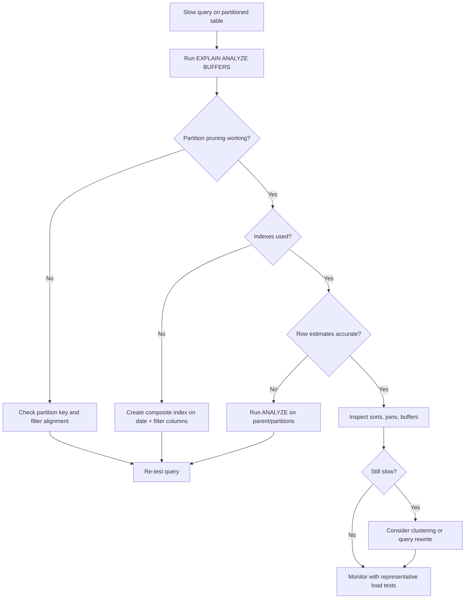

| Difficulty | Channel | Tags |
|---|---|---|
| intermediate | database | explain, query-plan, partitioning |

At Hatchet, a YC-backed durable execution engine processing hundreds of millions of tasks per day, a routine scaling move turned into a production scare. After rolling out daily range partitions on a task table that had ballooned to roughly 200 million rows, batched JOIN queries suddenly became up to 10x slower, spiking CPU and active database sessions [1]. If you have ever assumed partitioning automatically makes large-table queries faster, this story is a reminder that the real win comes from verifying what PostgreSQL actually does at execution time.

---

> ### Real-World Case — Hatchet
>
> Hatchet, a YC-backed durable execution engine built on PostgreSQL, stores hundreds of millions of tasks per day. After a single unpartitioned task table hit ~200M rows and deletion jobs ran nearly 24/7 to control bloat, they rolled out daily range partitions on inserted_at for v1_task and v1_task_event. Days after launch, batched JOIN queries got up to 10x slower — from a few milliseconds to over 20ms — causing large spikes in active sessions and CPU.
>
> | | |
> |---|---|
> | **Challenge** | They first blamed too many partitions being scanned and tried to force plan-time partition pruning, but that did not help. The real problem was that EXPLAIN ANALYZE showed the planner's row estimate was off by a factor of 6,100,000x on a join over a compound primary key, so it was choosing bad scan and join strategies despite correct indexes. |
> | **Solution** | They reproduced it locally with 14 daily partitions of 1M rows each and inspected the EXPLAIN plan. PostgreSQL expert Laurenz Albe identified the hidden cause: autovacuum never runs ANALYZE on partitioned parent tables (only on child partitions), so parent-level statistics were missing and the planner had no idea how many rows to expect. They added a manual, periodic ANALYZE on the parent tables, and also adopted DETACH PARTITION CONCURRENTLY plus FINALIZE for lock-safe retention. |
> | **Outcome** | Manually analyzing the parent table immediately fixed the bad plans: the 10x slowdown disappeared, queries returned to a few milliseconds, and the active-session and CPU spikes under moderate load went away. Load tests had missed it because their hot path rarely used large joins and they only pushed a single partition to its limit. |
> | **Lesson** | When a partitioned query is slow, read the whole EXPLAIN (ANALYZE, BUFFERS) plan — estimated vs. actual rows matter as much as partition pruning and index choice. Partitioning silently breaks planner statistics because autovacuum skips parent tables, so you must ANALYZE them yourself whenever partition data distribution changes. |

---

## Hook — The 10x Slowdown Nobody Expected

Picture this: your team ships a partitioning migration to tame a massive table, celebrates the cleaner maintenance story, and then watches query latency jump from a few milliseconds to over 20ms. That is exactly what happened at Hatchet after partitioning `v1_task` and `v1_task_event` by `inserted_at` [1]. The stakes were real: higher latency, rising active sessions, and CPU pressure under moderate load. Sound familiar? Many developers expect partitioning to be a silver bullet, but the database planner only gives you what it can prove with good statistics and the right access paths.

## Problem — Why a Partitioned Query Can Still Crawl

Partitioning divides a large table into smaller physical pieces, which can reduce the amount of data scanned when the planner can eliminate irrelevant partitions [2]. However, partition pruning alone does not guarantee a fast query. If the filter also includes non-partition columns, PostgreSQL may still choose sequential scans, poor join strategies, or expensive sorts. The core challenge is diagnosis: you need to distinguish between a pruning problem, a missing index problem, stale statistics, or an access pattern that no longer matches the data layout. Therefore, the question is not just "Is the table partitioned?" but "Is the planner making the right decisions for this exact query?"

## Real-World Case — Hatchet

Hatchet built its durable execution engine on PostgreSQL and stored hundreds of millions of tasks per day. Before partitioning, a single unpartitioned task table reached around 200 million rows, and deletion jobs ran nearly 24/7 to control bloat [1]. The team introduced daily range partitions on `inserted_at` for `v1_task` and `v1_task_event`. Days after launch, batched JOIN queries became up to 10x slower, jumping from a few milliseconds to over 20ms and causing spikes in active sessions and CPU. The fix was surprisingly direct: manually analyzing the parent table corrected the bad plans, latency returned to normal, and the spikes disappeared. The incident exposed a testing blind spot—load tests had missed the issue because their hot path rarely used large joins and only pushed a single partition to its limit [1].

## Deep Dive — Reading the Plan Like a Detective

When a date-filtered query on a partitioned table is slow, the first tool to reach for is `EXPLAIN (ANALYZE, BUFFERS)`. It shows the actual plan, runtime, rows, and I/O behavior, making guesswork unnecessary [3]. Start by checking partition pruning: are irrelevant partitions excluded, or is the planner scanning more partitions than expected? Next, inspect scan methods. Sequential scans across large partitions often signal missing or unused indexes, while bitmap or index scans suggest better selectivity [3]. Then look for expensive sort or hash aggregate nodes; they can dominate runtime when memory is tight or row estimates are off.

This leads to the index question. A composite index on `(event_date, status)` can help PostgreSQL jump directly to rows matching both the partition key and the filter column, reducing random I/O and sorting work [4]. But indexes are not magic. Stale statistics can mislead the planner into bad join orders or scan choices, especially after structural changes like partitioning. Running `ANALYZE` refreshes statistics so the planner can estimate row counts more accurately [5]. Finally, consider clustering if queries frequently read ranges in the same order; `CLUSTER` can physically reorder table data by an index, improving locality for some workloads, though it has maintenance trade-offs [6]. The key insight: partitioning, indexing, and statistics are a system, not isolated fixes [2][7].

## Workflow — A Practical Debugging Path

Building on the diagnosis, a reliable workflow keeps you from chasing symptoms. First, reproduce the slow query with `EXPLAIN (ANALYZE, BUFFERS)` and confirm whether partition pruning is effective [3]. Second, check index usage and row estimates; large estimate mismatches often point to stale statistics. Third, refresh statistics with `ANALYZE`, especially on parent tables after partitioning changes [5]. Fourth, add or refine composite indexes that match the query's filter pattern [4]. Fifth, evaluate physical layout strategies like clustering only after measuring read patterns and write costs [6].

The Hatchet lesson fits right here: load tests must reflect real query shapes, including large joins, or they will miss the exact failure mode that bites in production [1].

## Code Example — Inspect, Index, and Verify

The following bash script uses `psql` to run a diagnostic workflow. It captures the execution plan, creates a composite index concurrently, refreshes statistics, and optionally clusters the table. Each step maps directly to a common root cause: poor pruning visibility, missing index paths, stale planner statistics, or suboptimal physical order [3][4][5][6].

## Lessons Learned — What to Do Differently Tomorrow

The biggest takeaway is simple: partitioning is a storage and maintenance strategy, not a performance guarantee. You still need to prove that pruning happens, indexes are used, and statistics reflect reality [2][3]. Hatchet's incident shows how a missing `ANALYZE` can turn a reasonable schema change into a 10x regression, and how quickly the right diagnosis can restore normal performance [1].

Before rolling out partitioning changes, test with representative join patterns, not just single-partition hot paths. After rollout, monitor `EXPLAIN (ANALYZE, BUFFERS)` output for critical queries and watch for estimate mismatches. When performance drops, resist the urge to add indexes blindly—measure first, change one variable at a time, and verify the plan. The next time a query slows down on a 100M-row table, you'll know the drill: inspect the plan, trust the evidence, and let PostgreSQL tell you where the time is really going [8].

---

## Query Optimization Flow

<strong>Original Interview Question</strong>

**Q:** You have a PostgreSQL table with 100M rows partitioned by date. A query filtering on a specific date range is still slow. What would you check in the EXPLAIN plan and how would you optimize it?

**A:** Check partition pruning effectiveness, index utilization patterns, and expensive sort operations. Create composite indexes on (date, filtered_columns) and evaluate clustering strategies for optimal data access.

## Conclusion

The moral of the Hatchet story is that performance bugs often hide in the gap between what you think PostgreSQL should do and what the planner can prove. Tomorrow, pick one slow partitioned query, run `EXPLAIN (ANALYZE, BUFFERS)`, and verify pruning, indexes, and statistics before changing anything else. One careful plan reading can save hours of blind optimization.

---

## References

1. [Hatchet incident report](https://hatchet.run/blog/postgres-partitioning) — blog
2. [PostgreSQL Documentation: Table Partitioning](https://www.postgresql.org/docs/current/ddl-partitioning.html) — documentation
3. [PostgreSQL Documentation: Using EXPLAIN](https://www.postgresql.org/docs/current/using-explain.html) — documentation
4. [PostgreSQL Documentation: Multicolumn Indexes](https://www.postgresql.org/docs/current/indexes-multicolumn.html) — documentation
5. [PostgreSQL Documentation: ANALYZE](https://www.postgresql.org/docs/current/sql-analyze.html) — documentation
6. [PostgreSQL Documentation: CLUSTER](https://www.postgresql.org/docs/current/sql-cluster.html) — documentation
7. [Wikipedia: Partition (database)](https://en.wikipedia.org/wiki/Partition_(database)) — documentation
8. [DigitalOcean: How To Use Indexes in PostgreSQL](https://www.digitalocean.com/community/tutorials/how-to-use-indexes-in-postgresql) — blog

---

**Author:** Satishkumar Dhule — [GitHub](https://github.com/satishkumar-dhule) · [LinkedIn](https://linkedin.com/in/satishkumar-dhule) · [Website](https://satishkumar-dhule.github.io)
