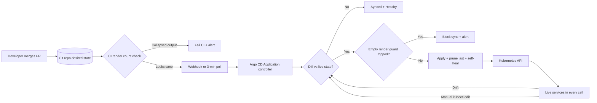

| Difficulty | Channel | Tags |
|---|---|---|
| beginner | devops | argocd, flux, declarative |

On August 25, 2021, a Skyscanner engineer merged what looked like a harmless no-op edit: the `{{` and `}}` delimiters vanished from a root templating file [1]. Git looked clean, the pipeline looked green, and Argo CD looked obedient. Within minutes, automated reconciliation pruned all 478 services across every namespace, availability zone, and region, taking skyscanner.net and its mobile apps offline for 4.5 hours [1]. That is the real price of treating Git as the single source of truth: your mistakes get the same fast distribution channel as your best commits.

---

> ### Real-World Case — Skyscanner
>
> Skyscanner ran a globally distributed 'cells' architecture: Kubernetes clusters in multiple AWS regions and availability zones, all reconciled from Git by Argo CD. On August 25, 2021, an engineer merged what was intended to be a no-op edit to a root templating file, accidentally removing the {{ }} delimiters; the change propagated to every cell immediately.
>
> | | |
> |---|---|
> | **Challenge** | Argo CD had to reconcile each cluster's live state against the desired state rendered from Git. With the template broken, the rendered config contained no valid namespaces, so the declarative 'desired state' effectively said there should be no services anywhere in the fleet. |
> | **Solution** | Skyscanner used Git as the single source of truth with Argo CD auto-sync and pruning, rather than pushing changes imperatively with kubectl. At 16:00 GMT, Argo CD compared Git-rendered manifests with live resources and deleted everything no longer declared. Recovery used the same declarative path: once the correct template was restored in Git, clusters reconciled themselves back to the intended state. |
> | **Outcome** | Argo CD deleted all 478 services across every namespace, AZ, and region, causing a 4.5-hour full global outage of skyscanner.net and its mobile apps. By 20:30 GMT the site was serving again from a single restored region; the remaining regions and non-critical services took through Thursday and Friday to bring back online. |
> | **Lesson** | Declarative GitOps enforces exactly what is in Git, not what the author intended: a two-character templating mistake became a fleet-wide delete because prune-based reconciliation cannot tell 'nothing should exist' from 'the render broke.' Guard desired-state generation with schema/render tests, forbid empty renders, and roll root config changes region by region instead of globally at once. |

---

## Hook — The deploy looked fine. Then the entire site disappeared

Picture the dashboard at 20:00 GMT: every cell reports Synced, every health check is green, and nobody is reaching for the incident channel. Then a templating edit quietly changes what Git says the world should look like. Argo CD compares desired state against live state, finds a mismatch, and does exactly what it was told to do. No crash, no bug in the controller, no rogue deploy script. Just a reconciliation loop with excellent manners and zero ability to read intent. That is the uncomfortable part: automation did not fail here, it succeeded. What happens when your loop is faster than your review process?

## Problem — Git is the source of truth, until somebody uses kubectl

Building on that near-perfect obedience, the core problem is not whether to automate deployments. The problem is deciding who owns the desired state. In a declarative model, manifests, Helm charts, or Kustomize overlays describe the complete target state in version control, and a controller continuously reconciles reality toward it [5]. In an imperative model, commands such as `kubectl scale` or `kubectl edit` mutate the cluster directly, bypassing review history and leaving Git unaware of the change [11].

Here is what you need to know:
- Declarative: every change is a commit, so audits, reviews, and rollbacks have a paper trail.
- Imperative: fast for a 2am hotfix, terrible for explaining three weeks later why production differs from staging.
- The failure mode is not speed, it is drift: two writers, one cluster, and no agreement about which one wins.

💡 Insight: Many developers discover GitOps because they want repeatable deploys, then stay because it makes 'what changed?' answerable in seconds. GitOps formalizes that desired-state workflow as a practice, not a product [9].

Sound familiar? The six-person team that carefully reviews every manifest still has an intern running a patch command 'just this once.' So who exactly is allowed to write to production - and does Git know about it?

## Real-World Case — Skyscanner

However, the story gets sharper when the two approaches collide at global scale. Skyscanner ran a cells architecture: Kubernetes clusters spread across multiple AWS regions and availability zones, all reconciled from Git by Argo CD [1]. On August 25, 2021, a change intended to be a no-op removed the `{{ }}` delimiters in a root templating file, which changed the rendered output everywhere at once [1]. Because pruning was enabled, Argo CD interpreted the missing rendered resources as intentional deletions and removed all 478 services across every namespace, AZ, and region [1]. By 20:30 GMT the site was being served from a single restored region, while the remaining regions and non-critical services limped back through Thursday and Friday [1].

⚠️ Watch Out: This was not a slow, partial degradation. A single commit had a 4.5-hour global blast radius because the same desired state fed every cell.

The plot twist is that self-healing was not the villain; pruning was. Self-heal reverts a manual change to match Git, while prune deletes live resources that no longer appear in Git [2]. If the controller cannot tell 'someone deleted a service on purpose' from 'the template renderer broke,' what stops a bad commit before it reaches 60 clusters?

## Deep Dive — Reconciliation, self-heal, and the three-minute window

This leads to the real mental model: Argo CD is a control loop, not a deploy button. An Application custom resource points at a repo, path, and target revision, then names the destination cluster and namespace [3]. The controller fetches that desired state, reads live objects from the Kubernetes API, diffs them, and optionally syncs. When teams say 'a 3-minute health check,' they usually mean the reconciliation window: `timeout.reconciliation` defaults to 120 seconds plus up to 60 seconds of jitter, for a maximum of roughly three minutes [4]. Health assessment itself is a separate signal that reports whether workloads are ready, often checked via Deployment status [10].

| Option | Declarative GitOps | Imperative kubectl |
| --- | --- | --- |
| Source of truth | Git repo with YAML, Kustomize, or Helm [6][7] | Live cluster state [11] |
| Change path | Pull request, review, merge | Direct API call |
| Drift handling | Detected and reconciled | Undocumented until someone greps shell history |
| Rollback | New commit, or sync to a previous revision [3] | Manual undo, often guesswork |
| Best time to use it | Routine deploys, multi-cluster fleets | Short-lived incident mitigation, then commit it |

Kubernetes itself supports both object-management styles, so the choice is a team contract rather than a platform limitation [5]. Kustomize shines when many environments share a base with small overlays [6]; Helm shines when applications need parameterized packaging and release semantics [7]. Flux CD solves a similar reconciliation problem with a different operator model [8].

🔥 Hot Take: `selfHeal: true` is the setting most teams argue about, but `prune: true` is the setting that can erase a company. Treat an empty or shrunken render as a failed build, not a valid desire.

One more nuance worth knowing: a classic rollback is blocked while automated sync is enabled on an Application [2], so the safe recovery path is a revert commit that the loop picks up. Which guardrail matters more: detecting drift, or refusing an empty render?

## Workflow — From merge to reconcile without deleting the world

Building on those guardrails, the safe path is a pipeline where Git remains the only writer and the controller is given explicit limits. The flow below shows the visual story: a merge becomes desired state, the controller diffs it against live state, and a safety gate can stop the sync before Kubernetes ever sees a destructive apply.

The Mermaid diagram below, 'GitOps Reconciliation Flow', maps the full loop, including manual drift entering from the right-hand side.

1. A developer opens a pull request against the manifests repo; CI renders Helm or Kustomize output and fails the build if the resource count collapses [6][7].
2. After review, the merge updates the tracked revision; a webhook or the roughly three-minute poll wakes the controller [4].
3. The Application CRD reads the source and destination, then diffs desired state against the cluster [3].
4. A guard checks `allowEmpty: false` and resource-count thresholds before any prune is allowed [2].
5. The sync applies resources in waves, prunes last, and waits for health rather than mere existence [3][10].
6. Manual `kubectl` edits become drift, which self-heal reverts on the next reconcile [2].
7. If health never settles, alerts fire and the team reverts in Git instead of hand-patching the cluster [11].

🎯 Key Point: A controller can reconcile quickly, but only your CI gate knows that a template rendered into nonsense. Put intent checks before the merge, not inside the controller.

On EKS clusters, this same pattern deploys to managed Kubernetes control planes without giving the CI runner cluster admin [12]. How does that translate into a manifest someone can apply at 2am?

## Code Example — An Application CRD with brakes

Here is the thing though: guardrails only exist if somebody wrote them down. The snippet below patches the reconciliation window, declares a production Application with automated sync, self-heal, and prune, adds an empty-render brake, runs a bounded retry, and ignores only one known injected annotation. The complete version lives in the `codeExample` field.

```bash
# 1) 120s + up to 60s jitter = roughly a 3-minute reconcile window [4]
kubectl -n argocd patch configmap argocd-cm --type merge \
  -p '{"data":{"timeout.reconciliation":"120s","timeout.reconciliation.jitter":"60s"}}'

# 2) Application CRD: Git is the only writer [3]
cat > payment-api-app.yaml <<'YAML'
apiVersion: argoproj.io/v1alpha1
kind: Application
metadata:
  name: payment-api
  namespace: argocd
spec:
  project: payments-prod
  source:
    repoURL: https://github.com/acme/platform-manifests.git
    targetRevision: main
    path: apps/payment-api/overlays/production
  destination:
    server: kubernetes.default.svc
    namespace: payments
  syncPolicy:
    automated:
      enabled: true
      prune: true
      selfHeal: true
      allowEmpty: false
    syncOptions:
      - CreateNamespace=true
      - PruneLast=true
    retry:
      limit: 3
      backoff: { duration: 5s, factor: 2, maxDuration: 3m }
  ignoreDifferences:
    - group: apps
      kind: Deployment
      jsonPointers:
        - /spec/template/spec/containers/0/annotations/sidecar.istio.io~1status
YAML

kubectl apply -f payment-api-app.yaml
argocd app wait payment-api --health --sync --timeout 180s

# 3) Drift drill: self-heal should restore replicas at the next reconcile
kubectl -n payments scale deployment payment-api --replicas=9
```

Line by line: the ConfigMap patch makes the polling cadence explicit; `source` and `destination` bind one Git path to one namespace; `enabled: true` turns on auto-sync; `prune: true` allows deletion, so it deserves the most scrutiny; `selfHeal: true` reverts manual edits; `allowEmpty: false` refuses to sync a path with zero resources; `PruneLast=true` keeps deletions at the end of the sync; `retry.limit: 3` with exponential backoff prevents a flapping app from hammering the API; and `ignoreDifferences` excludes one mesh-injected annotation instead of disabling comparison entirely [2][3][4].

Use this shape when one team owns a service and the repo is protected by required reviews. Use manual sync instead for databases or stateful workloads where deletion needs a human. Which of those lines would have saved Skyscanner?

## Lessons Learned — Automate the loop, not the trust

After tracing that chain from brace to blackout, the lesson is not 'avoid GitOps.' The lesson is that a declarative system is only as safe as the intent checks wrapped around it.

Battle scars worth avoiding:
- Treating `prune: true` as harmless housekeeping; it is a deletion primitive with a Git-shaped trigger [2].
- Skipping rendered-output validation in CI, so a template error becomes a cluster-wide delete [1].
- Letting imperative hotfixes linger; commit them immediately, then let self-heal prove Git still wins [11].
- Disabling diff checks wholesale because an admission webhook adds a field; use a narrow `ignoreDifferences` entry instead [3].
- Assuming a green health badge means correct intent; health reports readiness, not business correctness [10].

💡 Insight: Self-heal answers 'did someone change the cluster?' Declarative Git answers 'did someone change the plan?' Only the second question protects 478 services.

When would developers actually use each piece? Declarative manifests for every routine deploy [5]; Kustomize for many near-identical environments [6]; Helm for packaged, parameterized apps [7]; Flux CD when a different reconciliation operator fits the platform better [8]; auto-sync for stateless services; manual sync plus human approval for destructive or stateful changes.

So what changes tomorrow? Add a resource-count assertion to CI, require review on the repo that feeds production, keep `allowEmpty: false`, and run a drift drill once per quarter. Teams have all been there - staring at a green dashboard while users go dark. The difference is whether the next bad commit meets a guardrail or an open door. What will your team change before the next merge?

---

## GitOps Reconciliation Flow



<details>
<summary><strong>Original Interview Question</strong></summary>

**Q:** You're setting up GitOps for a microservices deployment. How would you configure ArgoCD to automatically sync changes from your Git repository to Kubernetes, and what's the difference between declarative and imperative approaches in this context?

**A:** I'd configure ArgoCD by setting up a Git repository containing Kubernetes manifests or Helm charts, creating an Application CRD that points to the Git repository, enabling auto-sync with a health check interval of 3 minutes, and implementing self-healing to automatically revert any manual changes. The declarative approach involves defining the desired state in Git through YAML manifests, Helm charts, or Kustomize configurations, where ArgoCD continuously reconciles the actual state with the desired state. In contrast, the imperative approach uses kubectl commands to make direct changes to the cluster, bypassing the Git repository as the single source of truth.

</details>

## Conclusion

Skyscanner's outage started with two missing characters and ended with 478 services gone because a perfectly obedient loop believed a broken render was the new truth [1]. The takeaway to share with your team is simple: declarative GitOps makes Git the source of truth, self-heal keeps the cluster honest, and prune is the setting that deserves a seat at every design review. Tomorrow, add a rendered-resource-count check to CI, keep `allowEmpty: false`, protect the manifests repo, and rehearse a revert commit instead of a heroic kubectl patch. Automate the reconciliation, not the trust.

---

## References

1. [Skyscanner incident report](https://medium.com/@SkyscannerEng/how-a-couple-of-characters-brought-down-our-site-356ccaf1fbc3) — article
2. [Argo CD Automated Sync Policy](https://github.com/argoproj/argo-cd/blob/master/docs/user-guide/auto_sync.md) — documentation
3. [Argo CD Application Specification Reference](https://github.com/argoproj/argo-cd/blob/master/docs/user-guide/application-specification.md) — documentation
4. [Argo CD argocd-cm Configuration Reference](https://github.com/argoproj/argo-cd/blob/master/docs/operator-manual/argocd-cm.yaml) — documentation
5. [Kubernetes Object Management](https://kubernetes.io/docs/concepts/overview/working-with-objects/object-management/) — documentation
6. [Kubernetes Kustomization](https://kubernetes.io/docs/tasks/manage-kubernetes-objects/kustomization/) — documentation
7. [Helm GitHub Repository](https://github.com/helm/helm) — documentation
8. [Flux CD GitHub Repository](https://github.com/fluxcd/flux2) — documentation
9. [GitOps - Wikipedia](https://en.wikipedia.org/wiki/GitOps) — documentation
10. [Kubernetes Deployments](https://kubernetes.io/docs/concepts/workloads/controllers/deployment/) — documentation
11. [Kubernetes kubectl Reference](https://kubernetes.io/docs/reference/kubectl/) — documentation
12. [Amazon EKS User Guide](https://docs.aws.amazon.com/eks/latest/userguide/what-is-eks.html) — documentation

---

**Author:** Satishkumar Dhule — [GitHub](https://github.com/satishkumar-dhule) · [LinkedIn](https://linkedin.com/in/satishkumar-dhule) · [Website](https://satishkumar-dhule.github.io)
