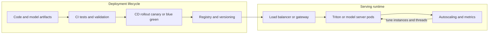

| Difficulty | Channel | Tags |
|---|---|---|
| beginner | devops | mlops, deployment |

When latency spikes hit during peak dinner hours, every millisecond of model serving feels personal to users waiting on an order. DoorDash learned this the hard way while running hundreds of PyTorch models on NVIDIA Triton Inference Server for search, ranking, dispatch, fraud, and ads, where the obvious “give the pod all threads” setup quietly starved throughput [1]. That story sets the stakes for understanding how model deployment and model serving differ in practice, and why the wrong runtime choices can multiply cost and pain instead of capacity.

---

> ### Real-World Case — DoorDash
>
> DoorDash runs hundreds of PyTorch models on NVIDIA Triton Inference Server for search, ranking, dispatch, fraud, and ads. The default serving pattern—one Triton model instance using all threads on an N-vCPU pod—often wasted capacity, and in 44 of 219 comparable cases larger pods actually cut throughput to half or less of the smaller-tier result.
>
> | | |
> |---|---|
> | **Challenge** | Find the lowest-cost serving configuration per model (CPU tier, Triton instance count, OpenMP threads, concurrency, memory) that meets latency and throughput targets, consistently across hundreds of production and shadow models, without manual per-model benchmarking. |
> | **Solution** | Built an automated Triton auto-tuning platform with a shared 252-pod benchmark pool (21 deployment groups across 4/8/16/32 vCPU tiers on amd64 and arm64). It uses NVIDIA perf_analyzer over gRPC, hot-loads candidate ModelConfigs via Triton's model-control API without pod restarts, rejects configs missing latency/CPU limits, and emits deployment overrides for the delivery workflow. The data also exposed a scaling trap: CPU-based HPA predicted 1,252 QPS where the model saturated at 829 QPS, pushing them toward queue-pressure signals. |
> | **Outcome** | The same model artifact on the same 32-vCPU pod delivered 68 QPS with 1 instance x 32 threads versus 863 QPS with 32 instances x 1 thread; p99 latency fell from 126 ms to 14 ms and CPU use from 67% to 16%. Across 264 models, mean QPS lifts were 1.75x at 4 vCPU, 2.31x at 8, 3.65x at 16, and 6.78x at 32; severe regressions were 20.1% (44/219) with one instance versus 0% (0/206) with one instance per vCPU. |
> | **Lesson** | Serving configuration is part of model performance: the deployed artifact and hardware never changed, yet a 12.7x throughput difference came purely from runtime settings. More compute can create thread-pool contention, and CPU utilization alone is not a safe autoscaling signal—Triton queue depth predicts saturation better. |

---

## Hook — The 3 a.m. feeling when inference suddenly crawls

Picture this: dashboards turn red, p99 latency climbs, and engineers scramble while traffic keeps pouring in. You might assume the fix is “bigger pods,” but real systems often punish that instinct. DoorDash found that a default Triton pattern—one model instance consuming all threads on an N-vCPU pod—frequently wasted capacity, and in 44 of 219 comparable cases larger pods delivered half or less throughput than smaller tiers [1]. That kind of surprise is why teams need a clear mental model of what deployment buys you versus what serving must guarantee every millisecond at runtime.

## Problem — Deployment pipelines and serving APIs solve different pains

Many developers discover the terms “deployment” and “serving” used interchangeably, then pay for it in production incidents. Deployment is the lifecycle around getting models into reliable environments: packaging, CI/CD, infrastructure provisioning, rollout controls, and monitoring hooks. Serving is the runtime contract: exposing inference endpoints, routing requests, loading model versions, batching work, and meeting latency or throughput targets under load [2][3]. If you treat serving as “just another web service” without model-aware concerns, you risk cold starts, poor GPU utilization, version chaos, and autoscaling that fights your real bottlenecks.

## Real-World Case — DoorDash

DoorDash operates hundreds of PyTorch models on NVIDIA Triton Inference Server across critical surfaces like search, ranking, dispatch, fraud, and ads. The team observed that the default serving pattern—one Triton model instance using all threads on an N-vCPU pod—often wasted capacity. In 44 of 219 comparable cases, larger pods actually cut throughput to half or less of the smaller-tier result [1]. After tuning with Triton AutoTuner to use one instance per vCPU (32 instances × 1 thread) on the same 32-vCPU pod, the same model artifact delivered 68 QPS with the default shape versus 863 QPS with the tuned shape; p99 latency dropped from 126 ms to 14 ms and CPU use fell from 67% to 16% [1]. Across 264 models, mean QPS lifts were 1.75× at 4 vCPU, 2.31× at 8, 3.65× at 16, and 6.78× at 32; severe regressions were 20.1% (44/219) with one instance versus 0% (0/206) with one instance per vCPU [1].

## Deep Dive — What differs, what stacks you see, and what trade-offs dominate

Building on that case, the split becomes practical. Deployment work typically centers on repeatable infrastructure and release safety: containers, orchestration, infrastructure-as-code, experiment and model registries, and CI/CD that can promote or roll back versions [4][5][6]. Serving work centers on the inference path: HTTP/gRPC APIs, request routing, model loading strategies, dynamic batching, concurrency tuning, and autoscaling signals tied to latency or queue depth [7][8][9]. Common tool patterns you will see include Kubernetes, Docker, Terraform, MLflow, SageMaker, or Vertex AI for deployment flows, paired with FastAPI or gRPC front doors and model servers such as TorchServe, TensorFlow Serving, or Triton for serving [2][4][5][7][8][9][10]. The hard trade-offs stay consistent: latency versus throughput, real-time versus batch inference, and cold start or warm pool costs versus elasticity. Horizontal scaling adds replicas; vertical scaling changes GPU memory and CPU allocation; SLOs often demand sub-100 ms for real-time experiences and under a second for many batch-adjacent flows, while A/B testing relies on traffic splitting and gradual rollouts [2][3].

## Workflow — From CI/CD gates to a tuned serving path

Think of deployment as the assembly line and serving as the race car on track. A typical flow starts in CI: tests, model validation, and packaging into containers or artifacts. CD promotes versions through environments with approvals, canary or blue-green strategies, and registry-backed versioning [4][5][6]. At serve time, a gateway or load balancer routes traffic to model servers that load specific versions, apply batching and concurrency settings, and expose metrics for scaling decisions [7][8][9][10]. DoorDash’s lesson fits here: the deployment artifact may be identical, but serving configuration (instances per pod, threads per instance, batching) can dominate outcomes [1]. Use the diagram below as a mental map of where responsibilities split, then validate with load tests and auto-tuning rather than guessing. 💡 Insight: configuration is part of the serving product, not an afterthought.

## Code Example — A minimal Triton HTTP inference call in Python

To make the serving side concrete, here is a small Python example that sends an inference request to a Triton HTTP endpoint using the official client library. This is not a full production wrapper, but it shows the request shape teams instrument, time, and scale in real systems. You can adapt the model name, input tensor names, and shapes to match your deployed artifact.

## Lessons Learned — What to change on Monday

The story arc ends with choices you can control. First, separate concerns explicitly: treat deployment as reproducible delivery and rollback, and treat serving as a performance-tuned runtime with its own SLOs [2][3]. Second, measure before scaling vertically by default; DoorDash’s results show larger pods can hurt when instance/thread layouts waste parallelism [1]. Third, standardize observability for both worlds—deployment health and rollout metrics plus serving metrics like latency percentiles, queue depth, and utilization [2][6]. Fourth, plan versioning and traffic shifting early so canaries and rollbacks are routine, not emergencies [4][5]. If you remember one thing, remember this: the same model can behave like a toy or a workhorse depending on serving configuration, so validate runtime settings with real load tests and tuning loops [1].

---

## Deployment pipeline versus serving runtime flow

<strong>Original Interview Question</strong>

**Q:** Explain the key differences between model serving and model deployment in ML systems, including specific technologies, scaling considerations, and real-world implementation patterns?

**A:** Deployment encompasses CI/CD pipelines, infrastructure setup, and monitoring using tools like Kubernetes, MLflow, and SageMaker. Serving focuses on runtime inference APIs with frameworks like TensorFlow Serving, TorchServe, or BentoML, handling request routing, model versioning, and autoscaling. Key trade-offs include latency vs throughput, batch vs real-time inference, and cold start optimization.

## Conclusion

Deployment gets models into reliable, repeatable environments; serving decides whether users feel speed or friction at the moment of inference. The DoorDash results show that configuration choices in the serving layer can dwarf hardware changes when threads and instances are mismatched to workload behavior [1]. Tomorrow, map your stack into those two concerns, measure end-to-end latency and utilization under realistic load, and treat runtime tuning as a first-class engineering task rather than a last-minute knob turn.

---

## References

1. [DoorDash: Triton AutoTuner — Finding the Right Triton Configuration for Hundreds of Models](https://careersatdoordash.com/blog/triton-auto-tuner-finding-the-right-triton-configuration-for-hundreds-of-models/) — blog
2. [Wikipedia: Model serving](https://en.wikipedia.org/wiki/Model_serving) — documentation
3. [NVIDIA Triton Inference Server documentation](https://docs.nvidia.com/deeplearning/triton-inference-server/user-guide/docs/index.html) — documentation
4. [MLflow documentation](https://mlflow.org/docs/latest/index.html) — documentation
5. [AWS SageMaker: Deploy models for inference](https://docs.aws.amazon.com/sagemaker/latest/dg/deploy-model.html) — documentation
6. [Kubernetes documentation: Deployments](https://kubernetes.io/docs/concepts/workloads/controllers/deployment/) — documentation
7. [TensorFlow Serving guide](https://www.tensorflow.org/tfx/guide/serving) — documentation
8. [TorchServe documentation (PyTorch)](https://pytorch.org/serve/) — documentation
9. [MDN Web Docs: HTTP overview](https://developer.mozilla.org/en-US/docs/Web/HTTP/Overview) — documentation
10. [DigitalOcean: An Introduction to Kubernetes](https://www.digitalocean.com/community/tutorials/an-introduction-to-kubernetes) — blog

---

**Author:** Satishkumar Dhule — [GitHub](https://github.com/satishkumar-dhule) · [LinkedIn](https://linkedin.com/in/satishkumar-dhule) · [Website](https://satishkumar-dhule.github.io)
