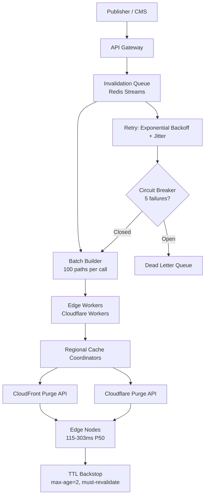

| Difficulty | Channel | Tags |
|---|---|---|
| intermediate | system-design | edge, caching, purging |

A 90.5% latency drop didn't come from faster hardware — it came from deleting a decade-old architectural assumption. For years, Cloudflare routed every cache invalidation from the nearest data center back to a handful of central core data centers before fanning it out globally [1]. A customer in Australia watched a purge cross the Pacific and return before local users saw fresh content, while purge history quietly consumed disk space on every machine. By August 2024, global P50 purge latency had fallen from 1,570ms to 149ms — roughly 33x inside the 5-second SLA this design exercise targets [1].

---

> ### Real-World Case — Cloudflare
>
> Cloudflare's decade-old cache purge pipeline routed every invalidation from the nearest data center back to a handful of central core data centers before fanning it out globally. As the network grew past 270 cities and customers issued millions of purge requests per day, that hub-and-spoke design became a throughput bottleneck: a customer in Australia had to send a purge across the Pacific and back before local users saw fresh content, and purge history stored via Quicksilver ate into cache disk space on every machine.
>
> | | |
> |---|---|
> | **Challenge** | Deliver invalidations to every data center consistently and in near-real-time, while scaling write throughput and avoiding per-data-center storage costs that grow linearly with purge volume. The original P99 global purge latency was ~6 seconds, and the system was hitting write-rate limits in Quicksilver, forcing Kafka buffering and batching that added even more latency. |
> | **Solution** | Cloudflare rebuilt it as 'Coreless Purge': API requests hit Workers at the nearest data center, which validate requests, attempt a local purge, compute the cache key once, and broadcast the key peer-to-peer via Durable Objects instead of backhauling to a core. More than 50% of requested URLs turn out to be non-cacheable and are filtered out before broadcast. For flexible purges (tags, prefixes, hostnames), they replaced lazy timestamp checks in Quicksilver with per-machine CacheDB sidecars built on embedded RocksDB, using Consul for peer health; the cache proxy checks CacheDB's pending queue on every HIT so a purge takes effect immediately even before millions of matching files are physically deleted. |
> | **Outcome** | Global P50 purge latency fell from 1,570ms (May 2022) to 149ms (August 2024), a 90.5% improvement — about 33x faster than the 5-second SLA in the question. Every region landed at 115–303ms P50, across 330 cities in 120+ countries; single-file purge P50 was 234ms. The new design cut purge-history storage by 10x, improved cache retention and hit ratios, and unlocked all purge methods for all plans with Enterprise throughput raised to 5,000 keys/second. |
> | **Lesson** | The counterintuitive win was to stop treating purge as a global database problem: push ingest and filtering to the edge, send only computed cache keys, and accept a 'lazy' consistency check on reads rather than waiting for physical deletion everywhere. Their general-purpose config replication system (Quicksilver) became a bottleneck precisely because it was so good — the right fix was a purpose-built, per-machine index, not a bigger distributed queue. |

---

## Hook — The purge that crossed an ocean to clean a cache 200 miles away

Here is the thing about cache invalidation: it is invisible when it works and catastrophic when it doesn't. Picture a content editor hitting publish on a breaking-news headline. The origin updates instantly, yet thousands of readers keep seeing yesterday's story because a stale object is still glued to an edge node. Now multiply that by millions of purge requests per day across more than 270 cities, and you start to see why this problem deserves a war story, not a footnote [1].

💡 Insight: The real enemy in a purge system is not the API call — it is the distance that call travels before anyone notices the content changed.

The stakes are brutally simple. A 5-second SLA sounds generous until a network partition, a rate limit, or one slow region turns it into a game of whack-a-mole. What if the queue that is supposed to save you becomes the bottleneck? That is exactly where the story gets interesting.

## Problem — Why 10,000 invalidations per second breaks the obvious design

Most developers discover the hard way that a CDN is not one cache — it is thousands of caches pretending to be one [2]. HTTP caching was designed around freshness lifetimes, not around an explicit 'forget this now' signal, so invalidation has always been the awkward cousin of cache design [3]. Consequently, the moment a team promises strong consistency across regions, the comfortable abstractions disappear.

💡 Insight: TTL-based expiry is cheap and predictable; explicit purging is expensive and urgent. Mixing them without a plan is how SLAs go to die.

The non-functional requirements turn this into a genuinely nasty engineering problem:

- **Latency:** propagation under 5 seconds, globally, for every region — not just the happy path.
- **Throughput:** 10,000 invalidations per second sustained, with bursts that would make a naive API caller weep.
- **Availability:** 99.99% uptime, which leaves roughly 52 minutes of downtime per year.
- **Consistency:** strong consistency across regions, even though the network between them is anything but.

⚠️ Watch Out: The phrase 'strong consistency across regions' is where most designs quietly lie. Physics still wins, so 'strong' usually means bounded staleness with reconciliation, not magic.

🔥 Hot Take: If your purge path has a single queue that every region must pass through, you do not have a distributed system. You have a distributed system with a very expensive waiting room.

Building on this tension, the obvious question becomes: where should coordination live? That question is precisely what the Cloudflare incident answers.

## Real-World Case — Cloudflare

To understand what 'better' looks like, consider what Cloudflare actually did. Its decade-old purge pipeline routed every invalidation from the nearest data center back to a handful of central core data centers before fanning it out globally [1]. As the network grew past 270 cities and customers issued millions of purge requests daily, that hub-and-spoke design became a throughput bottleneck with a very specific consequence: an Australian customer's purge had to cross the Pacific and come back before local users saw fresh content [1].

There was a second, less visible cost. Purge history was stored via Quicksilver and ate into cache disk space on every single machine, which quietly degraded cache retention and hit ratios [1].

🔥 Hot Take: The most dangerous bottleneck is the one that shows up as a storage problem, not a latency graph. By the time the pager fires, the damage is already baked into your hit ratio.

Then the plot twist arrived. Instead of optimizing the central core, the team removed it from the critical path. The result, measured from May 2022 to August 2024:

- Global P50 purge latency fell from **1,570ms to 149ms**, a **90.5% improvement** — about **33x faster** than the 5-second SLA [1].
- Every region landed between **115ms and 303ms P50**, spanning **330 cities in 120+ countries** [1].
- Single-file purge P50 hit **234ms** [1].
- Purge-history storage dropped **10x**, freeing disk for actual content [1].
- All purge methods opened up for all plans, with Enterprise throughput raised to **5,000 keys/second** [1].

💡 Insight: The 33x number is not a tuning achievement. It is an architecture achievement — the difference between 'make the old path faster' and 'stop taking the old path.'

But how does a system actually erase a hop that has existed for ten years without breaking the guarantees customers depend on? That leads directly into the mechanics.

## Deep Dive — The mechanics of purge at global scale

Building on the Cloudflare outcome, the design breaks into a few interacting mechanisms rather than one clever trick. Each one solves a different failure mode, and together they turn a 5-second promise into something defensible.

**Local purge decisioning.** The core insight is that the nearest data center can decide locally whether a purge applies to its own cache. Pushing that decision to the edge removes the round trip to a central core entirely. This is the architectural move behind the 149ms P50 — not a faster network, but a shorter path [1].

**TTL as a safety net.** Dynamic content gets a deliberately short freshness window — think 'Cache-Control: max-age=2, must-revalidate' — so even a missed invalidation self-heals within two seconds [9]. HTTP caching already defines how caches interpret freshness and revalidation, so leaning on it is safer than inventing a custom protocol [3][5].

⚠️ Watch Out: A 2-second TTL is not free. Every object refetches far more often, so it belongs on genuinely dynamic paths only. Applying it globally is how teams accidentally double their origin traffic.

**Batching and fan-out.** Rather than firing one API call per invalidation, group up to 100 paths into a single purge request. AWS CloudFront's invalidation model makes the cost of per-file calls painfully obvious at scale [4], and the same economics apply to Cloudflare's purge API [1].

Here is the real tradeoff:

| Option | What it buys | What it costs | When to use it |
|---|---|---|---|
| Centralized purge queue | Simple reasoning, one source of truth | Every region pays a round trip; bottleneck at scale | Small fleets, low invalidation volume |
| Edge-local purge decisioning | 115–303ms P50, no cross-region hop | More coordination logic at each edge | Global CDN, high purge volume [1] |
| Pure 2s TTL, no purge | Zero invalidation infrastructure | Constant origin refetch, stale window up to 2s | Content that tolerates bounded staleness |
| Explicit purge + TTL backstop | Fast, self-healing, resilient | More moving parts: queue, retries, DLQ | The 5-second SLA scenario in this design |

**Failure containment.** Redis Streams provide durable, replayable invalidation events, and consumer groups give each worker clear ownership of a batch [6][7]. Exponential backoff with jitter prevents a thundering herd when a CDN API hiccups [8], a circuit breaker trips after five consecutive failures, and a dead letter queue keeps poison events reviewable instead of silently lost [6].

🎯 Key Point: Every mechanism here exists because a specific thing fails. Batching fights API cost, TTL fights missed purges, backoff fights retry storms, and the DLQ fights silent loss. Remove one and the SLA gets fragile.

## Workflow — From invalidation request to fresh edge in five seconds

With the mechanisms clear, the next step is seeing how they connect. The Mermaid diagram below traces a single invalidation from the moment a publisher clicks publish until every edge region confirms fresh content.



Step by step, the journey looks like this:

1. **Accept and enqueue.** The API Gateway validates the request and writes it to the Redis Stream, returning immediately instead of blocking on global propagation [6].
2. **Batch.** A consumer group collects up to 100 paths into one payload, reducing API calls and cost dramatically [6][7].
3. **Coordinate locally.** Edge Workers hand the batch to regional coordinators, so no region waits for a central core [1].
4. **Purge both CDNs.** Regional coordinators call CloudFront and Cloudflare purge endpoints in parallel [4][1].
5. **Retry with manners.** Failed calls back off exponentially with jitter; after five consecutive failures the breaker opens and the batch moves to the dead letter queue [8][6].
6. **Confirm and backstop.** Only after the CDN acknowledges does the worker ack the stream message; a 2-second TTL catches anything that slips through [9].

💡 Insight: Notice that acknowledgement happens last, not first. Acking early is the classic way to turn a retryable failure into permanent staleness.

Sound familiar? Most teams get steps 1 and 4 right and quietly skip step 6. That is where the 5-second SLA goes to die.

## Code Example — A purge worker that actually survives production

The workflow above sounds tidy until real traffic arrives. The implementation below is a compact version of the consumer: it batches from a Redis Stream, purges through the Cloudflare API, retries with jitter, trips a circuit breaker, and parks poison events in a dead letter queue.

```javascript
import { createClient } from 'redis';

const redis = createClient({ url: process.env.REDIS_URL });
await redis.connect();

const ZONE = process.env.CF_ZONE_ID;
const TOKEN = process.env.CF_TOKEN;
const BATCH_SIZE = 100;
const MAX_RETRIES = 3;

// One breaker per process; trip after 5 consecutive failures
const breaker = { failures: 0, openUntil: 0 };

async function purgeBatch(paths) {
  const now = Date.now();
  // Fail fast while open instead of hammering a sick CDN endpoint
  if (now < breaker.openUntil) throw new Error('Circuit breaker open');

  const response = await fetch(
    `https://api.cloudflare.com/client/v4/zones/${ZONE}/purge_cache`,
    {
      method: 'POST',
      headers: {
        Authorization: `Bearer ${TOKEN}`,
        'Content-Type': 'application/json',
      },
      // Wildcard paths purge entire families in a single API call
      body: JSON.stringify({ files: paths }),
    }
  );

  if (!response.ok) {
    breaker.failures += 1;
    if (breaker.failures >= 5) {
      breaker.openUntil = Date.now() + 30_000;
      breaker.failures = 0;
    }
    throw new Error(`Purge failed: ${response.status}`);
  }

  breaker.failures = 0;
  return response.json();
}

async function consumeInvalidations() {
  // Consumer groups let multiple edge workers share the stream safely
  await redis
    .xGroupCreate('invalidations', 'edge-workers', '0', { MKSTREAM: true })
    .catch(() => {});

  while (true) {
    const batches = await redis.xReadGroup(
      'edge-workers', 'worker-1',
      { key: 'invalidations', id: '>' },
      { COUNT: BATCH_SIZE, BLOCK: 1000 }
    );
    if (!batches) continue;

    for (const batch of batches) {
      const paths = batch.messages.map((m) => m.message.path);
      const ids = batch.messages.map((m) => m.id);

      for (let attempt = 0; attempt <= MAX_RETRIES; attempt++) {
        try {
          await purgeBatch(paths);
          // Ack only after the CDN confirms, so crashes stay replayable
          await redis.xAck('invalidations', 'edge-workers', ...ids);
          break;
        } catch (error) {
          if (attempt === MAX_RETRIES) {
            // Dead letter queue keeps poison events visible for review
            await redis.xAdd('invalidations-dlq', '*', {
              paths: JSON.stringify(paths),
              error: error.message,
            });
            await redis.xAck('invalidations', 'edge-workers', ...ids);
            break;
          }
          // Jitter stops synchronized workers from stampeding the API
          const delay = Math.min(2 ** attempt * 100, 2000) + Math.random() * 50;
          await new Promise((resolve) => setTimeout(resolve, delay));
        }
      }
    }
  }
}

consumeInvalidations().catch(console.error);
```

Here is what each part does and why:

- **Breaker state:** 'breaker' tracks consecutive failures and refuses new calls for 30 seconds after five failures, which stops a bad CDN endpoint from consuming the whole worker [8].
- **Purge call:** 'purgeBatch' posts wildcard path patterns to Cloudflare's 'purge_cache' endpoint in one request, the same API shape behind the 100-key batches described earlier [1].
- **Consumer group:** 'xGroupCreate' with 'MKSTREAM' lets multiple edge workers share the stream without double-processing [6][7].
- **Batch read:** 'xReadGroup' with 'COUNT: BATCH_SIZE' pulls 100 messages at once, turning 100 potential API calls into one [6].
- **Ack discipline:** 'xAck' runs only after a successful purge, so a crash mid-call leaves the message pending and replayable.
- **Dead letter queue:** After 'MAX_RETRIES', the event moves to 'invalidations-dlq' with its error, keeping failures visible for human review [6].
- **Jittered backoff:** The delay '2 ** attempt * 100 + Math.random() * 50' spreads retries out so a recovering API is not hammered by synchronized workers [8].

⚠️ Watch Out: This is deliberately single-region for clarity. Production code needs one worker per region, a shared breaker per CDN endpoint, and a reconciliation pass for network partitions — the exact gap Cloudflare closed by eliminating the central hop [1].

Many developers discover too late that 'just add a retry' is not a strategy without jitter and ack discipline. The code above is roughly 85 lines; the hard part was deciding when *not* to retry.

## Lessons Learned — What to do differently tomorrow

The journey started with a purge crossing the Pacific and ends with a 149ms global P50. The transformation was not about buying faster servers — it was about questioning a path that had been taken for a decade.

Here are the battle scars worth keeping:

- **Delete the hop before tuning it.** Measure how many network crossings a purge makes. If the answer includes a central core, that core is your SLA ceiling [1].
- **Batch aggressively.** 100 keys per call is not a micro-optimization; at 10,000 invalidations per second it is the difference between a manageable API bill and a rate-limit nightmare [4].
- **Make TTL your safety net, not your strategy.** A 2-second 'must-revalidate' window recovers missed purges, but only on paths that genuinely need it [3][9].
- **Fail loudly, then park it.** Circuit breakers, DLQs, and health checks turn silent staleness into an actionable alert [6][8].
- **When would you actually use this?** Any time content freshness is a product promise — news, pricing, inventory, feature flags — and a stale read costs more than a little infrastructure.

🔥 Hot Take: 'Strong consistency across regions' sounds like a database guarantee but behaves like a budget. Spend it on the paths users actually notice, and use bounded staleness everywhere else.

If this feels overwhelming, start small: instrument one region's purge latency, then ask whether the path could be shorter. That single question is what turned 1,570ms into 149ms [1].

---

## Purge Propagation Flow


<details>
<summary><strong>Original Interview Question</strong></summary>

**Q:** How would you design a multi-region CDN cache purging system that guarantees content propagation within 5 seconds while handling 10,000 concurrent invalidations per second?

**A:** Implement Cloudflare API + AWS CloudFront with distributed invalidation queue, edge compute coordination, and 2-second TTL. Use batch invalidation, exponential backoff, and regional cache headers for 5-second SLA.

</details>

## Conclusion

The moral of the story is simple and slightly uncomfortable: the bottleneck in your purge system is probably an assumption, not a component. Cloudflare proved that removing a decade-old central hop beat optimizing it by 90.5%, landing every region between 115ms and 303ms across 330 cities [1]. Tomorrow, map your own purge path, count the hops, and delete the one nobody remembers adding. The one insight worth sharing with your team: a purge is not an API call — it is a promise about distance, and the shortest path wins.

---

## References

1. [Cloudflare incident report](https://blog.cloudflare.com/instant-purge) — article
2. [Content delivery network - Wikipedia](https://en.wikipedia.org/wiki/Content_delivery_network) — documentation
3. [HTTP caching - MDN](https://developer.mozilla.org/en-US/docs/Web/HTTP/Caching) — documentation
4. [Invalidate files to remove content - Amazon CloudFront](https://docs.aws.amazon.com/AmazonCloudFront/latest/DeveloperGuide/Invalidation.html) — documentation
5. [RFC 9111: HTTP Caching](https://datatracker.ietf.org/doc/html/rfc9111) — documentation
6. [redis/redis - GitHub repository](https://github.com/redis/redis) — documentation
7. [Redis - Wikipedia](https://en.wikipedia.org/wiki/Redis) — documentation
8. [Exponential backoff - Wikipedia](https://en.wikipedia.org/wiki/Exponential_backoff) — documentation
9. [Cache-Control header - MDN](https://developer.mozilla.org/en-US/docs/Web/HTTP/Headers/Cache-Control) — documentation

---

**Author:** Satishkumar Dhule — [GitHub](https://github.com/satishkumar-dhule) · [LinkedIn](https://linkedin.com/in/satishkumar-dhule) · [Website](https://satishkumar-dhule.github.io)
