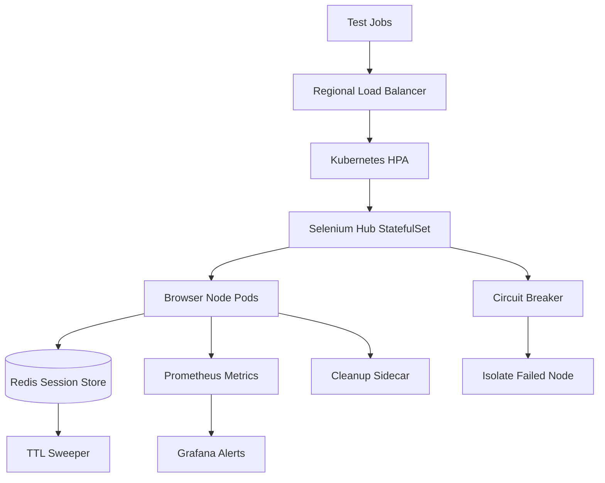

| Difficulty | Channel | Tags |
|---|---|---|
| advanced | system-design | selenium, webdriver, grid |

By 2014, Expedia Group's UI automation suite had swelled to roughly 9,000 tests scattered across 350+ Jenkins jobs, with browsers running directly on Jenkins executors until stale processes made machines unusable [1]. The breaking point was not the test count but the infrastructure: executors could juggle only a few browsers, so parallelism hit a wall. Teams answered by building a distributed grid that ran 1,000 UI automation tests in 5 minutes and cycled 4,500+ nodes on demand each day. That journey is the blueprint for anyone staring down 10,000 concurrent Selenium sessions today.

---

> ### Real-World Case — Expedia Group
>
> By 2014, Expedia Group's UI automation suite had grown to roughly 9,000 tests spread across 350+ Jenkins jobs, running browsers directly on Jenkins executors. This setup couldn't scale: executors handled only a few browsers, stale browsers made machines unusable, and parallelism was limited by infrastructure rather than test demand.
>
> | | |
> |---|---|
> | **Challenge** | They needed a way to run large Selenium test suites with high concurrency, fast feedback, and elastic infrastructure, without being bottlenecked by fixed Jenkins executors or expensive always-on capacity. |
> | **Solution** | Expedia built a distributed Selenium Grid automation platform on AWS using SeleniumGridScaler. A hub orchestrated on-demand EC2 nodes, each capable of running multiple browser sessions (15 Chrome/Firefox sessions per c5.xlarge node), with hubs and nodes in the same subnet to avoid forwarding failures. The system dynamically created and terminated nodes based on demand and idle/billing cycles, scaling across 90+ hubs and thousands of nodes. |
> | **Outcome** | Expedia reported running 1,000 UI automation tests in 5 minutes. In steady operation, 90+ hubs created, used, and terminated around 4,500+ nodes on demand per day, while packing 15 browser sessions per node reduced cost compared with one-test-per-instance approaches. |
> | **Lesson** | Scaling browser testing isn't just about adding Selenium nodes; it requires elastic orchestration, session density tuning, and aggressive cleanup. Treating test infrastructure as disposable, autoscaled compute turns UI regression from a bottleneck into fast CI/CD feedback. |

---

## Hook — The dashboard was green. Then the browsers started eating RAM.

The metrics looked calm at 2am. Then queue depth spiked, browser pods began OOM-killing themselves, and a single stale Chrome process quietly held 2GB on a node nobody was watching. Sound familiar? Many developers discover that Selenium Grid failures rarely announce themselves with a clean stack trace — they arrive as slow tests, ghost sessions, and a Jenkins queue that grows faster than any executor can drain. The stakes are concrete: a blocked release train means every minute of stalled UI verification delays shipping. Here is the uncomfortable truth — adding more nodes usually makes the problem worse before it makes it better.

## Problem — When infrastructure, not tests, sets the speed limit

Building on that 2am scene, the core problem is deceptively simple: 10,000 concurrent sessions need predictable capacity, but browser processes are memory-hungry, stateful, and famously bad at cleaning up after themselves. A naive grid treats every session as a long-lived tenant. Consequently, a crashed test leaves a browser alive, that browser holds RAM, and the node slowly suffocates until it stops accepting work.

Here is what you are really fighting:

- **Orphaned sessions:** a test dies, the driver never calls quit(), and the browser lingers for hours.
- **Unbounded concurrency:** more nodes without quotas simply spread the leak across a larger fleet.
- **Slow failure detection:** a dead node keeps receiving traffic until a health check finally notices.
- **Cross-DC variance:** regional latency turns a 2s session initiation target into a 20s timeout.

| Approach | What it promises | Real tradeoff |
|---|---|---|
| One browser per VM | Strong isolation | Expensive; Expedia found 15 sessions per node far cheaper [1] |
| Static Jenkins executors | Simple setup | Parallelism capped by hardware, not demand |
| Auto-scaling grid pods | Elastic capacity | Needs TTLs and cleanup or the leaks scale too |
| Circuit-broken nodes | Fast failure isolation | Requires careful thresholds to avoid flapping |

💡 **Insight:** The bottleneck is rarely raw CPU. It is session lifecycle discipline. But how does a cleanup policy stay ahead of 10,000 sessions without becoming a full-time job?

## Real-World Case — Expedia Group

Now the story turns from theory into proof. By 2014, Expedia Group had roughly 9,000 UI tests across 350+ Jenkins jobs, and browsers were running straight on Jenkins executors [1]. The setup hit three walls at once: executors could handle only a few browsers, stale browsers rendered machines unusable, and parallelism was limited by infrastructure instead of test demand.

The discovery was counterintuitive. Instead of scaling out one instance per test, teams packed **15 browser sessions per node** and leaned on ephemeral infrastructure [1]. 🔥 **Hot Take:** Density beat isolation. The payoff was 1,000 UI automation tests in 5 minutes, with 90+ hubs creating, using, and terminating around 4,500+ nodes on demand every day [1].

⚠️ **Watch Out:** Density only works when cleanup is automatic. Without TTL-based session expiry, packing 15 sessions into a node simply gives you 15 leaks instead of one.

## Deep Dive — The four pillars that keep 10,000 sessions honest

Building on Expedia's density lesson, a 10,000-session grid rests on four pillars: capacity math, session expiry, observability, and failure isolation.

**Capacity math comes first.** 10,000 sessions divided by 50 sessions per node gives 200 nodes minimum. At 2GB RAM and 1 CPU per pod, that is 400GB baseline; add a 30% buffer and the cluster needs roughly 520GB of memory. 🔥 **Hot Take:** Teams size for the average and then get punished by the P99. Regional load balancing keeps session initiation under 2s at P99, but only when the horizontal pod autoscaler reacts to queue depth rather than CPU alone [2][3].

**Session expiry comes second.** Redis-backed registration with TTL policies means a session that outlives its window disappears without human help [4], while Kubernetes resource quotas stop one namespace from monopolizing the memory buffer [5].

**Observability comes third.** Prometheus scrapes memory trends and session duration on a 10s cadence, with alerts at 80% memory [6]. An HTTP /status endpoint probed at the same interval removes a node after three consecutive failures [7].

**Failure isolation comes fourth.** Circuit breakers quarantine a sick node for a 30-second recovery window, and leader election prevents split-brain during network partitions.

- Use **HPA** for elasticity and **Pod Disruption Budgets** to preserve 85% capacity during routine drains [8].
- Use **rolling updates** and canary traffic splits so a new node version never takes the whole fleet down.
- Use **init containers** to remove stale Docker volumes before a node restarts.

⚠️ **Watch Out:** Weekly rolling restarts hide leaks rather than fix them. They buy stability while the real bug hides in driver code. So what does the daily workflow actually look like?

## Workflow — From test trigger to clean shutdown

Consequently, the grid needs a repeatable path from test trigger to clean shutdown, not a bag of clever tricks. The Mermaid flow below maps that journey across regions and failure boundaries.



Step by step:

1. **Submit:** Jenkins jobs route through a regional load balancer so P99 initiation stays under 2s.
2. **Scale:** the HPA watches queue depth and adds node pods before the backlog becomes an incident [2].
3. **Register:** each session writes to Redis with a 300-second TTL [4].
4. **Execute:** Selenium hubs dispatch to browser pods, packing multiple sessions per node to control cost [1][9].
5. **Probe:** a /status check every 10s removes a node after 3 failures [7][11].
6. **Isolate:** circuit breakers hold the node out for 30s while the platform drains it.
7. **Cleanup:** a sidecar or init container removes stale volumes; the TTL sweeper closes orphaned sessions.
8. **Observe:** Prometheus tracks memory and session duration; alerts fire at 80% [6].

🎯 **Key Point:** Every step has an owner. If a step has no owner, that is exactly where the next leak will live.

## Code Example — A session registry that refuses to leak

This leads to the implementation layer. The registry below, built on Python threading and a bounded thread pool [10], turns the sweep and probe steps into enforceable code.

```python
import time
import threading
from concurrent.futures import ThreadPoolExecutor, as_completed
from dataclasses import dataclass

# Production values come from env vars / service discovery
SESSION_TTL_SECONDS = 300
HEALTH_CHECK_INTERVAL = 10
FAILURE_THRESHOLD = 3

@dataclass
class GridNode:
    node_id: str
    endpoint: str
    capacity: int
    consecutive_failures: int = 0
    isolated_until: float = 0.0

class SessionRegistry:
    """Tracks session lifetimes so stale browsers never leak memory."""
    def __init__(self, ttl: int = SESSION_TTL_SECONDS):
        self.ttl = ttl
        self._sessions = {}
        self._lock = threading.Lock()

    def register(self, session_id: str, node: GridNode) -> None:
        with self._lock:
            self._sessions[session_id] = {
                "node": node.node_id,
                "expires_at": time.time() + self.ttl,
            }

    def sweep(self):
        """Drop expired sessions; mirrors Redis TTL scans every 5 minutes."""
        now = time.time()
        expired = []
        with self._lock:
            for sid, meta in list(self._sessions.items()):
                if meta["expires_at"] <= now:
                    expired.append(sid)
                    del self._sessions[sid]
        return expired

def probe_node(node: GridNode) -> GridNode:
    """Stand-in for HTTP GET /status every 10 seconds."""
    # Real code: requests.get(node.endpoint + "/status", timeout=2)
    node.consecutive_failures = 0  # simulated healthy response
    return node

def health_loop(nodes, registry: SessionRegistry) -> None:
    with ThreadPoolExecutor(max_workers=16) as pool:
        while True:
            futures = [pool.submit(probe_node, n) for n in nodes]
            for future in as_completed(futures):
                node = future.result()
                if node.consecutive_failures >= FAILURE_THRESHOLD:
                    node.isolated_until = time.time() + 30  # breaker window
            for sid in registry.sweep():
                pass  # emit metric, kill browser, release slot
            time.sleep(HEALTH_CHECK_INTERVAL)
```

Line by line:

- `SESSION_TTL_SECONDS` mirrors the Redis TTL window: a session older than five minutes is assumed dead.
- `SessionRegistry.sweep()` scans under a lock, so cleanup never races with a fresh registration.
- `probe_node()` stands in for an HTTP GET /status; real code must set a 2s timeout.
- `health_loop()` fans out probes with `ThreadPoolExecutor`, applies the 3-failure threshold, and enforces the 30s breaker window.

⚠️ **Watch Out:** Simulated probes are fine for illustration, but a real health check without a timeout can hang forever — turning your safety net into the failure.

## Lessons Learned — Battle scars and what to do tomorrow

Looking back at the journey from Jenkins executors to a 10,000-session grid, the lesson is not simply 'add Kubernetes.' It is 'make every session accountable.'

**Battle scars worth avoiding:**

- Treating weekly restarts as a fix — they are a bandage, not a cure.
- Autoscaling on CPU instead of queue depth — the backlog grows while pods stay small.
- Skipping Pod Disruption Budgets — a routine drain can drop capacity below 85% [8].
- Forgetting cross-DC latency — a 2s P99 target becomes fiction without regional routing.
- Reverting to one browser per instance — Expedia proved 15 per node is the cost winner [1].

💡 **Insight:** The most counterintuitive takeaway is that density and safety are friends, not enemies. Density only pays off when TTLs and circuit breakers are non-negotiable.

🎯 **Key Point:** Tomorrow, add one TTL to your session store and one failure threshold to your health check, then measure. That is the whole transformation, and it begins with a single expired key.

---

## Grid Session Architecture Flow


<details>
<summary><strong>Original Interview Question</strong></summary>

**Q:** Design a scalable Selenium Grid architecture to handle 10,000 concurrent test sessions with 99.9% uptime, ensuring zero memory leaks through automatic session lifecycle management, real-time monitoring, and graceful node failure recovery across multiple data centers?

**A:** Deploy Kubernetes cluster with auto-scaling node pools, Redis session store with TTL policies, Prometheus metrics for memory monitoring, circuit breakers for node isolation, and sidecar containers for session cleanup. Implement health checks, resource quotas, and rolling updates.

</details>

## Conclusion

From 9,000 tests jamming Jenkins executors to 4,500+ nodes cycled daily, Expedia Group showed that scale is an architecture problem, not a hardware budget [1]. The same pattern carries you to 10,000 concurrent sessions: capacity math, TTL-driven cleanup, Prometheus eyes on memory, and circuit breakers that fail fast. The next time a browser ghost eats 2GB at 2am, you will know exactly which pillar failed — and you will already have written the sweep that fixes it.

---

## References

1. [Expedia Group incident report](https://medium.com/expedia-group-tech/distributed-automation-how-to-run-1000-ui-automation-tests-in-5mins-cf9a84ca32d1) — article
2. [Kubernetes: Horizontal Pod Autoscaling](https://kubernetes.io/docs/tasks/run-application/horizontal-pod-autoscale/) — documentation
3. [Kubernetes: Resource Management for Pods and Containers](https://kubernetes.io/docs/concepts/configuration/manage-resources-containers/) — documentation
4. [Redis - Wikipedia](https://en.wikipedia.org/wiki/Redis) — documentation
5. [Kubernetes: Resource Quotas](https://kubernetes.io/docs/concepts/policy/resource-quotas/) — documentation
6. [Prometheus (software) - Wikipedia](https://en.wikipedia.org/wiki/Prometheus_(software)) — documentation
7. [MDN: HTTP response status codes](https://developer.mozilla.org/en-US/docs/Web/HTTP/Status) — documentation
8. [Amazon EKS Documentation](https://docs.aws.amazon.com/eks/latest/userguide/what-is-eks.html) — documentation
9. [SeleniumHQ Selenium GitHub Repository](https://github.com/SeleniumHQ/selenium) — documentation
10. [Python docs: concurrent.futures](https://docs.python.org/3/library/concurrent.futures.html) — documentation
11. [RFC 7231: Hypertext Transfer Protocol (HTTP/1.1) Semantics](https://datatracker.ietf.org/doc/html/rfc7231) — documentation

---

**Author:** Satishkumar Dhule — [GitHub](https://github.com/satishkumar-dhule) · [LinkedIn](https://linkedin.com/in/satishkumar-dhule) · [Website](https://satishkumar-dhule.github.io)
