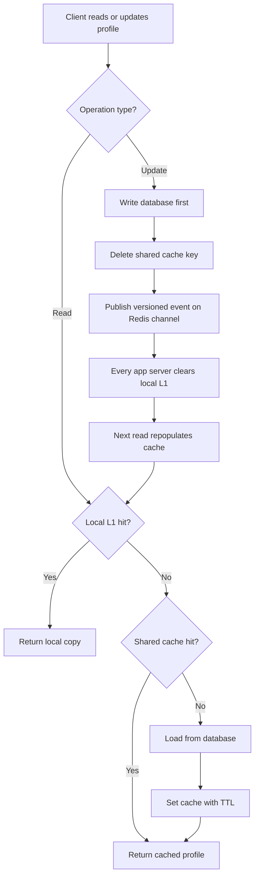

| Difficulty | Channel | Tags |
|---|---|---|
| beginner | backend | redis, memcached, cache-invalidation |

In 2011, Twitter's Rails application began quietly undoing the very changes users asked for — usernames, screen names, and even passwords reverted, sometimes a full week later [1]. The culprit was not a database bug but a caching layer where each web worker independently decided which memcached shard owned a key. After transient errors, a worker could eject a shard from its view, leaving the same profile cached in several places at once. Stale copies eventually flowed back into the database, turning a performance optimization into a two-year architectural headache.

---

> ### Real-World Case — Twitter
>
> In 2011 Twitter's Rails app was silently reverting user-initiated profile changes — usernames, screen names, and passwords — sometimes a full week after the user made them. Each web worker independently decided which memcached shard owned a key and could 'eject' a shard after transient errors, so the same profile could be cached in several shards at once, and stale copies were written back to the database.
>
> | | |
> |---|---|
> | **Challenge** | Keep cached profile data consistent with the authoritative DB when clients disagree about which cache nodes are alive — with no instrumentation to see the inconsistency at first. Early fixes (blocking stale cache-to-DB writes, longer host ejection times, moving to a quieter cluster) failed or took the site down entirely. |
> | **Solution** | Added cache-inconsistency, exception-path, and host-ejection metrics; stopped stale cache writes to the DB; retried before ejecting hosts; set IRQ affinity to spread packet processing off CPU0; and fixed a BIOS/BMC health check that ran every 20h40m and interrupted the kernel long enough to drop packets. The long-term fix was a cache architecture that tolerates partitions without divergent copies (~2 years). Notably, Twitter's cache fleet was overwhelmingly a memcached fork; a Redis fork had worse average and tail performance and higher operational burden at their scale, so its use was limited. |
> | **Outcome** | Instrumentation showed roughly 0.2% of users out of sync at the point of cache-to-DB write, and 150 popular users checked were cached in at least two places each, some in as many as six (expected: at most one). CPU0 spent 65-70% of its time handling soft IRQs. The immediate mitigation took about two months; the architectural fix took about two years. |
> | **Lesson** | Cache invalidation is a distributed-systems correctness problem, not just a DEL call: independent client views of shard liveness can create multiple cache copies that overwrite each other, and the true root cause can be a saturated CPU core or firmware health check rather than cache logic. Instrument inconsistency directly, treat TTL as a safety net, and choose the cache engine on measured tail latency and operational cost — not feature checklists. |

---

## Hook — The Profile That Refused to Stay Changed

Ever wondered why a username can revert a week after it was saved? Everyone says caching is the simplest win in backend engineering; the 2011 Twitter incident tells a different story [1]. A user changed a screen name, saw it stick, and then watched the old name return — through no fault of their own. Sound familiar? Many developers discover the hard way that caching is easy until two copies of the same fact disagree. The stakes are not just cosmetic: stale profile data can resurrect old credentials, break auth flows, and erode trust in minutes. This is the story of how one eject-the-shard decision snowballed, and what your cache invalidation strategy needs to survive it.

## Problem — Two Copies of the Truth

Building on that tension, the core problem is deceptively simple: a cached value and a database value can disagree, and something has to decide which one wins. Caching exists to avoid expensive reads, yet every extra copy creates another place for stale data to hide [2]. HTTP designers hit the same wall years ago and settled on explicit expiry rules, which is why cache directives and validators still dominate web caching specifications today [7][8]. For a profile service, the usual compromise is a TTL between 5 and 30 minutes — long enough to absorb traffic spikes, short enough that wrong data has a short half-life. However, TTL alone is not invalidation; it is merely a deadline. The moment a user submits an update, your service must actively remove or replace the old entry, and on a multi-server fleet that means telling every other node as well. At 50,000 requests per second, even a 0.2% stale rate is 100 wrong answers per second. You might think deleting one key is enough, but the next section shows why that assumption collapses under real traffic.

## Real-World Case — Twitter

This leads directly to Twitter's 2011 incident, one of the clearest documented examples of cache inconsistency done wrong [1]. Each Rails web worker independently computed which memcached shard owned a profile key, and a transient error could cause that worker to mark a shard as dead and pick another one. Consequently, a single profile could be cached in multiple shards simultaneously — instrumentation found 150 popular users cached in at least two places each, with some appearing in as many as six when the design allowed at most one. At the point of cache-to-database writes, roughly 0.2% of users were already out of sync, and stale values were written back to the database, which is why changes reverted days later. Meanwhile, CPU0 spent 65–70% of its time servicing soft IRQs, a symptom of the network and cache churn the mismatch created. The immediate mitigation took about two months; the architectural fix took roughly two years. ⚠️ Watch Out: a harmless-looking failover heuristic can quietly multiply your data. Here is the twist — faster shard failover made the system more available and less correct at the same time.

## Deep Dive — Write-Through, Cache-Aside, and the Redis Divide

With the failure mode clear, the fix starts by naming the patterns. Cache-aside means reads check the cache first, fall back to the database on a miss, and repopulate with a TTL. Write-through means an update writes both the database and the cache, so the next read finds fresh data immediately. Many teams mix the two: cache-aside for reads, delete-on-update plus a short TTL for writes, which is the safest default when correctness matters more than a perfect hit rate [2]. 💡 Insight: deleting is usually safer than overwriting the cached value, because a concurrent stale write cannot resurrect an old entry after a delete. The next decision is which cache engine carries the load.

| Option | Redis | Memcached — the real tradeoff |
|---|---|---|
| Invalidation | Built-in pub/sub broadcasts changes to every subscriber [3][5] | Manual coordination across nodes; no native fan-out [4][6] |
| Persistence | Optional snapshots and append-only logs | None — pure in-memory cache |
| Data structures | Strings, hashes, sets, sorted sets, streams | Simple key/value strings only |
| Memory overhead | Higher per-key overhead | Lower, denser for pure caching |
| Scaling | Vertical, clustering, or managed sharding | Straightforward horizontal scaling |
| Best fit | Complex invalidation and durability needs | High-volume, ephemeral, simple lookups |

🔥 Hot Take: choosing Memcached to save a few megabytes per key is a false economy once one stale-password incident reaches the support queue. Redis offers pub/sub channels, persistence, and richer structures, which is why distributed invalidation becomes a few lines of code rather than a custom gossip protocol [3][5]. Memcached wins on simplicity and lower memory overhead, but coordination becomes your team's problem [4][6]. 🎯 Key Point: when would each apply? Use Redis when profiles need cross-node invalidation, durability, or versioned events; use Memcached when values are cheap to recompute, the dataset is huge, and staleness is harmless. A two-engineer team can wire Redis pub/sub invalidation in an afternoon, while a hand-rolled Memcached coordination layer tends to grow into a small distributed systems project.

## Workflow — From Update to Every Node

Building on the engine choice, the write path becomes a short, boring sequence — and boring is exactly what is wanted at 2am. The flow below (Figure 1: Cache Invalidation Flow) shows how one profile update travels from the client to the database and out to every cache copy.

1. A client submits a profile change; the service writes to the database first, because the database remains the source of truth.
2. The service deletes the shared cache key, so no stale entry survives in Redis.
3. The service publishes an invalidation event with a version token on a Redis pub/sub channel.
4. Every application server receives the event and clears its local L1 copy — this is the step Twitter's workers effectively skipped [1].
5. The next read misses the cache, loads fresh data from the database, and repopulates with a 5–30 minute TTL.
6. Monitoring tracks hit rate, miss latency, and invalidation lag so drift is caught before users notice.

Consequently, correctness no longer depends on every node guessing the same shard mapping. ⚠️ Watch Out: publish after the database commit, not before, or subscribers can clear a key that gets repopulated with the old value.

## Code Example — A Production-Shaped Python Implementation

To make this concrete, the Python snippet in the code block implements the exact workflow: a two-level cache with a shared Redis layer, a small in-process L1 map, and pub/sub invalidation. The walkthrough below follows the code top to bottom.

- `cache_key` centralizes key naming, so every node agrees on the same string — the exact detail Twitter's workers got wrong [1].
- `get_profile` checks the local map, then Redis, then the database, and writes back with `setex` so every entry carries a TTL.
- `update_profile` commits to the database first, then uses a pipeline to delete the shared key and publish the event in one round trip.
- `_local_cache.pop` on the writer plus `listen_for_invalidations` on every reader guarantees no node keeps a stale L1 copy.
- `uuid.uuid4().hex` supplies a version token that lets consumers ignore out-of-order events [9].

💡 Insight: using `pipeline(transaction=False)` avoids a multi-command transaction here because ordering, not atomicity, is what matters. ⚠️ Watch Out: subscriptions must reconnect after network blips; a silently dead pub/sub listener looks exactly like a cache that never invalidates.

## Lessons Learned — Battle Scars and Tomorrow's Fix

After tracing the whole journey, several lessons stand out. First, treat invalidation as part of the write path, not a background chore; a delete that happens eventually is a stale read already promised to someone. Second, prefer delete over update, and always pair it with a TTL as a safety net [2][7]. Third, make the transport explicit: Redis pub/sub turns fan-out into a primitive, whereas Memcached leaves coordination to application code [3][4].

Battle scars worth memorizing:

- **The phantom shard:** failover logic that remaps keys silently can duplicate data — Twitter spent roughly two years fixing exactly that [1].
- **The resurrection:** publishing before the database commit lets old values refill the cache right after invalidation.
- **The immortal key:** a cache entry without a TTL outlives every deployment and every good intention.

The so what is straightforward: tomorrow, add a TTL to every cache write, move invalidation inside the database transaction's success path, and emit a versioned event on update. 🔥 Hot Take: a cache with no monitoring is just a very fast lie. Track hit rate and invalidation lag, and alert on the 0.2% class of drift before it becomes a week-long revert.

---

## Cache Invalidation Flow

<strong>Original Interview Question</strong>

**Q:** You're building a user profile service that caches frequently accessed profiles. How would you implement cache invalidation when a user updates their profile, and what trade-offs would you consider between Redis and Memcached?

**A:** Implement write-through caching with TTL-based expiration. On profile update, invalidate the cache by deleting the key and writing new data to both the database and cache. Redis offers pub/sub for automatic distributed invalidation, while Memcached requires manual coordination across nodes.

## Conclusion

The Twitter incident began with a small assumption — that every worker would agree on where a profile lived — and ended with passwords reverting a week later [1]. The journey through write-through caching, cache-aside reads, TTLs, and Redis pub/sub shows that invalidation is not a footnote; it is the design. You do not need a two-year rewrite to avoid that fate: delete on update, publish the change, cap every entry with a TTL, and watch the hit rate like a hawk. The one insight worth sharing with your team: a cache is a promise that someone else will remember to forget. Make forgetting automatic, and your profiles will stay changed.

---

## References

1. [Twitter incident report](https://danluu.com/cache-incidents/) — article
2. [Cache (computing) - Wikipedia](https://en.wikipedia.org/wiki/Cache_(computing)) — documentation
3. [Redis - Wikipedia](https://en.wikipedia.org/wiki/Redis) — documentation
4. [Memcached - Wikipedia](https://en.wikipedia.org/wiki/Memcached) — documentation
5. [redis/redis GitHub repository](https://github.com/redis/redis) — documentation
6. [memcached/memcached GitHub repository](https://github.com/memcached/memcached) — documentation
7. [HTTP caching - MDN Web Docs](https://developer.mozilla.org/en-US/docs/Web/HTTP/Caching) — documentation
8. [RFC 9111: HTTP Caching](https://datatracker.ietf.org/doc/html/rfc9111) — documentation
9. [uuid — UUID objects in Python](https://docs.python.org/3/library/uuid.html) — documentation

---

**Author:** Satishkumar Dhule — [GitHub](https://github.com/satishkumar-dhule) · [LinkedIn](https://linkedin.com/in/satishkumar-dhule) · [Website](https://satishkumar-dhule.github.io)
