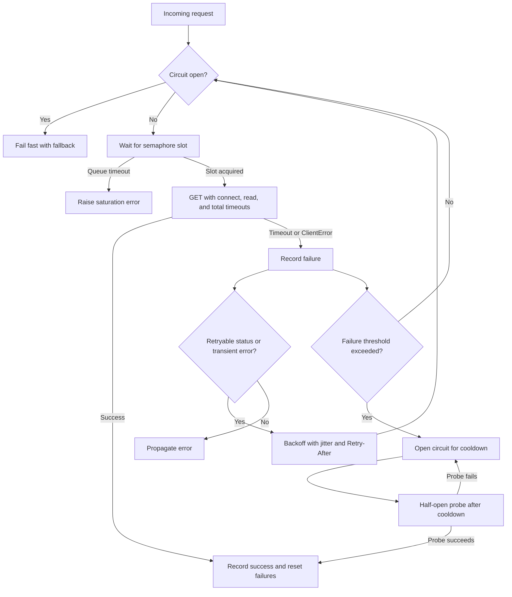

| Difficulty | Channel | Tags |
|---|---|---|
| advanced | backend | asyncio, aiohttp, concurrency |

At peaks above 100,000 dependency requests per second, a single slow backend can turn a healthy API into a queue of stranded users. Netflix saw the pattern at brutal scale: more than 1 billion incoming calls per day fanned out roughly 1:6 across dozens of services, and 30 dependencies at 99.99% uptime each still implied two-plus hours of downtime per month [1]. Teams that survived learned to isolate failure inside the client, not inside a hopeful SLA. That same lesson applies when your Python service uses aiohttp and one latent dependency starts holding your event loop hostage.

---

> ### Real-World Case — Netflix
>
> Netflix's API handled more than 1 billion incoming calls per day, fanning out at roughly 1:6 into several billion calls across dozens of backend services, with peaks above 100,000 dependency requests per second on thousands of EC2 instances. Because each backend shipped its own opaque Java client, a single latent dependency could saturate every Tomcat request thread in seconds; even with 30 dependencies at 99.99% uptime each, the math implied 2+ hours of downtime per month.
>
> | | |
> |---|---|
> | **Challenge** | Stop a slow or failing downstream service from exhausting the shared pool and cascading into a full API outage, while failing fast or returning a degraded response instead of making every user wait for a timeout. |
> | **Solution** | Netflix built Hystrix: every dependency call was wrapped with aggressive network timeouts plus retries, per-dependency bulkhead thread pools, and non-blocking semaphore limits (tryAcquire, never a blocking acquire) that cap concurrent calls; circuit breakers tripped after thresholds like 50% errors in 10 seconds and then probed for recovery; fallbacks returned stale cache data, queued writes, stubbed values, or empty responses. Semaphores also protected the fallback path itself so a misbehaving fallback could not take down the app, with live metrics and configuration changes propagating across the fleet in about a second. |
> | **Outcome** | Netflix reported 'tens of billions of thread-isolated and hundreds of billions of semaphore-isolated calls' flowing through Hystrix daily and a 'dramatic improvement in uptime and resilience.' A typical dependency pool was sized at just 10 threads to absorb 99th-percentile bursts, while healthy traffic used only 1-2 threads at ~40ms median latency. Open-sourced in 2012, the pattern became the industry standard for fault tolerance. |
> | **Lesson** | The plot twist: Hystrix's own author later said the circuit breaker 'gets way too much credit' and is merely 'icing on the cake' — it is reactive, and at Netflix's traffic velocity 'we would be dead by the time a circuit breaker can do anything about it.' The semaphore/concurrency cap is the real proactive protection: it prevents latency from consuming all application resources before any failure statistic even exists. Size it from p99 healthy latency x peak RPS (if something needs 2-3 slots, give it 10, not 100), and resist adaptive limits that slowly 'boil the frog' and erode the safety margin. |

---

## Hook — One Slow Dependency Is All It Takes

One slow dependency. That is the whole villain of this story.

You might think the fix is more connections, more retries, and a bigger timeout. Actually, those three moves often make the outage louder: more connections create more in-flight requests, more retries create a retry storm, and a larger timeout keeps every slot occupied for longer.

Picture the 3am pager moment: latency looks fine at the edge, yet the service is returning 503s because a downstream catalog call decided to take 12 seconds instead of 40 milliseconds. Sound familiar? Developers have all stared at that dashboard, watching a flat green line turn into a cliff while the logs insist nothing changed.

🔥 Hot Take: the dangerous resource is not the socket. It is the waiting. A request that waits forever is a request that keeps consuming memory, file descriptors, and hope.

So what does a resilient pool actually look like when the stakes are measured in thousands of calls per second?

## Problem — The Event Loop Has No Spare Threads

Building on that picture, the core pain is not raw concurrency; it is unbounded waiting.

In asyncio, a semaphore limits how many coroutines pass at once, but the standard library warns that its primitives are not thread-safe and do not accept timeout arguments; teams wrap acquisition in `asyncio.wait_for()` instead [2]. A bounded wait turns a queue into a controlled queue. An unbounded wait turns a slow dependency into a memory-resident traffic jam.

Specifically, these failure modes show up fast:

- Connection leaks when responses are returned after their context manager has already released the connection.
- Timeout settings that are too generous, leaving slots parked while a downstream service is clearly dead.
- Retry loops that hammer a 429 or 503 endpoint instead of honoring `Retry-After`, a response header that exists precisely to ask clients to slow down [8].
- SSL contexts disabled for convenience, trading a clean handshake failure for a security incident.

⚠️ Watch Out: `aiohttp.ClientSession` is not magic pooling by itself. The connector enforces hard limits, while a semaphore decides which callers wait politely and which get rejected quickly [4].

Here is the thing though: the event loop has no spare thread pool to absorb this. One suspended coroutine does not block the loop, but thousands of them waiting on the same dead dependency consume sockets, memory, and patience. When would this matter in practice? Any fan-out endpoint that calls five or more downstream services is already a candidate.

If the queue is the problem, what stops the queue from growing forever?

## Real-World Case — Netflix

That question is not academic; Netflix answered it with production numbers. Its API handled more than 1 billion incoming calls per day, fanned out at roughly 1:6 into several billion calls across dozens of backend services, with peaks above 100,000 dependency requests per second on thousands of EC2 instances [1].

The painful part was architectural. Because each backend shipped its own opaque Java client, one latent dependency could saturate every Tomcat request thread in seconds [1]. Even with 30 dependencies at 99.99% uptime each, the mathematics implied two or more hours of downtime per month. Teams had built a system where statistical perfection still produced very imperfect Mondays.

🔥 Hot Take: the hero was not a giant pool. A typical dependency pool was sized at just 10 threads to absorb 99th-percentile bursts, while healthy traffic used only 1-2 threads at roughly 40ms median latency [1]. Small pools created backpressure at the boundary, so failures stayed local instead of spreading through the whole call chain.

Netflix reported tens of billions of thread-isolated and hundreds of billions of semaphore-isolated calls through Hystrix daily, plus a dramatic improvement in uptime and resilience [1]. Open-sourced in 2012, the pattern became the industry standard for fault tolerance [1]. But wait, it gets better: the circuit breaker half of that story follows a simple closed, open, and half-open state machine [6], and that maps cleanly onto asyncio.

The next question is mechanics: how do those pieces actually interact when a request arrives?

## Deep Dive — Semaphores, Breakers, and the Math of Backoff

That question leads straight into the mechanics of isolation. A semaphore is a counter, not a scheduler: each admission decrements it, each completion increments it, and everyone else waits [2]. Use it to cap in-flight calls, then pair it with an aiohttp connector limit so the network layer and application layer agree on what "enough" means [4].

💡 Insight: the semaphore is a bulkhead, not a performance tuner. If a dependency tolerates 20 concurrent calls, allowing 500 only queues disappointment faster. When does this matter? Whenever one host can receive 500 requests per second but a downstream database happily serves 20.

Consequently, timeouts need just as much care. `asyncio.TimeoutError` is now an alias of `TimeoutError`, raised when an operation exceeds its deadline [3]. Splitting time into connect, socket-read, and total budgets prevents one slow phase from silently consuming the entire request window.

⚠️ Watch Out: a single giant total timeout is not a strategy. It is a polite way to keep every pool slot occupied while a downstream service politely ignores you.

Moreover, a circuit breaker changes the rules once failure is proven. In closed state, calls flow normally; in open state, calls fail immediately; in half-open state, a limited probe decides whether to close again [6]. A breaker is a refusal to keep paying for a failure that has already been demonstrated.

Backoff handles the recovery side. AWS guidance warns that frequent retries can overload bandwidth and that idempotency matters before retrying an operation [5], while RFC 9110 defines which HTTP methods are idempotent [7]. Add jitter so thousands of clients do not retry in lockstep, and honor `Retry-After` when the server offers it [8].

| Option | Looks safer | Real tradeoff |
| --- | --- | --- |
| Unbounded retry queue | nobody sees an error | latency explodes and the downstream gets hammered |
| Small semaphore plus fast rejection | some requests fail early | callers get predictable latency and the dependency recovers |
| Big semaphore plus long timeout | more parallel work | p99 grows, sockets pile up, cascade risk rises |
| Breaker plus jittered backoff | brief graceful fallbacks | requires careful state, metrics, and cleanup |

🎯 Key Point: retries, timeouts, and breakers are one system. Tune one without the others and the system quietly rewrites your outage plan.

Knowing the parts is one thing; ordering them under load is where most implementations get tangled.

## Workflow — From Request to Fallback in Seven Steps

Ordering is exactly where this section begins. Each step has one job, and the order matters because a rejected request should never consume a network slot.

1. The request checks breaker state first. If the circuit is open, it returns a fallback immediately.
2. The caller waits for a semaphore slot with a bounded deadline. Overrun that deadline and the request fails fast with a saturation error.
3. The connector supplies a keepalive connection, with certificate verification left intact [4].
4. The HTTP call runs under connect, read, and total timeouts.
5. A success resets the failure counter and closes a half-open circuit.
6. A timeout, 429, or 503 records a failure; a 429 may carry `Retry-After`, and jittered backoff schedules the next attempt [8].
7. Once the failure threshold is crossed, the circuit opens for a cooldown, then allows one half-open probe before deciding again [6].

The Mermaid flowchart labeled Request Resilience Flow, provided in the `diagram` field, tells the same story visually: admission, network call, failure recording, backoff, and the half-open probe all form one loop.

💡 Insight: the half-open probe is the most underrated step. It prevents a service from staying open forever after the dependency has already recovered.

With the path clear, the next question is what the code should actually guard.

## Code Example — A Pool Manager That Refuses to Panic

The workflow becomes concrete in code. The full implementation lives in the `codeExample` field; the essential admission pattern looks like this:

```python
await asyncio.wait_for(self._sem.acquire(), timeout=self._queue_timeout)
try:
    async with self._session.get(url) as resp:
        body = await resp.read()  # read before the context closes
finally:
    self._sem.release()
```

Step by step, the design works like this:

- `TCPConnector` sets hard connection limits; the semaphore sets the admission policy on top of them [4].
- `asyncio.wait_for()` bounds queue time, so waiting cannot become indefinite [2].
- `ClientTimeout` splits connect, read, and total budgets, making slow phases visible [3].
- `CircuitOpen` rejects requests without touching the network, which is the entire point of a breaker [6].
- `_record_success()` and `_record_failure()` run under a lock, keeping breaker state consistent across concurrent coroutines.
- `health_check()` and `warmup()` probe dependencies at startup, giving the pool a chance to prune dead paths before real traffic arrives.
- `_retry_delay()` honors `Retry-After` when present and otherwise uses exponential delay with jitter, a pattern recommended for transient failures [5].
- `close()` closes the session and connector during shutdown, preventing leaks that only show up during deploys.

⚠️ Watch Out: returning a raw `ClientResponse` after leaving `async with` is a classic trap. The context manager releases the connection, so callers receive an object whose transport is already gone. Consume the body inside the block.

But what happens when the code is elegant and the operational habits are not?

## Lessons Learned — Battle Scars and the Next Move

That question opens the last chapter: the battle scars. Most outages here are not exotic; they are small mistakes repeated under load.

If this feels overwhelming, you are not alone; start with a connector limit and one honest total timeout, then add the breaker once the metrics justify it.

- ✅ Do cap concurrency at both the connector and the admission layer. Do not trust default limits to match your dependency's real capacity.
- ✅ Do consume responses inside their context manager. Do not hand raw responses to callers after release.
- ✅ Do use the event loop's monotonic clock for cooldowns. Do not use wall-clock time that jumps with NTP corrections.
- ✅ Do retry only idempotent or explicitly safe operations. Do not replay a payment POST because it returned a timeout [7].
- ✅ Do close sessions on shutdown. Do not leave keepalive connections dangling for the next deploy to discover.
- ✅ Do log breaker transitions and queue wait time. Do not log only HTTP status codes and wonder why latency spiked.

Use this pattern when fan-out exceeds roughly five dependencies, p99 latency crosses 200ms, or a downstream service has already caused an incident. For a smaller service with two stable dependencies, a single connector limit and a good total timeout may be enough; extra machinery needs a reason.

💡 Insight: graceful degradation is not a feature you bolt on after scaling. It is the decision to make failure small, local, and boring before the pager makes it personal.

The best pool is the one that knows when to say no. Tomorrow, cap admission, cap waiting, cap retries, and let the breaker open before the queue turns into a pileup.

---

## Request Resilience Flow



<details>
<summary><strong>Original Interview Question</strong></summary>

**Q:** How would you implement a connection pool manager for aiohttp that handles graceful degradation under high load and connection timeouts?

**A:** Implement a connection pool manager for aiohttp using a semaphore to limit concurrent connections, exponential backoff for retrying failed requests, and circuit breaker pattern to gracefully degrade under high load and connection timeouts.

</details>

## Conclusion

Netflix's lesson was not that dependencies never fail; it was that failure should be bounded before it becomes contagious [1]. For an aiohttp service, the equivalent move tomorrow is simple: cap concurrency, cap waiting, cap retries, and let the breaker open before your event loop becomes a traffic jam. The one-line insight to share with your team: a pool without a breaker is just a polite queue for a pileup.

---

## References

1. [Netflix incident report](https://netflixtechblog.com/fault-tolerance-in-a-high-volume-distributed-system-91ab4faae74a) — article
2. [asyncio Synchronization Primitives](https://docs.python.org/3/library/asyncio-sync.html) — documentation
3. [asyncio Exceptions](https://docs.python.org/3/library/asyncio-exceptions.html) — documentation
4. [aiohttp GitHub repository](https://github.com/aio-libs/aiohttp) — documentation
5. [Retry with backoff pattern](https://docs.aws.amazon.com/prescriptive-guidance/latest/cloud-design-patterns/retry-backoff.html) — documentation
6. [Circuit breaker design pattern](https://en.wikipedia.org/wiki/Circuit_breaker_design_pattern) — documentation
7. [RFC 9110: HTTP Semantics](https://datatracker.ietf.org/doc/html/rfc9110) — documentation
8. [429 Too Many Requests](https://developer.mozilla.org/en-US/docs/Web/HTTP/Status/429) — documentation

---

**Author:** Satishkumar Dhule — [GitHub](https://github.com/satishkumar-dhule) · [LinkedIn](https://linkedin.com/in/satishkumar-dhule) · [Website](https://satishkumar-dhule.github.io)
