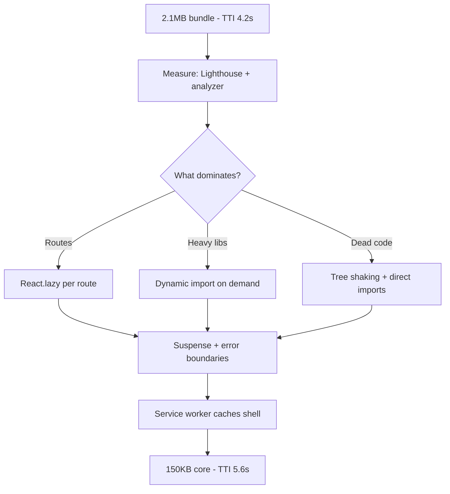

| Difficulty | Channel | Tags |
|---|---|---|
| intermediate | frontend | lighthouse, bundle, lazy-loading |

Picture this: a visitor taps a link on an average Android phone over 3G, then stares at a blank screen for 23 seconds. That was the everyday reality of Pinterest's legacy mobile web site, which shipped more than 2.5MB of JavaScript and converted barely 1% of unauthenticated visitors [1]. In a single quarter, a team rebuilt that experience as a React/Redux/webpack PWA and cut Time to Interactive from 23s to 5.6s [1]. The lesson hidden in those numbers is not about writing faster React code — it is about deciding what never loads at all.

---

> ### Real-World Case — Pinterest
>
> Pinterest's legacy mobile web site had become a monolith shipping over 2.5MB of JavaScript — roughly 1.5MB in the main bundle plus 1MB lazy-loaded — and users on average Android hardware over 3G waited 23 seconds before the UI was usable. Only about 1% of unauthenticated mobile web visitors converted to signups, logins, or app installs, so the slow experience was directly capping international growth. The team rebuilt the experience as a React/Redux/webpack PWA in a single quarter.
>
> | | |
> |---|---|
> | **Challenge** | Make the mobile web feed interactive fast enough on slow 3G and mid-range Android hardware to become a real user-acquisition channel, while still delivering the full Pinterest experience. |
> | **Solution** | They used webpack Bundle Analyzer to find the real culprit: duplicated code spread across lazy-loaded route chunks. Counterintuitively, they moved shared code into the entry bundle — growing it from 59KB to 71KB — which shrank async route chunks by 60-90% (Homefeed 13.9KB to 1KB, Closeup 18KB to 7KB). They split JavaScript into a vendor chunk (~73KB), an entry chunk (~72KB), and async route chunks (13-18KB) via React Router dynamic imports, transpiled only what target browsers needed with babel-preset-env, virtualized the Masonry grid to lazy-load images, and progressively added service worker caching of route bundles for repeat visits, using Lighthouse to validate gains. |
> | **Outcome** | Core JavaScript bundle dropped from ~650KB to 150KB minified+gzip, first meaningful paint fell from 4.2s to 1.8s, and Time to Interactive collapsed from 23s to 5.6s (3.9s on repeat visits with service worker caching). CSS went from 150KB to 6KB inlined and P90 Pin-page load improved from 20s to 6.5s. Business metrics followed: time spent up 40%, user-generated ad revenue up 44%, and core engagements up 60%. |
> | **Lesson** | Measure before you cut: the biggest win came from a surprising tradeoff — deliberately making the initial bundle 20% larger eliminated duplication and made every lazy route up to 90% smaller. Route-level splitting plus service worker caching turns bundle analysis into both a performance and a growth win. |

---

## Hook — 23 Seconds of Nothing

Picture this: 23 seconds of nothing. No spinner worth mentioning, no useful content, just a connection that feels broken. That was the daily experience of Pinterest's legacy mobile web site, where roughly 1.5MB sat in the main bundle and another 1MB arrived later, all while average Android hardware over 3G tried to parse it [1]. With only about 1% of unauthenticated mobile visitors converting to signups, logins, or app installs, every wasted second was quietly capping international growth [1]. Sound familiar? Many teams have stared at a Lighthouse report like this — score 65, bundle 2.1MB, TTI 4.2s — and promised a fix 'next sprint.' The stakes are simple: either the critical path shrinks, or the audience does.

## Problem — The 2.1MB Tax Nobody Sees

However, a Lighthouse score of 65 with a 2.1MB bundle and a 4.2-second Time to Interactive is not a mystery; it is a receipt. Every kilobyte parsed on the main thread is time stolen from the first tap, and on mid-range devices that bill arrives with interest. Lighthouse treats TTI, Total Blocking Time, and Largest Contentful Paint as first-class signals, so one oversized initial bundle can drag several metrics down at once [6]. Teams often blame a slow CDN or an unoptimized hero image, but the usual culprit is JavaScript for pages the visitor never opens. Therefore, the real challenge is not technical complexity — it is the courage to remove things from the critical path that someone fought to add. Many developers discover this the hard way when a performance budget fails in CI, usually on a Friday, naturally. So what does that removal actually look like in production?

## Real-World Case — Pinterest

Building on that 4.2-second baseline, Pinterest's story is the cleanest proof that the fix is structural rather than cosmetic. The legacy mobile web experience was a monolith of more than 2.5MB of JavaScript, and users on average Android hardware over 3G waited 23 seconds for a usable interface [1]. Because roughly 1% of unauthenticated visitors converted, the slowness directly limited growth in international markets [1]. In one quarter, the team rebuilt it as a React/Redux/webpack progressive web app — an approach that pairs app-like reliability with the reach of the web [8]. Core JavaScript dropped from about 650KB to 150KB minified and gzipped, first meaningful paint fell from 4.2s to 1.8s, and TTI collapsed from 23s to 5.6s, or 3.9s on repeat visits with service worker caching [1]. CSS went from 150KB to 6KB inlined, P90 Pin-page load improved from 20s to 6.5s, and the business numbers followed: time spent up 40%, user-generated ad revenue up 44%, core engagements up 60% [1]. Here is the plot twist: the breakthrough did not come from a cleverer render loop. It came from shipping a smaller default and letting everything else arrive later.

## Deep Dive — What Actually Makes a Bundle Heavy

This leads to the obvious question: what is actually inside those 2.1MB? The reflex is to wrap every component in React.lazy(), but that is a great way to create a spinner waterfall. Dynamic import is the language primitive that lets webpack emit a separate chunk, and React.lazy() simply presents that promise as a component boundary [2][5]. Tree shaking removes exports that are never used, yet it only works reliably when modules remain in ES module form and the bundler can prove an import has no side effects [3]. One CommonJS package, one side-effectful barrel file, and the optimization quietly evaporates — which is why analysis precedes refactoring [4].

Here is the tradeoff table that tends to settle architecture debates:

| Strategy | When would you actually use it? | Real tradeoff |
|---|---|---|
| Route-based splitting | Dashboards where each route pulls distinct libraries | One extra round trip on first visit to that route |
| Component-based splitting | Below-the-fold charts, editors, maps | More Suspense boundaries to design and test |
| Tree shaking | Utility libraries imported by name | Breaks with CommonJS or side-effectful barrels |
| Service worker caching | Repeat visits and an offline-capable shell | Stale chunks unless versioning is disciplined |

💡 Insight: The fastest code is the code that never reaches the browser. Deferring a 300KB chart until someone opens analytics beats shaving 10% off that chart's render loop.

⚠️ Watch Out: A lazy component without an error boundary turns one failed chunk request into a blank screen. Chunk requests fail on flaky networks; plan for it [5].

🔥 Hot Take: A 2.1MB bundle is rarely one villainous library. It is fifty reasonable decisions that each looked harmless in code review. Moreover, webpack can split vendor code automatically, but configuration without measurement is just guessing [9].

## Workflow — From 65 to 90+ Without Guessing

Consequently, climbing from 65 to 90+ is a sequence, not a heroic weekend refactor. The 'Bundle Optimization Journey' diagram below maps the same path visually: measure, inspect, cut, split, defer, cache, verify.

1. Measure first. Run Lighthouse under throttling and record TTI, TBT, and LCP before changing anything [6].
2. Inspect composition. Generate production stats and rank chunks by parsed size, not raw file size [4].
3. Cut obvious waste. Delete unused dependencies, import from leaf paths instead of barrels, and confirm tree shaking is active [3][9].
4. Split at routes. Wrap route components in React.lazy() and place one Suspense boundary around the router [5].
5. Defer heavy guests. Dynamically import charts, editors, and third-party SDKs only when a feature is opened [2].
6. Cache the shell. Register a service worker so repeat visits reuse cached assets [7].
7. Re-measure and budget. Add a bundle-size gate to CI so a 150KB core cannot quietly grow into 600KB again.

🎯 Key Point: Analysis before splitting prevents the classic mistake of splitting a chunk that was never big in the first place. But which chunk should move first?

## Code Example — The Pattern That Carries the Load

With the workflow mapped, the implementation stays deliberately small. The snippet in the code block below shows the production pattern: route-level chunks, an on-demand chart import, an error boundary, and shell caching.

Specifically, the route declarations create separate chunks at build time, so dashboard code never ships to someone landing on analytics. The loadHeavyChart helper returns a promise from dynamic import, which means the chart library leaves the initial payload entirely [2]. The ChunkErrorBoundary catches a failed import and renders a message instead of a blank page, a detail that separates a robust app from a demo [5]. Inside LazyChartPanel, the mounted flag prevents state updates after unmount, and the Suspense fallback covers the moment between navigation and chunk arrival. Finally, service worker registration caches the shell for repeat visits, echoing the 3.9s repeat-visit TTI from the Pinterest case [1][7].

## Lessons Learned — Battle Scars and the Next Morning

Looking back at that 23-second starting line, the lesson is not 'use React.lazy()' — it is 'defend the initial bundle as a budget.' Battle scars worth memorizing:

- Lazy-loading above-the-fold content trades a fast paint for a later paint. Keep the shell and primary content eager [2].
- One giant Suspense boundary around the whole app produces a spinner waterfall; scope boundaries to the subtree that actually loads.
- Barrel imports can drag an entire directory into the critical path when side effects are present [3].
- Caching without cache-busting serves yesterday's chunks to today's users [7].
- Nobody improves what nobody measures; a CI budget turns performance into a habit rather than a cleanup project [6].

Therefore, the 'so what' for tomorrow is concrete: open the production analyzer, find the largest chunk that no one needs on first paint, and move it behind a dynamic import. That single change will not deliver 90+ on its own, but it starts the same journey Pinterest took, one kilobyte at a time.

---

## Bundle Optimization Journey

<strong>Original Interview Question</strong>

**Q:** You're tasked with improving a React app's Lighthouse performance score from 65 to 90+. The bundle size is 2.1MB and Time to Interactive is 4.2s. What specific steps would you take to optimize the bundle and implement lazy loading?

**A:** Implement code splitting with React.lazy() and Suspense, analyze bundle composition with webpack-bundle-analyzer to identify largest chunks, remove unused dependencies and optimize imports, add dynamic imports for heavy components and third-party libraries, implement route-based splitting for better initial load times, and utilize tree shaking with proper ES module configuration.

## Conclusion

Pinterest turned a 23-second wait into 5.6 seconds not by writing faster code, but by shipping less code at the right moment [1]. Tomorrow, add a bundle budget to CI and move the heaviest non-critical chunk behind a dynamic import. The one line worth sharing with your team: performance is not an optimization phase — it is a budgeting discipline, and every kilobyte needs an owner.

---

## References

1. [Pinterest incident report](https://medium.com/dev-channel/a-pinterest-progressive-web-app-performance-case-study-3bd6ed2e6154) — article
2. [MDN: import() dynamic import operator](https://developer.mozilla.org/en-US/docs/Web/JavaScript/Reference/Operators/import) — documentation
3. [MDN: JavaScript modules](https://developer.mozilla.org/en-US/docs/Web/JavaScript/Guide/Modules) — documentation
4. [webpack-bundle-analyzer repository](https://github.com/webpack-contrib/webpack-bundle-analyzer) — documentation
5. [React repository](https://github.com/facebook/react) — documentation
6. [Lighthouse repository](https://github.com/GoogleChrome/lighthouse) — documentation
7. [MDN: Service Worker API](https://developer.mozilla.org/en-US/docs/Web/API/Service_Worker_API) — documentation
8. [Wikipedia: Progressive web app](https://en.wikipedia.org/wiki/Progressive_web_app) — documentation
9. [webpack repository](https://github.com/webpack/webpack) — documentation
10. [Wikipedia: Webpack](https://en.wikipedia.org/wiki/Webpack) — documentation

---

**Author:** Satishkumar Dhule — [GitHub](https://github.com/satishkumar-dhule) · [LinkedIn](https://linkedin.com/in/satishkumar-dhule) · [Website](https://satishkumar-dhule.github.io)
