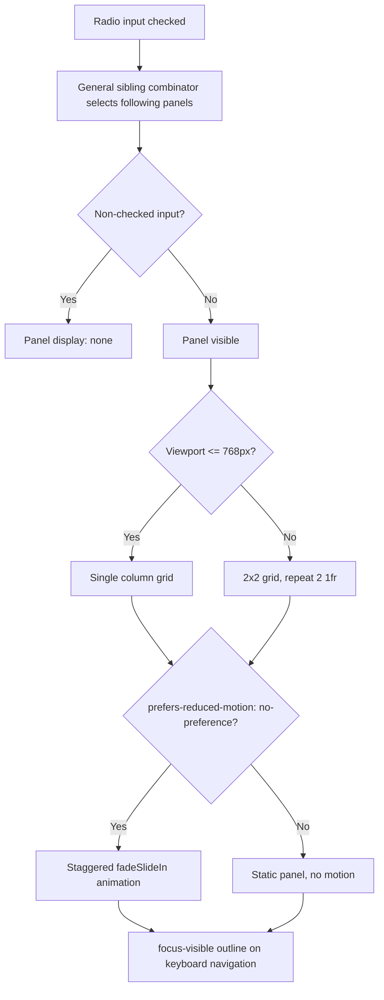

| Difficulty | Channel | Tags |
|---|---|---|
| beginner | frontend | css, flexbox, grid, animations |

A single attribute toggle once made Microsoft's Fluent UI team watch their browser match 23,511 focus selectors across an entire component tree, burning 2,098ms in the process [1]. The fix was not more JavaScript; it was trusting a native CSS pseudo-class that finished the same job in 116ms. That discovery sits at the heart of a deceptively simple challenge: building a CSS-only tab panel for a design-system docs page, complete with a 2x2 card grid, staggered entrances, and keyboard focus that does not melt the browser.

---

> ### Real-World Case — Microsoft
>
> Fluent UI v9, Microsoft's design system used across its own production apps, drove keyboard focus outlines by toggling a single `data-keyboard-nav` attribute on the root `FluentProvider`. Every time a user switched between mouse and keyboard navigation, that one global attribute forced the browser to re-match focus selectors across the entire component subtree.
>
> | | |
> |---|---|
> | **Challenge** | The provider-wide `[data-keyboard-nav]` selector caused a hidden style-recalculation storm — Edge tracing measured 23,511 selector match attempts and 2,098ms spent in the matching phase (1,120 fast rejects) on every navigation-mode change, an invisible tax on keystrokes in every Fluent UI app. |
> | **Solution** | The team replaced the root attribute with a localized `:focus-visible` ponyfill built on Keyborg that applies a `.fui-focus-visible` class only to the actually-focused element, then added `CSS.supports('selector(:focus-visible)')` detection so modern browsers use the native pseudo-class and skip the polyfill entirely. |
> | **Outcome** | Match attempts dropped from 23,511 to 1,484 (93.6% fewer) and elapsed time from 2,098ms to 377ms (82% faster); the `:focus-within` variant fell to 69ms (96.7% faster). A follow-up PR showed native `:focus-visible` at just 116ms — another 69.2% faster than the ponyfill. |
> | **Lesson** | An accessible focus indicator is non-negotiable, but where you store the navigation-mode state matters enormously: a global attribute on a provider root makes every descendant selector re-evaluate, while scoping state to the focused element and preferring the native pseudo-class preserves accessibility with almost no recalculation cost. |

---

## Hook — One attribute, 23,511 selector matches, and a browser begging for mercy

Picture a docs page that looks perfect on the surface. Tabs switch cleanly, cards slide in with a polite stagger, and the keyboard focus ring appears exactly when it should. Underneath, however, one global `data-keyboard-nav` attribute on the root `FluentProvider` is toggled every time someone moves between mouse and keyboard [1]. That single flip forces the browser to re-match focus selectors across the whole component subtree. Sound familiar? Many developers discover this kind of bottleneck only after the design system ships to production apps and the performance budget starts screaming. The stakes are not abstract: selector matching is invisible work that delays interaction feedback, and on large trees it adds up fast. The real question is whether the browser already knows how to do this better without any help from JavaScript.

## Problem — Building tabs without JavaScript is harder than it looks

Building on that tension, the interview prompt asks for a tab panel that switches sections using only radio inputs and labels, with no JavaScript at all. On desktop, each panel must show a 2x2 grid of cards; on mobile, a single column. Every card needs a fixed 16:9 image area, a title, and a short meta line. Moreover, the panel needs a subtle entrance animation with a stagger, visible focus outlines for keyboard users, and full respect for `prefers-reduced-motion`. Here is the thing though: the obvious DOM order almost always breaks the CSS. A radio's `:checked` state can only style elements that come after it in sibling combinators, so placing each input inside its own tab wrapper leaves earlier siblings unreachable. Then comes the accessibility plot twist. The ARIA Authoring Practices guide treats tabs as a widget with roving tabindex and arrow-key navigation [5], which is exactly what a radio group cannot provide. Therefore the honest CSS-only solution avoids claiming the `tab` role altogether and leans on native radio semantics instead. Many teams get this wrong by sprinkling ARIA on top and accidentally lying to screen readers. Add animation timing, reduced-motion guards, and focus-visible rules, and this beginner-looking question suddenly has teeth.

## Real-World Case — Microsoft

This is not theoretical hand-wringing; Microsoft's Fluent UI v9 team ran straight into it. Fluent UI is the design system used across Microsoft's own production apps, and its focus-outline strategy relied on toggling that one `data-keyboard-nav` attribute on the root `FluentProvider` whenever input modality changed [1]. Consequently, every toggle triggered a full selector re-match across the component subtree. The measured result was brutal: match attempts dropped from 23,511 to 1,484 after the fix, a 93.6% reduction, while elapsed time fell from 2,098ms to 377ms, an 82% improvement [1]. The `:focus-within` variant improved even further, landing at 69ms, roughly 96.7% faster. But wait, it gets better. A follow-up PR measured native `:focus-visible` at just 116ms, another 69.2% faster than the ponyfill [1]. Here is the counterintuitive insight: the clever JavaScript workaround was the expensive part, and the native browser feature was the cheap escape hatch. That is the same instinct behind CSS-only tabs: let the platform do the work.

## Deep Dive — Radio state, sibling selectors, grid, and motion preferences

Building on Microsoft's lesson, the core mechanism is a shared `name` across radio inputs so only one can be checked at a time. The general sibling combinator then connects a checked input to every following panel, which is why all inputs must sit before all panels in the DOM; MDN documents how `~` selects later siblings at the same level [2]. When would this actually be used? Think design-system docs, static marketing surfaces, or settings pages where panel content is known ahead of time and bundle size matters. Next comes layout: `grid-template-columns: repeat(2, 1fr)` creates the desktop 2x2 card arrangement, and a `max-width: 768px` media query collapses it to one column. CSS Grid handles equal-width tracks far more cleanly than flexbox would for this fixed-card case [4]. Each image container uses `aspect-ratio: 16 / 9`, which reserves space before media loads and prevents layout shift [6]. For motion, the `prefers-reduced-motion: no-preference` query gates the animation entirely, so sensitive users get a static panel rather than a forced fade. Staggering comes from `nth-child` delays of 0.1s, 0.2s, and 0.3s, which feels polished without turning into a circus. Finally, `:focus-visible` shows the ring for keyboard users while sparing mouse clicks; MDN notes it is the browser's own heuristic for modality [3]. Special mention goes to `:has()`, which can simplify some parent-state patterns in modern browsers [7], though it is not required here.

## Workflow — From radio click to rendered panel

This leads to a clean mental model you can reuse. First, lay out all radio inputs as direct children of the tabs container with a shared `name`, marking one `checked`. Second, place a `` for each input immediately after the inputs so clicking a label flips the matching radio. Third, render each panel as a `` after the inputs, with a grid of cards inside. Fourth, hide panels whose input is not checked using the sibling selector. Fifth, let media queries, aspect-ratio, animation delays, and focus-visible rules layer on top. The diagram below traces that journey visually. Notice how the checked radio becomes the single source of truth: no state store, no hydration, no event listeners. Specifically, the animation and focus branches are independent of visibility, which is exactly why `prefers-reduced-motion` can disable motion without breaking tab switching.

## Code Example — A TypeScript generator for the CSS-only pattern

Following that flow, a production docs site rarely hand-writes every tab, so the example below generates the CSS-only markup with TypeScript. This keeps the runtime at zero JavaScript while giving developers a type-safe build-time template. The generated HTML follows the sibling order described earlier, and the CSS carries the grid, aspect-ratio, reduced-motion, and focus rules. Use the explanation that follows to map each line back to the problem it solves.

## Lessons Learned — Battle scars and a better tomorrow

After walking through the pattern, a few scars are worth naming. ⚠️ Watch Out: if a panel sits inside a wrapper above its radio, the `~` combinator will not reach it, so keep inputs before panels. ⚠️ Watch Out: never paste `role="tab"` onto these labels without implementing full keyboard semantics; native radios already announce themselves, and half-finished ARIA is worse than none [5]. 💡 Insight: Microsoft's 93.6% drop in match attempts shows that fewer global state toggles beat clever ponyfills every time [1]. 🔥 Hot Take: most docs tabs do not need JavaScript, and the bundle you delete is a performance win you never have to maintain. 🎯 Key Point: reduced-motion and focus-visible are not polish; they are the difference between a demo and a design system. When would this actually be used? Reach for it on static docs, component galleries, and content-heavy settings pages; reach for JavaScript tabs when panels load dynamically or need async state [8]. Start tomorrow by auditing one tab surface, measuring its JavaScript cost, and asking whether the browser already ships the behavior. The memorable line to share with your team: the fastest interaction is the one the browser handles natively.

---

## CSS-Only Tab Rendering Flow

<strong>Original Interview Question</strong>

**Q:** Build a CSS-only tab panel for a design-system docs page. Use radio inputs to switch tabs (no JavaScript). Desktop: a 2x2 grid of cards under each tab; mobile: single column. Each card has a fixed 16:9 image area, a title, and a short meta line. Add a subtle entrance animation with a stagger and keep focus-visible outlines; ensure prefers-reduced-motion is respected?

**A:** Use a set of radio inputs with a shared `name` attribute and corresponding `` elements for each tab section. The `:checked` state of each radio controls visibility of its associated panel via adjacent sibling selectors. Each panel renders a 2×2 card grid on desktop and collapses to a single column on mobile. Cards use `aspect-ratio: 16/9` for fixed image containers, with a title and meta line below.

## Conclusion

The journey began with 23,511 selector matches and ended with a 116ms native focus solution [1]. Along the way, the CSS-only tab panel proved that radio state, sibling combinators, grid layouts, and reduced-motion guards can carry an entire interaction without a single runtime event handler. Tomorrow, pick one docs tab surface, measure the JavaScript it ships, and try replacing it with this pattern. If the team remembers only one thing, make it this: the fastest, most accessible interaction is usually the one the browser already knows how to deliver.

---

## References

1. [Microsoft incident report](https://github.com/microsoft/fluentui/pull/24154) — article
2. [MDN: General sibling combinator](https://developer.mozilla.org/en-US/docs/Web/CSS/General_sibling_combinator) — documentation
3. [MDN: :focus-visible](https://developer.mozilla.org/en-US/docs/Web/CSS/:focus-visible) — documentation
4. [MDN: CSS Grid Layout](https://developer.mozilla.org/en-US/docs/Web/CSS/CSS_grid_layout) — documentation
5. [ARIA Authoring Practices Guide: Tabs](https://developer.mozilla.org/en-US/docs/Web/Accessibility/ARIA/Roles/tab_role) — documentation
6. [MDN: aspect-ratio](https://developer.mozilla.org/en-US/docs/Web/CSS/aspect-ratio) — documentation
7. [MDN: :has()](https://developer.mozilla.org/en-US/docs/Web/CSS/:has) — documentation
8. [MDN: Using media queries](https://developer.mozilla.org/en-US/docs/Web/CSS/Media_queries/Using_media_queries) — documentation

---

**Author:** Satishkumar Dhule — [GitHub](https://github.com/satishkumar-dhule) · [LinkedIn](https://linkedin.com/in/satishkumar-dhule) · [Website](https://satishkumar-dhule.github.io)
